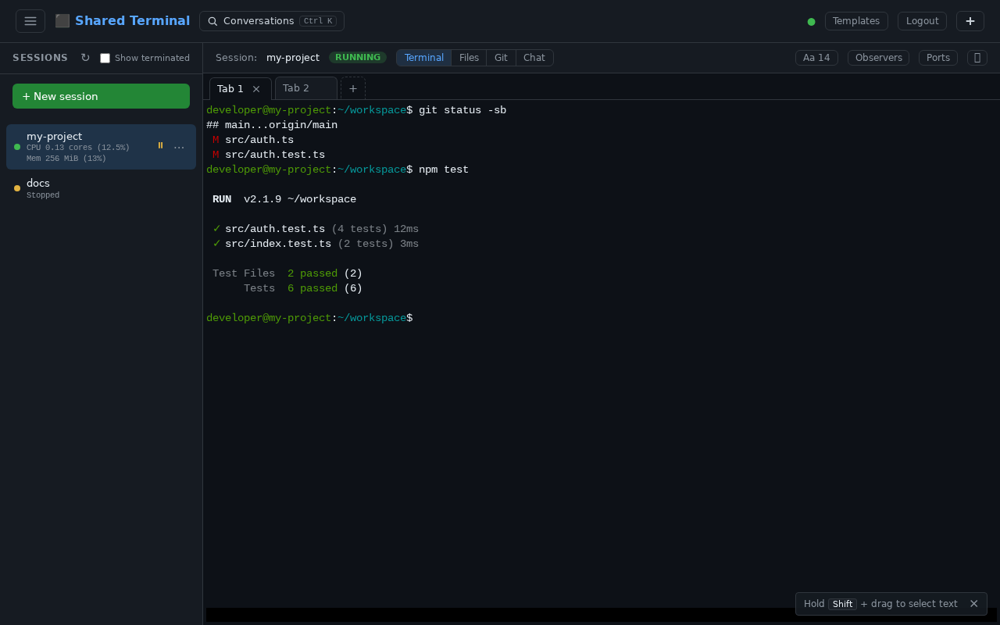
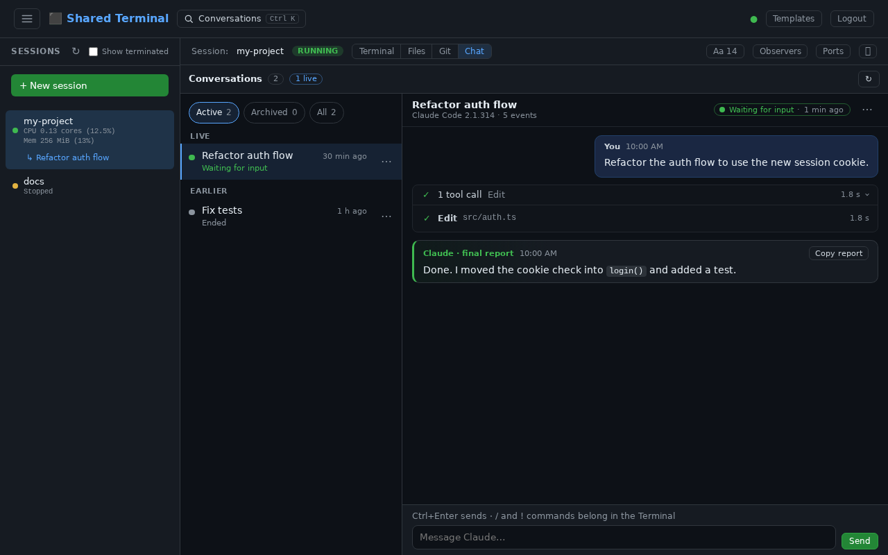
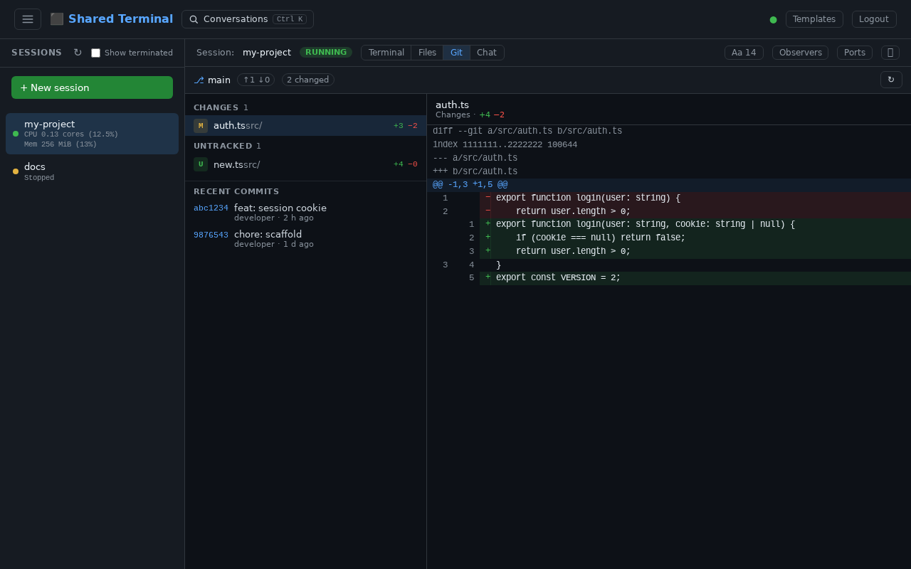
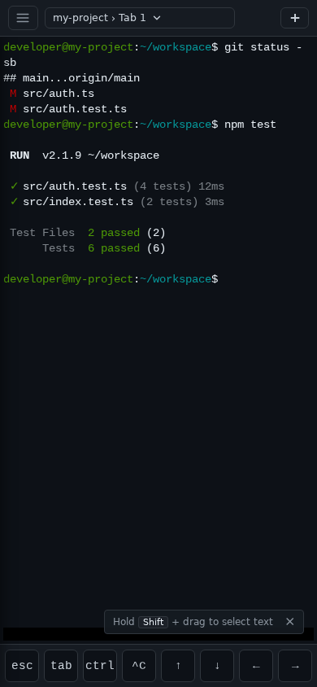
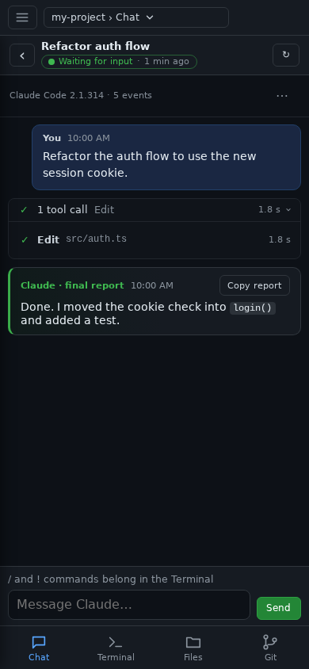
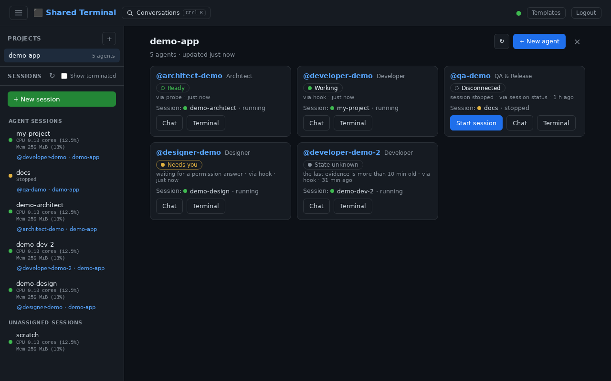
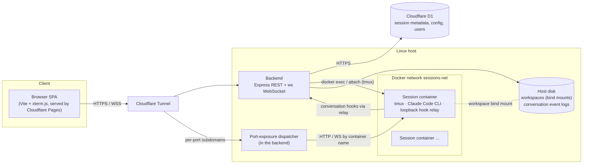

# Shared Terminal

**Persistent, isolated Claude Code workspaces you can reach from any browser — your laptop, a tablet or your phone.**

Shared Terminal is a self-hosted service that gives each project its own Docker container with
Claude Code, git and the usual dev tools, running inside tmux. Close the tab, lose Wi-Fi or switch
devices: the session keeps running, and every browser tab or device that opens it attaches to the
same terminal. Next to the terminal you can follow what Claude Code is doing as a readable
conversation, send it a message, browse the workspace and review the git diff, all without touching
the container. Sessions are stopped, restarted and recovered without losing the workspace, which
lives on the host, not in the container.

<p align="center">
  
</p>

## What you can use today

Everything below is on `main` and running in the reference deployment.

**Sessions**

- Create, stop, start, soft-delete (workspace kept, restartable) and hard-delete (workspace purged) sessions.
- Per-session config at creation: env vars (secret values AES-256-GCM-encrypted at rest), git repo clone
  (HTTPS/SSH, PAT or key), dotfiles repo, agent-config seed, git identity, `postCreate` / `postStart`
  hooks with a live bootstrap log, CPU/memory caps.
- Reusable **templates** (secrets are never stored in a template), **per-user quotas** (session count,
  total CPU/RAM) and **idle auto-stop**.

**Terminal**

- xterm.js attached to tmux in the container; several tabs per session, each its own tmux session.
- Reconnect replays the current screen (colours and cursor) and then streams live output — no gaps,
  no duplicates. Many browsers can watch and type into the same tab.
- Search in the scrollback, adjustable font size, and a key bar (Esc, Tab, Ctrl, arrows…) on touch devices.

**Chat view** — the Claude Code conversation, live

- Hook-based conversation capture renders each Claude Code conversation as a thread: your prompts,
  grouped tool calls, the final report, and subagents in their own panel.
- Live updates over WebSocket, "Load earlier" paging, rename and archive, and a conversation switcher
  (`Ctrl K`) across sessions.
- Privacy by design: tool calls are summarised structurally (program, file path, URL host), never the
  full command or tool output.

**Composer** — type to Claude Code from the Chat view

- Send a message to the interactive Claude Code CLI running in the session's terminal, with
  explicit delivery states (delivered / unconfirmed / failed) and no automatic retries.
- The Composer for CLI *background* sessions exists but is **experimental and off**
  (`CONVERSATION_COMPOSER_BG_ENABLED`).

**Workspace Explorer and Git Changes** (read-only)

- **Files**: browse the workspace, preview text, rendered Markdown, syntax highlighting and images,
  download files. Works on stopped sessions too; credential paths (`.env*`, `.ssh/`, `.git/`…) are refused.
- **Git**: status, per-file unified diff and recent commits. Git runs inside the session container,
  never on the host.

<p align="center">
  
  
</p>

**Phone-friendly**

The same app on a phone: one pane at a time, a bottom navigation between the views and a key bar
on the terminal.

<p align="center">
  
  
</p>

**More**

- **Port exposure** — declare container ports and reach them at `p<port>-<session>.<your-domain>`,
  private (your login) or public (webhooks, OAuth callbacks); editable while the session runs.
- **HTTP exec API** — run commands in a session and stream NDJSON output, for automation
  ([docs/EXEC_API.md](./docs/EXEC_API.md)).
- **Admin** — cross-user session list with live CPU/memory, force stop/delete, live resource caps,
  per-user quota overrides, invites, groups; admins and group leads can **observe** a session
  read-only, and every cross-user attach is logged for the owner to see.
- **Backup & restore** — `npm run backup` / `npm run restore` (D1 tables + workspaces), refuses to
  restore with the wrong encryption key.
- **Image pins** — every image a session container uses is pinned, so rebuilding the session image
  can't delete it from under running sessions.
- **UI shell v2** — a unified session bar and user menu; try it per browser with `?ui=v2`
  (`?ui=v1` to go back), or make it the default with `UI_SHELL=v2`.
- **Remote editing** — open a session in desktop VS Code via `code tunnel`
  ([docs/REMOTE-EDITING.md](./docs/REMOTE-EDITING.md)).

## Projects & Agents — implemented, not yet available

Group sessions into **projects** and give each one an **agent** with its own identity
(`@handle`, role), a live presence state (Ready, Working, Needs you, Disconnected…) and one tap to its
Chat or Terminal. An agent is not a session: it is *bound* to one, and the binding history is kept.

<p align="center">
  
  <br><sub>Preview with synthetic data — not yet enabled in production.</sub>
</p>

The backend directory (D1 migration v19) and the frontend are merged, but the feature is off: it needs
the backend that carries v19 deployed and `PROJECT_CHAT_ENABLED=true`. Until the backend reports
`features.projectChat`, the UI stays hidden. Contract: [docs/PROJECTS.md](./docs/PROJECTS.md).

## Architecture



- **Backend** (`backend/src/`): stateless; all persistence is in D1 plus the host's workspace
  directories. One container per session, attached through `docker exec … tmux`.
- **Frontend** (`frontend/src/`): vanilla TypeScript, no framework.
- **Session image** (`session-image/`): Ubuntu 24.04, Node 22, Claude Code CLI, GitHub CLI, tmux.

The deep dive (terminal data path, persistence, bootstrap, capture, composer, dispatcher) is in
[CLAUDE.md](./CLAUDE.md).

## Quick start

Requirements: Linux with Docker, Node 22+, a Cloudflare account (D1, and Tunnel + Pages for
production). Configuration lives in [`.env.example`](./.env.example); the full walkthrough
(D1 provisioning, Tunnel, Pages, port exposure) is [docs/DEPLOYMENT.md](./docs/DEPLOYMENT.md).

```bash
# Session container image (required before creating a session)
docker build -t shared-terminal-session ./session-image

# Backend
cd backend && npm install && npm run dev      # http://localhost:3001

# Frontend
cd frontend && npm install && npm run dev     # http://localhost:5173

# Production backend
docker compose up -d --build
```

Read [docs/SECURITY.md](./docs/SECURITY.md) before exposing the backend to the internet.

## Documentation

| | |
| --- | --- |
| [docs/DEPLOYMENT.md](./docs/DEPLOYMENT.md) | Local setup, production, Cloudflare Tunnel, capture, backup & restore |
| [docs/SECURITY.md](./docs/SECURITY.md) | Threat model and recommended posture |
| [docs/API.md](./docs/API.md) | REST endpoints, WebSocket channels, port dispatcher |
| [docs/EXEC_API.md](./docs/EXEC_API.md) | HTTP exec API contract |
| [docs/CONVERSATION.md](./docs/CONVERSATION.md) | Conversation capture, Chat and Composer contract |
| [docs/PROJECTS.md](./docs/PROJECTS.md) | Projects & agents directory contract |
| [docs/SECRETS_ENCRYPTION_KEY.md](./docs/SECRETS_ENCRYPTION_KEY.md) | The secrets encryption key runbook |
| [docs/design/](./docs/design/) | Design notes and proposals |
| [CONTRIBUTING.md](./CONTRIBUTING.md) | Workflow, branches, code style |

## Roadmap

Planned / in design — **none of this is available yet**:

- **Agent collaboration** — a Project Chat where agents of the same project talk to each other and
  to you, with mentions that name their recipients explicitly.
- **Tasks with explicit states** — work handed to an agent as a task you can track, not just a chat
  message.
- **Automation** — work that runs without someone at the keyboard.
- **Per-project attention signal** — one cheap, honest "needs you" indicator per project in the
  sidebar; design accepted, backend not implemented ([design](./docs/design/attention-signal.md)).

## License

Released under the [MIT License](./LICENSE).
