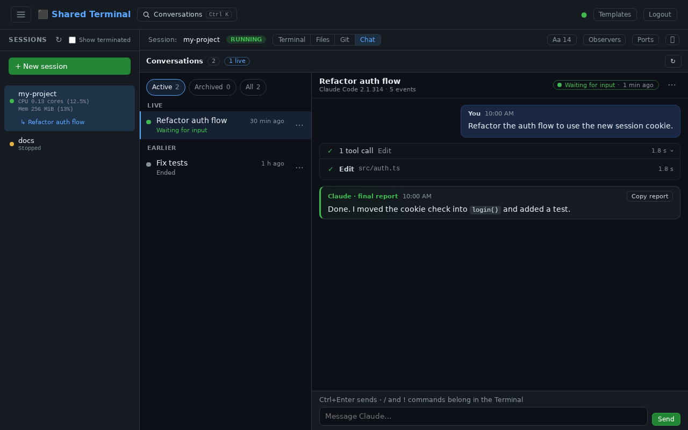
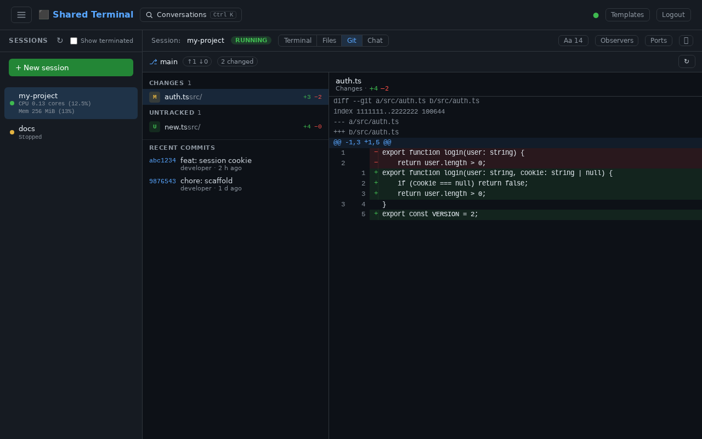
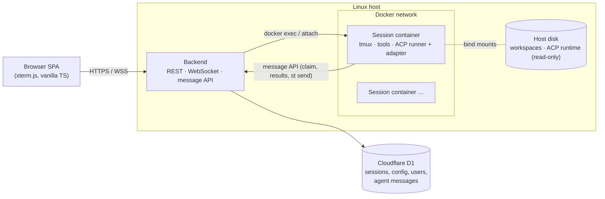

# Shared Terminal

**A self-hosted web platform for running development environments and coding agents — reachable
from any browser, running on your own server, never on your laptop.**

Shared Terminal gives every piece of work its own isolated Docker container with a persistent
workspace. You open it from a browser — laptop, tablet or phone — and get a real terminal, a file
browser, the Git diff and a chat with the agent working there. Close the tab or lose the
connection: the container keeps running, and the next browser that opens it picks up exactly where
things are. Agents keep working while you're away; their messages are stored, not lost with a
browser tab.

<p align="center">
  
</p>

## Where it's going

The target architecture is:

**Web UI → shared messaging API → sessions whose agents are driven through ACP.**

- **Docker is only the execution environment.** A session is a container plus a workspace; it
  should not care which agent runs inside it, or which version.
- **Agents are independent.** Each has its own context, repository and tools, and is addressed by
  name (`@developer`, `@reviewer`).
- **One durable messaging API** carries messages from you to an agent and between agents, from the
  web UI or from a small CLI inside the container.
- **[ACP](https://agentclientprotocol.com) (Agent Client Protocol)** drives the agent directly — no
  screen-scraping of a terminal UI. ACP is provider-neutral: the aim is Claude, Codex, Pi, OpenCode
  and others behind the same API.

Today ACP is implemented and tested **with Claude only**, and it is experimental (off by default).
Support for other agents and for running sessions on more than one host is **planned, not
implemented**. See [Status](#status) for the exact line.

## What you can do today

**Sessions**

- Create, stop, start, soft-delete (workspace kept, restartable) and hard-delete (workspace purged)
  sessions, each in its own container.
- Per-session config at creation: env vars (secrets encrypted at rest), Git repo clone, dotfiles,
  Git identity, `postCreate` / `postStart` hooks with a live bootstrap log, CPU/memory caps.
- Templates, per-user quotas, idle auto-stop.

**Terminal** — xterm.js attached to tmux in the container: several tabs per session, reconnect
without gaps or duplicates, many browsers on the same tab, search, and a key bar on touch devices.

**Files and Git** (read-only) — browse and preview the workspace (Markdown, code, images), download
files; Git status, per-file diffs and recent commits. Git runs inside the container, never on the
host.

**Chat** — talk to the agent of a session (see [Two kinds of sessions](#two-kinds-of-sessions)).

**Projects** — group sessions into projects whose agents have a name, a role and a presence state.

**Also** — port exposure on per-session subdomains, an HTTP exec API for automation, an admin
dashboard (live CPU/memory, force actions, quotas, read-only observe with an audit trail), backup &
restore, and a phone-friendly layout.

<p align="center">
  
  
</p>

## Two kinds of sessions

| | **Traditional session** | **ACP agent session** (experimental) |
| --- | --- | --- |
| What runs | tmux + whatever you start: a shell, Claude Code, any CLI | the same, **plus** an agent driven over ACP by Shared Terminal's runner |
| Terminal / Files / Git | yes | yes |
| Chat | Claude Code's conversation read from its hooks (capture), with the optional Composer to type into the CLI | the agent's message inbox: your messages, the agent's answers and live activity |
| How messages reach the agent | keystrokes into the CLI in tmux (Composer) | the durable message API, one message at a time |
| Agent ↔ agent | project conversation through the Composer (legacy) | `st send @name` from inside the container, same API |

ACP sessions are where the product is heading. Traditional sessions remain fully supported: tmux is
still the place for shell work, Git and any CLI tool.

### Create a traditional session

Click **New session**, pick a name and (optionally) a repository, env vars and resource caps. The
session opens on the Terminal.

### Create an ACP agent session

With `ACP_AGENTS_ENABLED=true` on the backend and an adapter installed (see
[docs/ACP_AGENTS.md](./docs/ACP_AGENTS.md#6-setup)), the New session form shows an **agent name**
field. Give it a lowercase name such as `developer`; that is how you and other agents address it
(`@developer`). The agent signs in the way Claude Code does in that session (its `~/.claude`
login — run `claude` once in its Terminal and `/login` — or a `CLAUDE_CODE_OAUTH_TOKEN` secret env
var); until then its Chat says it is waiting for login and your messages stay pending.

Over the API it is the same call with one extra field:

```http
POST /api/sessions
{ "name": "dev", "acpAgent": { "name": "developer" } }
```

## Using the views

- **Terminal** — tmux tabs in the container. Switching to another view never resizes or detaches it.
- **Files** — the workspace tree; works on stopped sessions too. Credential paths (`.env*`, `.ssh/`,
  `.git/`…) are refused.
- **Git** — status, diffs and log of the repositories in the workspace (the session must be running).
- **Chat** — in an ACP session, send a message; it is stored before the server answers, the agent
  takes it when it is free, and you see what it is doing while it works. In a traditional session,
  the Chat shows Claude Code's conversation when capture is enabled.

## How agents talk to each other

Inside an ACP agent's container, the `st` command uses the same message API you use from the web.
The sender is the agent's own credential, never an argument:

```bash
st agents                         # who can I talk to?
st send @reviewer "Please review the branch fix/login"
st send @reviewer -f notes.md     # longer content from a file
st list                           # my messages and their states
st get 42                         # one message, with its result
```

A message from one agent to another is queued like any other. When the recipient finishes it, the
**reply is written back automatically** to the sender. Every message has a state —
`pending → running → done | failed | uncertain` — and a message whose run was interrupted becomes
`uncertain`: it is **never resent automatically**; only you can requeue it (today through the API,
`POST /api/acp/messages/:id/requeue`).

**Chat vs Project Chat.** The Chat of a session is your one-to-one conversation with that agent.
*Project Chat* — a shared channel where you and the project's ACP agents post, with mentions —
is **in development** ([#674](https://github.com/gatof81/shared-terminal/pull/674)). Today's
Projects view uses the older Composer-based project conversation.

## Architecture



- **Backend** (`backend/`): Express + WebSocket. Stateless: persistence is Cloudflare D1 plus the
  workspaces on the host disk.
- **Frontend** (`frontend/`): vanilla TypeScript SPA, deployed as static files (Cloudflare Pages).
- **Session image** (`session-image/`): Ubuntu 24.04, Node 22, Git, GitHub CLI, tmux and the Claude
  Code CLI for terminal use.
- **ACP runtime** (`acp-runtime/`): the runner and the pinned agent adapters live in a host directory
  mounted read-only into agent sessions — **not** in the image, so upgrading an adapter needs no
  image rebuild.

The developer deep dive is [CLAUDE.md](./CLAUDE.md).

## Installation

Requirements: a Linux host with Docker, Node 22+, and a Cloudflare account (D1; Tunnel and Pages
for production). Configuration lives in [`.env.example`](./.env.example). The full walkthrough —
D1, Tunnel, Pages, port exposure, backups — is [docs/DEPLOYMENT.md](./docs/DEPLOYMENT.md).

```bash
cp .env.example .env    # fill in the Cloudflare/D1 values, JWT_SECRET, SECRETS_ENCRYPTION_KEY

# Session image (first install; later rebuilds go through scripts/build-session-image.sh)
docker build -t shared-terminal-session ./session-image

# Development
cd backend && npm install && npm run dev      # http://localhost:3001
cd frontend && npm install && npm run dev     # http://localhost:5173

# Production backend
docker compose up -d --build
```

To try ACP agents, follow [docs/ACP_AGENTS.md → Setup](./docs/ACP_AGENTS.md#6-setup). Read
[docs/SECURITY.md](./docs/SECURITY.md) before exposing the backend to the internet.

## Status

**Implemented** (on `main`)

- Sessions, terminal, Files, Git, templates, quotas, idle stop, ports, exec API, admin, backup &
  restore.
- Claude Code conversation capture and the Composer for traditional sessions (opt-in flags).
- Projects directory and the Composer-based project conversation (opt-in flags).
- **ACP agents — experimental, off by default** (`ACP_AGENTS_ENABLED`): durable message inbox, direct
  ACP runner with Claude's adapter, per-agent Chat, `st` CLI, automatic replies between agents.

**In development**

- Project Chat on ACP: agents in projects, project-scoped messages, live updates
  ([#674](https://github.com/gatof81/shared-terminal/pull/674)).
- Interactive questions from an agent to you, and retiring the Composer.

**Planned**

- Agents other than Claude (Codex, Pi, OpenCode…) through ACP adapters.
- A provider-neutral session image (no agent CLI baked in).
- Sessions on more than one host.
- Retiring conversation capture once ACP covers its uses.

**Known limitations**

- ACP is tested with Claude only and runs with permissions bypassed inside the container: the
  container is the sandbox, the workspace is not protected from the agent.
- An agent signals a long-running background process (e.g. a dev server) with a provisional text
  marker; a structured signal is still to be designed.
- Live activity (tool calls, partial text) is kept in memory: a backend restart loses it, messages
  and results are kept.
- One backend host; single-tenant network between session containers.

## Documentation

| | |
| --- | --- |
| [docs/DEPLOYMENT.md](./docs/DEPLOYMENT.md) | Install, production, Cloudflare Tunnel, backup & restore |
| [docs/ACP_AGENTS.md](./docs/ACP_AGENTS.md) | ACP agents: model, message API, runtime, operation |
| [docs/SECURITY.md](./docs/SECURITY.md) | Threat model and recommended posture |
| [docs/API.md](./docs/API.md) | REST endpoints and WebSocket channels |
| [docs/EXEC_API.md](./docs/EXEC_API.md) | HTTP exec API contract |
| [docs/CONVERSATION.md](./docs/CONVERSATION.md) | Capture and Composer contract (traditional sessions) |
| [docs/PROJECTS.md](./docs/PROJECTS.md) | Projects & agents directory contract |
| [docs/PROJECT_CONVERSATION.md](./docs/PROJECT_CONVERSATION.md) | Composer-based project conversation (legacy path) |
| [CONTRIBUTING.md](./CONTRIBUTING.md) | Workflow, branches, code style |

## License

Released under the [MIT License](./LICENSE).
