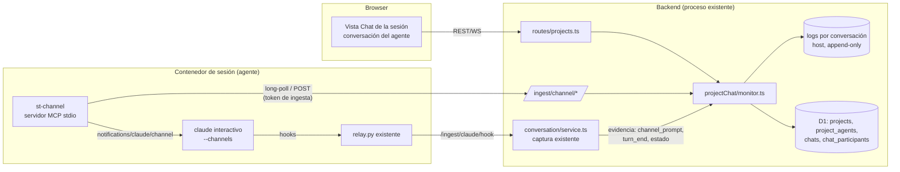
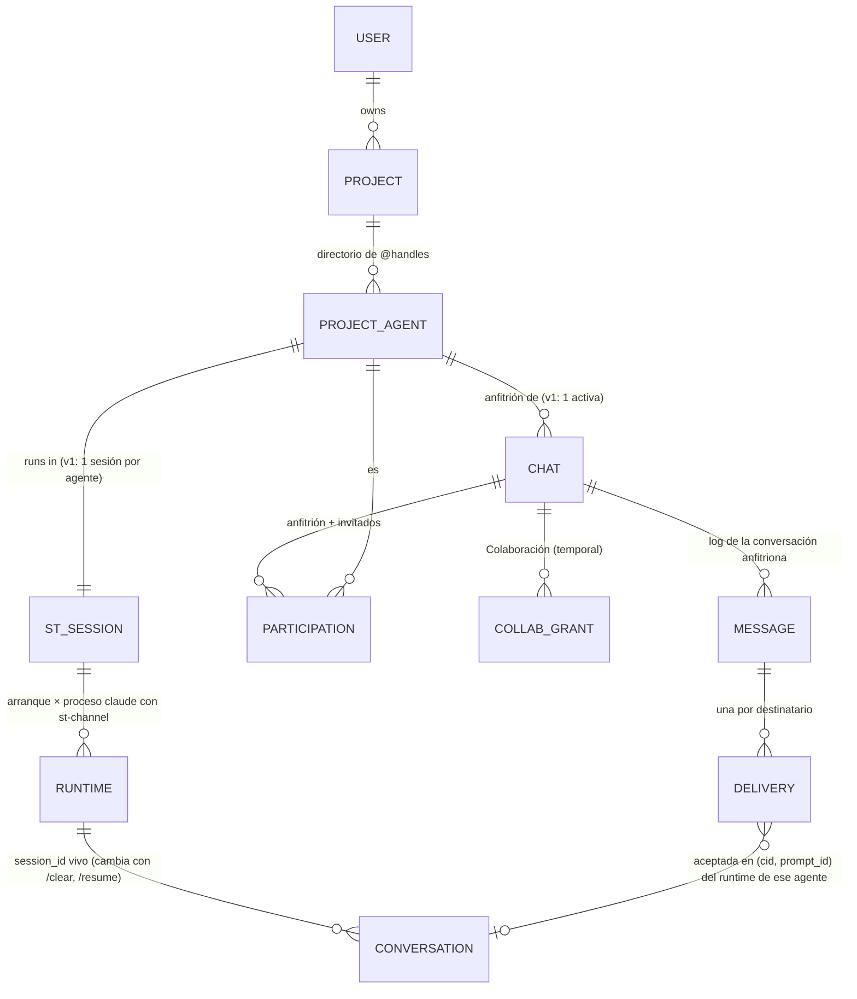
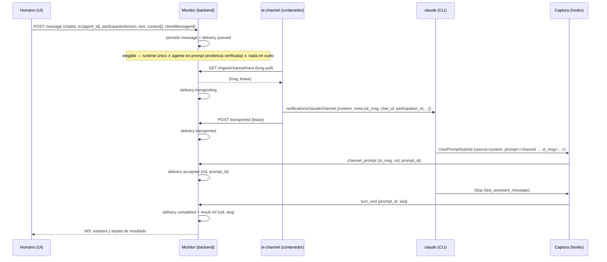

# Project Chat + Agent Monitor + Channels — RFC de arquitectura

Estado: **borrador para revisión (2026-11-02)**. No vinculante. Nada de esto se implementa hasta que
la POC ([04-poc.md](./04-poc.md)) dé GO y el responsable apruebe las decisiones abiertas (§9). El
contrato vinculante, si se aprueba, se redacta como documento propio (ver roadmap, fase P2) con el
mismo estilo que [CONVERSATION.md](../../CONVERSATION.md).

Actualización 2026-11-03: la experiencia principal pasa de un chat por proyecto a la **conversación
del agente con invitados temporales** (decisiones R10–R15 de §9, propuesta en
[08](./08-host-chat-guests.md)). Cambian el modelo (§5.2), las filas de §5.3, la `meta` de §5.4, la
elegibilidad (§5.5), el capítulo agente a agente (§5.6, con invitaciones y modo Colaboración) y la
seguridad (§7). La evidencia sobre Channels, las alternativas y los gates no cambian.

Documentos hermanos: [visión](./01-vision.md) · [protocolo](./03-protocol.md) ·
[POC](./04-poc.md) · [roadmap](./05-roadmap.md) · [UX](./06-ux.md) ·
[revisión independiente](./07-review.md).

---

## 1. Contexto

Shared Terminal ya tiene, en producción o detrás de banderas:

| Pieza | Qué hace | Dónde | Reutilizable para Project Chat |
| --- | --- | --- | --- |
| Captura de conversación (3.0b–3.0d) | Hooks del CLI → relay loopback → `POST /ingest/claude/hook` → log append-only por conversación en el host | `backend/src/conversation/`, CONVERSATION.md §2–§5 | **Sí**: es la fuente de evidencia de "el agente aceptó el mensaje" y "terminó el turno". |
| Estado del CLI | Máquina de estados por evidencia (hooks + `claude agents --json`), identidad verificada por pane y pid | `state.ts`, `probe.ts`, §5.3 (v1.7.2–v1.7.4) | **Sí**: decide cuándo un agente está en su prompt. |
| Vista Chat (3.1) | Lectura de la conversación por WS con replay sin huecos | `conversation/ws.ts`, `frontend/src/chatView.ts` | **Sí**: el hilo del agente se sigue mostrando ahí. |
| Composer (3.2) | Escribe en el pane por tmux con exclusión durable por pane | `conversation/composer.ts`, §8 | **No como transporte**. Queda como Control Directo. |
| Activación y recreación (3.0d) | Estado solicitado/efectivo, managed settings montados ro, recreación del contenedor | `activation.ts`, `captureAuth.ts`, `recreate/` | **Sí**: el mismo mecanismo entrega la configuración del canal. |
| Locks y registros durables | `sessionLifecycleLock`, registros atómicos con fsync | `sessionLifecycleLock.ts`, `paneRecord.ts`, `recreateAttempt.ts` | **Sí** (patrones). |
| Autorización | owner / admin / lead con `assertOwnedBy*`, `assertCanObserve`, `assertCanOperate` | `sessionManager.ts`, `routes/shared.ts` | **Sí**; Project Chat es owner-only en v1. |

El problema: hoy un mensaje del Chat a Claude sólo puede viajar por tmux (Composer), con todas las
precondiciones de §8.1.3 y su riesgo residual (§8.1.10: texto mezclado con lo tecleado, Enter
consumido por un diálogo, `misdelivered`). Además no existe ningún modelo de proyecto, de agente
estable, ni de mensajes entre agentes.

## 2. Objetivos y no-objetivos

Objetivos:

1. Una conversación por agente (anfitrión) donde la persona le escribe y, con menciones, invita a
   otros agentes del proyecto como participantes temporales.
2. Entrega a una sesión interactiva **existente** sin escribir en tmux.
3. Separar tres hechos: **transportado**, **aceptado** (evidencia de que el agente lo tomó) y
   **resultado**.
4. Un único historial por hecho: ningún mensaje vive en dos almacenes que puedan divergir.
5. Fallo cerrado: sin reintentos automáticos que puedan duplicar un turno.
6. Reutilizar backend, captura, activación y almacenamiento existentes; ningún servicio nuevo fuera
   del contenedor, ninguna base de datos ni cola nueva.

No-objetivos (fase 1): tareas tipo Jira, asignaciones con estados de flujo, proyectos con varios
humanos, edición de mensajes, adjuntos, relay de permisos, agentes headless (`-p`), teammates.

## 3. Evidencia sobre Claude Code Channels

Fuentes: documentación oficial (`code.claude.com/docs/en/channels`, `channels-reference`, `mcp`,
`hooks`), CHANGELOG del CLI, issues públicos de `anthropics/claude-code`, plugins oficiales
(`claude-plugins-official/external_plugins/telegram`, `fakechat`) y **strings del binario 2.1.314**
instalado en esta máquina (`claude.exe`, no ejecutado). Nada se probó contra una sesión real
(límite de esta fase). Las citas de la documentación pasaron por un extractor web: se revalidan
contra la página antes de la POC.

### 3.1 Capacidades

Leyenda: **D** documentado · **B** observado en el binario 2.1.314 · **O** observado manualmente por
el responsable el 2026-11-02 con su suscripción y `fakechat` oficial (exploratorio, sin hooks; 04-poc.md
§1.8) · **I** reportado en un issue (no verificado) · **H** hipótesis · **—** sin evidencia.

| # | Capacidad | Evidencia | Estado |
| --- | --- | --- | --- |
| C1 | Un servidor MCP con `capabilities.experimental['claude/channel']` empuja `notifications/claude/channel {content: string, meta?: Record<string,string>}` | D (channels-reference); B (`v$t` = `{method:"notifications/claude/channel", params:{content, meta?}}`) | **Comprobado en doc + binario** |
| C2 | El CLI lo convierte en una entrada de su cola de comandos: `enqueue({mode:"prompt", value:<channel source="…" k="v">content</channel>, priority:"next", isMeta:true, origin:{kind:"channel", server}, skipSlashCommands:true, skipAttachments:true})` | B | **Observado en binario**. `skipSlashCommands` ⇒ un `/` inicial no se interpreta como comando (a confirmar en POC) |
| C3 | Claves de `meta` que no cumplen `^[a-zA-Z_][a-zA-Z0-9_]*$` se descartan en silencio | D; B (`dropped N meta key(s)`) | Comprobado (doc + binario) |
| C4 | Entrega a una sesión **interactiva ya abierta** (el servidor es hijo stdio del CLI) | D ("spawns it as a subprocess and communicates over stdio"; "Events only arrive while the session is open"); **O** 3/3 | **Observado** con `fakechat`; con nuestro servidor, **H** |
| C5 | **Despertar** una sesión en su prompt | D (sólo como ejemplo en el quickstart); I #44380 "Channel messages don't wake idle sessions" (abierto); **O** 3/3, una tras ≈ 3 min sin mensajes; **O** prueba instrumentada T (2026-11-03): despertar y flujo bidireccional tras 32 s de inactividad observada | **Observado en muestra mínima**; tras ≥ 1 h y con fiabilidad, **H** — criterio de la fase 0 |
| C6 | Recibir mientras Claude trabaja | D: "If several notifications arrive while Claude is busy, they're delivered together on the next turn and Claude handles them as a group"; B: `priority:"next"` | Documentado: **se encolan y se agrupan** (rompe la correlación 1 mensaje ↔ 1 turno) |
| C7 | Confirmación de entrega | D: "Claude Code doesn't acknowledge notifications… resolves when the message is written to the transport… drops the events silently" | **No existe**. Hay que construirla con evidencia externa (§5.4) |
| C8 | `UserPromptSubmit` para la entrada de canal | B: el esquema declara `source` (`system` = "other machine-injected turns (peer/**channel messages**, …)") con la salvedad *"Payloads may omit it while the field rolls out"*; pero en 2.1.314 y 2.1.317 los dos constructores del payload ponen `...!1` donde iría el campo ⇒ **nunca** se emite. I #94675 (abierto; ausente hasta 2.1.316). **O** (prueba T, 2.1.317, 04-poc.md §1.10): hook a +0,05 s con una etiqueta `<channel>` y el `message_id` de Fakechat como atributo; `source` **ausente** | Hook y etiqueta **observados**; `source` **no disponible** en las versiones conocidas ⇒ G3 no se cumple y ninguna entra en `CHANNEL_CLI_VERSIONS`. El origen existe dentro del CLI (C2, transcript) pero no llega al hook; alternativas en 04-poc.md §1.10 |
| C9 | Respuesta | D: herramienta MCP `reply` convencional; I #95011 "Claude does not call the reply tool automatically"; **O** 3/3 cuando el mensaje lo pedía | Documentado; **no determinista** (depende del modelo); por eso el resultado sigue siendo el `turn_end` (R8) |
| C10 | `--resume` / `--continue` | — (docs no dicen nada); I #78028, #90160, #101872, #80707 (flag perdido en re-host/fork/background) | **Hipótesis**; la POC lo mide |
| C11 | Varias sesiones simultáneas | D: "run separate sessions"; un servidor por proceso CLI | Documentado (un proceso de canal por CLI) |
| C12 | Reconexión | B: "Channel notifications re-registered after reconnect"; CHANGELOG 2.1.187 (conexiones caídas tras `/bg`, `/tui`, `/update`) | Parcial; **H** sin pérdidas |
| C13 | Requiere `--channels <servers>` al lanzar; flag oculto en `--help` | D; B (`--channels <servers...>` con `hideHelp()`); **O** | Comprobado |
| C14 | Servidor propio fuera de la allowlist ⇒ `--dangerously-load-development-channels server:<name>` (confirmación al arrancar) o plugin admitido por `allowedChannelPlugins` en managed settings | D; B ("is not on the approved channels allowlist (use --dangerously-load-development-channels for local dev)") | Comprobado; **H** que un marketplace local en la imagen sea admitible; **O**: el plugin oficial `fakechat` se carga con `--channels plugin:…` sin flag de desarrollo |
| C15 | Política: `channelsEnabled` en managed settings. claude.ai Team/Enterprise: apagado por defecto; Console (API key): **encendido salvo que existan managed settings** | B (descripción del setting); D (enterprise controls) | Comprobado. **Nuestros contenedores tienen managed settings** (`managed-settings.d/conversation.json`) ⇒ hay que escribir `channelsEnabled: true`. Planes individuales de claude.ai (Pro/Max): según la doc "skip these checks entirely"; el binario sólo exige el setting a Team/Enterprise. Pero #105326 reporta "not currently available" en Max desde 2026-10-25: **la disponibilidad con la suscripción del responsable es lo primero que comprueba la fase 0**; **O**: disponible con la suscripción del responsable el 2026-11-02 |
| C16 | Sólo proveedor first-party (claude.ai o Console); no Bedrock/Vertex/Foundry. **Para este proyecto sólo se usa la suscripción de claude.ai** (decisión del responsable) | D; B ("channels are not available on third-party providers") | Comprobado |
| C17 | Kill switch remoto: "channels feature is not currently available" | B (gate `Oj()`); I #105326 (Max, desde 2026-10-25, abierto) | **Riesgo**: Anthropic puede apagarlo sin release; **O**: no activado para la suscripción del responsable el 2026-11-02 (el riesgo sigue) |
| C18 | Servidor que negocia la revisión MCP 2026-07-28 ⇒ no se registra como canal | D (mcp: "can't deliver channel messages"); B (`era: modern` ⇒ skip) | Comprobado: nuestro servidor **MUST** negociar la revisión anterior |
| C19 | No funciona en `-p` / Agent SDK | D; I #99658 | Comprobado: sólo agentes interactivos |
| C20 | Con `--channels` activo se desactivan `AskUserQuestion` y las herramientas de plan mode | CHANGELOG 2.1.83 | Documentado; **H** que siga vigente en 2.1.314. Impacto UX en el Terminal |
| C21 | Relay de permisos (`claude/channel/permission`) | D; B | Fuera de alcance: no lo declaramos (§7) |
| C22 | Estado de research preview | D | Riesgo de dependencia permanente hasta GA |

### 3.2 Lo que esto significa

- Channels resuelve **el transporte** (sin tmux, sin pegar en el input, sin carrera con lo tecleado)
  y **nada más**: no confirma, no persiste, no deduplica, agrupa en `busy` y puede no despertar.
- La confirmación tiene que venir de la **captura de hooks** que ya tenemos (C8) — **condicionado**:
  con 2.1.314–2.1.317 el hook no trae `source`, así que hoy no distingue una entrada de canal de un
  texto tecleado con la misma forma (G3, 04-poc.md §1.10). Si el
  `UserPromptSubmit` de la entrada de canal llega con la etiqueta y nuestro identificador, tenemos
  una evidencia tan fuerte como el ack del Composer (§8.1.7), y sin depender de que el modelo llame
  a una herramienta.
- El resultado tiene que venir del `Stop` del turno correlacionado (`turn_end.last_assistant_message`,
  ya persistido), no de que el modelo decida llamar a `reply` (C9).
- El orden y la ausencia de duplicados los garantiza el monitor entregando **un mensaje por agente
  a la vez y sólo con el agente en su prompt** (evita C6).

## 4. Alternativas

| Criterio | A. **Channels** + monitor | B. Hooks (`asyncRewake` / `Stop` block / `additionalContext`) | C. MCP convencional (pull `check_inbox`) | D. Composer (tmux) | E. `claude -p --resume` por mensaje (exec API) |
| --- | --- | --- | --- | --- | --- |
| 1. Entrega a sesión interactiva existente | Sí (D) | Sí, sólo en eventos del ciclo de hooks | Sólo si el modelo llama a la herramienta | Sí | **No**: segunda instancia sobre la misma conversación |
| 2. Despertar en el prompt | Disputado (#44380) | `asyncRewake`: D ("wakes the model on exit code 2"), sin probar con un prompt inactivo | **No** | Sí | n/a |
| 3. Recibir mientras trabaja | Encola y agrupa (D) | `Stop` block: al final del turno; `additionalContext`: sólo en el siguiente prompt | No | Encola en el input (§8.2.1); por eso §8.1.3 lo bloquea | n/a |
| 4. Respuestas/resultados | Hook `Stop` (determinista) + herramienta opcional | Hook `Stop` | Herramienta | Hook `Stop` | stdout del exec |
| 5. Continuidad tras `--resume` | H (issues abiertos) | Sí: los hooks son managed settings, no flags | Sí | Sí | n/a |
| 6. Varios agentes | Un servidor por CLI (D) | Sí | Sí | Lock por pane | Sí |
| 7. Recuperación | Monitor + evidencia | Monitor + evidencia | Monitor | Registro de pane durable | Registro de exec |
| Escribe en tmux | **No** | No | No | **Sí** | No |
| Autoridad del texto para el modelo | `<channel source=…>` con `isMeta` (no es turno humano) | system-reminder "Stop hook feedback" | resultado de herramienta | turno humano | turno humano |
| Estabilidad de la API | **Research preview**, kill switch remoto (C17) | Hooks: interfaz estable que ya usamos (CONVERSATION.md §1); `asyncRewake`: documentado en hooks-guide | Estable | tmux estable; comportamiento del input del CLI validado sólo en 2.1.314 | Estable |
| Cambios en el contenedor | Flag `--channels` en el lanzamiento + servidor + managed settings | Sólo managed settings + script | Servidor MCP | Ninguno | Ninguno |
| Coste/complejidad | Medio | Medio (re-armado por turno, cancelación) | Bajo pero no cumple | Ya existe; alta complejidad acumulada | Bajo pero no cumple |

Descartadas: **C** (no despierta; depende de que el modelo consulte), **E** (crea otra instancia
sobre la misma conversación: viola "no crea sesiones nuevas" y colisiona con la interactiva — ya
descartada en phase3 §5.1), **D como transporte principal** (es lo que el producto quiere dejar de
ampliar; queda como Control Directo).

Quedan **A** (objetivo) y **B** (alternativa evaluada en la POC si A falla en C5 o C10). Ambas
comparten el 90 % del diseño: el monitor, la persistencia, la evidencia por hooks y la UI no
dependen del adaptador. Sólo cambia el proceso que, dentro del contenedor, pone el texto delante del
modelo.

## 5. Decisión propuesta

### 5.1 Componentes



| Componente | Nuevo / reutilizado | Responsabilidad |
| --- | --- | --- |
| `projectChat/monitor.ts` (backend) | **Nuevo módulo**, mismo proceso | Fuente de verdad de mensajes y entregas; elegibilidad; participaciones; Colaboración; límites; política entre agentes; correlación con la evidencia. |
| Log por conversación `<WORKSPACE_ROOT>/.projects/<projectId>/chats/<chatId>.events.jsonl`, más un log de runtimes del proyecto | **Nuevos archivos**: formato de `conversation/store.ts` (seq, snapshot, rotación) pero escritura con fsync y **sin** ruta de descarte (protocolo §2.2) | Contenido, participaciones, permisos de Colaboración y transiciones. El contenido **nunca** entra en D1. |
| D1 `projects`, `project_agents`, `project_agent_edges`, `chats`, `chat_participants` | **Nuevas tablas**, migración append-only (diseño para P3) | Metadatos: propiedad, directorio de agentes, handles, proveedor y rol, conversaciones anfitrionas, participaciones vigentes, política. Sin contenido. |
| `/ingest/channel/*` (backend) | **Nuevas rutas**, montadas como `/ingest/claude/hook` (antes de `express.json`, lector de cuerpo acotado) | API del endpoint de canal autenticada con el token de ingesta de la sesión. |
| `st-channel` (imagen) | **Nuevo proceso**, hijo stdio del CLI, Python stdlib como `relay.py` | Adaptador Channels: registra el runtime, recibe el mensaje del monitor, emite la notificación, expone herramientas de publicación. **Sin estado durable.** |
| Captura de conversación | **Reutilizada**, un clasificador nuevo (`channel_prompt`) | Evidencia de aceptación y de fin de turno. |
| Activación (managed settings + recreación) | **Reutilizada** | Escribe `channelsEnabled`, `allowedChannelPlugins` y el lanzamiento con `--channels` cuando el agente está habilitado. |
| Vista Chat | **Reutilizada** | Hilo de ejecución del agente (herramientas, deltas). |
| Composer | **Congelado** | Control Directo, nunca invocado por el monitor. |

No hay procesos nuevos en el host, ni colas externas, ni otra base de datos.

### 5.2 Modelo



- **Proyecto**: propiedad de un usuario (owner-only en v1, como las conversaciones, phase3 §3.4).
  Es **directorio y frontera de permisos**: los `@handles` son únicos en el proyecto, las aristas
  `allow` son del proyecto y un invitado tiene que ser agente del mismo proyecto (R14). No es una
  sala de chat.
- **Agente**: identidad lógica estable (`agent_id` UUID + `@handle`), ligada a **una** sesión ST del
  mismo owner. Sobrevive a reinicios del CLI, `--resume`, `/clear`, paradas y recreaciones del
  contenedor. Declara `provider` (`claude-code` en v1; `codex` reservado, sin implementar) y `role`
  (texto corto del owner, para el selector).
- **Conversación anfitriona** (`chat_id`): la conversación individual de la persona con un agente.
  Su dueño es la persona; su **anfitrión** es un `agent_id` fijado al crearla que **nunca cambia**,
  así "sin mención" tiene siempre un significado estable. En v1 hay **una activa por agente**; se
  archiva (queda de solo lectura, con su historial) para empezar otra (R10). No es la conversación
  del CLI: sobrevive a `/clear`, `/resume` y reinicios.
- **Participación** (`participation_id`): (`chat_id`, `agent_id`, `role: host|guest`, `state`). Cambia
  con cada reinvitación, así una entrega, un préstamo, una respuesta o un permiso de Colaboración de
  una participación anterior **nunca** se engancha a la nueva. Ciclo de vida en §5.6.
- **Permiso de Colaboración** (`grant_id`): autorización temporal, por conversación, que la persona da
  a un conjunto de participaciones (§5.6).
- **Runtime**: la instancia concreta que puede recibir: (`st_session_id`, generación de arranque
  `startGen` de §5.2 v1.7.2, `endpoint_id` de `st-channel`, `claude_pid`, `pane`). Muere con el
  proceso.
- **Conversación del CLI** (`cid`): el `session_id` de Claude que está vivo en ese proceso; es
  **evidencia** de dónde se procesó un mensaje, nunca la dirección del mensaje.

Los mensajes se dirigen a **agentes** (`agent_id`, nunca el handle) dentro de una conversación
anfitriona; el monitor resuelve agente → runtime en el momento de entregar y registra en qué
conversación del CLI se aceptó. Ver una conversación no es recibirla: un participante sólo procesa
lo que se le **entrega**.

**Adaptador de runtime (sólo diseño; ninguno nuevo se implementa).** El agente lógico se separa del
adaptador que lo ejecuta. El adaptador declara sus capacidades y el monitor y la UI se rigen por
ellas; un agente cuyo adaptador no declara una capacidad requerida no es elegible ("sin canal").

| Capacidad | Adaptador Claude Code (este diseño) | Requisito para cualquier otro proveedor |
| --- | --- | --- |
| Transporte a una sesión interactiva | Channels (si pasa la POC); Composer sólo como Control Directo | Propio, con su POC y gates equivalentes a G1–G12 |
| Evidencia de aceptación | `channel_prompt` (G3, hoy no cumplido) / PASS-A/PASS-B | Evidencia verificable del propio proveedor; sin ella ⇒ `unconfirmed`, igual que hoy |
| Resultado | `turn_end` (R8) | Un fin de turno correlacionable; si no existe, `ended_unattributed` |
| Identidad del runtime | pid/`starttime`/pane, probe | Equivalente verificable, o el agente no es elegible |
| Captura del historial | `conversation/` | Adaptador de captura propio; el historial nunca se fusiona con el de otro proveedor |

Los estados de entrega y R8 ya son neutrales al proveedor; `channel_prompt`, `st-channel` y el
CLAUDE.md del agente son **del adaptador Claude Code**. Codex, ChatGPT y credenciales de otros
proveedores quedan fuera de alcance.

### 5.3 Un solo historial por hecho

| Hecho | Único lugar donde vive | Cómo aparece en la otra vista |
| --- | --- | --- |
| Texto de un mensaje humano o de un agente a la conversación | Log de la conversación anfitriona (`chat_id`) | En la conversación del CLI del destinatario aparece como `channel_prompt` **sin texto** (referencia `st_msg`), igual que `internal_prompt` (§4.2.1) |
| Turnos del anfitrión (deltas, herramientas, informe final) | Log de la conversación del CLI del anfitrión (captura) | En el **carril principal** de la conversación anfitriona, renderizados desde la captura por referencia (`cid`, `prompt_id`), como la vista Chat de hoy |
| Turno de un invitado | Log de la conversación del CLI del invitado (captura) | **Tarjeta de invitado** con `@handle`, proveedor y "→ respondiendo a": referencia al `turn_end` de la entrega a ese invitado (R8), más sus `chat_post` con `in_reply_to`. Nunca en la burbuja del anfitrión |
| Contexto citado en un envío (`context[]`) | Los mensajes originales en el log de la conversación | El evento `message` guarda sólo los `msg_id` elegidos; el texto se arma al prestar la entrega, como cita con autor, y no se persiste otra vez |
| Participaciones y permisos de Colaboración | D1 (conjunto vigente) + log de la conversación (historia: `participant`, `collab_*`) | Barra de participantes y banner de Colaboración |
| Mensaje enviado por Control Directo (Composer) | Log de la conversación del CLI (`user_prompt` + `composer_send`) | En la conversación anfitriona: marcador "Control directo" con enlace, sin copia |
| Estado del agente (trabajando, esperando, desconectado) | Captura (`state.ts`) + runtime en memoria | Disponibilidad en el selector `@` y en la barra de participantes |

### 5.4 Entrega: transporte, aceptación y resultado



El flujo no cambia con las conversaciones anfitrionas: la `meta` de la notificación gana `chat_id` y
`participation_id` (la del destinatario), y `content` puede llevar, después del texto, el contexto que
la persona autorizó, marcado como **cita y no instrucción** (protocolo §6.2).

- **Transportado** = `st-channel` informó que escribió la notificación en el stdio del CLI. No dice
  que el CLI la haya encolado (C7).
- **Aceptado** = la captura persistió un `channel_prompt` con ese `st_msg` desde el pane del runtime.
  Dice que el CLI la convirtió en un turno. No dice nada del resultado.
- **Completado** = llegó el `turn_end` del `prompt_id` aceptado **y ninguna otra entrada compartió
  ese turno** (protocolo §3.1). Sólo entonces el **resultado** es ese informe final (referencia), más
  cualquier publicación explícita del agente con `in_reply_to`. Si otra entrada compartió el turno
  (Terminal, Control Directo, notificación de tarea), o el mensaje se encoló detrás de otro turno, o
  hubo pérdidas de hooks, la entrega termina `ended_unattributed` y el informe no se presenta como
  respuesta al mensaje. La regla mira la secuencia de eventos y no sólo `prompt_id`, porque el CLI
  anuncia una entrada encolada con el `prompt_id` del turno en curso (CONVERSATION.md §8.2.1).
- Sin `channel_prompt` dentro de `T_accept` ⇒ `uncertain`: el CLI puede tenerlo en su cola y
  ejecutarlo más tarde, así que sigue contando como en vuelo. Pasa a `unconfirmed` sólo con evidencia
  de que el CLI ya no lo tiene (protocolo §3 regla 2b). **Nunca** se reenvía solo, ni por Channels
  ni por Composer: la persona decide (nuevo mensaje, o Control Directo explícito), y sólo cuando la
  entrega ya es `unconfirmed`.

### 5.5 Elegibilidad y concurrencia (el monitor evita el agrupamiento)

Un mensaje se entrega a un agente sólo si:

1. hay **exactamente un** runtime registrado para el agente en el arranque actual del contenedor
   (dos ⇒ `runtime-ambiguous`, nada se entrega);
2. la conversación viva de ese runtime (probe: entrada con `pid = claude_pid`) está en
   `waiting_input` **con identidad verificada** (§5.3 v1.7.2, regla de prompt de v1.7.4);
3. el agente no tiene otra entrega `transporting`/`transported`/`accepted` sin completar;
4. el pane no tiene una operación del Composer sin liberar (registro de pane, §8.1.4.1);
5. el destinatario tiene una participación `active` en la conversación del mensaje **con el mismo
   `participation_id`** que registró la entrega, comprobado **en el momento del préstamo** (`next`),
   y D1 y el log de la conversación coinciden en sus participantes (si no, la conversación está
   `participants-unverified` y no presta nada; protocolo §9.5).
   Si no (retirado, reinvitado, conversación archivada), la entrega no se presta y pasa a
   `cancelled{participant-removed}` o `cancelled{chat-archived}`;
6. si el autor es un agente, la entrega tiene una **autorización válida en el momento del
   préstamo**: una aprobación humana registrada; una arista `allow` del proyecto entre dos
   participantes **activos** de esa conversación; o un permiso de Colaboración **vivo** de esa
   misma conversación que cubre las participaciones del autor y del destinatario y al que le queda
   presupuesto (§5.6). Una Colaboración terminada ⇒ `cancelled{collab-ended}`; una arista quitada ⇒
   `cancelled{edge-removed}`.

Las condiciones 5 y 6 se suman a las anteriores: la exclusión mutua con el Composer, "uno en vuelo
por agente" (que vale entre todas las conversaciones donde participa) y la definición estricta de "en
su prompt" no cambian.

Con eso, el caso documentado de agrupamiento en `busy` (C6) sólo puede ocurrir por una carrera con
algo que **no** es el monitor (la persona escribe en el Terminal en el mismo instante, o termina una
tarea en background). Esa carrera se detecta por `prompt_id` dentro de la ventana del turno y la
entrega termina `ended_unattributed{mixed-input}`: nunca se atribuye un informe compartido a un solo
mensaje (protocolo §3.1).

### 5.6 Participantes, invitaciones, agente a agente y Colaboración

**Enrutamiento.** El servidor **nunca** interpreta el texto: las menciones son chips y el cliente
manda siempre `to[]` explícito (`agent_id`) más `participants_version`.
- Sin mención, el cliente pone el chip del anfitrión, visible y removible; el servidor **no infiere**
  el destinatario.
- Con mención, reciben **sólo** los de `to[]`; mencionar a `@otro` no entrega también al anfitrión
  (R11). Para ambos, `@anfitrión @otro`.
- Si `participants_version` no es la vigente, 409 `participants-changed` y el borrador se conserva:
  nunca se envía a un conjunto que la persona no vio.
- El `message` registra `routing: default-host | explicit`, `participants_version` y el `to[]`
  resuelto.

**Ciclo de vida de una participación.**

```
            invitar (persona)                    primer mensaje entregado
  (ninguno) ───────────────► invited ────────────────────────────► active
                 │  invitar (agente) ⇒ awaiting_approval ─aprobada─┘   │
                 │                         └─rechazada─► declined       │
                 └──────────────── retirar (persona) ◄──────────────────┘
                                           │
                                           ▼
                                        removed   (historial intacto; reinvitar = participation_id nuevo)
```

- **Invitar desde la persona.** La primera `@mención` de un agente que no participa muestra "Invitar
  a @x a esta conversación" antes de enviar; enviar es la confirmación. El servidor registra
  `participant{invited}` **antes** del `message`. Sólo agentes del mismo proyecto (R14).
- **Invitar desde un agente** (`chat_invite`): siempre `awaiting_approval` en v1, **aunque exista una
  arista `allow` y aunque haya una Colaboración activa** (R13). Las aristas y la Colaboración
  autorizan mensajes entre participantes actuales, nunca agregar participantes.
- **Retirar** (sólo la persona, desde la barra de participantes): las entregas `queued` o
  `awaiting_approval` para ese agente, y las que ese agente originó y todavía no se prestaron, pasan a
  `cancelled{participant-removed}`; las entregas en vuelo (`transporting`/`transported`/`uncertain`/
  `accepted`) **no se pueden recuperar** (Channels no tiene cancelación): siguen su curso y su
  resultado se muestra marcado "llegó después del retiro"; todo `chat_post`/`chat_send` posterior de
  ese agente en esa conversación ⇒ 403 `not-a-participant`; un permiso de Colaboración que lo
  incluía termina (`participant-removed`); el historial no se toca.
- **El anfitrión no se retira**: se archiva la conversación (`archived`, colas canceladas con
  `chat-archived`, Colaboración terminada, solo lectura).
- **Sesión del invitado eliminada o recreada**: la participación sigue (el `agent_id` es estable) y
  la disponibilidad lo muestra. Si se quita el **agente** del proyecto, todas sus participaciones
  pasan a `removed`.

**Contexto.** Un destinatario recibe el mensaje que lo menciona y sólo el contexto que la persona
elige en ese envío: mensajes anteriores de la conversación, o resultados de otros participantes,
como cita con autor. Nada viene preseleccionado y la UI muestra una vista previa del total antes de
enviar (R15). La conversación del CLI del anfitrión (herramientas, salidas, archivos), sus
credenciales, su entorno y sus rutas **nunca** viajan. Un `chat_send` de un agente lleva sólo su
texto; el contexto adicional lo agrega la persona al aprobarlo, nunca el agente solo.

**Agente a agente.**
- Un agente publica con herramientas MCP de `st-channel` (`chat_post`, `chat_send`, `chat_invite`),
  nunca escribiendo en el chat por otro camino. Cada llamada se ancla a una conversación por su
  `in_reply_to`, que tiene que ser un mensaje **entregado a ese agente en esa conversación**; nunca
  por "la última conversación".
- Un mensaje de agente a agente **no se entrega** sin autorización. El campo `authorized_by` de la
  entrega dice cuál: `approval` (por defecto queda `awaiting_approval` hasta que el owner lo aprueba),
  `edge` (arista `allow` `from → to` del proyecto, válida **sólo** entre participantes activos de la
  conversación donde se envía) o `collab:<grant_id>` (abajo). El modo Colaboración es el camino
  preferido y más simple.
- **La respuesta de un invitado no vuelve sola al anfitrión** (R12): se muestra a la persona, que
  puede citarla en un mensaje al anfitrión con "Enviar a @anfitrión". Dentro de una Colaboración el
  intercambio ocurre sólo por `chat_send` explícitos; el `turn_end` de un participante nunca se
  reenvía.
- Toda entrega lleva `from_kind="agent"` en `meta`; las instrucciones del servidor dicen que es una
  petición de un par, no del owner. Esto es **defensa en profundidad**, no la garantía: la garantía
  es que nada llega sin aprobación, arista explícita o Colaboración autorizada por la persona (los
  agentes corren con `--dangerously-skip-permissions`, así que cualquier texto entregado tiene el
  poder completo del contenedor destino).
- Límites anti-bucle (protocolo §8): profundidad de cadena ≤ 3 fuera de Colaboración, ≤ 20 mensajes
  de agentes por cadena (global: con cualquier autorización y a través de todos los permisos), ≤ 10 mensajes salientes por minuto por agente, ≤ 5 destinatarios, sin auto-envío, cola
  por agente ≤ 20; participantes por conversación ≤ 6; invitaciones iniciadas por agentes ≤ 2 por
  cadena.

**Modo Colaboración (R12, modificada por el responsable).**

| Aspecto | Regla |
| --- | --- |
| Alcance | Por conversación (`chat_id`), temporal, activado **sólo por la persona** con el diálogo "Activar colaboración" y valores por defecto simples. Un único "Detener" lo revoca en cualquier momento. A lo sumo un permiso vivo por conversación |
| El permiso | Evento append-only `collab_grant{grant_id, chat_id, by (user_id), participants: [{agent_id, participation_id}], max_deliveries (6 por defecto, tope 20), expires_at (30 min por defecto, tope 2 h), created_at}`. El alcance se muestra antes de activar y se registra exactamente como se mostró |
| Qué autoriza | Un `chat_send` explícito de un participante del permiso a otro participante **del permiso**, **en esa misma conversación**, se entrega sin aprobación por mensaje. Cada entrega así consume una unidad del presupuesto y lleva `authorized_by: collab:<grant_id>` |
| Qué **no** autoriza | Reenvío automático de respuestas (sólo `chat_send` explícitos); invitar (R13 sigue); destinatarios fuera del permiso; otras conversaciones (`grant.chat_id == msg.chat_id`); participantes reinvitados después del permiso (su `participation_id` cambió); ampliar las aristas del proyecto |
| Fin | `collab_revoked{grant_id, by}` o `collab_ended{grant_id, reason: budget\|expired\|participant-removed\|chat-archived}`. Las entregas originadas por agentes bajo el permiso que siguen en cola pasan a `cancelled{collab-ended}`; las que ya están en vuelo no se pueden recuperar: siguen y se marcan "en curso al terminar la colaboración" |
| Bucles | Presupuesto y vencimiento, más el límite de tasa por agente (M6) y la prohibición de auto-envío (M7). Dentro de un permiso, M4 (profundidad ≤ 3) no se aplica: la profundidad la acota `max_deliveries`, y siempre M5 = 20, que es **global por cadena** |
| La cadena | Una cadena conserva su `chain_id`, su `depth` y sus contadores (M5, M10) al entrar a una Colaboración y al salir de ella: `depth` también avanza en las entregas `collab:`. Renovar el permiso, o activar otro después de que terminó, no abre una cadena nueva ni devuelve unidades de M5. Si la cadena sale del permiso con `depth` > 3, el camino ordinario la rechaza (`depth-exceeded`); la persona puede abrir una cadena nueva con un mensaje propio |

El presupuesto se consume **al prestar** (cuando se escribe `transporting`), no al encolar, para que
la condición 6 de §5.5 ("le queda presupuesto en el momento del préstamo") y el contador que ve la
persona digan lo mismo. El consumo es una línea del log de la conversación, que tiene un único
escritor: dos préstamos simultáneos para agentes distintos no pueden gastar la misma unidad. Cuando
se consume la última, el monitor escribe `collab_ended{budget}` y cancela lo que quedaba en cola bajo
ese permiso.

### 5.7 Relación con Composer y Terminal

- El monitor **nunca** llama al Composer. Un fallo de Channels se informa y se detiene.
- **Camino de envío por defecto de la conversación anfitriona.** Hasta el GO de Channels (POC y sus
  gates sin cambios), escribirle al anfitrión sigue siendo el Composer 3.2 de la vista Chat, como
  hoy. El envío por defecto pasa al monitor **sólo tras ese GO** (roadmap P9); invitados y
  Colaboración necesitan el monitor y no existen antes.
- El Composer pasa a ser **Control Directo**: acción explícita de la persona, desde el menú de la
  sesión del agente, con el aviso de que escribe en el terminal. Sin cambios de contrato (§8 sigue
  vigente).
- Exclusión mutua: el monitor no entrega si el pane tiene un registro del Composer sin liberar
  (regla 4). La regla inversa (el Composer rechaza con 409 si hay una entrega del monitor en vuelo)
  es un cambio pequeño de §8.1.3 que se hace en su propio PR (roadmap P6), no en esta fase.
- El Terminal no cambia. Con `--channels` activo el CLI desactiva `AskUserQuestion` y plan mode
  (C20): por eso el canal se habilita **por agente**, no en todas las sesiones.

## 6. Fallos y recuperación

| Situación | Qué pasa | Qué ve la persona |
| --- | --- | --- |
| CLI sin `--channels`, o canal no registrado (C13–C18) | `st-channel` no arranca o no se registra; no hay runtime | Agente "sin canal" con la razón conocida; mensajes en cola |
| Kill switch remoto (C17) | `st-channel` arranca pero el CLI no registra el handler o descarta la notificación (el gate se evalúa en **cada** notificación, B). Sin señal directa al servidor | La entrega queda `uncertain` → `unconfirmed{no-evidence}` (regla 2b (c)); el runtime pasa a `degraded` en el **primer** caso y no recibe nada más; la cola se conserva y se ve "retenido". Sale sólo por un runtime nuevo o por acción del owner. Nunca Composer (protocolo §6.4) |
| `st-channel` muere antes de informar `transported` | Lease vence (`T_lease`) | `uncertain` (pudo llegar o no) hasta la evidencia de la regla 2b; nada se reenvía |
| Backend se reinicia | Al abrir el log, toda entrega `transporting`/`transported` sin `accepted` pasa a `uncertain{orphaned}`; un `channel_prompt` tardío la lleva a `accepted{late}`; `queued` sigue en cola | Igual que arriba |
| Contenedor se para | Runtime retirado (`startGen` cambia en `onSessionDown`); entregas en vuelo ⇒ `unconfirmed`/`interrupted`; `queued` sigue esperando | Agente "desconectado"; cola visible |
| CLI sale (`exit`, crash) sin parar el contenedor | `startGen` **no** cambia; el runtime se retira por `bye`, por la comprobación de `pid` en el siguiente `hello`/`next`, o por silencio (60 s) | Igual; un `claude --resume` inmediato no queda `ambiguous` |
| `claude --resume` | Nuevo proceso ⇒ nuevo `st-channel` ⇒ nuevo runtime (si el alias lleva `--channels`); conversación reanudada | Agente vuelve a estar disponible |
| `/resume` o `/clear` dentro del CLI | Mismo proceso y runtime; cambia la conversación viva | Los mensajes siguientes se aceptan en la conversación nueva; el historial lo muestra |
| Hook perdido (relay) | Sin `channel_prompt` ⇒ `uncertain` y después `unconfirmed` aunque Claude haya trabajado | Explicación "sin evidencia"; el `turn_end` posterior se muestra en el hilo del agente |
| Dos `claude` con canal en el mismo contenedor | `runtime-ambiguous` | Aviso con la acción (cerrar uno) |
| Disco lleno en el host | Escritura del log falla ⇒ el `POST` responde 503, nada se entrega | Error inmediato |
| Invitado retirado con una entrega en vuelo | No se puede recuperar; sigue su curso | El resultado aparece marcado "llegó después del retiro"; lo que estaba en cola se ve `cancelled{participant-removed}` |
| La Colaboración termina con entregas pendientes | En cola ⇒ `cancelled{collab-ended}`; en vuelo siguen | Banner con el motivo; cada entrega en vuelo marcada "en curso al terminar la colaboración" |
| Participantes cambiaron mientras la persona escribía | 409 `participants-changed`, nada se persiste | El borrador se conserva y se muestra el conjunto nuevo |
| D1 y el log no coinciden en los participantes (caída entre las dos escrituras) | La conversación queda `participants-unverified`: no presta nada y responde 409 a envíos, invitaciones y Colaboración. Sólo se reconcilia sola una única transición, con D1 una versión por delante y sin una aprobación faltante; se escribe con `recovered: true`, la discrepancia y la procedencia, nunca como una aprobación humana. Los permisos de Colaboración no se reconstruyen desde D1 (protocolo §9.5) | "Participantes por verificar": la discrepancia, y la acción de resolverla (registrada con su identidad) cuando no es inequívoca |

Principio: **at-most-once en el transporte, evidencia para confirmar, la persona decide el
reintento**. Es la misma política que el Composer (§8.1.7) y la que pidió el responsable.

## 7. Seguridad

- **Aislamiento**: proyectos y conversaciones anfitrionas owner-only; todos los agentes de un
  proyecto pertenecen al owner; una sesión pertenece como mucho a un proyecto activo. Admin/lead no leen el chat en v1 (decisión
  abierta §9).
- **Autenticación del endpoint**: token de ingesta de la sesión (`ST_INGEST_TOKEN`, creado con el
  contenedor y conservado entre stop/start), validado contra `ingest_token_hash` + `SESSION_ID`.
  Autoriza sólo a: registrar runtimes de **esa** sesión, recibir mensajes de **su** agente y publicar
  **como** ese agente sólo en las conversaciones de **su** proyecto donde tiene una participación
  activa. Cualquier proceso del contenedor tiene el token: la
  evidencia de aceptación es tan fiable como el contenedor del agente, nunca más (protocolo §7).
- **Prompt injection**: (1) entre agentes, aprobación o arista explícita (§5.6); (2) el contenido de
  mensajes de agentes se marca `from_kind="agent"`; (3) el CLI escapa `content` y `meta` (B: `Bd`,
  `EPt`) — **H**, la POC lo prueba con un `</channel>` y atributos falsos dentro del contenido;
  (4) el clasificador de `channel_prompt` acepta sólo una etiqueta bien formada cuyo `st_msg` exista
  en una entrega `transported` de ese runtime; un texto humano que imite la etiqueta no confirma nada.
- **Fuga de contexto**: un invitado sólo recibe el mensaje que lo menciona y el contexto que la
  persona eligió en ese envío, con vista previa (R15); el hilo del CLI del anfitrión, su entorno, sus
  credenciales y sus rutas nunca viajan (§5.6). Un agente no puede adjuntar contexto: lo agrega la
  persona al aprobar. El contexto se marca como cita, no como instrucción (defensa en profundidad).
- **Publicar en conversaciones ajenas**: `chat_post`, `chat_send` y `chat_invite` exigen un
  `in_reply_to` entregado **a ese agente** en **esa** conversación y una participación `active`; si
  no, 403 `not-a-participant`. Una entrega se enruta por `in_reply_to → chat_id`, nunca por "la última
  conversación". Un agente en varias conversaciones no puede cruzar contenido de una a otra.
- **Alcance de la Colaboración**: el permiso nombra participaciones (`participation_id`), no agentes
  en abstracto, y una conversación (`grant.chat_id == msg.chat_id`); un reinvitado no queda cubierto;
  no autoriza invitar ni amplía aristas; termina por presupuesto, vencimiento, retiro, archivo o
  "Detener". Sólo la persona lo crea: ninguna herramienta MCP puede pedirlo ni extenderlo.
- **Invitaciones**: invitar a otro agente desde un agente requiere siempre aprobación (R13); los
  invitados son del mismo proyecto (R14) y el selector muestra handle, nombre, proveedor, rol y
  sesión; un handle ambiguo no se confirma.
- **Integridad de la evidencia hasta el backend** (PASS-B, 04-poc.md §1.14). El token de ingesta
  no alcanza, porque lo tiene cualquier proceso del contenedor. PASS-B busca un canal donde el
  backend identifique **al proceso del CLI**. B0 dio PASS (§1.14.13): el par de un socket Unix es
  el CLI y el host lo identifica con `SO_PEERCRED`/pidfd, `NSpid` y el cgroup. No usa
  `sock_diag`, que sólo responde dentro del namespace de red de quien consulta. Lo que no está
  probado:
  - la instalación administrada (B1);
  - el gateway con inscripción y MAC (B2);
  - la recuperación (B3);
  - el hash del binario desde el host.

  Hasta que PASS-B pase, la evidencia sigue valiendo lo que vale el contenedor.
- **Sin relay de permisos**: `st-channel` no declara `claude/channel/permission` (quien responde por
  el canal podría aprobar herramientas, D).
- **Sin flag de desarrollo en producción**: la POC usa `--dangerously-load-development-channels`; la
  producción usa un plugin en un marketplace local de la imagen, admitido por `allowedChannelPlugins`
  en managed settings (C14, **H**). Si eso no funciona, la decisión vuelve al responsable (§9).
- **Auditoría**: un envío de admin sobre sesión ajena no existe en v1 (owner-only). Las aprobaciones
  agente→agente, las invitaciones, los retiros y los permisos de Colaboración (activación, "Detener",
  fin) quedan en el log de la conversación con el usuario que los decidió; cada entrega entre agentes
  dice qué la autorizó (`authorized_by`).

## 8. Compatibilidad

- Todo detrás de `PROJECT_CHAT_ENABLED` (backend) y por agente; apagado ⇒ sin rutas, sin archivos,
  sin cambios en managed settings (como `CONVERSATION_ENABLED`).
- Migraciones D1 append-only (v18+), sólo tablas nuevas. Ninguna columna existente cambia.
- La captura gana un tipo de evento (`channel_prompt`) y un clasificador; los clientes antiguos que
  no lo conocen lo ignoran (el parser del frontend ya tolera tipos desconocidos — **a verificar** en
  P3). La copia idéntica en el frontend sigue la regla de `internalPrompt.ts`.
- Habilitar un agente en una sesión existente necesita recrear el contenedor (imagen con
  `st-channel` + alias con `--channels`), con el motor de 3.0d. Ninguna sesión cambia sin que el
  admin lo pida.
- Versión del CLI: lista explícita `CHANNEL_CLI_VERSIONS`, como `COMPOSER_CLI_VERSIONS`; fuera de la
  lista el agente queda "canal no validado" y no recibe. Revalidar exige autenticación first-party
  real (C16–C17: el mock del smoke no sirve), así que no puede ser un job de CI ordinario. Con el
  auto-update de los workspaces, cada versión nueva dejaría a los agentes sin canal hasta revalidar.
  Decisión (R9): **fijar la versión del CLI en las sesiones de agente** (sin auto-update) y
  revalidar con una corrida manual firmada antes de subir el pin, autenticada con la suscripción del
  responsable y sin gasto adicional (mismas reglas que la POC, 04-poc.md §1.4).

## 9. Decisiones del responsable (2026-11-02)

La dirección está aprobada **conceptualmente**. No están autorizados: ejecutar la POC, implementar
el monitor, mergear ni desplegar.

| # | Decisión | Resolución del responsable |
| --- | --- | --- |
| R1 | Dependencia de un research preview con kill switch remoto | **Sí, condicional a una POC exitosa.** Channels puede ser el transporte principal, pero no una dependencia indispensable del producto: degradación visible y ningún fallback automático (protocolo §6.4) |
| R2 | Alternativa si Channels no despierta o no sobrevive a `--resume` | **Sí, evaluar `asyncRewake`** (POC E13) si Channels falla. **No** se aprueba automáticamente para producción |
| R3 | Agente ↔ sesión | **1:1** |
| R4 | Agente → agente | **Aprobación humana por defecto** y reglas explícitas (aristas `allow`) |
| R5 | Visibilidad | **Owner-only en v1** |
| R6 | Carga del canal | **Plugin local autorizado** (`allowedChannelPlugins`); **sin** flags de desarrollo en producción |
| R7 | Alcance | Channels **sólo** en sesiones configuradas como agentes |
| R8 | Resultado | `turn_end` del turno aceptado, **siempre que la correlación sea inequívoca** (protocolo §3.1; si no, `ended_unattributed`) |
| R9 | Versión del CLI | **Fijada** en sesiones de agente; se actualiza sólo tras validación (con la suscripción, sin gasto adicional). Las sesiones convencionales no cambian |
| — | Autenticación de la POC (**decisión definitiva**, reemplaza la propuesta anterior de API key de Console) | **Sólo la suscripción de Claude del responsable**, con el login oficial de Claude Code. Sin Console ni API keys de pago. Sin extraer ni reutilizar tokens OAuth o credenciales de sesiones existentes |
| — | Consumo de la POC | **Ningún gasto adicional**: sólo lo incluido en la suscripción, con el uso extra desactivado. La propuesta anterior de USD 30 queda sin efecto |
| — | Secuencia | Primero **sólo la fase 0** con `fakechat`, previa autorización para esa prueba: disponibilidad con la suscripción y despertar de una sesión inactiva. Bloqueo de Channels para la suscripción ⇒ **NO-GO**, sin cambiar a API. Si funciona ⇒ resultados y **GO separado** para la POC completa (04-poc.md §1.7, §7) |

### Decisiones del 2026-11-03: conversación del agente con invitados

El responsable aprobó la dirección de [08-host-chat-guests.md](./08-host-chat-guests.md) con las
decisiones D1–D6 (D3 modificada: se agrega el modo Colaboración). R1–R9 siguen vigentes. No cambian
los gates de Channels (G1–G12, G3 sin cumplir, G3-A no aprobado, R8, PASS-A/PASS-B, la POC), el
Composer 3.2 como Control Directo y recuperación, ni lo que sigue sin autorizar.

| # | = | Decisión | Resolución del responsable |
| --- | --- | --- | --- |
| R10 | D1 | Conversaciones anfitrionas por agente | **Una activa por agente** en v1; se puede archivar y su historial se conserva |
| R11 | D2 | Destinatarios de un mensaje | Una mención explícita entrega **sólo** a los seleccionados, no también al anfitrión. Sin mención ⇒ el anfitrión. El cliente manda siempre `to[]` explícito y `participants_version`; el servidor nunca infiere destinatarios ni analiza menciones en el texto |
| R12 | D3 (**modificada**) | Respuesta de un invitado | Por defecto se muestra a la persona y **no** se entrega automáticamente al anfitrión. Se agrega un **modo Colaboración** autorizado explícitamente por la persona, por conversación y temporal (§5.6) |
| R13 | D4 | Un agente invita a otro | Siempre con autorización humana en v1, **aunque exista una arista `allow`** (y aunque haya una Colaboración activa) |
| R14 | D5 | Origen de los invitados | Sólo agentes del **mismo proyecto** en v1 |
| R15 | D6 | Contexto de un envío | Nada preseleccionado; vista previa del contexto autorizado antes de enviar |
| — | — | Otros proveedores | El modelo queda listo para otros (como Codex): `agent.provider`, `agent.role` y una interfaz de adaptador con capacidades declaradas (§5.2), **sin implementar ningún adaptador**. Sin integración con ChatGPT |
| — | — | Camino de envío | El envío por defecto de la conversación anfitriona pasa al monitor **sólo tras el GO de Channels**; hasta entonces sigue el Composer 3.2 |
