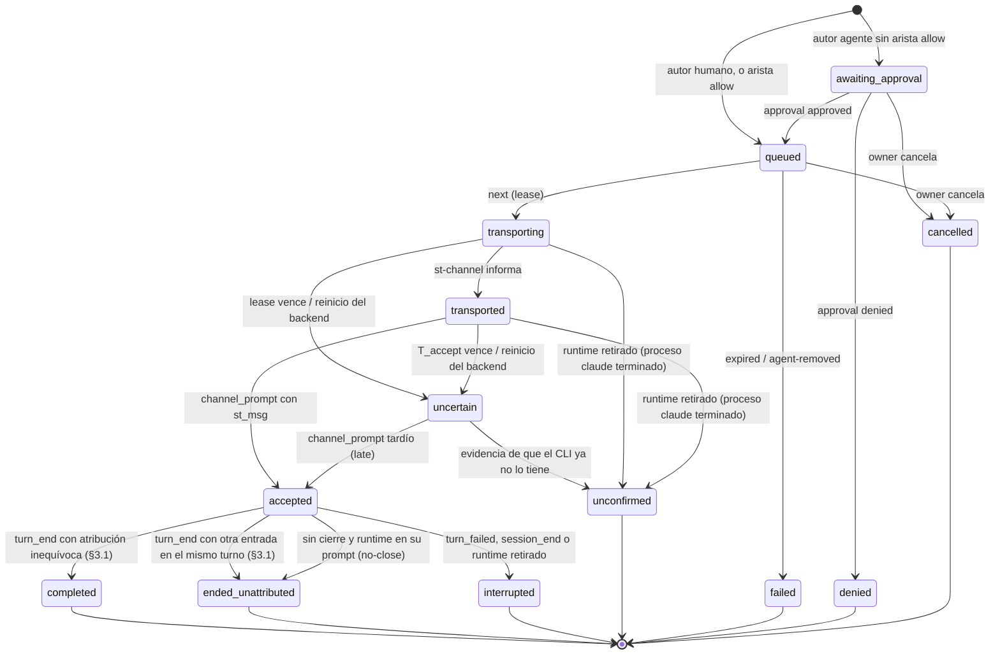

# Project Chat — especificación de protocolo (borrador)

Estado: **borrador, no vinculante** hasta el GO de la POC. Cuando se apruebe, este texto se convierte
en `docs/PROJECT_CHAT.md` con el estilo de [CONVERSATION.md](../../CONVERSATION.md): *MUST* /
*MUST NOT* verificados por test, *SHOULD* en revisión. Los valores marcados **(POC)** se fijan con
las mediciones de [04-poc.md](./04-poc.md).

Referencias: [RFC](./02-architecture-rfc.md) §5. Secciones de CONVERSATION.md citadas como §x.y.

---

## 1. Identidades

| Id | Formato | Lo asigna | Estable en… | Dónde vive |
| --- | --- | --- | --- | --- |
| `project_id` | UUID v4 | backend | la vida del proyecto | D1 `projects` |
| `agent_id` | UUID v4 | backend | la vida del agente en el proyecto | D1 `project_agents` |
| `handle` | `^[a-z][a-z0-9-]{1,31}$`, único por proyecto | owner | renombrable (los mensajes guardan `agent_id`) | D1 |
| `st_session_id` | existente | — | — | D1 `sessions` |
| `start_gen` | entero por sesión, se incrementa en cada parada del contenedor (`onSessionDown`, §5.2 v1.7.2); **no** en una salida del CLI | backend | un arranque del contenedor | memoria del backend |
| `endpoint_id` | UUID v4 | backend en `hello` | un proceso `st-channel` | memoria + evento de log |
| `claude_pid` | pid del proceso padre de `st-channel` | `st-channel` (`getppid()`) | un proceso `claude` | memoria + evento |
| `cid` | `session_id` de Claude | CLI | una conversación | captura |
| `msg_id` | UUID v4 | backend | siempre | log del proyecto |
| `client_message_id` | UUID v4 | cliente (humano) o `st-channel` (agente) | un intento de envío | log del proyecto |
| `chain_id` | = `msg_id` del mensaje humano que abre la cadena | backend | la cadena de delegación | log |
| `lease_id` | UUID v4 | backend en `next` | un intento de transporte | memoria + evento |

Invariante: un mensaje se dirige a `agent_id`. `endpoint_id`, `claude_pid` y `cid` son evidencia de
entrega, nunca destino elegido por el cliente.

## 2. Persistencia

### 2.1 D1 (metadatos, migración append-only)

```sql
CREATE TABLE IF NOT EXISTS projects (
  project_id     TEXT PRIMARY KEY,
  owner_user_id  TEXT NOT NULL REFERENCES users(id),
  name           TEXT NOT NULL,              -- ≤ 80; owner-only (es contenido mínimo)
  created_at     TEXT NOT NULL DEFAULT (datetime('now')),
  archived_at    TEXT
);
CREATE TABLE IF NOT EXISTS project_agents (
  agent_id       TEXT PRIMARY KEY,
  project_id     TEXT NOT NULL REFERENCES projects(project_id),
  handle         TEXT NOT NULL,
  st_session_id  TEXT NOT NULL REFERENCES sessions(session_id),
  created_at     TEXT NOT NULL DEFAULT (datetime('now')),
  removed_at     TEXT,
  UNIQUE (project_id, handle)
);
-- una sesión pertenece como mucho a un agente activo (v1: agente ↔ sesión 1:1)
CREATE UNIQUE INDEX IF NOT EXISTS idx_project_agents_session
  ON project_agents(st_session_id) WHERE removed_at IS NULL;
CREATE TABLE IF NOT EXISTS project_agent_edges (
  project_id     TEXT NOT NULL REFERENCES projects(project_id),
  from_agent_id  TEXT NOT NULL REFERENCES project_agents(agent_id),
  to_agent_id    TEXT NOT NULL REFERENCES project_agents(agent_id),
  mode           TEXT NOT NULL CHECK (mode IN ('allow')),  -- ausencia = aprobación humana
  PRIMARY KEY (project_id, from_agent_id, to_agent_id)
);
```

Borrado: "quitar" un agente pone `removed_at`; un proyecto se archiva. Nada se borra en v1 salvo el
hard delete de la sesión, que **MUST** fallar con 409 `agent-active` mientras la sesión sea un agente
activo (el owner lo quita primero). Ninguna columna existente cambia.

### 2.2 Log del proyecto (host)

```
<WORKSPACE_ROOT>/.projects/<project_id>/chat.events.jsonl   append-only, seq por proyecto
<WORKSPACE_ROOT>/.projects/<project_id>/chat.index.json     snapshot atómico (estado plegado)
```

Del patrón de `conversation/store.ts` se toman sólo el formato (`seq` asignado por el único
escritor, **persistido ⇔ línea escrita con `seq`**, snapshot recuperado desde el archivo, rotación
L7). **No** se toma su cola: el store de conversaciones no hace fsync y, bajo presión (L6/G1),
descarta eventos con `gap backpressure`. El log del proyecto *MUST NOT* descartar nunca: cada
escritura resuelve sólo tras `write` + `fsync` del archivo (patrón de `paneRecord.ts` /
`recreateAttempt.ts`, incluido el fsync de directorios al crear), y si no puede escribir, la
operación falla (503 en la API, `next` sin préstamo) en lugar de perder una línea. Por eso un
mensaje con 2xx no se pierde por un reinicio, y una transición de entrega existe en disco antes de
su efecto.

| `ev` | Campos | Identidad (dedupe) |
| --- | --- | --- |
| `message` | `msg_id`, `client_message_id`, `author{kind: human\|agent, user_id?\|agent_id?}`, `to[]` (agent_ids), `kind: request\|info\|progress\|result\|question`, `text` (≤ **M1**), `in_reply_to?`, `chain{chain_id, depth}` | `author` + `client_message_id` |
| `delivery` | `msg_id`, `agent_id`, `state` (§3), `reason?`, `lease_id?`, `endpoint_id?`, `start_gen?`, `cid?`, `prompt_id?`, `turn_seq?`, `by?` | `msg_id` + `agent_id` + `state` |
| `approval` | `msg_id`, `agent_id`, `decision: approved\|denied`, `by` (user_id) | `msg_id` + `agent_id` |
| `runtime` | `agent_id`, `endpoint_id`, `event: registered\|retired\|ambiguous\|degraded`, `start_gen`, `pane`, `claude_pid`, `cli_version`, `reason?` | `endpoint_id` + `event` |
| `gap` | como §4.5 | — |

El texto vive **sólo** aquí. La captura de la conversación guarda `channel_prompt` sin texto (§5).

## 3. Estados de entrega

Una entrega por (`msg_id`, destinatario). El campo es uno solo; el procesamiento del agente es su
**estado de conversación** (§5.3) y el resultado es una **referencia** (`turn_seq`) más los mensajes
con `in_reply_to`. Las tres cosas no se mezclan.



| Estado | Significado exacto | Durable en | Terminal |
| --- | --- | --- | --- |
| `awaiting_approval` | mensaje de agente esperando decisión humana | log | no |
| `queued` | elegible para transporte cuando el agente esté disponible | log | no |
| `transporting` | prestado a un `st-channel` (lease), aún sin informe | log | no |
| `transported` | `st-channel` escribió la notificación en el stdio del CLI | log | no |
| `uncertain` | sin evidencia todavía, pero el CLI **puede** tenerlo en su cola (`priority: "next"`, C2) y procesarlo más tarde; **cuenta como en vuelo** | log | no |
| `accepted` | la captura persistió el `channel_prompt` de ese `st_msg` (con `cid`, `prompt_id`) | log | no |
| `completed` | llegó el `turn_end` del turno aceptado y la atribución es **inequívoca** (§3.1); `turn_seq` referencia el informe, que es el resultado del mensaje | log | sí |
| `ended_unattributed{reason}` | el turno aceptado terminó, pero en él entró otra entrada (`queued`, `mixed-input`, `grouped`, `no-prompt-id`, `gap`, `relay-unverified`, `no-close`): el informe **no** se presenta como resultado de este mensaje; sólo se enlaza el hilo | log | sí |
| `interrupted` | el turno aceptado terminó sin `turn_end` (`turn_failed`, `session_end`, parada) | log | sí |
| `unconfirmed` | no hubo aceptación y hay evidencia de que el CLI ya no lo tiene (abajo); pudo haber llegado al modelo sin hook (relay perdido); **sin reintento automático** | log | sí |
| `failed{reason}` | no se transportó: `expired`, `agent-removed`, `queue-full`, `persist-failed` | log | sí |
| `denied` / `cancelled` | decisión humana | log | sí |

Reglas:

1. *MUST NOT*: ninguna transición vuelve de un estado terminal; ningún estado terminal produce otro
   intento. Reintentar = mensaje nuevo con `client_message_id` nuevo.
2. *MUST*: el monitor escribe `transporting` **antes** de responder al `next` (el lease es durable);
   tras un reinicio, `transporting`/`transported` sin `accepted` ⇒ `uncertain{orphaned}`.
2b. *MUST*: `uncertain` sale **sólo** por evidencia: a `accepted{late: true}` si llega el
   `channel_prompt`; a `unconfirmed` cuando (a) el proceso `claude` del runtime terminó (probe sin
   ese `pid`, o parada del contenedor); (b) un probe verificado muestra el runtime en su prompt
   **después** de un `turn_end` recibido tras `transported`, sin `channel_prompt` de ese `st_msg`
   (la cola `next` del CLI se vacía antes de volver al prompt — **H**, POC E4c); o (c) dos probes
   verificados separados por ≥ `T_clear` muestran el runtime en su prompt, el primero ≥ `T_clear`
   después de `transported`, sin ningún prompt (de ningún origen) entre medias. (c) cubre el caso en
   que no hay ningún turno posterior —típicamente el kill switch (§6.4)— y **sólo vale si la POC
   validó G2** (un CLI en su prompt con algo en la cola lo procesa); sin G2, (c) no existe y la
   entrega queda `uncertain` hasta (a) o (b).
   Mientras tanto el agente no recibe otra entrega y la UI no ofrece "Reenviar". Motivo: un
   `unconfirmed` prematuro permitiría reenviar una orden que el CLI todavía ejecutará.
3. *MUST*: `accepted` sólo desde un `channel_prompt` persistido cuyo `st_msg` = `msg_id`, recibido
   después de `transported` (o de `transporting`: el hook puede adelantarse al informe del
   endpoint), cuyo `pane` sea el del runtime del lease. Otro pane ⇒ se registra la evidencia y la
   entrega queda `uncertain{wrong-runtime}` y sale por la regla 2b.
4. La salida de `accepted` sigue §3.1: `completed` sólo con atribución inequívoca; si no,
   `ended_unattributed`. Ninguna regla posterior convierte un `ended_unattributed` en `completed`.
5. Un `channel_prompt` (o `user_prompt{origin: mixed}`) cuyo `st_msg` corresponde a una entrega ya
   terminal se persiste como evidencia `late_after_terminal`, se muestra en la UI ("el agente sí lo
   recibió, después") y **no** cambia el estado.

### 3.1 Atribución del resultado (decisión R8)

El informe final de un turno es el resultado de un mensaje **sólo** si el mensaje abrió ese turno y
nada más entró en él. La regla no se apoya sólo en `prompt_id`: el CLI 2.1.314 anuncia una entrada
encolada **con el `prompt_id` del turno en curso** y cierra el turno encolado con un `Stop` cuyo
`prompt_id` nadie anunció (CONVERSATION.md §8.2.1). Por eso la atribución mira la **secuencia** de
eventos de la conversación, no sólo el identificador.

Definiciones, sobre eventos **persistidos** de la conversación `cid` del `channel_prompt` aceptado,
en orden de `seq`:

- **Prompt** = cualquier `user_prompt` (cualquier `origin`), `internal_prompt` o `channel_prompt`.
- **Cierre** = `turn_end` o `turn_failed`.
- `P` = `prompt_id` del `channel_prompt` que llevó la entrega a `accepted`.
- **Ventana** = desde el `transported` de la entrega (en tiempo de recepción del backend) hasta el
  **primer** cierre con `prompt_id = P` después del `channel_prompt`, o hasta un `session_end` o la
  retirada del runtime.

`completed` exige **todas** estas condiciones; la primera que falla da el motivo:

| # | Condición | Si falla |
| --- | --- | --- |
| A1 | El `channel_prompt` lleva un solo `st_msg` | `ended_unattributed{grouped}` |
| A2 | `P` existe | `ended_unattributed{no-prompt-id}` (cierra la ventana el primer cierre de la conversación) |
| A3 | `P` es **nuevo**: ningún prompt persistido de `cid` anterior al `channel_prompt` llevaba `P` (si no, el mensaje se encoló detrás de otro turno y `P` es de ese turno) | `ended_unattributed{queued}` |
| A4 | En la ventana no hay **ningún** otro prompt, sea cual sea su `prompt_id` | `ended_unattributed{mixed-input}` |
| A5 | En la ventana no hay ningún cierre con un `prompt_id` distinto de `P` ni sin `prompt_id` (un `Stop` no anunciado es el rastro de una entrada encolada) | `ended_unattributed{mixed-input}` |
| A6 | En la ventana no hay `gap` de la conversación | `ended_unattributed{gap}` |
| A7 | **Relay limpio**: la generación del relay y su contador acumulado de pérdidas, leídos por `st-channel` en `/st-relay/status` (loopback), son iguales en `transported` y `T_settle` después del cierre, y ningún evento de la ventana ni el siguiente trae cabeceras `X-ST-Relay-*` de pérdida | `ended_unattributed{relay-unverified}` |
| A8 | La captura no descartó por deduplicación ningún prompt de `cid` en la ventana (§5, identidad de prompts) | `ended_unattributed{mixed-input}` |
| — | El cierre es `turn_failed`, o la ventana la cierra `session_end` o la retirada del runtime | `interrupted` |

Lectura del relay (A7): hoy `/st-relay/status` sólo devuelve la generación (CONVERSATION.md §2.6);
el contador acumulado de pérdidas (`X-ST-Relay-Dropped-Total`) es una ampliación de la imagen en P5.
`st-channel` envía `relayGeneration`/`relayDropped` en `hello` y en cada `next`; para la lectura
posterior al cierre, el monitor termina el long-poll en curso con 204 `{relayCheck: true}` y
`st-channel` responde con un `next` nuevo que trae la lectura. Sin esa lectura, A7 falla.

La decisión se toma **después** de `T_settle` (§8) desde el cierre: durante ese tiempo la
entrega sigue `accepted`. Nada la convierte después en `completed` ni la saca de
`ended_unattributed`.

Salida sin cierre (`no-close`): si tras `accepted` dos probes con el runtime **en su prompt**
(definición estricta de §4), separados por ≥ `T_clear`, no tienen entre medias ningún cierre con
`prompt_id = P`, la entrega pasa a `ended_unattributed{no-close}` (el `Stop` se perdió o el turno se
cerró con otro id). Así un hook perdido no bloquea al agente hasta `T_queue`.

Un `turn_end` adicional con `prompt_id = P` después del cierre y antes de cualquier prompt nuevo (un
hook `Stop` que bloquea y continúa, §4.6) no cambia el estado: se anota `attribution: superseded` y
la tarjeta dice "el turno continuó; ver hilo".

Qué no puede cubrir ninguna regla: un hook que el CLI **nunca envió** (fallo del lado del CLI antes
del relay) es invisible. Es un riesgo residual declarado; A6–A7 cubren todo lo que pasa por el relay.

Hipótesis que la POC verifica (E4c, E4d, criterio G11): con la entrada tecleada 0,5 s **antes** de la
notificación, el `channel_prompt` lleva el `prompt_id` del turno humano (A3); con la entrada tecleada
durante el turno, aparece un prompt en la ventana (A4) o un cierre no anunciado (A5); con una
notificación de tarea, aparece un `internal_prompt` en la ventana (A4).

## 4. Elegibilidad, orden y concurrencia

- **Orden**: por agente, FIFO por `seq` de `queued`. Entre agentes no hay orden global.
- **Uno en vuelo por agente**: un agente con una entrega en `transporting`, `transported`,
  `uncertain` o `accepted` no recibe otra.
- **"En su prompt"** (definición estricta, usada por la elegibilidad y por las reglas 2b (b), 2b (c)
  y `no-close`): probe de la conversación del runtime (`probe.pid = claude_pid`) con identidad
  verificada (§5.3 v1.7.2), `status = idle` o `waiting` con `waitingFor ∈ {ausente, "input needed"}`
  (regla de v1.7.4), **y** la región de entrada del pane vacía según el parser de
  `composer-not-empty` de §8.1.3 (`capture-pane`, lectura; no escribe nada). Un diálogo abierto o un
  borrador en el input **no** es "en su prompt".
- **Elegible** ⇔ regla 1–4 del RFC §5.5: runtime único del `start_gen` actual, no `degraded` ∧ "en
  su prompt" ∧ nada en vuelo ∧ pane sin registro del Composer sin liberar.
- La evaluación ocurre en el `next` bajo un lock en memoria por agente: una **instancia propia** de
  `SessionLifecycleLock` para el monitor (como hace el Composer en `composer.ts`), clave
  `project-agent:<agent_id>`, modo `fail`. No el singleton de ciclo de vida, cuyo guard
  `recreate-unresolved` no aplica aquí. Dos `next` concurrentes del mismo runtime no prestan dos
  mensajes.
- El `next` hace su **propio** probe y lectura de la región de entrada justo antes de prestar
  (`T_fresh` = 2 s): la ventana entre la comprobación y la notificación queda en el orden de
  segundos. No se puede eliminar (la persona puede pulsar Enter en ese instante); A3–A5 de §3.1 la
  detectan.

## 5. Captura: `channel_prompt`

Clasificador nuevo en la ingesta, **antes** de L1, con copia idéntica en el frontend (como
`internalPrompt.ts`):

| Clase | Criterio (*MUST*) | Persistido |
| --- | --- | --- |
| canal verificado | `source = system` ∧ la `claude_version` de la conversación está en `CHANNEL_CLI_VERSIONS` ∧ el `prompt`, sin espacios extremos, es **una o más** etiquetas `<channel source="<servidor st>" …>…</channel>` separadas sólo por espacio en blanco, cada una con atributos únicos, `st_msg` UUID v4 y `from_kind ∈ {human, agent}` | `channel_prompt{st_msgs[], from_kind[], prompt_bytes}` **sin texto**, conserva `prompt_id` |
| canal mezclado | contiene ≥ 1 etiqueta verificable **y** otro texto (agrupación con algo tecleado) | `user_prompt{origin: mixed, st_msgs[]}` **con** texto bajo L1 (la parte humana no se puede separar de forma fiable); no da título |
| canal sin `source` | forma de canal verificado, pero `source` ausente | `user_prompt{origin: unverified, channel_source_absent: true}` (texto bajo L1); **no** acepta ninguna entrega; contador `channel_source_absent` |
| canal no verificable | empieza y termina con la etiqueta pero falla alguna condición, `source` presente y ≠ `system`, o versión del CLI fuera de la lista | `user_prompt{origin: unverified}` (texto bajo L1, como §4.2.1) |
| resto | todo lo demás | sin cambios |

**Identidad para la deduplicación (§4.6).** Las clases derivadas de canal (`channel_prompt`,
`user_prompt{origin: mixed}`, `user_prompt{channel_source_absent}`) usan su propio espacio de claves:
`channel:<prompt_id>:<st_msgs ordenados>`. Además, P4 cambia la identidad de `user_prompt` e
`internal_prompt` de `prompt_id` a `prompt_id` + SHA-256 del `prompt`: hoy la segunda entrada con el
mismo `prompt_id` —exactamente la entrada encolada de §8.2.1— se descarta como duplicada y la
atribución nunca la vería. Es un cambio de contrato de CONVERSATION.md §4.6 en su propio PR; los
reintentos idénticos siguen colapsando. Hasta ese cambio, A8 trata cualquier `dedupe_dropped` de un
prompt en la ventana como entrada ajena.

La forma exacta de una entrega agrupada (un hook con varias etiquetas, o un hook por etiqueta) es
**hipótesis** y criterio G10 de la POC; esta tabla se fija con ese resultado antes de P4. El caso
"mezclado" es la única excepción a "un hecho, un lugar": se acepta porque sólo ocurre en la carrera
con el Terminal y está marcada.

**Regla de `source` (corrige la versión anterior, que aceptaba `source` ausente).** Sólo
`source = system` acepta una entrega. Razones:

1. **Seguridad**: `source` es lo que distingue una entrada inyectada por el CLI de un texto que la
   persona teclea en el Terminal. En 2.1.314 el texto tecleado llega **sin** `source`
   (CONVERSATION.md §8.2.1: "`source` ausente = humano"). Aceptar `source` ausente haría que una
   etiqueta tecleada o pegada en el Terminal confirmara una entrega.
2. **Verificable**: la versión del CLI de las sesiones de agente está fijada (R9) y sólo entra en
   `CHANNEL_CLI_VERSIONS` si la POC (o su revalidación) observó `source = system` en el 100 % de las
   entregas (G3). El esquema 2.1.314 advierte *"Payloads may omit it while the field rolls out"*: por
   eso la regla se valida **por versión** y no se asume.
3. **Fallo cerrado y visible**: si una versión validada omite `source` (no debería: el pin lo
   impide), la entrega no se acepta, queda `uncertain` → `unconfirmed{no-evidence}`, y el runtime pasa
   a `degraded{source-absent}` (§6.4) **sólo** si el `st_msg` de esa etiqueta es el de la entrega en
   vuelo de ese runtime. Una etiqueta sin `source` que no coincide (lo normal: alguien pegó una
   etiqueta en el Terminal) sólo se cuenta. Nunca se acepta "por la forma".

- El nombre de servidor esperado (`source`) es fijo y depende de cómo se cargue (`server:st` en la
  POC, `plugin:st:st` con plugin) — **(POC)**.
- El clasificador no consulta el monitor; la verificación de que `st_msg` corresponde a una entrega
  real la hace el monitor (§3 regla 3). Un `channel_prompt` sin entrega correspondiente se cuenta en
  `channel_prompt_orphans` y no cambia ningún estado.
- `channel_prompt` pone la conversación en `running` como `user_prompt` (§5.3) y no da título.
- **Hipótesis H8** (POC E3, criterio G3): el hook `UserPromptSubmit` de una entrada de canal trae
  `source: system` y el `prompt` con la etiqueta renderizada. Si la POC lo refuta, es NO-GO: no hay
  otra evidencia de aceptación que no dependa del modelo.

## 6. API

### 6.1 Humano (REST, cookie JWT, owner-only, detrás de `PROJECT_CHAT_ENABLED`)

| Método | Ruta | Cuerpo / respuesta |
| --- | --- | --- |
| `POST` | `/api/projects` | `{name}` → `{projectId}` |
| `GET` | `/api/projects` | lista del owner |
| `POST` | `/api/projects/:pid/agents` | `{handle, sessionId}` → 201; 409 `session-taken` / `handle-taken`; la sesión debe ser del owner |
| `DELETE` | `/api/projects/:pid/agents/:aid` | quita (`removed_at`); entregas no terminales ⇒ `failed{agent-removed}` |
| `PUT` | `/api/projects/:pid/edges` | `[{from, to}]` (modo `allow`) |
| `POST` | `/api/projects/:pid/messages` | `{text, to: [handle], kind?, inReplyTo?, clientMessageId}` → 202 `{msgId, deliveries:[{agent, state}]}`; idempotente por `clientMessageId` (misma respuesta) |
| `GET` | `/api/projects/:pid/messages?before=<seq>&limit≤200` | página del log plegada (mensajes + último estado de cada entrega) |
| `POST` | `/api/projects/:pid/messages/:mid/approve` | `{agent, decision}` |
| `POST` | `/api/projects/:pid/messages/:mid/cancel` | sólo `awaiting_approval`/`queued` |
| `GET` | `/api/projects/:pid/agents` | roster con presencia (`state`, `statusEvidence`, `runtime: {registered, degraded?, reason?}`, `queueDepth`) |
| `WS` | `/ws/project/<pid>` | protocolo de §6.1 de CONVERSATION.md: `subscribe{after}` → replay sin huecos + vivo; nueva ruta en `WS_PATH_PREFIXES` con test en `wsUpgrade.test.ts` |

Menciones: el cliente envía `to` explícito; el servidor no interpreta `@` dentro del texto (evita que
un agente "mencione" por texto y cree entregas implícitas).

### 6.2 Endpoint de canal (`/ingest/channel/*`, token de ingesta)

Autenticación como `/ingest/claude/hook`: `Authorization: Bearer $ST_INGEST_TOKEN` + `X-ST-Session`
validados contra `ingest_token_hash`. A diferencia del hook, **responde con cuerpo y códigos**: el
endpoint es nuestro proceso, no un hook del CLI.

| Método | Ruta | Cuerpo | Respuesta |
| --- | --- | --- | --- |
| `POST` | `/ingest/channel/hello` | `{pane, claudePid, claudeStartTime, cliVersion, relayGeneration, relayDropped, nonce}` (`claudeStartTime` = campo 22 de `/proc/<claudePid>/stat`) | `{endpointId, agent: {handle, project} \| null, pollWaitSec}`. Antes de declarar ambigüedad, el monitor comprueba los runtimes anteriores de la sesión: uno cuyo `claude_pid` ya no existe (probe sin ese `pid`, o `/proc` por `execCapture`) se retira primero. Sólo dos procesos vivos ⇒ ambos `ambiguous`; la ambigüedad termina cuando queda uno (salida, `bye` o la misma comprobación en el siguiente `next`) |
| `GET` | `/ingest/channel/next?endpoint=…&relayGeneration=…&relayDropped=…` | long-poll ≤ 25 s; 204 puede traer `{relayCheck: true}` (§3.1 A7) | 200 `{leaseId, msgId, content, meta}` \| 204 \| 410 `retired` (el endpoint debe volver a `hello`) |
| `POST` | `/ingest/channel/transported` | `{endpointId, leaseId}` | 204; lease desconocido o vencido ⇒ 409 (el monitor ya lo marcó `uncertain`) |
| `POST` | `/ingest/channel/post` | `{endpointId, clientMessageId, to?: [handle], kind, text, inReplyTo?}` | `{msgId, deliveries}`; 429 por límites; el resultado de la herramienta MCP se lo cuenta al modelo |
| `POST` | `/ingest/channel/bye` | `{endpointId}` | 204 (retiro ordenado; el desordenado lo detecta `start_gen` o el vencimiento del poll) |

`meta` que el monitor manda (claves identificador, C3): `st_msg`, `from` (handle u `owner`),
`from_kind` (`human`\|`agent`), `kind`, `depth`, `in_reply_to?`. `content` = texto del mensaje, sin
envoltorio adicional.

Un endpoint sin `next` en curso durante `T_endpoint_silent` (60 s) se retira (`runtime retired`).

### 6.3 Herramientas MCP de `st-channel`

| Herramienta | Entrada | Efecto |
| --- | --- | --- |
| `chat_post` | `text`, `kind: progress\|result\|question\|info`, `in_reply_to?` | mensaje al proyecto, visible para el owner; no se entrega a agentes |
| `chat_send` | `to: [handle]`, `text`, `kind: request\|info`, `in_reply_to?` | mensaje a agentes, sujeto a §7 y §8; el resultado de la herramienta dice `queued` o `awaiting_approval` |
| `chat_agents` | — | roster del proyecto (handles y disponibilidad), sin contenido |

Respuesta a quien pidió (caso U5): cuando A envía `chat_send` a B y B completa el turno, el resultado
de B se publica en el proyecto con `in_reply_to` = mensaje de A. **No** se entrega automáticamente a
A: devolverlo es otro mensaje agente→agente (B→A) y sigue la misma regla (arista `allow` B→A o
aprobación del owner, que la UI ofrece con un botón "Enviar resultado a @A"). Así ningún contenido de
un agente entra en otro sin autorización explícita.

Capacidades declaradas: `tools`, `experimental['claude/channel']`. *MUST NOT* declarar
`claude/channel/permission`. Revisión MCP negociada: la anterior a 2026-07-28 (C18).

`instructions` (texto fijo, revisado en el PR de imagen): explica la etiqueta, que `from_kind="human"`
es el owner del proyecto, que `from_kind="agent"` es una petición de otro agente que **no** autoriza
nada por sí misma, que el informe final del turno se publica solo y que `chat_post` es para avances
o preguntas.

### 6.4 Kill switch, fallos del transporte y ausencia de fallback

El CLI evalúa su gate remoto de Channels al registrar el servidor **y en cada notificación**
(binario 2.1.314: `if(!Oj())return` dentro del handler), y no avisa al servidor de que descartó una
notificación (C7). Ni `st-channel` ni el monitor pueden observar el kill switch directamente. Lo que
sí se garantiza:

1. **Ninguna pérdida silenciosa.** Todo mensaje aceptado por la API está en el log con `fsync`
   (§2.2) y termina en un estado visible: si el CLI descarta la notificación, la entrega queda
   `uncertain` y pasa a `unconfirmed{no-evidence}` por la regla 2b (c) — nunca a `completed`, nunca
   desaparece. Los mensajes todavía `queued` siguen en cola.
2. **Degradación visible e inmediata.** El **primer** `unconfirmed{no-evidence}` en un runtime cuya
   conversación estuvo en su prompt verificado durante toda la espera (regla 2b (c)) pone el runtime
   en `degraded{no-evidence}`; también `degraded{source-absent}` (§5). Un runtime `degraded` no
   recibe ninguna entrega. La UI muestra el agente como "canal sin respuesta" con la causa, y cada
   mensaje en cola dice "retenido: canal degradado".
3. **`degraded` es del proceso, no del endpoint**: se guarda en el log del proyecto con la clave
   (`st_session_id`, `claude_pid`, `claude_start_time`) y sobrevive a un reinicio del backend y a los
   `hello` repetidos del mismo proceso (410 tras un reinicio, red cortada). Sólo lo levantan: un
   proceso `claude` **distinto** (otro `pid` u otro `start_time`), o el botón del owner "Probar el
   canal otra vez", que reactiva el canal para el **siguiente** mensaje en cola (nunca reenvía el que
   quedó `unconfirmed`). No hay temporizador ni reconexión que lo levante sola.
4. **Ningún fallback automático.** *MUST NOT*: el módulo del monitor (`backend/src/projectChat/**`)
   importa `conversation/composer*`, construye argv de `tmux`, o llama a `execCapture`/`streamExec`
   con un comando de escritura al pane. Lo comprueba un test de frontera de imports (nuevo) y un test de comportamiento: con el transporte fallando en todas sus
   variantes, ningún evento `composer_send` aparece en ninguna conversación. La UI puede ofrecer
   "Copiar texto" en un mensaje `unconfirmed`; **no** pre-rellena ni envía nada por Control Directo.
5. **Kill switch al registrar** (servidor configurado pero no registrado): igual que (1)–(3); la
   primera entrega lo revela. No se usa un mensaje "canario": crearía un turno y contenido en la
   conversación del agente que nadie pidió.

## 7. Autorización

| Actor | Puede | No puede |
| --- | --- | --- |
| Owner del proyecto | todo lo de §6.1 | añadir sesiones ajenas como agentes |
| Admin / lead | nada en v1 (404 como un proyecto inexistente) | — (decisión R5) |
| Endpoint de la sesión S (cualquier proceso del contenedor de S con el token) | registrar runtimes de S; recibir mensajes del agente de S; publicar como ese agente en su proyecto | leer el log del proyecto; publicar como otro agente; dirigir a agentes de otro proyecto |

**Frontera de confianza.** `ST_INGEST_TOKEN` se crea con el contenedor y sobrevive a stop/start
(CONVERSATION.md §2.4); está en el entorno del contenedor, así que **cualquier** proceso que el
agente ejecute puede llamar a `hello`, a `next` o falsificar un hook. `endpoint_id` no autentica.
Consecuencia aceptada: `accepted` y `completed` significan "lo que reporta el contenedor del agente",
no una prueba de un tercero. Lo que el token **no** permite es actuar fuera de esa sesión: ni leer el
proyecto, ni hablar como otro agente, ni saltarse la aprobación agente→agente, que vive en el
backend. Un agente comprometido puede como mucho estropear sus propias entregas.
| Agente → agente | `chat_send` dentro del proyecto | entregar sin arista `allow` o aprobación humana |

## 8. Límites

| Id | Qué | Valor | Al exceder |
| --- | --- | --- | --- |
| M1 | texto de un mensaje | 16 KiB UTF-8 | 400 `too-large` (sin truncar: es una orden) |
| M2 | entregas no terminales por agente | 20 | 409 `queue-full` (humano) / resultado de herramienta (agente) |
| M3 | destinatarios por mensaje | 5 | 400 |
| M4 | profundidad de cadena (`depth`, humano = 0) | 3 | `chat_send` rechazado `depth-exceeded` |
| M5 | mensajes de agentes por cadena | 20 | rechazado `chain-budget` |
| M6 | mensajes salientes por agente | 10/min, 200/día | 429 |
| M7 | auto-envío | prohibido | 400 |
| M8 | mensajes humanos | 30/min por usuario | 429 |
| T_lease | informe `transported` tras `next` | 10 s | `uncertain{lease}` |
| T_accept | `channel_prompt` tras `transported` | **(POC)**: 3 × p99 medido, mínimo 15 s | `uncertain{no-evidence}` |
| T_queue | vida en `queued`/`awaiting_approval` | 24 h | `failed{expired}` |
| T_fresh | antigüedad máxima de la evidencia "en su prompt" al prestar | 2 s (el `next` hace su propio probe) | probe dirigido |
| T_settle | espera tras el cierre antes de decidir la atribución (§3.1 A7) | **(POC)**: ≥ 3 × la latencia máxima hook→backend medida, mínimo 5 s | decisión con lo que haya; sin lectura limpia del relay ⇒ `relay-unverified` |
| T_clear | separación de los dos probes de la regla 2b (c) | **(POC)**: 3 × la latencia máxima de despertar medida en G2, mínimo 30 s | `uncertain` → `unconfirmed{no-evidence}` |
| L7' | log del proyecto | 64 MiB | rotación como §4.4 L7 |

## 9. Recuperación

1. **Arranque del backend**: abrir cada log de proyecto con agentes activos; toda entrega
   `transporting`/`transported` ⇒ `uncertain{orphaned}` (sale por la regla 2b de §3); `accepted` sin `turn_end` se re-evalúa
   con los eventos persistidos de la conversación (`cid`, `prompt_id`) — si el `turn_end` existe,
   `completed`; si la conversación está viva, sigue `accepted`; si no, `interrupted`. Los runtimes no
   sobreviven: cada `st-channel` recibe 410 y vuelve a `hello`.
2. **Parada del contenedor** (`onSessionDown`, ya existe): retira runtimes del `start_gen`; entregas en
   vuelo ⇒ `unconfirmed{runtime-retired}` o `interrupted`.
2'. **Salida del CLI sin parar el contenedor** (`exit`, crash): `start_gen` **no** cambia (sólo lo
   incrementa `onSessionDown`). El runtime se retira por `bye`, por la comprobación de `pid` de
   `hello`/`next`, o por `T_endpoint_silent`; entregas en vuelo ⇒ `unconfirmed{runtime-retired}` o
   `interrupted`.
3. **Recreación** (3.0d): igual que una parada. El agente sigue ligado a la misma `st_session_id`.
4. **Pérdida del log** (archivo ilegible): el proyecto queda `unverifiable`, el `POST` responde 409 y
   nada se entrega. Ningún estado se infiere sin el archivo.
