# Project Chat — especificación de protocolo (borrador)

Estado: **borrador, no vinculante** hasta el GO de la POC. Cuando se apruebe, este texto se convierte
en `docs/PROJECT_CHAT.md` con el estilo de [CONVERSATION.md](../../CONVERSATION.md): *MUST* /
*MUST NOT* verificados por test, *SHOULD* en revisión. Los valores marcados **(POC)** se fijan con
las mediciones de [04-poc.md](./04-poc.md).

Referencias: [RFC](./02-architecture-rfc.md) §5. Secciones de CONVERSATION.md citadas como §x.y.

Actualización 2026-11-03: los mensajes viven en **conversaciones anfitrionas** (una por agente, con
invitados temporales y modo Colaboración; RFC §5.2, §5.6 y decisiones R10–R15). Las reglas de
entrega, la atribución (§3.1), el clasificador (§5) y el kill switch (§6.4) no cambian.

---

## 1. Identidades

| Id | Formato | Lo asigna | Estable en… | Dónde vive |
| --- | --- | --- | --- | --- |
| `project_id` | UUID v4 | backend | la vida del proyecto | D1 `projects` |
| `agent_id` | UUID v4 | backend | la vida del agente en el proyecto | D1 `project_agents` |
| `handle` | `^[a-z][a-z0-9-]{1,31}$`, único por proyecto | owner | renombrable (los mensajes guardan `agent_id`) | D1 |
| `provider` | `claude-code` en v1; `codex` reservado (sin adaptador) | owner al crear el agente | la vida del agente | D1 `project_agents` |
| `role` | texto ≤ 60, para el selector | owner | editable | D1 `project_agents` |
| `chat_id` | UUID v4 | backend | la vida de la conversación anfitriona (sobrevive a `/clear`, `/resume`, reinicios); el anfitrión **nunca** cambia | D1 `chats` + ruta del log |
| `participation_id` | UUID v4 | backend al invitar | una participación (`chat_id`, `agent_id`); **nuevo** en cada reinvitación | D1 `chat_participants` + eventos |
| `participants_version` | entero por `chat_id`, +1 en cada cambio del conjunto de participaciones no terminales | backend | hasta el siguiente cambio | D1 `chats` + eventos |
| `grant_id` | UUID v4 | backend al activar Colaboración | un permiso de Colaboración | log de la conversación |
| `st_session_id` | existente | — | — | D1 `sessions` |
| `start_gen` | entero por sesión, se incrementa en cada parada del contenedor (`onSessionDown`, §5.2 v1.7.2); **no** en una salida del CLI | backend | un arranque del contenedor | memoria del backend |
| `endpoint_id` | UUID v4 | backend en `hello` | un proceso `st-channel` | memoria + evento de log |
| `claude_pid` | pid del proceso padre de `st-channel` | `st-channel` (`getppid()`) | un proceso `claude` | memoria + evento |
| `cid` | `session_id` de Claude | CLI | una conversación | captura |
| `msg_id` | UUID v4 | backend | siempre | log de la conversación |
| `client_message_id` | UUID v4 | cliente (humano) o `st-channel` (agente) | un intento de envío | log de la conversación |
| `chain_id` | = `msg_id` del mensaje humano que abre la cadena | backend | la cadena de delegación | log |
| `lease_id` | UUID v4 | backend en `next` | un intento de transporte | memoria + evento |

Invariante: un mensaje se dirige a `agent_id` **dentro de un `chat_id`**, y cada entrega queda ligada
al `participation_id` vigente del destinatario. `endpoint_id`, `claude_pid` y `cid` son evidencia de
entrega, nunca destino elegido por el cliente.

**Principal y vínculo (G3.1–G3.2, [10-g3-sender-identity.md](./10-g3-sender-identity.md)).** El principal
autenticado de un agente es **su sesión, es decir el contenedor de esa sesión**, nunca el modelo ni
un proceso concreto: "lo escribió el agente A" significa "lo envió el contenedor de la sesión de A".
El **vínculo vigente** es la tupla (`agent_id`, `project_id`, `st_session_id`, `container_id`), con la
fila activa de `project_agents` como época. v1 no reasigna una sesión en el lugar: reasignar es quitar
el agente y crear otro, con un `agent_id` nuevo. Si una versión futura permite cambiar la sesión de un
agente existente, *MUST* agregar `binding_epoch` y la regla de §6.1 sobre entregas en vuelo. Toda
evidencia (hook, `transported`, post) se evalúa contra el vínculo vigente; la de un vínculo anterior se
registra y no cambia estados del agente nuevo. Ningún campo del cuerpo (`from`, `source`, handle,
`author`, etiquetas, texto, `@`) aporta identidad.

## 2. Persistencia

### 2.1 D1 (metadatos, migración append-only)

```sql
CREATE TABLE IF NOT EXISTS projects (
  project_id     TEXT PRIMARY KEY,
  owner_user_id  TEXT NOT NULL REFERENCES users(id),
  name           TEXT NOT NULL,              -- ≤ 80; owner-only (es contenido mínimo)
  created_at     TEXT NOT NULL DEFAULT (datetime('now')),
  archived_at    TEXT
);
CREATE TABLE IF NOT EXISTS project_agents (
  agent_id       TEXT PRIMARY KEY,
  project_id     TEXT NOT NULL REFERENCES projects(project_id),
  handle         TEXT NOT NULL,
  st_session_id  TEXT NOT NULL REFERENCES sessions(session_id),
  provider       TEXT NOT NULL DEFAULT 'claude-code' CHECK (provider IN ('claude-code')), -- 'codex' reservado: se agrega con su adaptador
  role           TEXT,                       -- ≤ 60, para el selector
  created_at     TEXT NOT NULL DEFAULT (datetime('now')),
  removed_at     TEXT,
  UNIQUE (project_id, handle)
);
-- una sesión pertenece como mucho a un agente activo (v1: agente ↔ sesión 1:1)
CREATE UNIQUE INDEX IF NOT EXISTS idx_project_agents_session
  ON project_agents(st_session_id) WHERE removed_at IS NULL;
CREATE TABLE IF NOT EXISTS project_agent_edges (
  project_id     TEXT NOT NULL REFERENCES projects(project_id),
  from_agent_id  TEXT NOT NULL REFERENCES project_agents(agent_id),
  to_agent_id    TEXT NOT NULL REFERENCES project_agents(agent_id),
  mode           TEXT NOT NULL CHECK (mode IN ('allow')),  -- ausencia = aprobación humana
  PRIMARY KEY (project_id, from_agent_id, to_agent_id)
);
-- conversación anfitriona (diseño para P3; la migración se escribe en P3, no ahora)
CREATE TABLE IF NOT EXISTS chats (
  chat_id               TEXT PRIMARY KEY,
  project_id            TEXT NOT NULL REFERENCES projects(project_id),
  owner_user_id         TEXT NOT NULL REFERENCES users(id),
  host_agent_id         TEXT NOT NULL REFERENCES project_agents(agent_id),  -- nunca cambia
  participants_version  INTEGER NOT NULL DEFAULT 1,
  created_at            TEXT NOT NULL DEFAULT (datetime('now')),
  archived_at           TEXT
);
-- una conversación anfitriona activa por agente (R10)
CREATE UNIQUE INDEX IF NOT EXISTS idx_chats_active_host
  ON chats(host_agent_id) WHERE archived_at IS NULL;
CREATE TABLE IF NOT EXISTS chat_participants (
  participation_id  TEXT PRIMARY KEY,
  chat_id           TEXT NOT NULL REFERENCES chats(chat_id),
  agent_id          TEXT NOT NULL REFERENCES project_agents(agent_id),  -- del mismo proyecto que el chat (R14)
  role              TEXT NOT NULL CHECK (role IN ('host','guest')),
  state             TEXT NOT NULL CHECK (state IN ('invited','awaiting_approval','active','declined','removed')),
  invited_by        TEXT NOT NULL,             -- 'user:<id>' | 'agent:<agent_id>'
  created_at        TEXT NOT NULL DEFAULT (datetime('now')),
  ended_at          TEXT
);
-- a lo sumo una participación no terminal por (chat, agente)
CREATE UNIQUE INDEX IF NOT EXISTS idx_chat_participants_live
  ON chat_participants(chat_id, agent_id) WHERE state IN ('invited','awaiting_approval','active');
```

Borrado: "quitar" un agente pone `removed_at` (y sus participaciones pasan a `removed`); un proyecto
se archiva; una conversación anfitriona se archiva (`archived_at`). Nada se borra en v1 salvo el hard
delete de la sesión, que **MUST** fallar con 409 `agent-active` mientras la sesión sea un agente
activo (el owner lo quita primero). Ninguna columna existente cambia.

`chats` y `chat_participants` son el **conjunto vigente**: el cambio de participaciones es un CAS sobre
`participants_version` (la escritura incluye `WHERE participants_version = ?`), y el log de la
conversación registra cada cambio con la versión resultante como historia. El monitor guarda en
memoria las participaciones de las conversaciones con entregas no terminales (escritura directa,
invalidada antes y después de cada escritura, el mismo patrón que `portMappings.ts` y el cache de propiedad de `sessionManager.ts`), así la condición 5 de
RFC §5.5 no agrega una lectura a D1 por `next`. **Los permisos de Colaboración no tienen tabla D1**:
viven sólo en el log de la conversación (son temporales, se consumen en el camino caliente del
préstamo y su único escritor es el del log); el snapshot del índice guarda el permiso vivo y su
consumo.

D1 es el **estado vigente** de los participantes y el log es la **historia durable**. Que ambos
coincidan es una precondición: si el pliegue de los eventos `participant` del log no da el mismo
conjunto y la misma `participants_version` que D1, la conversación pasa a
`participants-unverified` y no presta nada hasta una reconciliación verificable (§9.5). Esto es
fail-closed: la discrepancia nunca se resuelve eligiendo un lado sin evidencia.

### 2.2 Logs de las conversaciones (host)

```
<WORKSPACE_ROOT>/.projects/<project_id>/chats/<chat_id>.events.jsonl   append-only, seq por conversación
<WORKSPACE_ROOT>/.projects/<project_id>/chats/<chat_id>.index.json     snapshot atómico (estado plegado)
<WORKSPACE_ROOT>/.projects/<project_id>/runtimes.events.jsonl          append-only, eventos `runtime` del proyecto
```

Un log por conversación anfitriona: mensajes, participaciones, permisos de Colaboración y entregas
de esa conversación. Los eventos `runtime` (registro, `degraded`, `cleared`) son del **agente**, no
de una conversación —un agente participa en varias y "uno en vuelo por agente" vale entre todas—,
así que viven en un log del proyecto con el mismo formato y las mismas garantías. Lo que sigue vale
para los dos.

Del patrón de `conversation/store.ts` se toman sólo el formato (`seq` asignado por el único
escritor, **persistido ⇔ línea escrita con `seq`**, snapshot recuperado desde el archivo, rotación
L7). **No** se toma su cola: el store de conversaciones no hace fsync y, bajo presión (L6/G1),
descarta eventos con `gap backpressure`. Estos logs *MUST NOT* descartar nunca: cada
escritura resuelve sólo tras `write` + `fsync` del archivo (patrón de `paneRecord.ts` /
`recreateAttempt.ts`, incluido el fsync de directorios al crear), y si no puede escribir, la
operación falla (503 en la API, `next` sin préstamo) en lugar de perder una línea. Por eso un
mensaje con 2xx no se pierde por un reinicio, y una transición de entrega existe en disco antes de
su efecto.

| `ev` | Campos | Identidad (dedupe) |
| --- | --- | --- |
| `chat` | `chat_id`, `project_id`, `host_agent_id`, `event: created\|archived`, `by` (user_id) | `chat_id` + `event` |
| `participant` | `participation_id`, `agent_id`, `role: host\|guest`, `event: invited\|joined\|declined\|removed`, `by` (`user:<id>` o `agent:<agent_id>`; **ausente** en un evento recuperado cuyo autor no consta), `awaiting_approval?` (en `invited` pedido por un agente), `participants_version` (resultante), `reason?` (`agent-removed`, `chat-archived`). Si lo escribe la reconciliación (§9.5): `recovered: true`, `reconcile_id`, `discrepancy{log_version, d1_version, kind}` y `provenance{source: "d1", invited_by?, d1_state, d1_ended_at?}` — sólo lo que D1 registra, nunca una aprobación | `participation_id` + `event` (recuperados: `reconcile_id`) |
| `collab_grant` | `grant_id`, `chat_id`, `by` (user_id), `participants: [{agent_id, participation_id}]`, `max_deliveries`, `expires_at`, `created_at` — exactamente el alcance que se mostró al activar | `grant_id` |
| `collab_revoked` | `grant_id`, `by` (user_id) | `grant_id` |
| `collab_ended` | `grant_id`, `reason: budget\|expired\|participant-removed\|chat-archived` | `grant_id` |
| `message` | `msg_id`, `chat_id`, `client_message_id`, `author{kind: human\|agent, user_id?\|agent_id?, participation_id?}`, `to[]` (agent_ids resueltos), `routing: default-host\|explicit`, `participants_version`, `context[]` (`msg_id`s elegidos por la persona; vacío por defecto), `kind: request\|info\|progress\|result\|question`, `text` (≤ **M1**), `in_reply_to?`, `chain{chain_id, depth}` (siempre el de la cadena de `in_reply_to`, con cualquier autorización; los contadores de §8 se derivan del log por `chain_id`) | `author` + `client_message_id` |
| `delivery` | `msg_id`, `chat_id`, `agent_id`, `participation_id` (del destinatario), `state` (§3), `reason?`, `authorized_by?` (`approval`\|`edge`\|`collab:<grant_id>`, sólo autor agente), `collab_n?` (unidad consumida, en `transporting`), `marks?` (`after_removal`, `after_collab_end`), `lease_id?`, `endpoint_id?`, `start_gen?`, `relay{generation, dropped}?` (lectura de base, en `transporting`/`transported`), `cid?`, `prompt_id?`, `turn_seq?`, `by?` | `msg_id` + `agent_id` + `state` |
| `approval` | `msg_id`, `agent_id`, `decision: approved\|denied`, `context[]?` (agregado por la persona al aprobar), `by` (user_id) | `msg_id` + `agent_id` |
| `runtime` | `agent_id`, `endpoint_id`, `event: registered\|retired\|ambiguous\|degraded\|cleared`, `start_gen`, `pane`, `claude_pid`, `claude_start_time`, `cli_version`, `reason?`, `trigger_msg_id?` (la entrega que causó `degraded`), `by?` (usuario que pulsó "Probar el canal otra vez" en `cleared`) | `endpoint_id` + `event` + `trigger_msg_id` (o `seq` del evento para `cleared`): un segundo `degraded` tras un `cleared` no se descarta como repetido |
| `gap` | como §4.5 | — |

Orden en el log: `participant{invited}` se escribe **antes** del `message` que invita; un
`collab_grant` antes de cualquier entrega que lo cite; `collab_ended{budget}` inmediatamente después
del `transporting` que consumió la última unidad. Las líneas del log de runtimes van a su archivo.
Una invitación pedida por un agente es `participant{invited, by: agent:…, awaiting_approval: true}`;
su decisión es `joined` o `declined` con el `by` del usuario. Una invitada por la persona pasa a
`joined` con su primera entrega prestada.

El texto vive **sólo** aquí. La captura de la conversación del CLI guarda `channel_prompt` sin texto
(§5). `context[]` guarda referencias, no copias: el texto citado se arma al prestar la entrega.

## 3. Estados de entrega

Una entrega por (`msg_id`, destinatario). El campo es uno solo; el procesamiento del agente es su
**estado de conversación** (§5.3) y el resultado es una **referencia** (`turn_seq`) más los mensajes
con `in_reply_to`. Las tres cosas no se mezclan.

```mermaid
stateDiagram-v2
  [*] --> awaiting_approval: autor agente sin arista allow ni Colaboración viva
  [*] --> queued: autor humano, arista allow o Colaboración viva
  awaiting_approval --> queued: approval approved
  awaiting_approval --> denied: approval denied
  awaiting_approval --> cancelled: owner cancela / participante retirado / conversación archivada
  queued --> transporting: next (lease; condiciones 5 y 6 del RFC §5.5)
  queued --> cancelled: owner cancela / participante retirado / conversación archivada / Colaboración terminada / arista quitada
  queued --> failed: expired / agent-removed
  transporting --> transported: st-channel informa
  transporting --> uncertain: lease vence / reinicio del backend
  transported --> accepted: channel_prompt con st_msg
  transporting --> accepted: channel_prompt antes del informe de st-channel
  transported --> uncertain: T_accept vence / reinicio del backend
  uncertain --> accepted: channel_prompt tardío (late)
  uncertain --> unconfirmed: evidencia de que el CLI ya no lo tiene
  transporting --> unconfirmed: runtime retirado (proceso claude terminado)
  transported --> unconfirmed: runtime retirado (proceso claude terminado)
  accepted --> completed: turn_end con atribución inequívoca (§3.1)
  accepted --> ended_unattributed: turn_end con otra entrada en el mismo turno (§3.1)
  accepted --> ended_unattributed: sin cierre y runtime en su prompt (no-close)
  accepted --> interrupted: turn_failed, session_end o runtime retirado
  completed --> [*]
  ended_unattributed --> [*]
  interrupted --> [*]
  unconfirmed --> [*]
  failed --> [*]
  denied --> [*]
  cancelled --> [*]
```



| Estado | Significado exacto | Durable en | Terminal |
| --- | --- | --- | --- |
| `awaiting_approval` | mensaje de agente esperando decisión humana | log | no |
| `queued` | elegible para transporte cuando el agente esté disponible | log | no |
| `transporting` | prestado a un `st-channel` (lease), aún sin informe | log | no |
| `transported` | `st-channel` escribió la notificación en el stdio del CLI | log | no |
| `uncertain` | sin evidencia todavía, pero el CLI **puede** tenerlo en su cola (`priority: "next"`, C2) y procesarlo más tarde; **cuenta como en vuelo** | log | no |
| `accepted` | la captura persistió el `channel_prompt` de ese `st_msg` (con `cid`, `prompt_id`) | log | no |
| `completed` | llegó el `turn_end` del turno aceptado y la atribución es **inequívoca** (§3.1); `turn_seq` referencia el informe, que es el resultado del mensaje | log | sí |
| `ended_unattributed{reason}` | el turno aceptado terminó, pero en él entró otra entrada (`queued`, `mixed-input`, `grouped`, `no-prompt-id`, `gap`, `relay-unverified`, `no-close`): el informe **no** se presenta como resultado de este mensaje; sólo se enlaza el hilo | log | sí |
| `interrupted` | el turno aceptado terminó sin `turn_end` (`turn_failed`, `session_end`, parada) | log | sí |
| `unconfirmed` | no hubo aceptación y hay evidencia de que el CLI ya no lo tiene (abajo); pudo haber llegado al modelo sin hook (relay perdido); **sin reintento automático** | log | sí |
| `failed{reason}` | no se transportó: `expired`, `agent-removed`, `queue-full`, `persist-failed` | log | sí |
| `denied` / `cancelled{reason}` | decisión humana o consecuencia de una: `by-owner`, `participant-removed` (retirado el destinatario o el agente autor), `chat-archived`, `collab-ended` (la Colaboración que la autorizaba terminó antes del préstamo), `edge-removed` (la arista que la autorizaba ya no existe en el préstamo) | log | sí |

Reglas:

1. *MUST NOT*: ninguna transición vuelve de un estado terminal; ningún estado terminal produce otro
   intento. Reintentar = mensaje nuevo con `client_message_id` nuevo.
2. *MUST*: el monitor escribe `transporting` **antes** de responder al `next` (el lease es durable);
   tras un reinicio, `transporting`/`transported` sin `accepted` ⇒ `uncertain{orphaned}`.
2b. *MUST*: `uncertain` sale **sólo** por evidencia: a `accepted{late: true}` si llega el
   `channel_prompt`; a `unconfirmed` cuando (a) el proceso `claude` del runtime terminó (probe sin
   ese `pid`, o parada del contenedor); (b) un probe verificado muestra el runtime en su prompt
   **después** de un `turn_end` recibido tras `transported`, sin `channel_prompt` de ese `st_msg`
   (la cola `next` del CLI se vacía antes de volver al prompt — **H**, POC E4c); o (c) dos probes
   verificados separados por ≥ `T_clear` muestran el runtime en su prompt, el primero ≥ `T_clear`
   después de `transported` —o, si nunca llegó a `transported` (`uncertain{lease}`), después del
   vencimiento del lease—, sin ningún prompt ni cierre (de ningún origen) entre medias y con todos los
   probes intermedios "en su prompt" (§4). **Relay**: (b) y (c) sólo valen con una lectura limpia
   del relay (misma generación y mismo contador de pérdidas que la lectura de base persistida, como
   A7 de §3.1). Si cambió o no se pudo leer, el resultado es `unconfirmed{relay-loss}`: la UI avisa
   "puede haberse ejecutado; el hook pudo perderse — mirá el hilo o el Terminal antes de reenviar" y
   **nunca** se degrada el runtime. Motivo: un hook perdido no prueba que el CLI no lo haya ejecutado.
   Si nunca llegó a `transported`, el motivo es `unconfirmed{not-transported}` (no se sabe si la
   notificación se escribió) y tampoco degrada. (c) cubre el caso en
   que no hay ningún turno posterior —típicamente el kill switch (§6.4)— y **sólo vale si la POC
   validó G2** (un CLI en su prompt con algo en la cola lo procesa); sin G2, (c) no existe y la
   entrega queda `uncertain` hasta (a) o (b).
   Mientras tanto el agente no recibe otra entrega y la UI no ofrece "Reenviar". Motivo: un
   `unconfirmed` prematuro permitiría reenviar una orden que el CLI todavía ejecutará.
3. *MUST*: `accepted` sólo desde un `channel_prompt` persistido cuyo `st_msg` = `msg_id`, recibido
   después de `transported` (o de `transporting`: el hook puede adelantarse al informe del
   endpoint), cuyo `pane` sea el del runtime del lease. Otro pane ⇒ se registra la evidencia y la
   entrega queda `uncertain{wrong-runtime}` y sale por la regla 2b.
4. La salida de `accepted` sigue §3.1: `completed` sólo con atribución inequívoca; si no,
   `ended_unattributed`. Ninguna regla posterior convierte un `ended_unattributed` en `completed`.
5. Un `channel_prompt` (o `user_prompt{origin: mixed}`) cuyo `st_msg` corresponde a una entrega ya
   terminal se persiste como evidencia `late_after_terminal`, se muestra en la UI ("el agente sí lo
   recibió, después") y **no** cambia el estado.
6. *MUST*: una entrega en vuelo (`transporting`, `transported`, `uncertain`, `accepted`) **no se
   cancela** por un retiro, un archivo o el fin de una Colaboración: Channels no tiene cancelación y
   el CLI puede tenerla. Sigue su curso hasta su estado terminal normal y se anota con `marks`:
   `after_removal` ("llegó después del retiro") o `after_collab_end` ("en curso al terminar la
   colaboración"). Su resultado se muestra así marcado y no se entrega a nadie (R12).
7. *MUST*: la condición de participación (`participation_id` del destinatario `active`) y la
   autorización de un autor agente (`approval`, `edge` entre participantes activos, o
   `collab:<grant_id>` vivo, de la misma conversación y con presupuesto) se comprueban **en el
   préstamo**, bajo el lock del agente y antes de escribir `transporting`. Si fallan, la entrega pasa a
   `cancelled{…}` y nada se presta. Para `collab`, la unidad de presupuesto se consume en esa misma
   escritura (`collab_n`).

### 3.1 Atribución del resultado (decisión R8)

El informe final de un turno es el resultado de un mensaje **sólo** si el mensaje abrió ese turno y
nada más entró en él. La regla no se apoya sólo en `prompt_id`: el CLI 2.1.314 anuncia una entrada
encolada **con el `prompt_id` del turno en curso** y cierra el turno encolado con un `Stop` cuyo
`prompt_id` nadie anunció (CONVERSATION.md §8.2.1). Por eso la atribución mira la **secuencia** de
eventos de la conversación, no sólo el identificador.

Definiciones, sobre eventos **persistidos** de la conversación `cid` del `channel_prompt` aceptado,
en orden de `seq`:

- **Prompt** = cualquier `user_prompt` (cualquier `origin`), `internal_prompt` o `channel_prompt`.
- **Cierre** = `turn_end` o `turn_failed`.
- `P` = `prompt_id` del `channel_prompt` que llevó la entrega a `accepted`.
- **Ventana** = desde el `transported` de la entrega o, si la entrega se aceptó sin llegar a `transported` (hook antes del informe, o `accepted{late}` desde `uncertain{lease}`), desde su `transporting` (en tiempo de recepción del backend) hasta el
  **primer** cierre con `prompt_id = P` después del `channel_prompt`, o hasta un `session_end` o la
  retirada del runtime.

`completed` exige **todas** estas condiciones (A1–A7); la primera que falla da el motivo:

| # | Condición | Si falla |
| --- | --- | --- |
| A1 | El `channel_prompt` lleva un solo `st_msg` | `ended_unattributed{grouped}` |
| A2 | `P` existe | `ended_unattributed{no-prompt-id}` (cierra la ventana el primer cierre de la conversación) |
| A3 | `P` es **nuevo**: ningún prompt persistido de `cid` anterior al `channel_prompt` llevaba `P` (si no, el mensaje se encoló detrás de otro turno y `P` es de ese turno) | `ended_unattributed{queued}` |
| A4 | En la ventana no hay **ningún** otro prompt, sea cual sea su `prompt_id` | `ended_unattributed{mixed-input}` |
| A5 | En la ventana no hay ningún cierre con un `prompt_id` distinto de `P` ni sin `prompt_id` (un `Stop` no anunciado es el rastro de una entrada encolada) | `ended_unattributed{mixed-input}` |
| A6 | En la ventana no hay `gap` de la conversación | `ended_unattributed{gap}` |
| A7 | **Relay limpio**: la generación del relay y su contador acumulado de pérdidas, leídos por `st-channel` en `/st-relay/status` (loopback), son iguales en la lectura de base (la que trae `POST transported`, persistida en el evento `delivery`; si no hubo `transported`, la del `next` que ganó el lease, persistida en `transporting`) y en una lectura tomada ≥ `T_settle` después del cierre, y ningún evento de la ventana ni el siguiente trae cabeceras `X-ST-Relay-*` de pérdida | `ended_unattributed{relay-unverified}` |
| — | El cierre es `turn_failed`, o la ventana la cierra `session_end` o la retirada del runtime | `interrupted` |

Lectura del relay (A7): hoy `/st-relay/status` sólo devuelve la generación (CONVERSATION.md §2.6);
el contador acumulado de pérdidas (`X-ST-Relay-Dropped-Total`) es una ampliación de la imagen en P5.
`st-channel` envía `relayGeneration`/`relayDropped` en `hello` y en cada `next`; para la lectura
posterior al cierre, el monitor termina el long-poll en curso con 204 `{relayCheck: true}` y
`st-channel` responde con un `next` nuevo que trae la lectura. Sin esa lectura, A7 falla.

La decisión se toma **después** de `T_settle` (§8) desde el cierre: durante ese tiempo la
entrega sigue `accepted`. Nada la convierte después en `completed` ni la saca de
`ended_unattributed`.

Salida sin cierre (`no-close`): si tras `accepted` dos probes con el runtime **en su prompt**
(definición estricta de §4), separados por ≥ `T_clear`, no tienen entre medias ningún cierre con
`prompt_id = P`, la entrega pasa a `ended_unattributed{no-close}` (el `Stop` se perdió o el turno se
cerró con otro id). Así un hook perdido no bloquea al agente hasta `T_queue`. Caso que queda en manos de la persona:
si un diálogo o un borrador en el Terminal impiden que el runtime esté "en su prompt", `no-close`
no se dispara y la entrega sigue `accepted`; la disponibilidad muestra "necesita el Terminal" y la cola
del agente espera. No se fuerza nada: es el mismo bloqueo que la persona ve en el Terminal.

Un `turn_end` adicional con `prompt_id = P` después del cierre y antes de cualquier prompt nuevo (un
hook `Stop` que bloquea y continúa, §4.6) no cambia el estado: se anota `attribution: superseded` y
la tarjeta dice "el turno continuó; ver hilo".

Qué no puede cubrir ninguna regla: un hook que el CLI **nunca envió** (fallo del lado del CLI antes
del relay) es invisible. Es un riesgo residual declarado; A6–A7 cubren todo lo que pasa por el relay.

Hipótesis que la POC verifica (E4c, E4d, criterio G11): con la entrada tecleada 0,5 s **antes** de la
notificación, el `channel_prompt` lleva el `prompt_id` del turno humano (A3); con la entrada tecleada
durante el turno, aparece un prompt en la ventana (A4) o un cierre no anunciado (A5); con una
notificación de tarea, aparece un `internal_prompt` en la ventana (A4).

## 4. Elegibilidad, orden y concurrencia

- **Orden**: por agente, FIFO. Dentro de una conversación, por `seq` de `queued`; entre las
  conversaciones de un mismo agente, por orden de llegada al backend (el `seq` es por conversación),
  sin prioridad por conversación en v1. Entre agentes no hay orden global.
- **Uno en vuelo por agente**: un agente con una entrega en `transporting`, `transported`,
  `uncertain` o `accepted` no recibe otra, **en ninguna** de las conversaciones donde participa. La
  entrega en vuelo lleva su `chat_id`; las respuestas se enrutan por `in_reply_to → chat_id`, nunca
  por "la última conversación".
- **"En su prompt"** (definición estricta, usada por la elegibilidad y por las reglas 2b (b), 2b (c)
  y `no-close`): probe de la conversación del runtime (`probe.pid = claude_pid`) con identidad
  verificada (§5.3 v1.7.2), `status = idle` o `waiting` con `waitingFor ∈ {ausente, "input needed"}`
  (regla de v1.7.4), **y** la región de entrada del pane vacía según el parser de
  `composer-not-empty` de §8.1.3 (`capture-pane`, lectura; no escribe nada). Un diálogo abierto o un
  borrador en el input **no** es "en su prompt".
- **Elegible** ⇔ reglas 1–6 del RFC §5.5: runtime único del `start_gen` actual, no `degraded` ∧ "en
  su prompt" ∧ nada en vuelo ∧ pane sin registro del Composer sin liberar ∧ participación `active`
  con el mismo `participation_id` ∧ (autor humano, o autorización válida en ese momento: §3 regla 7).
- La evaluación ocurre en el `next` bajo un lock en memoria por agente: una **instancia propia** de
  `SessionLifecycleLock` para el monitor (como hace el Composer en `composer.ts`), clave
  `project-agent:<agent_id>`, modo `fail`. No el singleton de ciclo de vida, cuyo guard
  `recreate-unresolved` no aplica aquí. Dos `next` concurrentes del mismo runtime no prestan dos
  mensajes.
- El `next` hace su **propio** probe y lectura de la región de entrada justo antes de prestar
  (`T_fresh` = 2 s): la ventana entre la comprobación y la notificación queda en el orden de
  segundos. No se puede eliminar (la persona puede pulsar Enter en ese instante); A3–A5 de §3.1 la
  detectan.

## 5. Captura: `channel_prompt`

Clasificador nuevo en la ingesta, **antes** de L1, con copia idéntica en el frontend (como
`internalPrompt.ts`):

| Clase | Criterio (*MUST*) | Persistido |
| --- | --- | --- |
| canal verificado | `source = system` ∧ la `claude_version` de la conversación está en `CHANNEL_CLI_VERSIONS` ∧ el `prompt`, sin espacios extremos, es **una o más** etiquetas `<channel source="<servidor st>" …>…</channel>` separadas sólo por espacio en blanco, cada una con atributos únicos, `st_msg` UUID v4 y `from_kind ∈ {human, agent}` | `channel_prompt{st_msgs[], from_kind[], prompt_bytes}` **sin texto**, conserva `prompt_id` |
| canal mezclado | contiene ≥ 1 etiqueta verificable **y** otro texto (agrupación con algo tecleado) | `user_prompt{origin: mixed, st_msgs[]}` **con** texto bajo L1 (la parte humana no se puede separar de forma fiable); no da título |
| canal sin `source` | forma de canal verificado, pero `source` ausente | `user_prompt{origin: unverified, channel_source_absent: true}` (texto bajo L1); **no** acepta ninguna entrega; contador `channel_source_absent` |
| canal no verificable | empieza y termina con la etiqueta pero falla alguna condición, `source` presente y ≠ `system`, o versión del CLI fuera de la lista | `user_prompt{origin: unverified}` (texto bajo L1, como §4.2.1) |
| resto | todo lo demás | sin cambios |

**Identidad para la deduplicación (§4.6).** Las clases derivadas de canal (`channel_prompt`,
`user_prompt{origin: mixed}`, `user_prompt{channel_source_absent}`) usan su propio espacio de claves:
`channel:<prompt_id>:<st_msgs ordenados>`. Además, P4 cambia la identidad de `user_prompt` e
`internal_prompt` de `prompt_id` a `prompt_id` + SHA-256 del `prompt`: hoy la segunda entrada con el
mismo `prompt_id` —exactamente la entrada encolada de §8.2.1— se descarta como duplicada y la
atribución nunca la vería. Es un cambio de contrato de CONVERSATION.md §4.6 en su propio PR; los
reintentos idénticos siguen colapsando. Ese cambio es **precondición** de P6 (el monitor no entrega
nada antes de que exista): por eso §3.1 no necesita una condición para descartes por deduplicación,
que hoy sólo se cuentan a nivel de proceso.

La forma exacta de una entrega agrupada (un hook con varias etiquetas, o un hook por etiqueta) es
**hipótesis** y criterio G10 de la POC; esta tabla se fija con ese resultado antes de P4. El caso
"mezclado" es la única excepción a "un hecho, un lugar": se acepta porque sólo ocurre en la carrera
con el Terminal y está marcada.

**Regla de `source` (corrige la versión anterior, que aceptaba `source` ausente).** Sólo
`source = system` acepta una entrega. Razones:

1. **Seguridad**: `source` es lo que distingue una entrada inyectada por el CLI de un texto que la
   persona teclea en el Terminal. En 2.1.314 el texto tecleado llega **sin** `source`
   (CONVERSATION.md §8.2.1: "`source` ausente = humano"). Aceptar `source` ausente haría que una
   etiqueta tecleada o pegada en el Terminal confirmara una entrega.
2. **Verificable**: la versión del CLI de las sesiones de agente está fijada (R9) y sólo entra en
   `CHANNEL_CLI_VERSIONS` si la POC (o su revalidación) observó `source = system` en el 100 % de las
   entregas (G3). El esquema 2.1.314 advierte *"Payloads may omit it while the field rolls out"*: por
   eso la regla se valida **por versión** y no se asume.
3. **Fallo cerrado y visible**: si una versión validada omite `source` (no debería: el pin lo
   impide), la entrega no se acepta, queda `uncertain` → `unconfirmed{no-evidence}`, y el runtime pasa
   a `degraded{source-absent}` (§6.4) **sólo** si el `st_msg` de esa etiqueta es el de la entrega en
   vuelo de ese runtime. Una etiqueta sin `source` que no coincide (lo normal: alguien pegó una
   etiqueta en el Terminal) sólo se cuenta. Nunca se acepta "por la forma".

- El nombre de servidor esperado (`source`) es fijo y depende de cómo se cargue (`server:st` en la
  POC, `plugin:st:st` con plugin) — **(POC)**.
- El clasificador no consulta el monitor; la verificación de que `st_msg` corresponde a una entrega
  real la hace el monitor (§3 regla 3). Un `channel_prompt` sin entrega correspondiente se cuenta en
  `channel_prompt_orphans` y no cambia ningún estado.
- `channel_prompt` pone la conversación en `running` como `user_prompt` (§5.3) y no da título.
- **Hipótesis H8** (POC E3, criterio G3): el hook `UserPromptSubmit` de una entrada de canal trae
  `source: system` y el `prompt` con la etiqueta renderizada. Si la POC lo refuta, es NO-GO: no hay
  otra evidencia de aceptación que no dependa del modelo.

## 6. API

### 6.1 Humano (REST, cookie JWT, owner-only, detrás de `PROJECT_CHAT_ENABLED`)

| Método | Ruta | Cuerpo / respuesta |
| --- | --- | --- |
| `POST` | `/api/projects` | `{name}` → `{projectId}` |
| `GET` | `/api/projects` | lista del owner |
| `POST` | `/api/projects/:pid/agents` | `{handle, sessionId}` → 201; 409 `session-taken` / `handle-taken`; 409 `previous-agent-in-flight` si la sesión tuvo un agente anterior con entregas no terminales (R-G6); la sesión debe ser del owner |
| `DELETE` | `/api/projects/:pid/agents/:aid` | quita (`removed_at`); entregas no terminales ⇒ `failed{agent-removed}` |
| `PUT` | `/api/projects/:pid/edges` | `[{from, to}]` (modo `allow`) |
| `POST` | `/api/projects/:pid/agents/:aid/chats` | crea la conversación anfitriona de ese agente → 201 `{chatId, participantsVersion}`; 409 `host-chat-active` si ya tiene una activa (R10) |
| `GET` | `/api/projects/:pid/agents/:aid/chats` | conversaciones de ese anfitrión: la activa y las archivadas |
| `POST` | `/api/chats/:cid/archive` | archiva: colas ⇒ `cancelled{chat-archived}`, Colaboración ⇒ `collab_ended{chat-archived}`, solo lectura |
| `GET` | `/api/chats/:cid` | metadatos, participantes (`participationId`, `agentId`, handle, proveedor, rol, `role`, `state`), `participantsVersion`, Colaboración viva (alcance, consumo, vencimiento) |
| `POST` | `/api/chats/:cid/messages` | `{text, to: [agentId], invite?: [agentId], participantsVersion, context?: [msgId], kind?, inReplyTo?, clientMessageId}` → 202 `{msgId, deliveries:[{agentId, participationId, state}]}`. Sin mención el cliente manda el anfitrión en `to` (`routing: default-host`); el servidor **nunca** infiere `to` ni lee `@` del texto. Cada `to` tiene que ser participante activo o estar en `invite` (agente del mismo proyecto, R14; ≤ M9 participantes) ⇒ si no, 400 `not-a-participant`. 409 `participants-changed` si `participantsVersion` no es la vigente (nada se persiste; el cliente conserva el borrador); 409 `chat-archived`. `context` sólo admite mensajes de esta conversación, se cuenta en M1 y viene vacío por defecto (R15). Idempotente por `clientMessageId` (misma respuesta) |
| `GET` | `/api/chats/:cid/messages?before=<seq>&limit≤200` | página del log plegada (mensajes + último estado de cada entrega + eventos de participación y Colaboración) |
| `POST` | `/api/chats/:cid/context-preview` | `{context: [msgId], to: [agentId]}` → el texto exacto que recibiría cada destinatario y su tamaño frente a M1; sin efectos |
| `DELETE` | `/api/chats/:cid/participants/:participationId` | retirar (sólo invitados; el anfitrión no se retira) ⇒ `participant{removed}`, +1 `participantsVersion`, efectos de RFC §5.6 |
| `POST` | `/api/chats/:cid/participants/:participationId/decision` | `{decision: approved\|denied}` para una invitación pedida por un agente ⇒ `joined`/`declined` |
| `POST` | `/api/chats/:cid/messages/:mid/approve` | `{agentId, decision, context?: [msgId]}`: la persona puede agregar contexto al aprobar un mensaje de agente |
| `POST` | `/api/chats/:cid/messages/:mid/cancel` | sólo `awaiting_approval`/`queued` |
| `POST` | `/api/chats/:cid/collab` | `{participants: [participationId], maxDeliveries?, expiresInSec?, participantsVersion}` → 201 `{grantId, …}` con el alcance registrado tal como se mostró; por defecto 6 entregas y 30 min, topes M11/M12 ⇒ 400; ≥ 2 participantes activos; 409 `collab-active` (ya hay uno vivo), `participants-changed`, `chat-archived` |
| `DELETE` | `/api/chats/:cid/collab/:grantId` | "Detener" ⇒ `collab_revoked{by}`; colas bajo el permiso ⇒ `cancelled{collab-ended}`; idempotente |
| `POST` | `/api/projects/:pid/agents/:aid/channel/retry` | "Probar el canal otra vez": owner-only; 409 `not-degraded` salvo con el runtime `degraded`; escribe `runtime cleared{by}`; no toca ninguna entrega (el `unconfirmed` no se reenvía); la siguiente entrega en cola vuelve a ser elegible |
| `GET` | `/api/projects/:pid/agents` | directorio con disponibilidad (`handle`, `provider`, `role`, `state`, `statusEvidence`, `runtime: {registered, degraded?, reason?}`, `queueDepth`) para el selector `@` |
| `WS` | `/ws/project/<pid>` | protocolo de §6.1 de CONVERSATION.md con `subscribe{chat, after}` (como `subscribe{conv, after}`) → replay sin huecos + vivo de esa conversación; nueva ruta en `WS_PATH_PREFIXES` con test en `wsUpgrade.test.ts` |

Menciones: el cliente envía `to` explícito; el servidor no interpreta `@` dentro del texto (evita que
un agente "mencione" por texto y cree entregas implícitas). Las rutas `/api/chats/:cid/*` comprueban
que la conversación sea del owner (404 si no, como un `chat_id` inexistente).

### 6.2 Endpoint de canal (`/ingest/channel/*`, token de ingesta)

Autenticación: el principal es la sesión S (§1). Cada request pasa **tres comprobaciones de
autorización**, todas del backend (no son factores de MFA), y la primera que falla decide:
1. `Authorization: Bearer $ST_INGEST_TOKEN` + `X-ST-Session` contra `ingest_token_hash` (como
   `/ingest/claude/hook`) ⇒ 401 `bad-token`;
2. **origen de red**: `req.socket.remoteAddress`, normalizada (IPv4 mapeada en IPv6 ⇒ IPv4,
   minúsculas, sin zona), *MUST* ser la IP en `sessions-net` del `container_id` vigente de S en D1,
   obtenida inspeccionando ese contenedor **por id** (corriendo, con ese mismo id). *MUST NOT* usar un
   header, `req.ip`, DNS ni una IP cacheada sin el `container_id` como clave. Una identidad que no se
   puede comprobar (inspección fallida, contenedor detenido o reemplazado, IP ausente o ambigua) ⇒
   403 `wrong-origin`. Así un token filtrado no sirve desde el túnel, desde loopback ni desde otro
   contenedor. Es el mismo mecanismo que CONVERSATION.md §3 aplica a la ingesta de hooks cuando su
   bandera está activa;
3. un **vínculo activo** de S con un agente del proyecto ⇒ 403 `not-bound`.

Ninguna de las tres sustituye la evidencia de aceptación del receptor (§5, G3.4). A diferencia del
hook, **responde con cuerpo y códigos**: el
endpoint es nuestro proceso, no un hook del CLI.

| Método | Ruta | Cuerpo | Respuesta |
| --- | --- | --- | --- |
| `POST` | `/ingest/channel/hello` | `{pane, claudePid, claudeStartTime, cliVersion, relayGeneration, relayDropped, nonce}` (`claudeStartTime` = campo 22 de `/proc/<claudePid>/stat`) | `{endpointId, agent: {handle, project} \| null, pollWaitSec}`. Antes de declarar ambigüedad, el monitor comprueba los runtimes anteriores de la sesión: uno cuyo `claude_pid` ya no existe (probe sin ese `pid`, o `/proc` por `execCapture`) se retira primero. Sólo dos procesos vivos ⇒ ambos `ambiguous`; la ambigüedad termina cuando queda uno (salida, `bye` o la misma comprobación en el siguiente `next`) |
| `GET` | `/ingest/channel/next?endpoint=…&relayGeneration=…&relayDropped=…` | long-poll ≤ 25 s; 204 puede traer `{relayCheck: true}` (§3.1 A7) | 200 `{leaseId, leaseTtlMs, msgId, content, meta}`. *MUST*: `st-channel` no escribe la notificación si ya pasó `requestSentAt + leaseTtlMs − 2 s` (medido desde que **envió** el `next`, cota conservadora porque el lease del servidor empieza después); en ese caso descarta el lease sin escribir nada. Así un 200 retrasado por la red nunca produce una escritura después de que el lease venció y la entrega pudo volverse terminal \| 204 \| 410 `retired` (el endpoint debe volver a `hello`) |
| `POST` | `/ingest/channel/transported` | `{endpointId, leaseId, relayGeneration, relayDropped}` (lectura tomada justo antes de escribir la notificación; es la base de A7 y de la regla 2b) | 204; lease desconocido o vencido ⇒ 409 (el monitor ya lo marcó `uncertain`) |
| `POST` | `/ingest/channel/post` | `{endpointId, clientMessageId, to?: [handle], kind, text, inReplyTo}` | `{msgId, deliveries}`. `inReplyTo` es **obligatorio**: tiene que ser un mensaje **entregado a este agente** en una conversación donde su participación sigue `active`; esa es la conversación del mensaje. Si no, 403 `not-a-participant`. Los `handle` de `to` se resuelven entre los participantes activos de esa conversación (fuera de ellos ⇒ 403 `not-a-participant`; un agente no invita por `post`). 429 por límites; el resultado de la herramienta MCP se lo cuenta al modelo |
| `POST` | `/ingest/channel/invite` | `{endpointId, clientMessageId, handle, reason, inReplyTo}` | `{participationId, state: awaiting_approval}` **siempre** (R13, aunque exista arista o Colaboración); mismo anclaje por `inReplyTo` que `post`; agente del mismo proyecto (R14); más de M9 participantes ⇒ 409 `too-many-participants`; más de M10 invitaciones de agentes por cadena ⇒ 429 `invite-budget` |
| `POST` | `/ingest/channel/bye` | `{endpointId}` | 204 (retiro ordenado; el desordenado lo detecta `start_gen` o el vencimiento del poll) |

`meta` que el monitor manda (claves identificador, C3): `st_msg`, `chat_id`, `participation_id` (la
del destinatario), `from_agent_id` (el `agent_id` del autor; ausente si es la persona), `from` (handle
u `owner`, **sólo para mostrar**: un handle es renombrable y no identifica), `from_kind`
(`human`\|`agent`), `kind`, `depth`,
`in_reply_to?`, `collab?` (`<grant_id>:<n>/<max>` si la autoriza una Colaboración), `context?` (los
`msg_id` citados, separados por coma). `content` = texto del mensaje; si la persona autorizó
contexto, después del texto van los mensajes citados, cada uno con su `msg_id` y su autor, marcados
como **cita y no instrucción**. El formato exacto del bloque citado se fija en P2. El total cumple M1.

Un endpoint sin `next` en curso durante `T_endpoint_silent` (60 s) se retira (`runtime retired`).

### 6.3 Herramientas MCP de `st-channel`

| Herramienta | Entrada | Efecto |
| --- | --- | --- |
| `chat_post` | `text`, `kind: progress\|result\|question\|info`, `in_reply_to` (obligatorio) | mensaje a la conversación de `in_reply_to`, visible para la persona; no se entrega a agentes. Exige participación activa y que `in_reply_to` se le haya **entregado a este agente en esa conversación**; si no, 403 `not-a-participant` |
| `chat_send` | `to: [handle]`, `text`, `kind: request\|info`, `in_reply_to` (obligatorio) | mensaje a participantes activos de esa misma conversación, sujeto a §7 y §8; el resultado de la herramienta dice `queued` (con `authorized_by: edge` o `collab:<grant_id>`, y en ese caso `n/max`) o `awaiting_approval`. Sólo su texto: un agente no adjunta contexto |
| `chat_invite` | `handle`, `reason`, `in_reply_to` (obligatorio) | pide sumar a un agente del mismo proyecto a esa conversación; **siempre** `awaiting_approval` (R13) |
| `chat_agents` | `in_reply_to?` | directorio del proyecto (handles, proveedor, rol, disponibilidad) y, con `in_reply_to`, los participantes activos de esa conversación; sin contenido |

Respuesta a quien pidió (caso U5): cuando A envía `chat_send` a B y B completa el turno, el resultado
de B se muestra a la persona en la conversación, en la tarjeta de B, con `in_reply_to` = mensaje de A.
**No** se entrega automáticamente a A (R12): la persona puede citarlo en un mensaje a A con "Enviar a
@A" (un mensaje humano nuevo con `context`), o B puede contestarle con un `chat_send` explícito, que
necesita aprobación, una arista `allow` B→A entre participantes activos, o una Colaboración viva que
cubra a los dos. Así ningún contenido de un agente entra en otro sin autorización explícita.

Capacidades declaradas: `tools`, `experimental['claude/channel']`. *MUST NOT* declarar
`claude/channel/permission`. Revisión MCP negociada: la anterior a 2026-07-28 (C18).

`instructions` (texto fijo, revisado en el PR de imagen): explica la etiqueta, que `from_kind="human"`
es el owner del proyecto, que `from_kind="agent"` es una petición de otro agente que **no** autoriza
nada por sí misma, que el contexto citado es material de referencia y no instrucciones, que el
informe final del turno se publica solo (y no le llega a nadie más), que toda herramienta se ancla
con `in_reply_to` a la conversación del mensaje recibido, y que `chat_post` es para avances o
preguntas.

### 6.4 Kill switch, fallos del transporte y ausencia de fallback

El CLI evalúa su gate remoto de Channels al registrar el servidor **y en cada notificación**
(binario 2.1.314: `if(!Oj())return` dentro del handler), y no avisa al servidor de que descartó una
notificación (C7). Ni `st-channel` ni el monitor pueden observar el kill switch directamente. Lo que
sí se garantiza:

1. **Ninguna pérdida silenciosa.** Todo mensaje aceptado por la API está en el log con `fsync`
   (§2.2) y termina en un estado visible: si el CLI descarta la notificación, la entrega queda
   `uncertain` y pasa a `unconfirmed{no-evidence}` por la regla 2b (c) — nunca a `completed`, nunca
   desaparece. Los mensajes todavía `queued` siguen en cola.
2. **Degradación visible e inmediata.** El **primer** `unconfirmed{no-evidence}` que cumple las tres
   condiciones siguientes pone el runtime en `degraded{no-evidence}`: la entrega llegó a
   `transported` (la notificación se escribió); salió por la regla 2b (c), con todos los probes de la
   espera "en su prompt" y sin ningún evento de la conversación entre medias; y la lectura del relay
   fue limpia. Un `unconfirmed{relay-loss}` o `{not-transported}` **no** degrada. También
   `degraded{source-absent}` (§5). Un runtime `degraded` no
   recibe ninguna entrega. La UI muestra el agente como "canal sin respuesta" con la causa, y cada
   mensaje en cola dice "retenido: canal degradado".
3. **`degraded` es del proceso, no del endpoint**: se guarda en el log de runtimes del proyecto (§2.2) con la clave
   (`st_session_id`, `claude_pid`, `claude_start_time`) y sobrevive a un reinicio del backend y a los
   `hello` repetidos del mismo proceso (410 tras un reinicio, red cortada). Sólo lo levantan: un
   proceso `claude` **distinto** (otro `pid` u otro `start_time`), o el botón del owner "Probar el
   canal otra vez", que reactiva el canal para el **siguiente** mensaje en cola (nunca reenvía el que
   quedó `unconfirmed`). No hay temporizador ni reconexión que lo levante sola.
4. **Ningún fallback automático.** *MUST NOT*: el módulo del monitor (`backend/src/projectChat/**`)
   importa `conversation/composer*`, construye argv de `tmux`, o llama a `execCapture`/`streamExec`
   con un comando de escritura al pane. Lo comprueba un test de frontera de imports (nuevo) y un test de comportamiento: con el transporte fallando en todas sus
   variantes, ningún evento `composer_send` aparece en ninguna conversación. La UI puede ofrecer
   "Copiar texto" en un mensaje `unconfirmed`; **no** pre-rellena ni envía nada por Control Directo.
5. **Kill switch al registrar** (servidor configurado pero no registrado): igual que (1)–(3); la
   primera entrega lo revela. No se usa un mensaje "canario": crearía un turno y contenido en la
   conversación del agente que nadie pidió.

## 7. Autorización

| Actor | Puede | No puede |
| --- | --- | --- |
| Owner del proyecto | todo lo de §6.1, incluidas invitaciones, retiros, aprobaciones y activar o detener una Colaboración | añadir sesiones ajenas como agentes; invitar agentes de otro proyecto (R14) |
| Admin / lead | nada en v1 (404 como un proyecto o una conversación inexistente) | — (decisión R5) |
| Endpoint de la sesión S (cualquier proceso del contenedor de S con el token) | registrar runtimes de S; recibir mensajes del agente de S; publicar como ese agente sólo en conversaciones donde su participación está `active` y anclado a un mensaje que se le entregó ahí (`in_reply_to`); pedir invitaciones (siempre con aprobación) | leer el log de una conversación; publicar como otro agente; publicar en una conversación donde no participa (403 `not-a-participant`); dirigir a agentes de otro proyecto o que no participan; invitar sin aprobación; crear, extender o ampliar una Colaboración |
| Agente → agente | `chat_send` a participantes activos de la misma conversación | entregar sin aprobación humana, arista `allow` entre participantes activos de esa conversación, o Colaboración viva que cubra a los dos (§3 regla 7) |

**Frontera de confianza.** El principal es la sesión, es decir su contenedor (§1); las tres
comprobaciones de §6.2 deciden si un request habla por ella. `ST_INGEST_TOKEN` se crea con el
contenedor y sobrevive a stop/start
(CONVERSATION.md §2.4); está en el entorno del contenedor, así que **cualquier** proceso que el
agente ejecute puede llamar a `hello`, a `next` o falsificar un hook. `endpoint_id` no autentica.
Consecuencia aceptada: `accepted` y `completed` significan "lo que reporta el contenedor del agente",
no una prueba de un tercero. Lo que el token **no** permite es actuar fuera de esa sesión: ni leer el
proyecto, ni hablar como otro agente, ni saltarse la aprobación agente→agente, que vive en el
backend, ni publicar en una conversación donde no participa. Un agente comprometido puede como
mucho estropear sus propias entregas y, dentro de una Colaboración viva, gastar su presupuesto.
**Fuera del contenedor el token solo no alcanza** (R-G1): la comprobación de origen de §6.2 rechaza un
token filtrado que se use desde Internet (túnel), desde loopback del host o desde otro contenedor de
`sessions-net`. **Dependencia con la captura** (R-G5): el canal usa el token de captura, así que
desactivar o revocar la captura de una sesión (incluida la CLI de emergencia) suspende el hash y corta
también su canal (fail-closed). Una sesión de agente *MUST* tener la captura activa, que además es la
fuente de la evidencia de §5.

## 8. Límites

| Id | Qué | Valor | Al exceder |
| --- | --- | --- | --- |
| M1 | texto de un mensaje | 16 KiB UTF-8 | 400 `too-large` (sin truncar: es una orden) |
| M2 | entregas no terminales por agente | 20 | 409 `queue-full` (humano) / resultado de herramienta (agente) |
| M3 | destinatarios por mensaje | 5 | 400 |
| M4 | profundidad de cadena (`depth`, humano = 0) para entregas **no** `collab:` | 3 | `chat_send` rechazado `depth-exceeded` |
| M5 | mensajes de agentes por cadena, **global**: cuenta todo mensaje de agente de la cadena con cualquier autorización (`approval`, `edge`, `collab:`) y de todos los permisos; nunca se reinicia | 20 | rechazado `chain-budget` |
| M6 | mensajes salientes por agente | 10/min, 200/día | 429 |
| M7 | auto-envío | prohibido | 400 |
| M8 | mensajes humanos | 30/min por usuario | 429 |
| M9 | participantes no terminales por conversación (anfitrión incluido) | 6 | 409 `too-many-participants` |
| M10 | invitaciones iniciadas por agentes por cadena | 2 | `chat_invite` rechazado `invite-budget` |
| M11 | `max_deliveries` de una Colaboración | 6 por defecto, tope 20 | 400 al activar; al agotarse ⇒ `collab_ended{budget}` |
| M12 | duración de una Colaboración | 30 min por defecto, tope 2 h | 400 al activar; al vencer ⇒ `collab_ended{expired}` |
| M13 | Colaboraciones vivas por conversación | 1 | 409 `collab-active` |
| — | profundidad dentro de una Colaboración | la acota `max_deliveries` (M11), nunca por encima del tope por cadena M5 = 20; M4 no se aplica a las entregas `collab:` | `chat_send` fuera del permiso ⇒ camino normal (aprobación o arista), con M4 evaluado sobre la profundidad real |
| T_lease | informe `transported` tras `next` | 10 s | `uncertain{lease}` |
| T_accept | `channel_prompt` tras `transported` | **(POC)**: 3 × p99 medido, mínimo 15 s | `uncertain{no-evidence}` |
| T_queue | vida en `queued`/`awaiting_approval` | 24 h | `failed{expired}` |
| T_fresh | antigüedad máxima de la evidencia "en su prompt" al prestar | 2 s (el `next` hace su propio probe) | probe dirigido |
| T_settle | espera tras el cierre antes de decidir la atribución (§3.1 A7) | **(POC)**: ≥ 3 × la latencia máxima hook→backend medida, mínimo 5 s | decisión con lo que haya; sin lectura limpia del relay ⇒ `relay-unverified` |
| T_clear | separación de los dos probes de la regla 2b (c) | **(POC)**: 3 × la latencia máxima de despertar medida en G2, mínimo 30 s | `uncertain` → `unconfirmed{…}` según la regla 2b (`no-evidence`, `relay-loss` o `not-transported`) |
| — | cadena a través de la frontera Colaboración ↔ mensajes ordinarios | `chain_id`, `depth` y los contadores M5/M10 se conservan: `depth` se incrementa también en las entregas `collab:`. Un permiso nuevo (renovar, o activar otro tras `collab_ended`/`collab_revoked`) trae su propio `max_deliveries`, pero **no** abre una cadena nueva ni devuelve unidades de M5 | si la cadena sale del permiso con `depth` > 3, sólo sigue con un permiso vivo o con un mensaje humano, que abre una cadena nueva |
| L7' | log de una conversación anfitriona, y log de runtimes | 64 MiB cada uno | rotación como §4.4 L7 |

## 9. Recuperación

1. **Arranque del backend**: abrir el log de runtimes de cada proyecto con agentes activos y el log
   de cada conversación con entregas no terminales; un permiso de Colaboración vencido durante la
   caída se cierra con `collab_ended{expired}` (y su cola, `cancelled{collab-ended}`) antes de
   aceptar `next`; un permiso vivo conserva su consumo, que está en el log. Toda entrega
   `transporting`/`transported` ⇒ `uncertain{orphaned}` (sale por la regla 2b de §3). Toda entrega
   `accepted` se decide con **las mismas condiciones A1–A7 de §3.1** sobre los eventos persistidos de
   la conversación: nunca hay un atajo de recuperación hacia `completed`. A7 usa la lectura de base
   persistida y una lectura nueva que `st-channel` trae al volver a `hello`; como el contador del relay
   es acumulado, la comparación sigue valiendo tras el reinicio del backend si la generación del relay
   no cambió; si no hay lectura nueva, o la generación cambió, `ended_unattributed{relay-unverified}`.
   Con la ventana todavía abierta y la conversación viva, sigue `accepted`; si el proceso terminó,
   `interrupted`. Los runtimes no sobreviven: cada `st-channel` recibe 410 y vuelve a `hello`;
   `degraded` sí sobrevive (§6.4).
2. **Parada del contenedor** (`onSessionDown`, ya existe): retira runtimes del `start_gen`; entregas en
   vuelo ⇒ `unconfirmed{runtime-retired}` o `interrupted`.
2'. **Salida del CLI sin parar el contenedor** (`exit`, crash): `start_gen` **no** cambia (sólo lo
   incrementa `onSessionDown`). El runtime se retira por `bye`, por la comprobación de `pid` de
   `hello`/`next`, o por `T_endpoint_silent`; entregas en vuelo ⇒ `unconfirmed{runtime-retired}` o
   `interrupted`.
3. **Recreación** (3.0d): igual que una parada. El agente sigue ligado a la misma `st_session_id`.
4. **Pérdida del log** (archivo ilegible): la conversación queda `unverifiable`, el `POST` responde
   409 y nada se entrega desde ella. Si el ilegible es el log de runtimes, ningún agente del proyecto
   recibe nada (el estado `degraded` no se puede probar). Ningún estado se infiere sin el archivo.
5. **D1 y log en desacuerdo sobre participantes** (por ejemplo, una caída entre el CAS de D1 y la
   línea del log). D1 es el estado vigente y el log la historia durable, pero ninguno se impone sin
   verificación:
   - **Detección.** Al abrir la conversación, y antes de cada préstamo con el índice en memoria, el
     monitor compara el pliegue de los `participant` del log con D1 (conjunto y
     `participants_version`). Si difieren, la conversación queda `participants-unverified`:
     `next` no presta nada de ella, y `POST` de mensajes, invitaciones y `…/collab` responden 409
     `participants-unverified`. Lo que ya estaba en vuelo sigue su curso, como en cualquier caída.
   - **Reconciliación inequívoca.** Es el único caso que se resuelve solo: D1 está **exactamente
     una** versión por delante, la diferencia es **una** transición de **una** participación, y esa
     transición no requiere una aprobación humana que el log no tenga. Se escribe ese `participant`
     con `recovered: true`, `reconcile_id = sha256(chat_id, log_version, d1_version)`,
     `discrepancy{log_version, d1_version, kind}` y `provenance` con lo que D1 registra
     (`invited_by`, `state`, `ended_at`) y nada más: `by` queda ausente si no consta, y **nunca** se
     escribe una aprobación humana que no esté en el log. Es idempotente: si el log ya tiene un
     evento con ese `reconcile_id`, no se escribe otro. La conversación sale de
     `participants-unverified` sólo después de releer el log y comprobar que su pliegue coincide con
     D1.
   - **Todo lo demás queda fail-closed:** log por delante de D1, más de una versión de diferencia,
     más de una transición, una invitación pedida por un agente que D1 marca `active` sin
     aprobación en el log, o D1 o el log ilegibles. La conversación sigue `participants-unverified`
     y el owner ve la discrepancia. Resolverla es una acción humana explícita, registrada con su
     identidad. No la resuelve un reintento automático.
   - **Los permisos de Colaboración no se reconstruyen desde D1**, porque viven sólo en el log. Si
     el log no tiene un `collab_grant`, no hay permiso. Si la reconciliación retira a un
     participante de un permiso vivo, el permiso termina con `collab_ended{participant-removed}`,
     como siempre.
   - Ninguna entrega se presta a una participación que no esté `active` en D1 **y** en el log.

## 10. Tareas por agente (propuesta 2026-11-06, no vinculante)

Diseño completo en [13-agent-tasks.md](./13-agent-tasks.md); nada de esto está aprobado ni
implementado. Lo que se propone fijar en este protocolo es **sólo la capa A** (13 §2):

- Identidades nuevas: `task_id` (UUID v4, la identidad), `task_key` (`T-<n>` por proyecto, alias),
  `assignee_agent_id` (no se reasigna en v1), `creator` (`user:`/`agent:`, estampado por el backend),
  `rev` (+1 en cada transición), `version` (+1 en cada cambio de definición aplicado),
  `instruction_id`, `client_instruction_id`, `attempt_id` (un despacho).
- Sobre `{verb, task_id, if_rev, definition?, reason?, client_instruction_id}`; `task_id` obligatorio
  salvo en `CREATE`. El servidor **nunca** interpreta instrucciones de tareas escritas en el texto de un
  mensaje.
- Errores: 409 `stale-rev`, `task-active` (un `UPDATE` sobre una activa), `task-not-active` (un
  `CHANGE` sobre una pendiente), `change-pending`, `idempotency-conflict`, `tasks-unverifiable`; 403
  `not-task-creator` / `not-task-assignee`.
- Tres confirmaciones: `received` (persistida), `applied` (CAS del backend sobre una pendiente, o
  `task_ack` del agente sobre una activa) y, para `STOP`, `stopped` sólo con la evidencia de 13 §3.5.
- La meta de una entrega gana `task_id`, `attempt_id`, `version` y, en las de control,
  `instruction_id` y `verb`. Los estados de entrega (§3), la atribución (§3.1) y la recuperación (§9)
  se aplican sin cambios a despachos y entregas de control.
- Herramientas MCP futuras de `st-channel` (capa B): `task_checkpoint`, `task_ack`, `task_report`.

