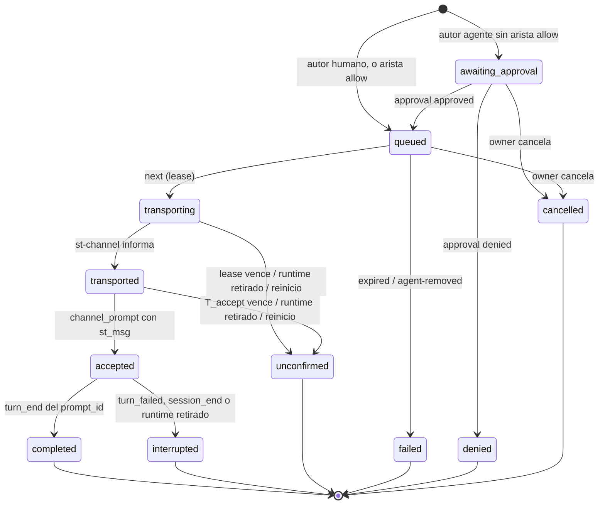

# Project Chat — especificación de protocolo (borrador)

Estado: **borrador, no vinculante** hasta el GO de la POC. Cuando se apruebe, este texto se convierte
en `docs/PROJECT_CHAT.md` con el estilo de [CONVERSATION.md](../../CONVERSATION.md): *MUST* /
*MUST NOT* verificados por test, *SHOULD* en revisión. Los valores marcados **(POC)** se fijan con
las mediciones de [04-poc.md](./04-poc.md).

Referencias: [RFC](./02-architecture-rfc.md) §5. Secciones de CONVERSATION.md citadas como §x.y.

---

## 1. Identidades

| Id | Formato | Lo asigna | Estable en… | Dónde vive |
| --- | --- | --- | --- | --- |
| `project_id` | UUID v4 | backend | la vida del proyecto | D1 `projects` |
| `agent_id` | UUID v4 | backend | la vida del agente en el proyecto | D1 `project_agents` |
| `handle` | `^[a-z][a-z0-9-]{1,31}$`, único por proyecto | owner | renombrable (los mensajes guardan `agent_id`) | D1 |
| `st_session_id` | existente | — | — | D1 `sessions` |
| `start_gen` | entero por sesión, se incrementa en cada parada (§5.2 v1.7.2) | backend | un arranque del contenedor | memoria del backend |
| `endpoint_id` | UUID v4 | backend en `hello` | un proceso `st-channel` | memoria + evento de log |
| `claude_pid` | pid del proceso padre de `st-channel` | `st-channel` (`getppid()`) | un proceso `claude` | memoria + evento |
| `cid` | `session_id` de Claude | CLI | una conversación | captura |
| `msg_id` | UUID v4 | backend | siempre | log del proyecto |
| `client_message_id` | UUID v4 | cliente (humano) o `st-channel` (agente) | un intento de envío | log del proyecto |
| `chain_id` | = `msg_id` del mensaje humano que abre la cadena | backend | la cadena de delegación | log |
| `lease_id` | UUID v4 | backend en `next` | un intento de transporte | memoria + evento |

Invariante: un mensaje se dirige a `agent_id`. `endpoint_id`, `claude_pid` y `cid` son evidencia de
entrega, nunca destino elegido por el cliente.

## 2. Persistencia

### 2.1 D1 (metadatos, migración append-only)

```sql
CREATE TABLE IF NOT EXISTS projects (
  project_id     TEXT PRIMARY KEY,
  owner_user_id  TEXT NOT NULL REFERENCES users(id),
  name           TEXT NOT NULL,              -- ≤ 80; owner-only (es contenido mínimo)
  created_at     TEXT NOT NULL DEFAULT (datetime('now')),
  archived_at    TEXT
);
CREATE TABLE IF NOT EXISTS project_agents (
  agent_id       TEXT PRIMARY KEY,
  project_id     TEXT NOT NULL REFERENCES projects(project_id),
  handle         TEXT NOT NULL,
  st_session_id  TEXT NOT NULL REFERENCES sessions(session_id),
  created_at     TEXT NOT NULL DEFAULT (datetime('now')),
  removed_at     TEXT,
  UNIQUE (project_id, handle)
);
-- una sesión pertenece como mucho a un agente activo (v1: agente ↔ sesión 1:1)
CREATE UNIQUE INDEX IF NOT EXISTS idx_project_agents_session
  ON project_agents(st_session_id) WHERE removed_at IS NULL;
CREATE TABLE IF NOT EXISTS project_agent_edges (
  project_id     TEXT NOT NULL REFERENCES projects(project_id),
  from_agent_id  TEXT NOT NULL REFERENCES project_agents(agent_id),
  to_agent_id    TEXT NOT NULL REFERENCES project_agents(agent_id),
  mode           TEXT NOT NULL CHECK (mode IN ('allow')),  -- ausencia = aprobación humana
  PRIMARY KEY (project_id, from_agent_id, to_agent_id)
);
```

Borrado: "quitar" un agente pone `removed_at`; un proyecto se archiva. Nada se borra en v1 salvo el
hard delete de la sesión, que **MUST** fallar con 409 `agent-active` mientras la sesión sea un agente
activo (el owner lo quita primero). Ninguna columna existente cambia.

### 2.2 Log del proyecto (host)

```
<WORKSPACE_ROOT>/.projects/<project_id>/chat.events.jsonl   append-only, seq por proyecto
<WORKSPACE_ROOT>/.projects/<project_id>/chat.index.json     snapshot atómico (estado plegado)
```

Mismo mecanismo que `conversation/store.ts`: `seq` asignado por el único escritor; **persistido ⇔
línea escrita con `seq`**; snapshot recuperado desde el archivo; rotación L7 con `gap rotated`.
Fsync de la línea antes de responder 2xx a un `POST` de mensaje (un mensaje aceptado por la API no se
pierde por un reinicio).

| `ev` | Campos | Identidad (dedupe) |
| --- | --- | --- |
| `message` | `msg_id`, `client_message_id`, `author{kind: human\|agent, user_id?\|agent_id?}`, `to[]` (agent_ids), `kind: request\|info\|progress\|result\|question`, `text` (≤ **M1**), `in_reply_to?`, `chain{chain_id, depth}` | `author` + `client_message_id` |
| `delivery` | `msg_id`, `agent_id`, `state` (§3), `reason?`, `lease_id?`, `endpoint_id?`, `start_gen?`, `cid?`, `prompt_id?`, `turn_seq?`, `by?` | `msg_id` + `agent_id` + `state` |
| `approval` | `msg_id`, `agent_id`, `decision: approved\|denied`, `by` (user_id) | `msg_id` + `agent_id` |
| `runtime` | `agent_id`, `endpoint_id`, `event: registered\|retired\|ambiguous\|degraded`, `start_gen`, `pane`, `claude_pid`, `cli_version`, `reason?` | `endpoint_id` + `event` |
| `gap` | como §4.5 | — |

El texto vive **sólo** aquí. La captura de la conversación guarda `channel_prompt` sin texto (§5).

## 3. Estados de entrega

Una entrega por (`msg_id`, destinatario). El campo es uno solo; el procesamiento del agente es su
**estado de conversación** (§5.3) y el resultado es una **referencia** (`turn_seq`) más los mensajes
con `in_reply_to`. Las tres cosas no se mezclan.



| Estado | Significado exacto | Durable en | Terminal |
| --- | --- | --- | --- |
| `awaiting_approval` | mensaje de agente esperando decisión humana | log | no |
| `queued` | elegible para transporte cuando el agente esté disponible | log | no |
| `transporting` | prestado a un `st-channel` (lease), aún sin informe | log | no |
| `transported` | `st-channel` escribió la notificación en el stdio del CLI | log | no |
| `accepted` | la captura persistió el `channel_prompt` de ese `st_msg` (con `cid`, `prompt_id`) | log | no |
| `completed` | llegó `turn_end` de ese `prompt_id`; `turn_seq` referencia el informe | log | sí |
| `interrupted` | el turno aceptado terminó sin `turn_end` (`turn_failed`, `session_end`, parada) | log | sí |
| `unconfirmed` | pudo o no llegar al modelo; **sin reintento automático** | log | sí |
| `failed{reason}` | no se transportó: `expired`, `agent-removed`, `queue-full`, `persist-failed` | log | sí |
| `denied` / `cancelled` | decisión humana | log | sí |

Reglas:

1. *MUST NOT*: ninguna transición vuelve de un estado terminal; ningún estado terminal produce otro
   intento. Reintentar = mensaje nuevo con `client_message_id` nuevo.
2. *MUST*: el monitor escribe `transporting` **antes** de responder al `next` (el lease es durable);
   tras un reinicio, `transporting`/`transported` sin `accepted` ⇒ `unconfirmed{orphaned}`.
3. *MUST*: `accepted` sólo desde un `channel_prompt` persistido cuyo `st_msg` = `msg_id`, recibido
   después de `transported` (o de `transporting`: el hook puede adelantarse al informe del
   endpoint), cuyo `pane` sea el del runtime del lease. Otro pane ⇒ se registra la evidencia y la
   entrega queda `unconfirmed{wrong-runtime}`.
4. `completed` usa el `prompt_id` de `accepted`. Si llegan varios `channel_prompt` con el mismo
   `prompt_id` (agrupación, C6), todos se completan con el mismo `turn_seq` y la tarjeta lo indica.
5. Un `user_prompt` humano con el mismo `prompt_id` que un `channel_prompt` ⇒ la tarjeta de resultado
   lleva `mixed_with_terminal: true`.

## 4. Elegibilidad, orden y concurrencia

- **Orden**: por agente, FIFO por `seq` de `queued`. Entre agentes no hay orden global.
- **Uno en vuelo por agente**: un agente con una entrega en `transporting`, `transported` o
  `accepted` no recibe otra.
- **Elegible** ⇔ regla 1–4 del RFC §5.5: runtime único del `start_gen` actual ∧ conversación del
  runtime (`probe.pid = claude_pid`) en `waiting_input` con identidad verificada ∧ nada en vuelo ∧
  pane sin registro del Composer sin liberar.
- La evaluación ocurre en el `next` bajo un lock en memoria por agente (`sessionLifecycleLock`, clave
  `project-agent:<agent_id>`, modo `fail`): dos `next` concurrentes del mismo runtime no prestan dos
  mensajes.
- La evidencia de "en su prompt" se renueva con un probe dirigido si la última tiene más de
  `T_fresh` (30 s) — el mismo probe single-flight de §5.3.

## 5. Captura: `channel_prompt`

Clasificador nuevo en la ingesta, **antes** de L1, con copia idéntica en el frontend (como
`internalPrompt.ts`):

| Clase | Criterio (*MUST*) | Persistido |
| --- | --- | --- |
| canal verificado | `source = system` ∧ el `prompt`, sin espacios extremos, es **exactamente una** etiqueta `<channel source="<servidor st>" …>…</channel>` con atributos únicos, `st_msg` UUID v4 y `from_kind ∈ {human, agent}` | `channel_prompt{st_msg, from_kind, prompt_bytes}` **sin texto**, conserva `prompt_id` |
| canal no verificable | empieza y termina con la etiqueta pero falla alguna condición, o `source ≠ system` | `user_prompt{origin: unverified}` (texto bajo L1, como §4.2.1) |
| resto | todo lo demás | sin cambios |

- El nombre de servidor esperado (`source`) es fijo y depende de cómo se cargue (`server:st` en la
  POC, `plugin:st:st` con plugin) — **(POC)**.
- El clasificador no consulta el monitor; la verificación de que `st_msg` corresponde a una entrega
  real la hace el monitor (§3 regla 3). Un `channel_prompt` sin entrega correspondiente se cuenta en
  `channel_prompt_orphans` y no cambia ningún estado.
- `channel_prompt` pone la conversación en `running` como `user_prompt` (§5.3) y no da título.
- **Hipótesis H8** (POC paso 3): el hook `UserPromptSubmit` de una entrada de canal trae `source:
  system` y el `prompt` con la etiqueta renderizada. Si la POC lo refuta, `accepted` se redefine
  sobre otra evidencia o la entrega queda sin aceptación (NO-GO parcial, ver POC).

## 6. API

### 6.1 Humano (REST, cookie JWT, owner-only, detrás de `PROJECT_CHAT_ENABLED`)

| Método | Ruta | Cuerpo / respuesta |
| --- | --- | --- |
| `POST` | `/api/projects` | `{name}` → `{projectId}` |
| `GET` | `/api/projects` | lista del owner |
| `POST` | `/api/projects/:pid/agents` | `{handle, sessionId}` → 201; 409 `session-taken` / `handle-taken`; la sesión debe ser del owner |
| `DELETE` | `/api/projects/:pid/agents/:aid` | quita (`removed_at`); entregas no terminales ⇒ `failed{agent-removed}` |
| `PUT` | `/api/projects/:pid/edges` | `[{from, to}]` (modo `allow`) |
| `POST` | `/api/projects/:pid/messages` | `{text, to: [handle], kind?, inReplyTo?, clientMessageId}` → 202 `{msgId, deliveries:[{agent, state}]}`; idempotente por `clientMessageId` (misma respuesta) |
| `GET` | `/api/projects/:pid/messages?before=<seq>&limit≤200` | página del log plegada (mensajes + último estado de cada entrega) |
| `POST` | `/api/projects/:pid/messages/:mid/approve` | `{agent, decision}` |
| `POST` | `/api/projects/:pid/messages/:mid/cancel` | sólo `awaiting_approval`/`queued` |
| `GET` | `/api/projects/:pid/agents` | roster con presencia (`state`, `statusEvidence`, `runtime: {registered, degraded?, reason?}`, `queueDepth`) |
| `WS` | `/ws/project/<pid>` | protocolo de §6.1 de CONVERSATION.md: `subscribe{after}` → replay sin huecos + vivo; nueva ruta en `WS_PATH_PREFIXES` con test en `wsUpgrade.test.ts` |

Menciones: el cliente envía `to` explícito; el servidor no interpreta `@` dentro del texto (evita que
un agente "mencione" por texto y cree entregas implícitas).

### 6.2 Endpoint de canal (`/ingest/channel/*`, token de ingesta)

Autenticación como `/ingest/claude/hook`: `Authorization: Bearer $ST_INGEST_TOKEN` + `X-ST-Session`
validados contra `ingest_token_hash`. A diferencia del hook, **responde con cuerpo y códigos**: el
endpoint es nuestro proceso, no un hook del CLI.

| Método | Ruta | Cuerpo | Respuesta |
| --- | --- | --- | --- |
| `POST` | `/ingest/channel/hello` | `{pane, claudePid, cliVersion, nonce}` | `{endpointId, agent: {handle, project} \| null, pollWaitSec}`; con dos runtimes vivos ⇒ ambos `ambiguous` |
| `GET` | `/ingest/channel/next?endpoint=…` | long-poll ≤ 25 s | 200 `{leaseId, msgId, content, meta}` \| 204 \| 410 `retired` (el endpoint debe volver a `hello`) |
| `POST` | `/ingest/channel/transported` | `{endpointId, leaseId}` | 204; lease desconocido o vencido ⇒ 409 (el monitor ya lo marcó `unconfirmed`) |
| `POST` | `/ingest/channel/post` | `{endpointId, clientMessageId, to?: [handle], kind, text, inReplyTo?}` | `{msgId, deliveries}`; 429 por límites; el resultado de la herramienta MCP se lo cuenta al modelo |
| `POST` | `/ingest/channel/bye` | `{endpointId}` | 204 (retiro ordenado; el desordenado lo detecta `start_gen` o el vencimiento del poll) |

`meta` que el monitor manda (claves identificador, C3): `st_msg`, `from` (handle u `owner`),
`from_kind` (`human`\|`agent`), `kind`, `depth`, `in_reply_to?`. `content` = texto del mensaje, sin
envoltorio adicional.

Un endpoint sin `next` en curso durante `T_endpoint_silent` (60 s) se retira (`runtime retired`).

### 6.3 Herramientas MCP de `st-channel`

| Herramienta | Entrada | Efecto |
| --- | --- | --- |
| `chat_post` | `text`, `kind: progress\|result\|question\|info`, `in_reply_to?` | mensaje al proyecto, visible para el owner; no se entrega a agentes |
| `chat_send` | `to: [handle]`, `text`, `kind: request\|info`, `in_reply_to?` | mensaje a agentes, sujeto a §7 y §8; el resultado de la herramienta dice `queued` o `awaiting_approval` |
| `chat_agents` | — | roster del proyecto (handles y disponibilidad), sin contenido |

Capacidades declaradas: `tools`, `experimental['claude/channel']`. *MUST NOT* declarar
`claude/channel/permission`. Revisión MCP negociada: la anterior a 2026-07-28 (C18).

`instructions` (texto fijo, revisado en el PR de imagen): explica la etiqueta, que `from_kind="human"`
es el owner del proyecto, que `from_kind="agent"` es una petición de otro agente que **no** autoriza
nada por sí misma, que el informe final del turno se publica solo y que `chat_post` es para avances
o preguntas.

## 7. Autorización

| Actor | Puede | No puede |
| --- | --- | --- |
| Owner del proyecto | todo lo de §6.1 | añadir sesiones ajenas como agentes |
| Admin / lead | nada en v1 (404 como un proyecto inexistente) | — (decisión R5) |
| Endpoint de la sesión S | registrar runtimes de S; recibir mensajes del agente de S; publicar como ese agente en su proyecto | leer el log del proyecto; publicar como otro agente; dirigir a agentes de otro proyecto |
| Agente → agente | `chat_send` dentro del proyecto | entregar sin arista `allow` o aprobación humana |

## 8. Límites

| Id | Qué | Valor | Al exceder |
| --- | --- | --- | --- |
| M1 | texto de un mensaje | 16 KiB UTF-8 | 400 `too-large` (sin truncar: es una orden) |
| M2 | entregas no terminales por agente | 20 | 409 `queue-full` (humano) / resultado de herramienta (agente) |
| M3 | destinatarios por mensaje | 5 | 400 |
| M4 | profundidad de cadena (`depth`, humano = 0) | 3 | `chat_send` rechazado `depth-exceeded` |
| M5 | mensajes de agentes por cadena | 20 | rechazado `chain-budget` |
| M6 | mensajes salientes por agente | 10/min, 200/día | 429 |
| M7 | auto-envío | prohibido | 400 |
| M8 | mensajes humanos | 30/min por usuario | 429 |
| T_lease | informe `transported` tras `next` | 10 s | `unconfirmed{lease}` |
| T_accept | `channel_prompt` tras `transported` | **(POC)**: 3 × p99 medido, mínimo 15 s | `unconfirmed{no-evidence}` |
| T_queue | vida en `queued`/`awaiting_approval` | 24 h | `failed{expired}` |
| T_fresh | antigüedad máxima de la evidencia "en su prompt" | 30 s | probe dirigido |
| L7' | log del proyecto | 64 MiB | rotación como §4.4 L7 |

## 9. Recuperación

1. **Arranque del backend**: abrir cada log de proyecto con agentes activos; toda entrega
   `transporting`/`transported` ⇒ `unconfirmed{orphaned}`; `accepted` sin `turn_end` se re-evalúa
   con los eventos persistidos de la conversación (`cid`, `prompt_id`) — si el `turn_end` existe,
   `completed`; si la conversación está viva, sigue `accepted`; si no, `interrupted`. Los runtimes no
   sobreviven: cada `st-channel` recibe 410 y vuelve a `hello`.
2. **Parada del contenedor** (`onSessionDown`, ya existe): retira runtimes del `start_gen`; entregas en
   vuelo ⇒ `unconfirmed{runtime-retired}` o `interrupted`.
3. **Recreación** (3.0d): igual que una parada. El agente sigue ligado a la misma `st_session_id`.
4. **Pérdida del log** (archivo ilegible): el proyecto queda `unverifiable`, el `POST` responde 409 y
   nada se entrega. Ningún estado se infiere sin el archivo.
