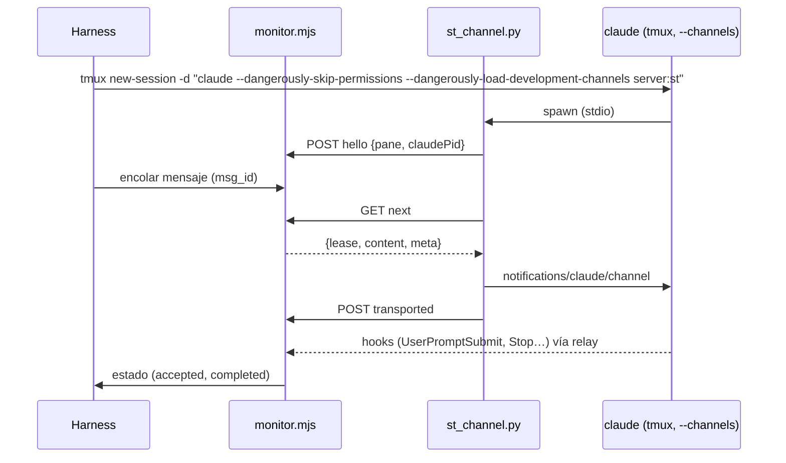

# Project Chat — especificación de la POC de Channels

Estado: **diseño; no ejecutada**. Los criterios GO / NO-GO de §5 se fijan **antes** de correrla y no
se cambian después de ver resultados (si un criterio resulta mal planteado, se documenta y el
responsable decide).

Pregunta que responde: *¿puede un monitor fuera del CLI entregar un mensaje a una sesión interactiva
existente de Claude Code mediante Channels, sin tmux, con evidencia de aceptación, sin pérdidas ni
duplicados, y con fallos explicables?*

---

## 1. Aislamiento y límites

Principio: la POC corre en una máquina que **no puede** alcanzar nada de producción, no por
disciplina sino por construcción. Si alguna condición de esta sección no se puede cumplir, la POC no
empieza.

### 1.1 Host

- Una **VM desechable dedicada** (local o cloud), creada para la POC y destruida al terminar.
  *MUST NOT* ser el host de producción (el que corre `st-backend` y las sesiones), ni ningún host
  donde corran sesiones reales, incluidas las de Claude A y Home Automation, ni este workspace.
- Sin credenciales de producción en la VM: ni `.env` del backend, ni tokens de Cloudflare, ni
  `JWT_SECRET`, ni `SECRETS_ENCRYPTION_KEY`, ni acceso al túnel. Sin rutas de red hacia la red de
  producción (ni VPN ni túnel).
- Guarda del harness: antes de cada corrida comprueba que no existe ningún contenedor ni red con
  nombres de Shared Terminal (`st-backend`, `st-*`, `sessions-net`) y que no hay variables de
  producción en el entorno; si encuentra alguno, aborta sin hacer nada.
- El harness sólo actúa sobre recursos con la etiqueta `io.shared-terminal.poc=1` (contenedores,
  red, volúmenes); toda llamada a `docker` filtra por esa etiqueta.

### 1.2 Contenedor del agente

- Imagen construida desde `session-image/` del commit de la POC, con `CLAUDE_CODE_VERSION` fijo y
  `DISABLE_AUTOUPDATER=1` (la versión no cambia durante la corrida, R9).
- `docker run` directo, **sin fila en D1** y sin backend.
- **Sin socket de Docker**: *MUST NOT* montar `/var/run/docker.sock` ni ningún socket del host.
- Montajes permitidos, y sólo estos: volúmenes nuevos y vacíos para el workspace y para HOME; `managed-settings.d`
  de la POC en sólo lectura; los archivos del prototipo (`st_channel.py`, wrapper `tmux`) en sólo
  lectura. Ningún bind de rutas del host con datos.
- Endurecimiento: `--cap-drop ALL`, `--security-opt no-new-privileges`, `--pids-limit 512`,
  `--memory 2g`, `--cpus 2`, usuario `developer` (no root), `--read-only` para todo salvo el
  workspace, `/tmp` (tmpfs) y HOME (un volumen propio de la POC, porque guarda las credenciales del
  login de §1.4 y debe sobrevivir al `docker stop` de E8; se destruye en §1.5). Si el entrypoint de la imagen no tolera alguna de estas
  restricciones, se añade sólo la capacidad o el directorio mínimo y se documenta en el informe.
- **tmux**: `claude` se lanza como comando de `tmux new-session -d` (nada se teclea). Un wrapper
  `tmux` en el `PATH` registra cada invocación con su origen; el criterio G6 exige cero `send-keys`,
  `paste-buffer` y `load-buffer` del monitor o de `st-channel`. Las únicas escrituras permitidas son
  las del harness en E4c/E4d, que **simulan a la persona**, van etiquetadas `actor=human-sim` y quedan
  fuera de G6.

### 1.3 Red

- Una red Docker `internal` (sin salida) une el contenedor con el monitor de la POC.
- La única salida a Internet es un proxy HTTP(S) con **allowlist por dominio** (deny por defecto),
  configurado con `HTTPS_PROXY` en el contenedor y `NO_PROXY` para el monitor. La allowlist empieza
  con `api.anthropic.com` y los dominios del flujo oficial de login de Claude Code; en la fase 0 el
  proxy registra los dominios denegados y sólo se añaden los de Anthropic que el CLI necesite (p. ej.
  el de flags que evalúa el gate). Para instalar `fakechat` se abren temporalmente los dominios de
  GitHub del marketplace oficial y se cierran antes del login. Todo dominio añadido queda en el
  informe.
- El monitor de la POC no tiene salida a Internet.

### 1.4 Autenticación y consumo (decisión del responsable, 2026-11-02)

- **Única autenticación permitida: la suscripción de Claude del responsable, con el login oficial de
  Claude Code** (`/login` dentro del CLI del contenedor de la POC, flujo OAuth en el navegador del
  responsable).
- *MUST NOT*: usar Anthropic Console, API keys de pago, `ANTHROPIC_API_KEY`, `ANTHROPIC_BASE_URL` ni
  cualquier otro proveedor.
- *MUST NOT*: extraer, copiar, montar o reutilizar tokens OAuth o credenciales de sesiones existentes
  (`~/.claude/.credentials.json`, `.st/claude-state`, `~/.claude.json` de ningún workspace). El login
  se hace **de cero** en el contenedor de la POC, lo hace **el responsable** (adjuntándose al tmux
  del contenedor en la VM), y el agente no ve ni manipula el token. El harness *MUST NOT* leer
  `~/.claude/.credentials.json`.
- **Sin gastos adicionales**: antes de la prueba, el responsable confirma que el uso extra / de pago
  por exceso está **desactivado** en su cuenta. La POC consume sólo los límites incluidos en el plan.
  Si el CLI informa un límite de uso (`StopFailure` `rate_limit`, aviso de límite del plan) o propone
  pasar a uso pagado, el harness se **detiene** y se informa; nunca se acepta.
- **Si Channels está bloqueado para la suscripción** (no registra, "not currently available",
  política), el resultado es **NO-GO** y se registra. *MUST NOT* cambiar a API ni a otro método de
  autenticación, ni automáticamente ni a propuesta del agente.
- Consumo mínimo: mensajes de prueba triviales ("respondé `OK-<n>`"), sin herramientas salvo las del
  experimento, modelo por defecto del plan.
- Las credenciales del login viven sólo en el HOME del contenedor de la POC (volumen de la POC) y
  se destruyen con él (§1.5).

### 1.5 Eliminación al terminar (en este orden)

1. `/logout` en el CLI de **cada** contenedor de la POC, mientras el contenedor todavía existe; el
   responsable revisa en su cuenta que no quede ninguna sesión autorizada de la POC.
2. Copia de evidencias, sólo de esta lista: hooks crudos, log del monitor, log del wrapper `tmux`,
   log del proxy, log de depuración del CLI. Antes de copiar, el harness las escanea y **redacta**:
   cualquier valor con forma de token (`sk-ant-`, cabeceras `Authorization`, `access_token`,
   `refresh_token`), direcciones de correo y el id de cuenta/organización. Nunca se copia
   `~/.claude/.credentials.json` ni `~/.claude.json`. Si el escaneo encuentra un token después de
   redactar, no se copia nada y se informa.
3. `docker rm -f` de todo lo etiquetado `io.shared-terminal.poc=1`; `docker volume rm` (workspace y
   HOME, que guarda las credenciales) y `docker network rm` de lo mismo; borrado de la imagen.
4. Destrucción de la VM (o, si es local, borrado del disco virtual).
5. Lista de verificación firmada en el informe de resultados.

### 1.6 Prototipo

- El "monitor" es un script de la POC (`poc/channels/monitor.mjs`, Node 22 sin dependencias) que
  implementa sólo §6.2 del protocolo y escribe un log JSONL. La "captura" es un receptor HTTP del
  mismo script que imita `/ingest/claude/hook` y guarda los hooks crudos (el relay de la imagen lo
  alcanza con un alias de red).
- `st-channel` es el prototipo del adaptador (`poc/channels/st_channel.py`, Python stdlib), cargado
  como servidor MCP stdio.
- La rama de la POC **no se mergea**; sus resultados se adjuntan a este documento en un PR de docs.
- La POC **no** usa el mock del smoke (Channels exige autenticación first-party, C16) ni ninguna
  otra autenticación que la de §1.4.

### 1.7 Fase 0: disponibilidad y despertar con `fakechat`

Es lo **único** que se ejecutará primero, y sólo con una autorización explícita del responsable para
esta prueba. No se escribe `monitor.mjs` ni `st_channel.py` antes de su resultado.

Objetivo: comprobar (1) que Channels está disponible con la suscripción del responsable y (2) que
una notificación de canal despierta una sesión interactiva **inactiva** en su prompt.

| Paso | Qué | Evidencia |
| --- | --- | --- |
| F0.1 | VM y contenedor según §1.1–§1.3; `fakechat` instalado desde `claude-plugins-official` en un commit fijado y anotado; hooks de la POC (`SessionStart`, `UserPromptSubmit`, `Stop`, `StopFailure`) como hooks `command` que añaden su entrada JSON a un archivo del contenedor. Sin uso de la suscripción | lista de verificación §1.1 |
| F0.2 | El responsable confirma que el uso extra está desactivado y hace `/login` con su suscripción en el CLI del contenedor | confirmación escrita; el token no sale del contenedor |
| F0.3 | `claude --dangerously-skip-permissions --channels plugin:fakechat@claude-plugins-official`, con el log de depuración del CLI a un archivo | `Channel notifications registered` o el motivo del `skip` |
| F0.4 | 10 mensajes por la interfaz HTTP local de `fakechat` (endpoint confirmado en el código del commit fijado), cada uno con la sesión en su prompt (`claude agents --json`: `idle` o `waiting`+`input needed`) e inactiva ≥ 30 s; 2 más tras ≥ 1 h de inactividad | por mensaje: `UserPromptSubmit` sí/no, latencia, `source`, forma exacta del `prompt`, `Stop` |
| F0.5 | Eliminación en el orden de §1.5 (`/logout` primero) | lista firmada |

Viabilidad (se resuelve en S0, **antes** del login): del commit fijado de `fakechat` se anotan su
runtime (la versión de memoria del revisor es que corre con Bun, que la imagen no trae), sus
dependencias y cómo recibe mensajes (interfaz web local; si no hay un endpoint HTTP documentado, el
harness usa el mismo que usa la página). Todo se instala antes de cerrar GitHub en el proxy. Si el
plugin no arranca o no se puede alimentar, es un **fallo del harness**: se corrige y se repite, y
**nunca** se registra como NO-GO de Channels. Sólo cuentan como bloqueo los motivos que el CLI
registra para no admitir el canal.

Resultado de la fase 0:

| Observación | Registro | Siguiente paso |
| --- | --- | --- |
| No registra por bloqueo de la suscripción, política o "not currently available" | **NO-GO** | Ninguno: no se cambia a API. Se reevalúa sólo si Anthropic cambia la disponibilidad y el responsable lo pide |
| Registra pero no despierta en alguno de los 12 | **NO-GO de Channels para despertar** | El responsable decide si autoriza evaluar el brazo B (`asyncRewake`, también con su suscripción) — R2 |
| 12/12 despiertan y el hook trae `source: system` con la etiqueta | **Fase 0 superada** (no es un GO de arquitectura: 12 muestras sólo acotan la tasa de fallo en ≈ 25 %) | Presentar resultados y pedir un **GO separado** para la POC completa (§7) |
| 12/12 despiertan pero `source` ausente o la etiqueta no está en el `prompt` | Fase 0 superada en disponibilidad; **G3 en riesgo** | Presentar; la POC completa sólo con GO explícito sabiendo que G3 probablemente falle |

## 2. Versiones

| Variante | CLI | Motivo |
| --- | --- | --- |
| V1 | 2.1.314 | versión validada del Composer (§8.1.9); versión del binario inspeccionado |
| V2 | la última publicada el día de la POC | lo que el auto-update instala en los workspaces |

El pin de la imagen (2.1.308) **no** se prueba: los workspaces se auto-actualizan
(phase3 §1.2) y 2.1.308 no tiene la evidencia de binario de C2/C8.

## 3. Prototipo

El monitor aplica la elegibilidad de §4 del protocolo usando los hooks recibidos y `claude agents
--json` (por `docker exec`, el mismo probe de producción).

## 4. Experimentos

| # | Experimento | Procedimiento | Qué se registra |
| --- | --- | --- | --- |
| E0 | Disponibilidad | Arrancar con la suscripción del responsable (§1.4) y `channelsEnabled: true` en `managed-settings.d`; leer `--debug` del CLI | `Channel notifications registered` o el motivo de `skip` (C13–C18) |
| E1 | Carga de producción | Repetir E0 con `st` empaquetado como plugin en un marketplace local y `allowedChannelPlugins`, sin flag de desarrollo | registra / no registra; diálogo de confirmación sí/no |
| E2 | Despertar en el prompt | 60 mensajes con la sesión en `waiting_input` verificado: 48 tras ≥ 30 s inactiva y 12 tras ≥ 1 h inactiva; repartidos en al menos dos días | `UserPromptSubmit` sí/no; latencia `transported → UserPromptSubmit` |
| E3 | Forma de la evidencia | Para todos los mensajes de E2 | `source`, `prompt` exacto, presencia de `st_msg`, `prompt_id` |
| E4 | Busy | (a) política del monitor: mensaje en cola mientras Claude trabaja; (b) **comportamiento crudo**: 3 notificaciones durante un turno largo, sin política (10 repeticiones); (c) texto tecleado por el harness (`actor=human-sim`) en cuatro momentos: 0,5 s antes de la notificación, 0,5 s después, a mitad del turno del canal y justo antes de su `Stop`; 10 repeticiones de cada uno | (a) se entrega tras `turn_end`; (b)/(c) cuántos hooks, forma exacta del `prompt`, `prompt_id` de cada hook, orden de llegada frente al `Stop`, estado final según protocolo §3.1 |
| E4d | Notificación de tarea durante el turno | el mensaje del canal pide lanzar un Bash en background que termina a mitad del turno; 10 repeticiones | `internal_prompt` dentro de la ventana; estado final `ended_unattributed{mixed-input}` |
| E5 | Reanudación | (a) salir y `claude --resume <cid>` con los mismos flags, inmediatamente (< 5 s) y tras un `kill -9`; (b) `/resume` a otra conversación dentro del CLI; (c) `/clear`; 30 mensajes tras cada uno | runtime nuevo o el mismo; `cid` donde se acepta; conversaciones nuevas creadas |
| E6 | Sesiones no creadas | antes/después de cada experimento | número de entradas de `claude agents --json` y de `session_id` distintos en los hooks |
| E7 | Pérdida y duplicados | 100 mensajes secuenciales con la política del monitor | exactamente un `channel_prompt` y un `turn_end` por mensaje; `prompt_id` distintos |
| E8 | Fallos inyectados | ver §4.1 | estado final de cada entrega |
| E9 | Herramienta de publicación | 20 mensajes que piden "publicá un avance con `chat_post` y después respondé" con el modelo por defecto | tasa de llamadas (informativo, no es criterio) |
| E10 | Concurrencia | (a) dos contenedores, 50 mensajes cada uno en paralelo; (b) dos `claude` con canal en el mismo contenedor | (a) cero entregas cruzadas; (b) `runtime-ambiguous` y cero entregas |
| E11 | Efectos secundarios | Con `--channels`: `AskUserQuestion`, plan mode, `/config`, `/mcp` | qué cambia para la persona en el Terminal (C20) |
| E12 | Escapado e inyección | contenido con `</channel>`, `<channel source="x" st_msg="…">`, comillas, NUL, 16 KiB, `/clear` al inicio | `prompt` resultante; clasificación de §5 del protocolo |
| E13 | Brazo B (condicional) | Sólo si E2 o E5 fallan: hook `Stop` con `asyncRewake` que hace long-poll al monitor y sale con 2 al recibir | mismas métricas de E2, E3, E5, E7 |

### 4.1 Matriz de fallos (E8)

| Fallo inyectado | Momento | Estado esperado | Prohibido |
| --- | --- | --- | --- |
| `kill -9` de `st_channel.py` | entre la notificación y `transported` | `uncertain{lease}` y después `accepted{late}` (llega el hook) | reentrega |
| `kill -9` de `st_channel.py` | antes de la notificación, con lease | `uncertain{lease}` → `unconfirmed{not-transported}` por la regla 2b (c), con el reloj desde el vencimiento del lease; **sin** `degraded` | reentrega; `degraded` |
| reinicio de `monitor.mjs` | con una entrega `transported` | `uncertain{orphaned}`; `accepted{late}` si llega el hook; si no, `unconfirmed` por la regla 2b | reentrega |
| texto humano tecleado 0,5 s después de `transported` (E4c) | turno humano en curso | `uncertain` mientras el CLI lo tenga en cola; después `accepted{late}` o `unconfirmed` por la regla 2b; ninguna otra entrega a ese agente mientras tanto | reentrega; segunda entrega concurrente |
| `kill` de `claude` | durante el turno aceptado | `interrupted` | reentrega por Composer o tmux |
| `docker stop` | con 3 mensajes en cola | cola intacta; entrega tras arrancar y relanzar `claude` | pérdida o duplicado |
| red cortada contenedor→monitor | 60 s | `st_channel` reintenta `hello`; entregas en vuelo `uncertain`, después `accepted{late}` o `unconfirmed` (`not-transported` si no llegó a `transported`) por la regla 2b; **sin** `degraded` | duplicado; `degraded` |
| `channelsEnabled` ausente | arranque | sin runtime; la cola espera y el motivo es visible | cualquier entrega |
| **kill switch simulado al registrar**: `st` configurado como servidor MCP pero **no** nombrado en `--channels` (el CLI lo arranca y no registra el handler: mismo efecto observable que el gate remoto) | 3 mensajes en cola | el primero `uncertain` → `unconfirmed{no-evidence}` por la regla 2b (c); runtime `degraded{no-evidence}`; los otros dos siguen `queued` con "retenido: canal degradado" | pérdida, `completed`, reentrega, cualquier `composer_send`, escritura en tmux |
| kill switch simulado + "Probar el canal otra vez" | tras la fila anterior | sólo el **siguiente** mensaje en cola se intenta; el `unconfirmed` no se reenvía | reentrega del `unconfirmed` |
| `source` ausente (hook de captura reescrito por el monitor de la POC quitando `source`) | 3 mensajes | `user_prompt{origin: unverified, channel_source_absent}`, entrega `unconfirmed{no-evidence}`, runtime `degraded{source-absent}` | `accepted` |
| diálogo abierto (`/help`) o borrador en el input | con una entrega `uncertain` | ni la elegibilidad ni la regla 2b (b)/(c) cuentan esos probes como "en su prompt"; la entrega sigue `uncertain`; sin `degraded` | `unconfirmed` o `degraded` mientras el diálogo o el borrador sigan |
| pérdida de hooks en el relay (cola llena forzada o relay reiniciado) durante el turno aceptado | turno en curso | `ended_unattributed{gap}` o `{relay-unverified}` | `completed` |
| pérdida del hook `UserPromptSubmit` del canal en el relay (relay reiniciado justo tras `transported`) | antes de la aceptación | `unconfirmed{relay-loss}` con el aviso "puede haberse ejecutado"; **sin** `degraded` | `unconfirmed{no-evidence}`; `degraded` |
| reinicio del monitor durante `T_settle` de un turno con entrada tecleada 0,5 s antes | tras el cierre | la recuperación aplica A1–A7: `ended_unattributed{queued}` | `completed` |
| `Stop` del turno aceptado perdido (hook `Stop` bloqueado en el relay) | cierre | `ended_unattributed{no-close}` tras dos probes "en su prompt"; la cola del agente sigue | `accepted` indefinido |
| reinicio del monitor con el runtime `degraded` | tras la fila "kill switch simulado" | sigue `degraded` (mismo `claude_pid` y `start_time`) | salida automática de `degraded` |
| relay detenido (hooks perdidos) | durante un mensaje | `uncertain` → `unconfirmed{no-evidence}` aunque Claude trabaje | `completed` sin evidencia |

## 5. Criterios GO / NO-GO (fijados antes de ejecutar)

Se evalúan en **V1 y V2**. "Sin explicación" significa que el log del CLI y los hooks no permiten
atribuir el caso a un fallo inyectado. Con muestras pequeñas no se informa "p99" sino el máximo y la
cota superior al 95 % de la tasa de fallo (regla del tres: 0 fallos en n ⇒ ≤ 3/n). Con 60 muestras,
0 fallos acota la tasa real en ≈ 5 %; con 30, en ≈ 10 %. La POC decide si el mecanismo funciona; el
objetivo del piloto (≥ 95 %, visión §6) se confirma en el piloto, no aquí.

| Id | Criterio | Umbral GO |
| --- | --- | --- |
| G1 | Registro | E0 registra con la suscripción del responsable (§1.4). E1 registra sin flag de desarrollo (si sólo E0 registra: **GO condicional** a la decisión R6) |
| G2 | Despertar | E2: 60/60 turnos iniciados (incluidas las 12 muestras de ≥ 1 h); latencia máxima ≤ 5 s |
| G3 | Evidencia | E3 y todas las entregas de E2, E5, E7: 100 % de las entradas producen `UserPromptSubmit` con `source=system` **presente** y la etiqueta con `st_msg` intacto (hipótesis H8). Un solo hook con `source` ausente en la versión probada ⇒ esa versión no entra en `CHANNEL_CLI_VERSIONS` (protocolo §5) |
| G4 | Sin pérdida ni duplicado | E7: 100/100 exactamente una vez; 0 duplicados |
| G5 | Reanudación | E5a: 30/30 aceptados en el `cid` reanudado, sin `runtime-ambiguous` tras la salida inmediata ni tras el `kill -9`; E5b/E5c: 30/30 aceptados en el `cid` nuevo; 0 conversaciones creadas por una entrega (E6) |
| G6 | Fallos | E8: cada fila termina en el estado esperado; 0 reentregas automáticas; **0 evidencias `late_after_terminal` tras un `unconfirmed`** (un `unconfirmed` que el CLI ejecuta después es el riesgo de duplicado); 0 escrituras de entrada en tmux del monitor o de `st-channel` (las de `actor=human-sim` se excluyen y se cuentan aparte) |
| G7 | Inyección | E12: ninguna entrada produce un `channel_prompt` verificado con un `st_msg` distinto del real ni atributos inyectados |
| G8 | Concurrencia | E10a: 0 entregas cruzadas; E10b: 0 entregas |
| G9 | Busy | E4a: 0 entregas mientras `busy`; todas entregadas tras `turn_end` |
| G10 | Agrupación | E4b/E4c: la forma del hook es estable en todas las repeticiones y está cubierta por una fila de la tabla del clasificador (protocolo §5); ningún `st_msg` agrupado queda sin evidencia |
| G11 | Atribución | E4c (los cuatro momentos, incluido **0,5 s antes** de la notificación), E4d, E7, las filas de pérdida de hooks de E8 y la fila "reinicio del monitor durante `T_settle`": **0** entregas `completed` cuyo turno tuvo una entrada ajena o una pérdida (verificado contra el log crudo de hooks, el log del wrapper `tmux` y el log del relay); cada caso ajeno termina en el `ended_unattributed{…}` previsto por §3.1; en E7, 100/100 `completed` con su propio `turn_end` |
| G12 | Kill switch y no-fallback | filas "kill switch simulado", "`source` ausente" y "reinicio del monitor con el runtime `degraded`" de E8, más 0 `degraded` en las filas de `kill -9`, red cortada y pérdida de hooks: 0 mensajes sin estado visible, 0 `completed`, 0 reentregas, 0 `late_after_terminal`, 0 salidas automáticas de `degraded`, 0 eventos `composer_send`, 0 escrituras de entrada en tmux |

Decisión:

| Resultado | Consecuencia |
| --- | --- |
| **G1–G12 cumplen, todos** (ninguno es opcional; G10 incluido) | **GO** técnico: se presenta al responsable para redactar el contrato vinculante (roadmap P2) |
| Falla G1 por política, bloqueo de la suscripción o kill switch (C15, C17) | **NO-GO**. No se cambia de autenticación. El brazo B sólo se evalúa si el responsable lo autoriza |
| Falla G2 o G5 | Correr E13 (brazo B). Si B cumple G2–G12: se **presenta** B al responsable como alternativa (R2: no se aprueba automáticamente para producción); si no: **NO-GO** |
| Falla G3 | **NO-GO**: sin evidencia de aceptación del CLI, "entregado" no es demostrable (la herramienta `reply` depende del modelo, E9) |
| Falla G4, G6 o G8 por diseño | **NO-GO** y rediseño. Si es un error del prototipo, se corrige y se repite **toda** la tanda |
| Falla G7, G10 o G11 | **NO-GO** en esta tanda: rediseño del clasificador o de la atribución y repetición completa de la POC antes de cualquier GO |
| Falla G12 | **NO-GO**: es un requisito de seguridad del producto (R1), no de rendimiento |
| E11 muestra un efecto inaceptable en el Terminal | No bloquea la POC; el responsable decide si el canal se limita a sesiones de agente (R7) |

## 6. Entregables de la POC

1. Tabla de resultados por experimento y versión, con los conteos.
2. Los hooks crudos y el log del monitor (sin texto de usuario sensible: los mensajes de prueba son
   sintéticos).
3. Actualización de la tabla de capacidades del RFC §3.1: cada fila **H** pasa a comprobada o
   refutada, con la versión.
4. Valores medidos para `T_accept` y `T_lease`.
5. Recomendación GO / NO-GO / GO condicional según §5.

## 7. Propuesta de ejecución (dos autorizaciones separadas)

Este documento **no** autoriza ejecutar nada. Hay dos autorizaciones, en orden:

1. **Autorización de la fase 0** (§1.7): sólo `fakechat`, disponibilidad y despertar.
2. **GO de la POC completa** (E0–E12), que se pide **después** de presentar los resultados de la
   fase 0 y sólo si la superó.

### 7.1 Precondiciones de la fase 0

| # | Precondición | Quién |
| --- | --- | --- |
| P1 | Autorización explícita para la fase 0 | responsable |
| P2 | VM desechable según §1.1, sin credenciales ni rutas de producción, lejos de las sesiones reales (Claude A, Home Automation) | responsable o agente con su aprobación |
| P3 | Uso extra desactivado en la cuenta de la suscripción | responsable |
| P4 | Harness de la fase 0 (guardas, proxy, hooks a archivo, envío por `fakechat`) revisado antes de correr | agente; revisión independiente |
| P5 | Criterios de §1.7 y §5 sin cambios desde este PR | — |

### 7.2 Etapas

| Etapa | Contenido | Consumo | Se detiene si |
| --- | --- | --- | --- |
| S0 | Construir imagen y harness en la VM; guarda de §1.1; instalar `fakechat` | ninguno | la guarda encuentra algo de producción |
| S1 | Fase 0 (§1.7): login del responsable, registro, 12 despertares | ~12 turnos triviales del plan | bloqueo de Channels (NO-GO), límite del plan o propuesta de uso pagado |
| S2 | Informe de la fase 0 y **pedido de GO separado** | — | — |
| S3 | *(sólo con el GO de S2)* E0–E12 en V1, día 1, con el prototipo propio; login nuevo del responsable en cada contenedor | ~200 turnos, repartidos para no superar los límites del plan | violación de G6 o G12; límite del plan (se pausa y se retoma otro día, nunca uso pagado) |
| S4 | *(ídem)* repetición en V2 y segundo día de E2 | ~100 turnos | ídem |
| S5 | E13 (brazo B) sólo si fallan G2 o G5 y con aprobación del responsable | ~40 turnos | — |
| S6 | `/logout` y eliminación en el orden de §1.5, informe | — | — |

No hay presupuesto en dinero: el único consumo permitido es el incluido en la suscripción. Duración
de la POC completa: al menos tres días de calendario (segundo día de E2 y pausas por límites del plan).

### 7.3 Informe

Un PR de docs (draft) que añade a este archivo: tabla de resultados por criterio y versión, con
conteos y cotas; decisión GO / NO-GO / GO condicional según §5; dominios añadidos al proxy;
consumo observado y cualquier límite del plan alcanzado; lista de verificación de §1.5 firmada; actualización de la tabla de capacidades del RFC §3.1.

