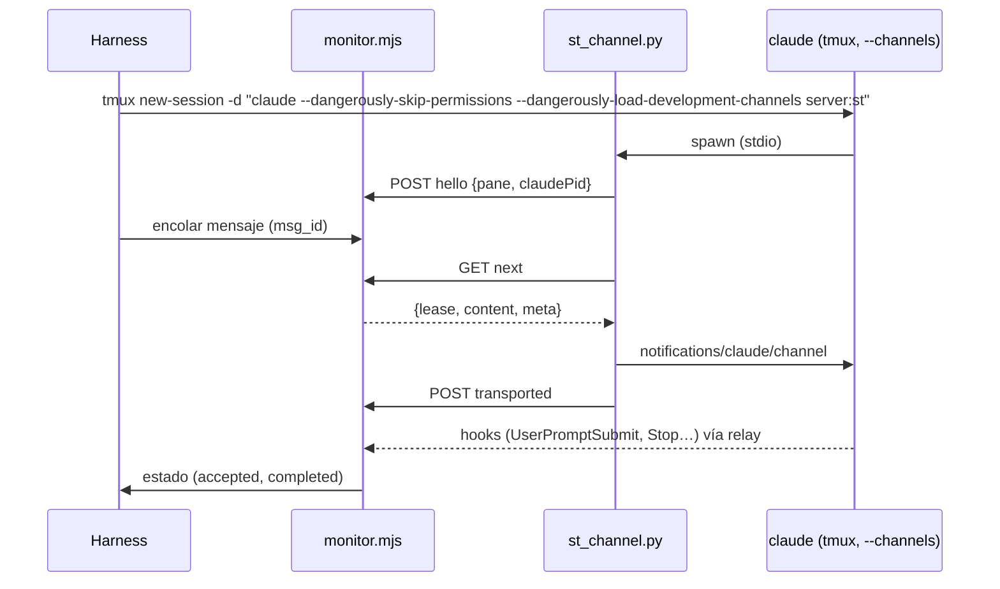

# Project Chat — especificación de la POC de Channels

Estado: **diseño; no ejecutada**. Los criterios GO / NO-GO de §5 se fijan **antes** de correrla y no
se cambian después de ver resultados (si un criterio resulta mal planteado, se documenta y el
responsable decide).

Pregunta que responde: *¿puede un monitor fuera del CLI entregar un mensaje a una sesión interactiva
existente de Claude Code mediante Channels, sin tmux, con evidencia de aceptación, sin pérdidas ni
duplicados, y con fallos explicables?*

---

## 1. Aislamiento y límites

Principio: la POC corre en una máquina que **no puede** alcanzar nada de producción, no por
disciplina sino por construcción. Si alguna condición de esta sección no se puede cumplir, la POC no
empieza.

### 1.1 Host

- Una **VM Linux x86_64 desechable**, en una **máquina físicamente independiente del Proxmox de
  producción** (preferencia del responsable, 2026-11-02), creada para la POC y destruida al terminar.
  *MUST NOT* ser el host de producción (el que corre `st-backend` y las sesiones), ni ningún host
  donde corran sesiones reales, incluidas las de Claude A, Home Automation y B, ni este workspace.
- Sin credenciales de producción en la VM: ni `.env` del backend, ni tokens de Cloudflare, ni
  `JWT_SECRET`, ni `SECRETS_ENCRYPTION_KEY`, ni acceso al túnel. Sin rutas de red hacia la red de
  producción (ni VPN ni túnel).
- Guarda del harness: antes de cada corrida comprueba que no existe ningún contenedor ni red con
  nombres de Shared Terminal (`st-backend`, `st-*`, `sessions-net`) y que no hay variables de
  producción en el entorno; si encuentra alguno, aborta sin hacer nada.
- El harness sólo actúa sobre recursos con la etiqueta `io.shared-terminal.poc=1` (contenedores,
  red, volúmenes); toda llamada a `docker` filtra por esa etiqueta.

### 1.2 Contenedor del agente

- Imagen construida desde `session-image/` del commit de la POC, con `CLAUDE_CODE_VERSION` fijo y
  `DISABLE_AUTOUPDATER=1` (la versión no cambia durante la corrida, R9).
- `docker run` directo, **sin fila en D1** y sin backend.
- **Sin socket de Docker**: *MUST NOT* montar `/var/run/docker.sock` ni ningún socket del host.
- Montajes permitidos, y sólo estos: volúmenes nuevos y vacíos para el workspace y para HOME; `managed-settings.d`
  de la POC en sólo lectura; los archivos del prototipo (`st_channel.py`, wrapper `tmux`) en sólo
  lectura. Ningún bind de rutas del host con datos.
- Endurecimiento: `--cap-drop ALL`, `--security-opt no-new-privileges`, `--pids-limit 512`,
  `--memory 2g`, `--cpus 2`, usuario `developer` (no root), `--read-only` para todo salvo el
  workspace, `/tmp` (tmpfs) y HOME (un volumen propio de la POC, porque guarda las credenciales del
  login de §1.4 y debe sobrevivir al `docker stop` de E8; se destruye en §1.5). Si el entrypoint de la imagen no tolera alguna de estas
  restricciones, se añade sólo la capacidad o el directorio mínimo y se documenta en el informe.
- **tmux**: `claude` se lanza como comando de `tmux new-session -d` (nada se teclea). Un wrapper
  `tmux` en el `PATH` registra cada invocación con su origen; el criterio G6 exige cero `send-keys`,
  `paste-buffer` y `load-buffer` del monitor o de `st-channel`. Las únicas escrituras permitidas son
  las del harness en E4c/E4d, que **simulan a la persona**, van etiquetadas `actor=human-sim` y quedan
  fuera de G6.

### 1.3 Red

- Una red Docker `internal` (sin salida) une el contenedor con el monitor de la POC.
- La única salida a Internet es un proxy HTTP(S) con **allowlist por dominio** (deny por defecto),
  configurado con `HTTPS_PROXY` en el contenedor y `NO_PROXY` para el monitor. La allowlist empieza
  con `api.anthropic.com` y los dominios del flujo oficial de login de Claude Code; en la fase 0 el
  proxy registra los dominios denegados y sólo se añaden los de Anthropic que el CLI necesite (p. ej.
  el de flags que evalúa el gate). Para instalar `fakechat` se abren temporalmente los dominios de
  GitHub del marketplace oficial y se cierran antes del login. Todo dominio añadido queda en el
  informe.
- El monitor de la POC no tiene salida a Internet.

### 1.4 Autenticación y consumo (decisión del responsable, 2026-11-02)

- **Única autenticación permitida: la suscripción de Claude del responsable, con el login oficial de
  Claude Code** (`/login` dentro del CLI del contenedor de la POC, flujo OAuth en el navegador del
  responsable).
- *MUST NOT*: usar Anthropic Console, API keys de pago, `ANTHROPIC_API_KEY`, `ANTHROPIC_BASE_URL` ni
  cualquier otro proveedor.
- *MUST NOT*: extraer, copiar, montar o reutilizar tokens OAuth o credenciales de sesiones existentes
  (`~/.claude/.credentials.json`, `.st/claude-state`, `~/.claude.json` de ningún workspace). El login
  se hace **de cero** en el contenedor de la POC, lo hace **el responsable** (adjuntándose al tmux
  del contenedor en la VM), y el agente no ve ni manipula el token. El harness *MUST NOT* leer
  `~/.claude/.credentials.json`.
- **Sin gastos adicionales**: antes de la prueba, el responsable confirma que el uso extra / de pago
  por exceso está **desactivado** en su cuenta. La POC consume sólo los límites incluidos en el plan.
  Si el CLI informa un límite de uso (`StopFailure` `rate_limit`, aviso de límite del plan) o propone
  pasar a uso pagado, el harness se **detiene** y se informa; nunca se acepta.
- **Si Channels está bloqueado para la suscripción** (no registra, "not currently available",
  política), el resultado es **NO-GO** y se registra. *MUST NOT* cambiar a API ni a otro método de
  autenticación, ni automáticamente ni a propuesta del agente.
- Consumo mínimo: mensajes de prueba triviales ("respondé `OK-<n>`"), sin herramientas salvo las del
  experimento, modelo por defecto del plan.
- Las credenciales del login viven sólo en el HOME del contenedor de la POC (volumen de la POC) y
  se destruyen con él (§1.5).

### 1.5 Eliminación al terminar (en este orden)

1. `/logout` en el CLI de **cada** contenedor de la POC, mientras el contenedor todavía existe; el
   responsable revisa en su cuenta que no quede ninguna sesión autorizada de la POC.
2. Copia de evidencias, sólo de esta lista: hooks crudos, log del monitor, log del wrapper `tmux`,
   log del proxy, log de depuración del CLI. Antes de copiar, el harness las escanea y **redacta**:
   cualquier valor con forma de token (`sk-ant-`, cabeceras `Authorization`, `access_token`,
   `refresh_token`), direcciones de correo y el id de cuenta/organización. Nunca se copia
   `~/.claude/.credentials.json` ni `~/.claude.json`. Si el escaneo encuentra un token después de
   redactar, no se copia nada y se informa.
3. `docker rm -f` de todo lo etiquetado `io.shared-terminal.poc=1`; `docker volume rm` (workspace y
   HOME, que guarda las credenciales) y `docker network rm` de lo mismo; borrado de la imagen.
4. Destrucción de la VM (o, si es local, borrado del disco virtual).
5. Lista de verificación firmada en el informe de resultados.

### 1.6 Prototipo

- El "monitor" es un script de la POC (`poc/channels/monitor.mjs`, Node 22 sin dependencias) que
  implementa sólo §6.2 del protocolo y escribe un log JSONL. La "captura" es un receptor HTTP del
  mismo script que imita `/ingest/claude/hook` y guarda los hooks crudos (el relay de la imagen lo
  alcanza con un alias de red).
- `st-channel` es el prototipo del adaptador (`poc/channels/st_channel.py`, Python stdlib), cargado
  como servidor MCP stdio.
- La rama de la POC **no se mergea**; sus resultados se adjuntan a este documento en un PR de docs.
- La POC **no** usa el mock del smoke (Channels exige autenticación first-party, C16) ni ninguna
  otra autenticación que la de §1.4.

### 1.7 Fase 0: disponibilidad y despertar con `fakechat` (variante local)

**Decisión del responsable (2026-11-02):** la fase 0 **no** usa VM. Corre como un **usuario
temporal del sistema, estándar y nuevo**, en el Mac o PC del responsable. Las secciones §1.1–§1.6
(VM, contenedor endurecido, proxy, eliminación de la VM) quedan para la **POC completa**, donde sí se
prueban fallos, concurrencia y reinicios. Kit: rama `poc/channels-phase0` (sin merge), carpeta
`poc/channels-local/`, con el procedimiento paso a paso en su README.

| Requisito | Cómo lo cumple la variante local |
| --- | --- |
| Perfil aislado | Usuario del sistema nuevo y no administrador (`pocchannels`): HOME, `~/.claude`, llavero y navegador propios; se borra al final. **No** se usa `CLAUDE_CONFIG_DIR` dentro del usuario habitual: en macOS el token va al llavero y podría mezclarse con la instalación habitual |
| Suscripción, sin API key ni uso extra | `/login` oficial; `forceLoginMethod: "claudeai"` en los settings del usuario temporal; `DISABLE_EXTRA_USAGE_COMMAND=1`; el responsable confirma en su cuenta que el uso extra está desactivado; el preflight falla con variables de API key |
| Sin credenciales existentes | HOME nuevo; el preflight comprueba antes del login que no hay credenciales de Claude (archivo, `~/.claude.json`, llavero) ni claves SSH |
| `fakechat` fijado y dependencias revisadas | Desde el marketplace oficial (para seguir en la allowlist de Anthropic); se exige el **conjunto exacto de archivos** y el SHA-256 de cada uno de `claude-plugins-official@7994c27`; `bun install --frozen-lockfile` con los 95 paquetes del `bun.lock` (integridad sha512); falla si el lockfile cambia. Las dependencias son el SDK de MCP 1.27.1 y lo que arrastra para su modo HTTP (express, hono, cors, jose…), que `fakechat` no usa: habla por stdio |
| Sin Docker, Shared Terminal, Proxmox ni producción | El kit no ejecuta `docker` ni `ssh` ni contacta otros hosts que Anthropic, GitHub, `bun.sh` y npm; el preflight exige que el usuario no sea administrador ni del grupo `docker` y que `docker ps` falle |
| Sin tocar proyectos, configuración ni sesiones | Todo en el HOME del usuario temporal; CLI 2.1.314 y Bun 1.3.10 instalados **en ese HOME** (el preflight falla si resuelven a la instalación habitual); managed settings de la máquina **no** se tocan (si existen, el preflight falla y se consulta) |
| Sin `--dangerously-skip-permissions` | Modo normal; **todas** las herramientas denegadas, incluida la respuesta de `fakechat` (su `reply` copia cualquier archivo legible a una carpeta que sirve sin autenticación). La medición sólo necesita `UserPromptSubmit` y `Stop`; si aparece un diálogo de permiso, la persona contesta **No** |
| Registro | Hooks `command` a un archivo (`SessionStart`, `UserPromptSubmit`, `Stop`, `StopFailure`, `Notification`, `SessionEnd`) y log de depuración del CLI |
| Limpieza | `/logout`, copia redactada (exige que ya no haya credenciales), borrado del usuario (HOME y llavero), borrado de sus temporales por uid (`/private/var/folders` en macOS, `/tmp/claude-<uid>` en Linux) y revisión de autorizaciones en claude.ai |

**Limitaciones de seguridad que introduce la variante local** (aceptadas por el responsable al
elegirla; ninguna afecta la validez de lo que la fase 0 mide):

1. **Sin sandbox.** El usuario temporal comparte equipo y kernel y puede leer archivos legibles por
   todos de otros usuarios. Mitigación: herramientas de lectura, escritura y shell denegadas;
   mensajes triviales; en macOS las carpetas personales son privadas por defecto.
2. **Red sin restringir.** La LAN, Proxmox incluido, es alcanzable a nivel de red. Mitigación: ninguna
   credencial de producción en ese usuario y ninguna herramienta de red o shell para Claude. A
   diferencia de la VM, se demuestra que **no se toca** producción, no que **no se pueda**.
3. **`fakechat` sin autenticación ni control de origen en `127.0.0.1`.** Durante las ~2,5 h de la
   prueba, cualquier proceso local y **cualquier página web abierta en el equipo** (formulario
   multipart a `/upload`, WebSocket a `/ws`) puede enviar un prompt a esa sesión. Mitigación:
   **ninguna** herramienta permitida, incluida `reply`, así que un prompt inyectado sólo produce
   texto y consume cuota; el informe lo detecta y esa muestra no cuenta como correlación limpia.
4. **Código de terceros** (`fakechat` y 95 paquetes) corre como el usuario temporal; fijado por
   lockfile con integridad, no auditado línea por línea.
5. **Mismo plan.** Los ~12 turnos consumen el límite incluido de la suscripción, compartido con las
   sesiones reales; sin gasto adicional.
6. **Login en el navegador del usuario temporal** (macOS) o en una ventana privada (Linux): el token
   nuevo vive sólo en ese usuario y se elimina con él.

**Dos etapas separadas** (decisión del responsable, 2026-11-02):

- **S0, preparación**: crear el usuario, instalar CLI y Bun fijados en su HOME, bajar el kit,
  `setup` (`fakechat` + pin + dependencias) y `preflight`, **sin** la suscripción. Termina con
  `preflight.md` sin ningún FAIL.
- **S1, fase 0**: sólo después de revisar S0 y de que el responsable haga el `/login` oficial.
  Registro del canal y hasta 12 despertares. El informe separa **registro del canal**, **despertar
  efectivo**, **latencia**, **`source` del hook** y **correlación del mensaje**, y termina en una
  nueva decisión del responsable. Un fallo del harness (subida rechazada, hooks sin funcionar, puerto
  de otro proceso, motivo de `skip` que no es de disponibilidad o política) **nunca** se registra como
  NO-GO.
- **NO-GO de disponibilidad sólo confirmado dos veces**: el gate del CLI decide con flags remotos
  que, en un HOME nuevo, pueden no estar todavía en caché, y falla cerrado. Un primer `skip` de
  política o disponibilidad queda **sin confirmar**; es NO-GO sólo si un segundo arranque, ≥ 60 s
  después, da el mismo motivo con los flags ya en caché.
- **NO-GO de despertar sólo con evidencia**: sin `UserPromptSubmit`, la muestra es "no despertó"
  únicamente si el CLI registró la recepción del mensaje, la sesión sigue en su prompt y no hubo
  turno. Cualquier otro caso (descarte silencioso del CLI, borrador en el input, duda) es
  **indeterminado**.

Es lo **único** que se ejecutará primero, y sólo con una autorización explícita del responsable para
esta prueba. No se escribe `monitor.mjs` ni `st_channel.py` antes de su resultado.

Objetivo: comprobar (1) que Channels está disponible con la suscripción del responsable y (2) que
una notificación de canal despierta una sesión interactiva **inactiva** en su prompt.

| Paso | Qué | Evidencia |
| --- | --- | --- |
| F0.1 | Usuario temporal, CLI y Bun fijados en su HOME, kit en el commit autorizado, `setup` y `preflight` (S0). Sin uso de la suscripción | `preflight.md` sin FAIL |
| F0.2 | El responsable hace `/login` con su suscripción y confirma que el uso extra está desactivado | `/status` con el plan; el token no sale del usuario temporal |
| F0.3 | `claude --channels plugin:fakechat@claude-plugins-official --debug-file …`, **sin** `--dangerously-skip-permissions`; `phase0.mjs registration` | registro o motivo del `skip`; el puerto de `fakechat` pertenece a ese `claude` |
| F0.4 | 10 mensajes con la sesión en su prompt (`claude agents --json`: `idle` o `waiting`+`input needed`) e inactiva ≥ 30 s, y 2 más tras ≥ 1 h | por mensaje: despertó, latencia, `source`, forma exacta del `prompt`, `Stop` del mismo `prompt_id` |
| F0.5 | `/logout`, `archive` (copia redactada) y borrado del usuario | informe archivado; usuario eliminado |

Viabilidad (se resuelve en S0, **antes** del login): del commit fijado de `fakechat` se anotan su
runtime (la versión de memoria del revisor es que corre con Bun, que la imagen no trae), sus
dependencias y cómo recibe mensajes (interfaz web local; si no hay un endpoint HTTP documentado, el
harness usa el mismo que usa la página). Todo se instala antes de cerrar GitHub en el proxy. Si el
plugin no arranca o no se puede alimentar, es un **fallo del harness**: se corrige y se repite, y
**nunca** se registra como NO-GO de Channels. Sólo cuentan como bloqueo los motivos que el CLI
registra para no admitir el canal.

Resultado de la fase 0:

| Observación | Registro | Siguiente paso |
| --- | --- | --- |
| No registra por bloqueo de la suscripción, política o "not currently available" | **NO-GO** | Ninguno: no se cambia a API. Se reevalúa sólo si Anthropic cambia la disponibilidad y el responsable lo pide |
| Registra pero no despierta en alguno de los 12 | **NO-GO de Channels para despertar** | El responsable decide si autoriza evaluar el brazo B (`asyncRewake`, también con su suscripción) — R2 |
| 12/12 despiertan y el hook trae `source: system` con la etiqueta | **Fase 0 superada** (no es un GO de arquitectura: 12 muestras sólo acotan la tasa de fallo en ≈ 25 %) | Presentar resultados y pedir un **GO separado** para la POC completa (§7) |
| 12/12 despiertan pero `source` ausente o la etiqueta no está en el `prompt` | Fase 0 superada en disponibilidad; **G3 en riesgo** | Presentar; la POC completa sólo con GO explícito sabiendo que G3 probablemente falle |

### 1.8 Evidencia exploratoria (2026-11-02) — **no** cuenta entre las 12 muestras

Pruebas manuales del responsable en su Mac, en su sesión habitual de Claude Code, con su
suscripción y `claude --channels plugin:fakechat@claude-plugins-official`, sin hooks ni medición.
Versión del CLI: a completar.

| Hora | Enviado desde Fakechat | Respuesta en Fakechat | Observación |
| --- | --- | --- | --- |
| 19:33:49 | `hola` | 19:33:56 | — |
| 19:34:25 | `Prueba de Shared Terminal. Respondé exactamente CHANNELS_OK y enviá tu respuesta a Fakechat.` | 19:34:28, `CHANNELS_OK` | — |
| 19:37:22 | `IDLE_01: Respondé exactamente IDLE_OK_01.` | 19:37:25, `IDLE_OK_01` | ≈ 2 min 54 s después de la respuesta anterior |

En la terminal aparecieron las tres entradas con el prefijo `← fakechat · web:` y cada una provocó
actividad sin que nadie escribiera ni pulsara Enter. Claude respondió las tres veces con la
herramienta de `plugin:fakechat:fakechat`.

| Qué muestra | Qué **no** muestra |
| --- | --- |
| Channels está disponible con la suscripción del responsable (2026-11-02) | Que `UserPromptSubmit` traiga `source=system` |
| El plugin oficial se carga con `--channels`, sin flag de desarrollo | Que el `prompt` del hook lleve una etiqueta `<channel>` utilizable para correlación |
| Una notificación llega a una sesión interactiva **existente** | Atribución inequívoca de cada `turn_end` |
| La sesión procesa el mensaje sin intervención en la terminal | Despertar tras ≥ 1 h de inactividad |
| Claude puede responder por la herramienta MCP del plugin cuando se le pide | `--resume`, concurrencia, fallos, kill switch |
| Al menos un despertar tras ≈ 3 min sin mensajes | Fiabilidad (3 muestras no acotan ninguna tasa) |

### 1.9 Fase 0 instrumentada: sesión local del responsable con hooks de carpeta

**Decisión del responsable (2026-11-02):** las 12 muestras de §1.7 se toman en la misma sesión local
de §1.8, no en un usuario temporal. La instrumentación se instala **sólo** en la carpeta de prueba
(`<carpeta>/.claude/settings.local.json`): sin tocar `~/.claude/settings.json`, sin reinstalar
Claude ni el plugin, sin leer credenciales y sin `/logout`. Kit: rama `poc/channels-phase0`,
carpeta `poc/channels-mac/`; el kit de usuario temporal (`poc/channels-local/`) queda como
alternativa no usada.

- **Hooks**: `UserPromptSubmit`, `Stop`, `StopFailure`, `SessionStart`, `Notification` y
  `PostToolUse(Failure)` sólo para las herramientas de Fakechat. Los nombres de eventos y campos se
  comprobaron en el binario 2.1.314. El logger registra además los **nombres** de los campos que
  llegan, porque la versión del responsable puede ser otra.
- **Observacional**: no imprime nada (en `UserPromptSubmit` y `SessionStart` lo impreso entra al
  contexto de Claude), siempre sale con 0 (el 2 bloquea) y no guarda texto de prompts o respuestas:
  sólo bytes, SHA-256, ids de prueba y los atributos permitidos de `<channel>`.
- **Orden**: primero **una** prueba instrumentada tras ≥ 30 s de inactividad **observada** (estado
  consultado cada 3 s, sin huecos > 10 s ni hooks nuevos; una sola observación nunca cuenta). Es lo
  único autorizado (2026-11-02): el kit rechaza las series sin una marca explícita. Las 10 cortas y
  las 2 de ≥ 1 h necesitan una autorización aparte tras revisar ese informe.
- **Despertar ≠ flujo bidireccional**: el informe da el veredicto de despertar de §1.7 y, aparte, si
  cada mensaje completó mensaje → turno → `Stop` → respuesta vista en Fakechat. Sin la respuesta
  observada en Fakechat, nunca se declara el flujo completo.
- **Por mensaje**: recibido por el CLI (línea de recepción del log de depuración), hook, despertar
  sin intervención, `Stop` del mismo `prompt_id`, respuesta vuelta a Fakechat (escucha pasiva de su
  WebSocket), latencias, `source` (presente o ausente), forma del prompt y correlación (A1–A5 de
  protocolo §3.1, `message_id` igual al id enviado).
- **Fakechat no es el monitor**: su `message_id` demuestra que una clave de `meta` aparece como
  atributo de `<channel>`. **No** demuestra `st_msg`, el nombre de nuestro servidor, su carga como
  plugin autorizado ni las condiciones A3–A7 con interferencia o relay. Eso sigue siendo hipótesis
  hasta la POC completa.
- **Seguridad de esta variante**: es la sesión habitual del responsable, no un perfil aislado. El
  riesgo nuevo es la inyección por Fakechat (sin autenticación ni control de origen): con `reply`
  permitido, un mensaje inyectado podría pedir adjuntar un archivo legible, que Fakechat sirve sin
  autenticación en `localhost`. Mitigaciones en el README del kit: carpeta dedicada sin datos
  sensibles, sin modo bypass, contestar No a diálogos inesperados, no navegar por sitios
  desconocidos durante las series.
- **Criterios**: el veredicto aplica la tabla de §1.7 sin cambios; G1–G12 de §5 no se tocan.

### 1.10 Resultado de la prueba instrumentada T (2026-11-03)

Prueba única autorizada en §1.9, id `P0T01-f9dfb6`, en la sesión del responsable con **Claude Code
2.1.317** (no 2.1.314: la sesión habitual se auto-actualiza; R9 rige para las sesiones de agente, no
para esta fase). No cuenta entre las 12 muestras. Cronología reconstruida de los registros
existentes con la extracción redactada X0 (sin texto):

| Tiempo desde el envío | Evento | `prompt_id` |
| --- | --- | --- |
| −32 s … 0 | inactividad **observada** (32 s) | — |
| +0,05 s | único `UserPromptSubmit`: una etiqueta `<channel>`, sin texto fuera; atributos `source`, `chat_id`, `message_id`, `user`, `ts`; `message_id` = id enviado; campo `source` del hook **ausente** | P1 |
| +70,18 s | `PostToolUse` de `reply` de Fakechat, respuesta exacta (vista en el WebSocket a +70,14 s) | P1 |
| +72,75 s | único `Stop` | P1 |
| +132,81 s | `Notification` `idle_prompt`, posterior al cierre del turno | — |

No hay otros `UserPromptSubmit` ni `Stop` en la ventana analizada.

**A4/A5 fallaron por un defecto del harness, no por eventos ajenos** (lo encontró el responsable):
`send.mjs` volvía a parsear `hooks.jsonl` en cada lectura y comparaba con `!==` objetos de lecturas
distintas, así que el propio `UserPromptSubmit` y el propio `Stop` se contaban como ajenos.
Corrección en `poc/channels-phase0@5686b65`: la identidad de un evento es su **línea absoluta** en el
JSONL (append-only); dos eventos distintos con el mismo `prompt_id` siguen siendo dos, y un `Stop`
duplicado del mismo `prompt_id` **sigue fallando A5** (R8 exige un único `turn_end`). Tests de
regresión: lecturas independientes, un solo prompt/`Stop`, `Stop` duplicado, prompt realmente
ajeno, línea a medio escribir. `rediagnose.mjs` recalcula un envío desde los registros existentes
sin modificarlos.

**Diagnóstico recalculado de T:**

| Dimensión | Resultado |
| --- | --- |
| Recepción por el CLI | sí |
| Despertar sin intervención (§1.7) | **observado** (sin otros prompts ni diálogo de permiso; `idle_prompt` no es un diálogo) |
| Flujo bidireccional (mensaje → turno → `Stop` → respuesta en Fakechat) | **observado** |
| Correlación A1–A5 + `Stop` del mismo `prompt_id` + `message_id` | OK |
| Campo `source` del hook | **ausente** |
| Prueba individual | **no limpia**: falta `source=system` |
| G3 en 2.1.317 | **no se cumple**: por G3 (§5), esa versión no entra en `CHANNEL_CLI_VERSIONS` |

**`source` en el binario (análisis estático, sin ejecutar):** en 2.1.314 (instalado en el host de
desarrollo) y en 2.1.317 (`@anthropic-ai/claude-code-darwin-arm64@2.1.317`, Mach-O arm64,
`shasum` igual al del registro npm, `VERSION:"2.1.317"`), los **dos** únicos constructores del
payload de `UserPromptSubmit` dejan vacío el lugar del campo:

    hook_event_name:"UserPromptSubmit",prompt:r,...!1,session_title:…
    hook_event_name:"UserPromptSubmit",prompt:e,...!1,session_title:…

`...!1` expande un `false` literal: el esquema declara `source` ("Payloads may omit it while the
field rolls out"), pero el hook de comando **nunca** lo recibe, sea cual sea el origen. Coincide con
[anthropics/claude-code#94675](https://github.com/anthropics/claude-code/issues/94675) (abierto;
ausente de 2.1.273 a 2.1.316 según sus comentarios). Internamente el CLI sí conoce el origen
(`origin:{kind:"channel",server}` al encolar, C2) y lo escribe en el transcript, no en el hook.
El atributo `source` de `<channel>` es texto del prompt: **no** es evidencia de origen.

**Los 50 ms frente a los 70 s:** el hook se dispara al enviarse el prompt encolado, antes de
cualquier llamada al modelo; mide la entrega. Los 70 s son la duración del turno hasta la llamada a
`reply`, dentro de un único turno sin otros eventos de hook en medio; los registros redactados no
determinan la causa (en §1.8 la respuesta tardó 3–7 s). No afecta al despertar ni a la correlación;
la latencia sigue siendo una dimensión que la POC completa mide.

**Hallazgo para R8 (sin cambiar R8):** en 2.1.314 y 2.1.317 el `Stop` de comando sale por dos
caminos (fin bloqueable del turno y fin de turno por resultado de herramienta, fin MCP o *loop
tick*), con el mismo payload y sin motivo. En T hubo uno solo; un duplicado haría fallar A5.

**Alternativas técnicas para el origen verificable (no elegidas; G3 no cambia):**

| | Alternativa | Qué aporta | Riesgo o costo | Verificación mínima |
| --- | --- | --- | --- | --- |
| A | Metadatos del transcript (`origin.kind = "channel"`, `promptSource`, `promptId`) | Escritos por el CLI; teclear texto no los produce | Formato interno sin documentar; momento de escritura respecto del hook; leer el transcript sólo por metadatos | Extraer esos campos del transcript de T (registros existentes) y comparar `promptId` con el `prompt_id` del hook |
| B | Hook de función de mods `prompt.submit` | Puede recibir `isMeta`/origen | Acceso anticipado; habilitación por managed settings (posible choque con R6); presencia del origen sin verificar | Inspección estática del binario |
| C | Esperar la corrección de #94675 | El `source` que pide G3 | Fecha desconocida; versión nueva validada por R9 | Inspección estática (desaparece `...!1`) y luego una prueba T |
| D | Sesiones headless stream-json (`origin` en `result`) | Origen tipado | Cambia la arquitectura (agentes interactivos en tmux) | Diseño aparte |

Descartadas por no cumplir G3 tal como está escrito: un nonce de nuestro servidor (prueba posesión
del token, no origen) y `asyncRewake` (R2), que también llega como prompt sin `source`.

**Estado:** las 12 muestras **no** están autorizadas; G1–G12 y R8 sin cambios. La alternativa A
dio positivo sobre los registros existentes y está en investigación (§1.11).

### 1.11 Alternativa A: origen según el transcript del CLI (en investigación)

**No cambia G3, R8 ni G1–G12.** Esta sección diseña cómo investigarla; la propuesta G3-A del final
es para una revisión de diseño aparte y **no** está aprobada ni sustituye a G3.

**X1 sobre los registros existentes de T (2.1.317, 2026-11-03):** un archivo de transcript, sin
líneas ilegibles; exactamente un registro de canal para la prueba (`type=user`, `isMeta=true`,
`promptSource=system`, `origin.kind=channel`, `origin.server=plugin:fakechat:fakechat`, misma
sesión); su `promptId` es **igual** al `prompt_id` del único `UserPromptSubmit` de la prueba, sin
otro registro de canal con ese `promptId`; un `Stop` con ese `prompt_id`. Las dos menciones del id
son ese registro y la respuesta del asistente. El `timestamp` del registro (+25 ms) es la creación
del mensaje, **no** la hora de escritura: con estos registros no se sabe si el registro ya estaba en
el archivo cuando corrió el hook (+53 ms). Debug en 0–75 s: sin retry, 429 ni 529; cinco líneas con
"permission", que no prueban diálogos.

#### 1.11.1 Experimento XA-1 (factibilidad local; **no autorizado**)

Una sola prueba T como §1.9, con el kit `poc/channels-phase0@e398df5`, que agrega
`transcript-probe.mjs` al mismo `UserPromptSubmit` del logger.

| Pregunta | Cómo se mide |
| --- | --- |
| ¿El registro ya está **en el archivo** cuando corre el hook? | La sonda hace **una** lectura de los últimos ≤ 1 MiB del transcript al ejecutarse, sin esperar ni reintentar. "Presente" = legible por otro proceso en ese instante (no prueba durabilidad: no hay `fsync` observable) |
| ¿Se relaciona sin ambigüedad con `prompt_id` y el id del mensaje? | `verified` sólo con **exactamente un** registro de prompt (no `tool_result`) con ese `promptId`, de canal, del servidor esperado, de la sesión, con `isMeta`, una sola etiqueta y ese `message_id`, que no aparece en ningún otro registro leído |
| ¿Cuántas veces falta o llega tarde? | `send.mjs` relee el archivo completo tras el turno: `present-at-hook`, `late` (ausente al hook, verificado después), `missing`, `invalid`. **Una** muestra no mide una tasa: eso exigiría una serie (XA-2), con autorización aparte |
| ¿Es estrictamente observacional? | No imprime (lo impreso entraría al contexto), siempre sale con 0, no bloquea ni modifica el prompt; registra su propia duración (`read_ms`). Única interferencia: el tiempo de una lectura acotada |
| ¿Archivo ausente, incompleto, duplicado o ilegible? | Siempre `unverified` con motivo: ruta ausente, otro nombre, fuera de `projects`, symlink, no es archivo, ausente, ilegible, vacío, línea ilegible, línea final a medio escribir, sin registro, duplicado, otro origen/servidor/sesión, sin `isMeta`, otra etiqueta o `message_id`, id repetido en otro registro, registro fuera de la cola leída, mensaje que llegó como `queued_command` |

Tests sintéticos del kit: 51 (24 nuevos para la alternativa A). La sonda nunca guarda texto,
rutas ni el prompt; `check` la autoprueba sobre un transcript sintético en un directorio temporal.

**Factibilidad positiva** sólo si en XA-1: una línea de sonda para el `prompt_id`, `verified`,
categoría `present-at-hook`, lectura posterior también `verified`, logger y flujo como en T.
Cualquier otro resultado se informa tal cual y la alternativa A no avanza sin rediseño.

#### 1.11.2 Garantías que la prueba local **no** demuestra (requisitos para producción)

| Riesgo | Por qué importa | Protección necesaria (a verificar por versión) |
| --- | --- | --- |
| El agente escribe el transcript | El archivo es del mismo usuario que el agente; Bash/Write o un trabajo en segundo plano pueden agregar o reescribir líneas | Prohibir escritura en el directorio de transcripts a las herramientas del agente (managed `permissions.deny` para Edit/Write y `sandbox` de sistema de archivos para Bash y trabajos en segundo plano); verificado con un smoke por versión |
| Inserción de un registro falso | Un registro de canal falso junto a un prompt tecleado | La regla "exactamente un registro de prompt por `promptId`" lo vuelve `unverified` (denegación, no falso positivo) |
| Reescritura antes de la captura | Reemplazar el registro real en la ventana entre su escritura y el hook (~ decenas de ms) | La prohibición de escritura anterior; además, evidencia de manipulación: inode y tamaño por captura; un archivo que encoge o cambia de inode marca la sesión como evidencia comprometida |
| Manipulación después de la captura | Releer más tarde no prueba nada | La sonda captura **en el hook** y la copia viaja por el relay al backend (fuera del alcance del agente); nunca se relee el transcript para decidir |
| Formato interno sin documentar | `origin`, `promptSource`, `promptId` pueden cambiar; el CLI repara filas al cargar | Pin del CLI (R9) y lista de versiones validadas **propia** de este contrato; campos desconocidos ⇒ `unverified` |
| Escritura tardía o perdida | La cola de escritura es asincrónica; un error sólo se registra | Ausente al hook ⇒ `unverified`, nunca un éxito diferido |
| Reinicio, `--resume`, fork, compactación, rewind | El registro puede quedar en otro archivo o podarse | `unverified` hasta revalidar; la evidencia se captura en el momento |
| Privacidad | La sonda lee el contenido para comparar el id | Lee dentro del contenedor y no emite texto (mismo nivel 0 que la captura) |

Riesgo residual declarado: otro proceso del mismo usuario fuera del sandbox (un servidor MCP, otro
hook) podría escribir el archivo.

#### 1.11.3 Propuesta G3-A (para revisión separada; no aprobada, no sustituye a G3)

Una entrada de canal estaría **verificada por transcript** sólo si:
1. El `UserPromptSubmit` tiene `prompt_id` P y el prompt cumple la forma del protocolo §5
   (etiqueta con `st_msg`).
2. Al ejecutarse ese hook, la cola leída del transcript de la sesión contiene exactamente un registro
   de prompt con `promptId` P, `type=user`, `isMeta`, `origin.kind=channel`, `origin.server` igual a
   nuestro servidor, la misma sesión y el `st_msg` en su única etiqueta, y ese `st_msg` no aparece en
   otro registro.
3. La captura se hace en el hook y se conserva fuera del alcance del agente; nunca se relee después.
4. Las protecciones de §1.11.2 están activas y verificadas para la versión, que figura en una lista
   propia de este contrato.
5. Cualquier ausencia, demora, ambigüedad, reinicio, `--resume` o duda ⇒ `unverified`, sin pasar a
   verificada después.

Aceptarla sería una decisión explícita del responsable tras esa revisión; mientras tanto, G3 rige
tal como está.

## 2. Versiones

| Variante | CLI | Motivo |
| --- | --- | --- |
| V1 | 2.1.314 | versión validada del Composer (§8.1.9); versión del binario inspeccionado |
| V2 | la última publicada el día de la POC | lo que el auto-update instala en los workspaces |

El pin de la imagen (2.1.308) **no** se prueba: los workspaces se auto-actualizan
(phase3 §1.2) y 2.1.308 no tiene la evidencia de binario de C2/C8.

## 3. Prototipo

El monitor aplica la elegibilidad de §4 del protocolo usando los hooks recibidos y `claude agents
--json` (por `docker exec`, el mismo probe de producción).

## 4. Experimentos

| # | Experimento | Procedimiento | Qué se registra |
| --- | --- | --- | --- |
| E0 | Disponibilidad | Arrancar con la suscripción del responsable (§1.4) y `channelsEnabled: true` en `managed-settings.d`; leer `--debug` del CLI | `Channel notifications registered` o el motivo de `skip` (C13–C18) |
| E1 | Carga de producción | Repetir E0 con `st` empaquetado como plugin en un marketplace local y `allowedChannelPlugins`, sin flag de desarrollo | registra / no registra; diálogo de confirmación sí/no |
| E2 | Despertar en el prompt | 60 mensajes con la sesión en `waiting_input` verificado: 48 tras ≥ 30 s inactiva y 12 tras ≥ 1 h inactiva; repartidos en al menos dos días | `UserPromptSubmit` sí/no; latencia `transported → UserPromptSubmit` |
| E3 | Forma de la evidencia | Para todos los mensajes de E2 | `source`, `prompt` exacto, presencia de `st_msg`, `prompt_id` |
| E4 | Busy | (a) política del monitor: mensaje en cola mientras Claude trabaja; (b) **comportamiento crudo**: 3 notificaciones durante un turno largo, sin política (10 repeticiones); (c) texto tecleado por el harness (`actor=human-sim`) en cuatro momentos: 0,5 s antes de la notificación, 0,5 s después, a mitad del turno del canal y justo antes de su `Stop`; 10 repeticiones de cada uno | (a) se entrega tras `turn_end`; (b)/(c) cuántos hooks, forma exacta del `prompt`, `prompt_id` de cada hook, orden de llegada frente al `Stop`, estado final según protocolo §3.1 |
| E4d | Notificación de tarea durante el turno | el mensaje del canal pide lanzar un Bash en background que termina a mitad del turno; 10 repeticiones | `internal_prompt` dentro de la ventana; estado final `ended_unattributed{mixed-input}` |
| E5 | Reanudación | (a) salir y `claude --resume <cid>` con los mismos flags, inmediatamente (< 5 s) y tras un `kill -9`; (b) `/resume` a otra conversación dentro del CLI; (c) `/clear`; 30 mensajes tras cada uno | runtime nuevo o el mismo; `cid` donde se acepta; conversaciones nuevas creadas |
| E6 | Sesiones no creadas | antes/después de cada experimento | número de entradas de `claude agents --json` y de `session_id` distintos en los hooks |
| E7 | Pérdida y duplicados | 100 mensajes secuenciales con la política del monitor | exactamente un `channel_prompt` y un `turn_end` por mensaje; `prompt_id` distintos |
| E8 | Fallos inyectados | ver §4.1 | estado final de cada entrega |
| E9 | Herramienta de publicación | 20 mensajes que piden "publicá un avance con `chat_post` y después respondé" con el modelo por defecto | tasa de llamadas (informativo, no es criterio) |
| E10 | Concurrencia | (a) dos contenedores, 50 mensajes cada uno en paralelo; (b) dos `claude` con canal en el mismo contenedor | (a) cero entregas cruzadas; (b) `runtime-ambiguous` y cero entregas |
| E11 | Efectos secundarios | Con `--channels`: `AskUserQuestion`, plan mode, `/config`, `/mcp` | qué cambia para la persona en el Terminal (C20) |
| E12 | Escapado e inyección | contenido con `</channel>`, `<channel source="x" st_msg="…">`, comillas, NUL, 16 KiB, `/clear` al inicio | `prompt` resultante; clasificación de §5 del protocolo |
| E13 | Brazo B (condicional) | Sólo si E2 o E5 fallan: hook `Stop` con `asyncRewake` que hace long-poll al monitor y sale con 2 al recibir | mismas métricas de E2, E3, E5, E7 |

### 4.1 Matriz de fallos (E8)

| Fallo inyectado | Momento | Estado esperado | Prohibido |
| --- | --- | --- | --- |
| `kill -9` de `st_channel.py` | entre la notificación y `transported` | `uncertain{lease}` y después `accepted{late}` (llega el hook) | reentrega |
| `kill -9` de `st_channel.py` | antes de la notificación, con lease | `uncertain{lease}` → `unconfirmed{not-transported}` por la regla 2b (c), con el reloj desde el vencimiento del lease; **sin** `degraded` | reentrega; `degraded` |
| reinicio de `monitor.mjs` | con una entrega `transported` | `uncertain{orphaned}`; `accepted{late}` si llega el hook; si no, `unconfirmed` por la regla 2b | reentrega |
| texto humano tecleado 0,5 s después de `transported` (E4c) | turno humano en curso | `uncertain` mientras el CLI lo tenga en cola; después `accepted{late}` o `unconfirmed` por la regla 2b; ninguna otra entrega a ese agente mientras tanto | reentrega; segunda entrega concurrente |
| `kill` de `claude` | durante el turno aceptado | `interrupted` | reentrega por Composer o tmux |
| `docker stop` | con 3 mensajes en cola | cola intacta; entrega tras arrancar y relanzar `claude` | pérdida o duplicado |
| red cortada contenedor→monitor | 60 s | `st_channel` reintenta `hello`; entregas en vuelo `uncertain`, después `accepted{late}` o `unconfirmed` (`not-transported` si no llegó a `transported`) por la regla 2b; **sin** `degraded` | duplicado; `degraded` |
| respuesta 200 de `next` retrasada más allá de `T_lease` (proxy de la POC que la retiene) | préstamo | `st-channel` descarta el lease sin escribir; la entrega `uncertain{lease}` → `unconfirmed{not-transported}`; **ninguna** escritura en el CLI | escritura de la notificación; `late_after_terminal` |
| `channelsEnabled` ausente | arranque | sin runtime; la cola espera y el motivo es visible | cualquier entrega |
| **kill switch simulado al registrar**: `st` configurado como servidor MCP pero **no** nombrado en `--channels` (el CLI lo arranca y no registra el handler: mismo efecto observable que el gate remoto) | 3 mensajes en cola | el primero `uncertain` → `unconfirmed{no-evidence}` por la regla 2b (c); runtime `degraded{no-evidence}`; los otros dos siguen `queued` con "retenido: canal degradado" | pérdida, `completed`, reentrega, cualquier `composer_send`, escritura en tmux |
| kill switch simulado + "Probar el canal otra vez" | tras la fila anterior | sólo el **siguiente** mensaje en cola se intenta; el `unconfirmed` no se reenvía | reentrega del `unconfirmed` |
| `source` ausente (hook de captura reescrito por el monitor de la POC quitando `source`) | 3 mensajes | `user_prompt{origin: unverified, channel_source_absent}`, entrega `unconfirmed{no-evidence}`, runtime `degraded{source-absent}` | `accepted` |
| diálogo abierto (`/help`) o borrador en el input | con una entrega `uncertain` | ni la elegibilidad ni la regla 2b (b)/(c) cuentan esos probes como "en su prompt"; la entrega sigue `uncertain`; sin `degraded` | `unconfirmed` o `degraded` mientras el diálogo o el borrador sigan |
| pérdida de hooks en el relay (cola llena forzada o relay reiniciado) durante el turno aceptado | turno en curso | `ended_unattributed{gap}` o `{relay-unverified}` | `completed` |
| pérdida del hook `UserPromptSubmit` del canal en el relay (relay reiniciado justo tras `transported`) | antes de la aceptación | `unconfirmed{relay-loss}` con el aviso "puede haberse ejecutado"; **sin** `degraded` | `unconfirmed{no-evidence}`; `degraded` |
| reinicio del monitor durante `T_settle` de un turno con entrada tecleada 0,5 s antes | tras el cierre | la recuperación aplica A1–A7: `ended_unattributed{queued}` | `completed` |
| `Stop` del turno aceptado perdido (hook `Stop` bloqueado en el relay) | cierre | `ended_unattributed{no-close}` tras dos probes "en su prompt"; la cola del agente sigue | `accepted` indefinido |
| reinicio del monitor con el runtime `degraded` | tras la fila "kill switch simulado" | sigue `degraded` (mismo `claude_pid` y `start_time`) | salida automática de `degraded` |
| relay detenido (hooks perdidos) | durante un mensaje | `unconfirmed{relay-loss}` con el aviso "puede haberse ejecutado" aunque Claude trabaje; **sin** `degraded` | `completed` sin evidencia; `unconfirmed{no-evidence}`; `degraded` |

## 5. Criterios GO / NO-GO (fijados antes de ejecutar)

Se evalúan en **V1 y V2**. "Sin explicación" significa que el log del CLI y los hooks no permiten
atribuir el caso a un fallo inyectado. Con muestras pequeñas no se informa "p99" sino el máximo y la
cota superior al 95 % de la tasa de fallo (regla del tres: 0 fallos en n ⇒ ≤ 3/n). Con 60 muestras,
0 fallos acota la tasa real en ≈ 5 %; con 30, en ≈ 10 %. La POC decide si el mecanismo funciona; el
objetivo del piloto (≥ 95 %, visión §6) se confirma en el piloto, no aquí.

| Id | Criterio | Umbral GO |
| --- | --- | --- |
| G1 | Registro | E0 registra con la suscripción del responsable (§1.4). E1 registra sin flag de desarrollo (si sólo E0 registra: **GO condicional** a la decisión R6) |
| G2 | Despertar | E2: 60/60 turnos iniciados (incluidas las 12 muestras de ≥ 1 h); latencia máxima ≤ 5 s |
| G3 | Evidencia | E3 y todas las entregas de E2, E5, E7: 100 % de las entradas producen `UserPromptSubmit` con `source=system` **presente** y la etiqueta con `st_msg` intacto (hipótesis H8). Un solo hook con `source` ausente en la versión probada ⇒ esa versión no entra en `CHANNEL_CLI_VERSIONS` (protocolo §5) |
| G4 | Sin pérdida ni duplicado | E7: 100/100 exactamente una vez; 0 duplicados |
| G5 | Reanudación | E5a: 30/30 aceptados en el `cid` reanudado, sin `runtime-ambiguous` tras la salida inmediata ni tras el `kill -9`; E5b/E5c: 30/30 aceptados en el `cid` nuevo; 0 conversaciones creadas por una entrega (E6) |
| G6 | Fallos | E8: cada fila termina en el estado esperado; 0 reentregas automáticas; **0 evidencias `late_after_terminal` tras un `unconfirmed`** (un `unconfirmed` que el CLI ejecuta después es el riesgo de duplicado); 0 escrituras de entrada en tmux del monitor o de `st-channel` (las de `actor=human-sim` se excluyen y se cuentan aparte) |
| G7 | Inyección | E12: ninguna entrada produce un `channel_prompt` verificado con un `st_msg` distinto del real ni atributos inyectados |
| G8 | Concurrencia | E10a: 0 entregas cruzadas; E10b: 0 entregas |
| G9 | Busy | E4a: 0 entregas mientras `busy`; todas entregadas tras `turn_end` |
| G10 | Agrupación | E4b/E4c: la forma del hook es estable en todas las repeticiones y está cubierta por una fila de la tabla del clasificador (protocolo §5); ningún `st_msg` agrupado queda sin evidencia |
| G11 | Atribución | E4c (los cuatro momentos, incluido **0,5 s antes** de la notificación), E4d, E7, las filas de pérdida de hooks de E8 y la fila "reinicio del monitor durante `T_settle`": **0** entregas `completed` cuyo turno tuvo una entrada ajena o una pérdida (verificado contra el log crudo de hooks, el log del wrapper `tmux` y el log del relay); cada caso ajeno termina en el `ended_unattributed{…}` previsto por §3.1; en E7, 100/100 `completed` con su propio `turn_end` |
| G12 | Kill switch y no-fallback | filas "kill switch simulado", "`source` ausente" y "reinicio del monitor con el runtime `degraded`" de E8, más 0 `degraded` en las filas de `kill -9`, red cortada y pérdida de hooks: 0 mensajes sin estado visible, 0 `completed`, 0 reentregas, 0 `late_after_terminal`, 0 salidas automáticas de `degraded`, 0 eventos `composer_send`, 0 escrituras de entrada en tmux |

Decisión:

| Resultado | Consecuencia |
| --- | --- |
| **G1–G12 cumplen, todos** (ninguno es opcional; G10 incluido) | **GO** técnico: se presenta al responsable para redactar el contrato vinculante (roadmap P2) |
| Falla G1 por política, bloqueo de la suscripción o kill switch (C15, C17) | **NO-GO**. No se cambia de autenticación. El brazo B sólo se evalúa si el responsable lo autoriza |
| Falla G2 o G5 | Correr E13 (brazo B). Si B cumple G2–G12: se **presenta** B al responsable como alternativa (R2: no se aprueba automáticamente para producción); si no: **NO-GO** |
| Falla G3 | **NO-GO**: sin evidencia de aceptación del CLI, "entregado" no es demostrable (la herramienta `reply` depende del modelo, E9) |
| Falla G4, G6 o G8 por diseño | **NO-GO** y rediseño. Si es un error del prototipo, se corrige y se repite **toda** la tanda |
| Falla G7, G10 o G11 | **NO-GO** en esta tanda: rediseño del clasificador o de la atribución y repetición completa de la POC antes de cualquier GO |
| Falla G12 | **NO-GO**: es un requisito de seguridad del producto (R1), no de rendimiento |
| E11 muestra un efecto inaceptable en el Terminal | No bloquea la POC; el responsable decide si el canal se limita a sesiones de agente (R7) |

## 6. Entregables de la POC

1. Tabla de resultados por experimento y versión, con los conteos.
2. Los hooks crudos y el log del monitor (sin texto de usuario sensible: los mensajes de prueba son
   sintéticos).
3. Actualización de la tabla de capacidades del RFC §3.1: cada fila **H** pasa a comprobada o
   refutada, con la versión.
4. Valores medidos para `T_accept` y `T_lease`.
5. Recomendación GO / NO-GO / GO condicional según §5.

## 7. Propuesta de ejecución (dos autorizaciones separadas)

Este documento **no** autoriza ejecutar nada. Hay dos autorizaciones, en orden:

1. **Autorización de la fase 0** (§1.7): sólo `fakechat`, disponibilidad y despertar.
2. **GO de la POC completa** (E0–E12), que se pide **después** de presentar los resultados de la
   fase 0 y sólo si la superó.

### 7.1 Precondiciones de la fase 0

| # | Precondición | Quién |
| --- | --- | --- |
| P1 | Autorización explícita para la fase 0 | responsable |
| P2 | Mac o PC del responsable con un usuario temporal nuevo y no administrador (§1.7); la VM queda para la POC completa | responsable |
| P3 | Uso extra desactivado en la cuenta de la suscripción | responsable |
| P4 | Kit local (`poc/channels-local`) revisado de forma independiente en el commit que se autoriza | agente; revisión independiente |
| P5 | Criterios de §1.7 y §5 sin cambios desde este PR | — |

### 7.2 Etapas

| Etapa | Contenido | Consumo | Se detiene si |
| --- | --- | --- | --- |
| S0 | Kit `poc/channels-local` como usuario temporal: instalación fijada, `setup`, `preflight`; se presenta `preflight.md` | ninguno | algún FAIL del preflight; `fakechat` no coincide con el commit |
| S1 | Fase 0 (§1.7): `/login` del responsable, `registration`, 12 despertares, `report`, limpieza | ~12 turnos triviales del plan | bloqueo de Channels (NO-GO), límite del plan, propuesta de uso pagado o fallo del harness (se corrige y se repite, nunca NO-GO) |
| S2 | Informe de la fase 0 y **pedido de GO separado** | — | — |
| S3 | *(sólo con el GO de S2)* E0–E12 en V1, día 1, con el prototipo propio; login nuevo del responsable en cada contenedor | ~200 turnos, repartidos para no superar los límites del plan | violación de G6 o G12; límite del plan (se pausa y se retoma otro día, nunca uso pagado) |
| S4 | *(ídem)* repetición en V2 y segundo día de E2 | ~100 turnos | ídem |
| S5 | E13 (brazo B) sólo si fallan G2 o G5 y con aprobación del responsable | ~40 turnos | — |
| S6 | `/logout` y eliminación en el orden de §1.5, informe | — | — |

No hay presupuesto en dinero: el único consumo permitido es el incluido en la suscripción. Duración
de la POC completa: al menos tres días de calendario (segundo día de E2 y pausas por límites del plan).

### 7.3 Informe

Un PR de docs (draft) que añade a este archivo: tabla de resultados por criterio y versión, con
conteos y cotas; decisión GO / NO-GO / GO condicional según §5; dominios añadidos al proxy;
consumo observado y cualquier límite del plan alcanzado; lista de verificación de §1.5 firmada; actualización de la tabla de capacidades del RFC §3.1.

