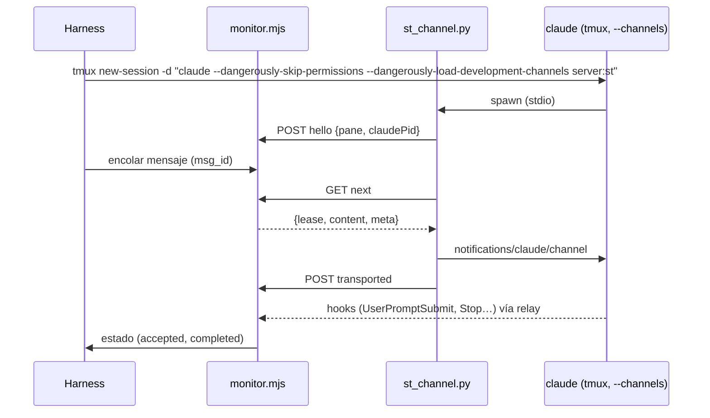

# Project Chat — especificación de la POC de Channels

Estado: **diseño; no ejecutada**. Los criterios GO / NO-GO de §5 se fijan **antes** de correrla y no
se cambian después de ver resultados (si un criterio resulta mal planteado, se documenta y el
responsable decide).

Pregunta que responde: *¿puede un monitor fuera del CLI entregar un mensaje a una sesión interactiva
existente de Claude Code mediante Channels, sin tmux, con evidencia de aceptación, sin pérdidas ni
duplicados, y con fallos explicables?*

---

## 1. Aislamiento y límites

Principio: la POC corre en una máquina que **no puede** alcanzar nada de producción, no por
disciplina sino por construcción. Si alguna condición de esta sección no se puede cumplir, la POC no
empieza.

### 1.1 Host

- Una **VM Linux x86_64 desechable**, en una **máquina físicamente independiente del Proxmox de
  producción** (preferencia del responsable, 2026-11-02), creada para la POC y destruida al terminar.
  *MUST NOT* ser el host de producción (el que corre `st-backend` y las sesiones), ni ningún host
  donde corran sesiones reales, incluidas las de Claude A, Home Automation y B, ni este workspace.
- Sin credenciales de producción en la VM: ni `.env` del backend, ni tokens de Cloudflare, ni
  `JWT_SECRET`, ni `SECRETS_ENCRYPTION_KEY`, ni acceso al túnel. Sin rutas de red hacia la red de
  producción (ni VPN ni túnel).
- Guarda del harness: antes de cada corrida comprueba que no existe ningún contenedor ni red con
  nombres de Shared Terminal (`st-backend`, `st-*`, `sessions-net`) y que no hay variables de
  producción en el entorno; si encuentra alguno, aborta sin hacer nada.
- El harness sólo actúa sobre recursos con la etiqueta `io.shared-terminal.poc=1` (contenedores,
  red, volúmenes); toda llamada a `docker` filtra por esa etiqueta.

### 1.2 Contenedor del agente

- Imagen construida desde `session-image/` del commit de la POC, con `CLAUDE_CODE_VERSION` fijo y
  `DISABLE_AUTOUPDATER=1` (la versión no cambia durante la corrida, R9).
- `docker run` directo, **sin fila en D1** y sin backend.
- **Sin socket de Docker**: *MUST NOT* montar `/var/run/docker.sock` ni ningún socket del host.
- Montajes permitidos, y sólo estos: volúmenes nuevos y vacíos para el workspace y para HOME; `managed-settings.d`
  de la POC en sólo lectura; los archivos del prototipo (`st_channel.py`, wrapper `tmux`) en sólo
  lectura. Ningún bind de rutas del host con datos.
- Endurecimiento: `--cap-drop ALL`, `--security-opt no-new-privileges`, `--pids-limit 512`,
  `--memory 2g`, `--cpus 2`, usuario `developer` (no root), `--read-only` para todo salvo el
  workspace, `/tmp` (tmpfs) y HOME (un volumen propio de la POC, porque guarda las credenciales del
  login de §1.4 y debe sobrevivir al `docker stop` de E8; se destruye en §1.5). Si el entrypoint de la imagen no tolera alguna de estas
  restricciones, se añade sólo la capacidad o el directorio mínimo y se documenta en el informe.
- **tmux**: `claude` se lanza como comando de `tmux new-session -d` (nada se teclea). Un wrapper
  `tmux` en el `PATH` registra cada invocación con su origen; el criterio G6 exige cero `send-keys`,
  `paste-buffer` y `load-buffer` del monitor o de `st-channel`. Las únicas escrituras permitidas son
  las del harness en E4c/E4d, que **simulan a la persona**, van etiquetadas `actor=human-sim` y quedan
  fuera de G6.

### 1.3 Red

- Una red Docker `internal` (sin salida) une el contenedor con el monitor de la POC.
- La única salida a Internet es un proxy HTTP(S) con **allowlist por dominio** (deny por defecto),
  configurado con `HTTPS_PROXY` en el contenedor y `NO_PROXY` para el monitor. La allowlist empieza
  con `api.anthropic.com` y los dominios del flujo oficial de login de Claude Code; en la fase 0 el
  proxy registra los dominios denegados y sólo se añaden los de Anthropic que el CLI necesite (p. ej.
  el de flags que evalúa el gate). Para instalar `fakechat` se abren temporalmente los dominios de
  GitHub del marketplace oficial y se cierran antes del login. Todo dominio añadido queda en el
  informe.
- El monitor de la POC no tiene salida a Internet.

### 1.4 Autenticación y consumo (decisión del responsable, 2026-11-02)

- **Única autenticación permitida: la suscripción de Claude del responsable, con el login oficial de
  Claude Code** (`/login` dentro del CLI del contenedor de la POC, flujo OAuth en el navegador del
  responsable).
- *MUST NOT*: usar Anthropic Console, API keys de pago, `ANTHROPIC_API_KEY`, `ANTHROPIC_BASE_URL` ni
  cualquier otro proveedor.
- *MUST NOT*: extraer, copiar, montar o reutilizar tokens OAuth o credenciales de sesiones existentes
  (`~/.claude/.credentials.json`, `.st/claude-state`, `~/.claude.json` de ningún workspace). El login
  se hace **de cero** en el contenedor de la POC, lo hace **el responsable** (adjuntándose al tmux
  del contenedor en la VM), y el agente no ve ni manipula el token. El harness *MUST NOT* leer
  `~/.claude/.credentials.json`.
- **Sin gastos adicionales**: antes de la prueba, el responsable confirma que el uso extra / de pago
  por exceso está **desactivado** en su cuenta. La POC consume sólo los límites incluidos en el plan.
  Si el CLI informa un límite de uso (`StopFailure` `rate_limit`, aviso de límite del plan) o propone
  pasar a uso pagado, el harness se **detiene** y se informa; nunca se acepta.
- **Si Channels está bloqueado para la suscripción** (no registra, "not currently available",
  política), el resultado es **NO-GO** y se registra. *MUST NOT* cambiar a API ni a otro método de
  autenticación, ni automáticamente ni a propuesta del agente.
- Consumo mínimo: mensajes de prueba triviales ("respondé `OK-<n>`"), sin herramientas salvo las del
  experimento, modelo por defecto del plan.
- Las credenciales del login viven sólo en el HOME del contenedor de la POC (volumen de la POC) y
  se destruyen con él (§1.5).

### 1.5 Eliminación al terminar (en este orden)

1. `/logout` en el CLI de **cada** contenedor de la POC, mientras el contenedor todavía existe; el
   responsable revisa en su cuenta que no quede ninguna sesión autorizada de la POC.
2. Copia de evidencias, sólo de esta lista: hooks crudos, log del monitor, log del wrapper `tmux`,
   log del proxy, log de depuración del CLI. Antes de copiar, el harness las escanea y **redacta**:
   cualquier valor con forma de token (`sk-ant-`, cabeceras `Authorization`, `access_token`,
   `refresh_token`), direcciones de correo y el id de cuenta/organización. Nunca se copia
   `~/.claude/.credentials.json` ni `~/.claude.json`. Si el escaneo encuentra un token después de
   redactar, no se copia nada y se informa.
3. `docker rm -f` de todo lo etiquetado `io.shared-terminal.poc=1`; `docker volume rm` (workspace y
   HOME, que guarda las credenciales) y `docker network rm` de lo mismo; borrado de la imagen.
4. Destrucción de la VM (o, si es local, borrado del disco virtual).
5. Lista de verificación firmada en el informe de resultados.

### 1.6 Prototipo

- El "monitor" es un script de la POC (`poc/channels/monitor.mjs`, Node 22 sin dependencias) que
  implementa sólo §6.2 del protocolo y escribe un log JSONL. La "captura" es un receptor HTTP del
  mismo script que imita `/ingest/claude/hook` y guarda los hooks crudos (el relay de la imagen lo
  alcanza con un alias de red).
- `st-channel` es el prototipo del adaptador (`poc/channels/st_channel.py`, Python stdlib), cargado
  como servidor MCP stdio.
- La rama de la POC **no se mergea**; sus resultados se adjuntan a este documento en un PR de docs.
- La POC **no** usa el mock del smoke (Channels exige autenticación first-party, C16) ni ninguna
  otra autenticación que la de §1.4.

### 1.7 Fase 0: disponibilidad y despertar con `fakechat` (variante local)

**Decisión del responsable (2026-11-02):** la fase 0 **no** usa VM. Corre como un **usuario
temporal del sistema, estándar y nuevo**, en el Mac o PC del responsable. Las secciones §1.1–§1.6
(VM, contenedor endurecido, proxy, eliminación de la VM) quedan para la **POC completa**, donde sí se
prueban fallos, concurrencia y reinicios. Kit: rama `poc/channels-phase0` (sin merge), carpeta
`poc/channels-local/`, con el procedimiento paso a paso en su README.

| Requisito | Cómo lo cumple la variante local |
| --- | --- |
| Perfil aislado | Usuario del sistema nuevo y no administrador (`pocchannels`): HOME, `~/.claude`, llavero y navegador propios; se borra al final. **No** se usa `CLAUDE_CONFIG_DIR` dentro del usuario habitual: en macOS el token va al llavero y podría mezclarse con la instalación habitual |
| Suscripción, sin API key ni uso extra | `/login` oficial; `forceLoginMethod: "claudeai"` en los settings del usuario temporal; `DISABLE_EXTRA_USAGE_COMMAND=1`; el responsable confirma en su cuenta que el uso extra está desactivado; el preflight falla con variables de API key |
| Sin credenciales existentes | HOME nuevo; el preflight comprueba antes del login que no hay credenciales de Claude (archivo, `~/.claude.json`, llavero) ni claves SSH |
| `fakechat` fijado y dependencias revisadas | Desde el marketplace oficial (para seguir en la allowlist de Anthropic); se exige el **conjunto exacto de archivos** y el SHA-256 de cada uno de `claude-plugins-official@7994c27`; `bun install --frozen-lockfile` con los 95 paquetes del `bun.lock` (integridad sha512); falla si el lockfile cambia. Las dependencias son el SDK de MCP 1.27.1 y lo que arrastra para su modo HTTP (express, hono, cors, jose…), que `fakechat` no usa: habla por stdio |
| Sin Docker, Shared Terminal, Proxmox ni producción | El kit no ejecuta `docker` ni `ssh` ni contacta otros hosts que Anthropic, GitHub, `bun.sh` y npm; el preflight exige que el usuario no sea administrador ni del grupo `docker` y que `docker ps` falle |
| Sin tocar proyectos, configuración ni sesiones | Todo en el HOME del usuario temporal; CLI 2.1.314 y Bun 1.3.10 instalados **en ese HOME** (el preflight falla si resuelven a la instalación habitual); managed settings de la máquina **no** se tocan (si existen, el preflight falla y se consulta) |
| Sin `--dangerously-skip-permissions` | Modo normal; **todas** las herramientas denegadas, incluida la respuesta de `fakechat` (su `reply` copia cualquier archivo legible a una carpeta que sirve sin autenticación). La medición sólo necesita `UserPromptSubmit` y `Stop`; si aparece un diálogo de permiso, la persona contesta **No** |
| Registro | Hooks `command` a un archivo (`SessionStart`, `UserPromptSubmit`, `Stop`, `StopFailure`, `Notification`, `SessionEnd`) y log de depuración del CLI |
| Limpieza | `/logout`, copia redactada (exige que ya no haya credenciales), borrado del usuario (HOME y llavero), borrado de sus temporales por uid (`/private/var/folders` en macOS, `/tmp/claude-<uid>` en Linux) y revisión de autorizaciones en claude.ai |

**Limitaciones de seguridad que introduce la variante local** (aceptadas por el responsable al
elegirla; ninguna afecta la validez de lo que la fase 0 mide):

1. **Sin sandbox.** El usuario temporal comparte equipo y kernel y puede leer archivos legibles por
   todos de otros usuarios. Mitigación: herramientas de lectura, escritura y shell denegadas;
   mensajes triviales; en macOS las carpetas personales son privadas por defecto.
2. **Red sin restringir.** La LAN, Proxmox incluido, es alcanzable a nivel de red. Mitigación: ninguna
   credencial de producción en ese usuario y ninguna herramienta de red o shell para Claude. A
   diferencia de la VM, se demuestra que **no se toca** producción, no que **no se pueda**.
3. **`fakechat` sin autenticación ni control de origen en `127.0.0.1`.** Durante las ~2,5 h de la
   prueba, cualquier proceso local y **cualquier página web abierta en el equipo** (formulario
   multipart a `/upload`, WebSocket a `/ws`) puede enviar un prompt a esa sesión. Mitigación:
   **ninguna** herramienta permitida, incluida `reply`, así que un prompt inyectado sólo produce
   texto y consume cuota; el informe lo detecta y esa muestra no cuenta como correlación limpia.
4. **Código de terceros** (`fakechat` y 95 paquetes) corre como el usuario temporal; fijado por
   lockfile con integridad, no auditado línea por línea.
5. **Mismo plan.** Los ~12 turnos consumen el límite incluido de la suscripción, compartido con las
   sesiones reales; sin gasto adicional.
6. **Login en el navegador del usuario temporal** (macOS) o en una ventana privada (Linux): el token
   nuevo vive sólo en ese usuario y se elimina con él.

**Dos etapas separadas** (decisión del responsable, 2026-11-02):

- **S0, preparación**: crear el usuario, instalar CLI y Bun fijados en su HOME, bajar el kit,
  `setup` (`fakechat` + pin + dependencias) y `preflight`, **sin** la suscripción. Termina con
  `preflight.md` sin ningún FAIL.
- **S1, fase 0**: sólo después de revisar S0 y de que el responsable haga el `/login` oficial.
  Registro del canal y hasta 12 despertares. El informe separa **registro del canal**, **despertar
  efectivo**, **latencia**, **`source` del hook** y **correlación del mensaje**, y termina en una
  nueva decisión del responsable. Un fallo del harness (subida rechazada, hooks sin funcionar, puerto
  de otro proceso, motivo de `skip` que no es de disponibilidad o política) **nunca** se registra como
  NO-GO.
- **NO-GO de disponibilidad sólo confirmado dos veces**: el gate del CLI decide con flags remotos
  que, en un HOME nuevo, pueden no estar todavía en caché, y falla cerrado. Un primer `skip` de
  política o disponibilidad queda **sin confirmar**; es NO-GO sólo si un segundo arranque, ≥ 60 s
  después, da el mismo motivo con los flags ya en caché.
- **NO-GO de despertar sólo con evidencia**: sin `UserPromptSubmit`, la muestra es "no despertó"
  únicamente si el CLI registró la recepción del mensaje, la sesión sigue en su prompt y no hubo
  turno. Cualquier otro caso (descarte silencioso del CLI, borrador en el input, duda) es
  **indeterminado**.

Es lo **único** que se ejecutará primero, y sólo con una autorización explícita del responsable para
esta prueba. No se escribe `monitor.mjs` ni `st_channel.py` antes de su resultado.

Objetivo: comprobar (1) que Channels está disponible con la suscripción del responsable y (2) que
una notificación de canal despierta una sesión interactiva **inactiva** en su prompt.

| Paso | Qué | Evidencia |
| --- | --- | --- |
| F0.1 | Usuario temporal, CLI y Bun fijados en su HOME, kit en el commit autorizado, `setup` y `preflight` (S0). Sin uso de la suscripción | `preflight.md` sin FAIL |
| F0.2 | El responsable hace `/login` con su suscripción y confirma que el uso extra está desactivado | `/status` con el plan; el token no sale del usuario temporal |
| F0.3 | `claude --channels plugin:fakechat@claude-plugins-official --debug-file …`, **sin** `--dangerously-skip-permissions`; `phase0.mjs registration` | registro o motivo del `skip`; el puerto de `fakechat` pertenece a ese `claude` |
| F0.4 | 10 mensajes con la sesión en su prompt (`claude agents --json`: `idle` o `waiting`+`input needed`) e inactiva ≥ 30 s, y 2 más tras ≥ 1 h | por mensaje: despertó, latencia, `source`, forma exacta del `prompt`, `Stop` del mismo `prompt_id` |
| F0.5 | `/logout`, `archive` (copia redactada) y borrado del usuario | informe archivado; usuario eliminado |

Viabilidad (se resuelve en S0, **antes** del login): del commit fijado de `fakechat` se anotan su
runtime (la versión de memoria del revisor es que corre con Bun, que la imagen no trae), sus
dependencias y cómo recibe mensajes (interfaz web local; si no hay un endpoint HTTP documentado, el
harness usa el mismo que usa la página). Todo se instala antes de cerrar GitHub en el proxy. Si el
plugin no arranca o no se puede alimentar, es un **fallo del harness**: se corrige y se repite, y
**nunca** se registra como NO-GO de Channels. Sólo cuentan como bloqueo los motivos que el CLI
registra para no admitir el canal.

Resultado de la fase 0:

| Observación | Registro | Siguiente paso |
| --- | --- | --- |
| No registra por bloqueo de la suscripción, política o "not currently available" | **NO-GO** | Ninguno: no se cambia a API. Se reevalúa sólo si Anthropic cambia la disponibilidad y el responsable lo pide |
| Registra pero no despierta en alguno de los 12 | **NO-GO de Channels para despertar** | El responsable decide si autoriza evaluar el brazo B (`asyncRewake`, también con su suscripción) — R2 |
| 12/12 despiertan y el hook trae `source: system` con la etiqueta | **Fase 0 superada** (no es un GO de arquitectura: 12 muestras sólo acotan la tasa de fallo en ≈ 25 %) | Presentar resultados y pedir un **GO separado** para la POC completa (§7) |
| 12/12 despiertan pero `source` ausente o la etiqueta no está en el `prompt` | Fase 0 superada en disponibilidad; **G3 en riesgo** | Presentar; la POC completa sólo con GO explícito sabiendo que G3 probablemente falle |

### 1.8 Evidencia exploratoria (2026-11-02) — **no** cuenta entre las 12 muestras

Pruebas manuales del responsable en su Mac, en su sesión habitual de Claude Code, con su
suscripción y `claude --channels plugin:fakechat@claude-plugins-official`, sin hooks ni medición.
Versión del CLI: a completar.

| Hora | Enviado desde Fakechat | Respuesta en Fakechat | Observación |
| --- | --- | --- | --- |
| 19:33:49 | `hola` | 19:33:56 | — |
| 19:34:25 | `Prueba de Shared Terminal. Respondé exactamente CHANNELS_OK y enviá tu respuesta a Fakechat.` | 19:34:28, `CHANNELS_OK` | — |
| 19:37:22 | `IDLE_01: Respondé exactamente IDLE_OK_01.` | 19:37:25, `IDLE_OK_01` | ≈ 2 min 54 s después de la respuesta anterior |

En la terminal aparecieron las tres entradas con el prefijo `← fakechat · web:` y cada una provocó
actividad sin que nadie escribiera ni pulsara Enter. Claude respondió las tres veces con la
herramienta de `plugin:fakechat:fakechat`.

| Qué muestra | Qué **no** muestra |
| --- | --- |
| Channels está disponible con la suscripción del responsable (2026-11-02) | Que `UserPromptSubmit` traiga `source=system` |
| El plugin oficial se carga con `--channels`, sin flag de desarrollo | Que el `prompt` del hook lleve una etiqueta `<channel>` utilizable para correlación |
| Una notificación llega a una sesión interactiva **existente** | Atribución inequívoca de cada `turn_end` |
| La sesión procesa el mensaje sin intervención en la terminal | Despertar tras ≥ 1 h de inactividad |
| Claude puede responder por la herramienta MCP del plugin cuando se le pide | `--resume`, concurrencia, fallos, kill switch |
| Al menos un despertar tras ≈ 3 min sin mensajes | Fiabilidad (3 muestras no acotan ninguna tasa) |

### 1.9 Fase 0 instrumentada: sesión local del responsable con hooks de carpeta

**Decisión del responsable (2026-11-02):** las 12 muestras de §1.7 se toman en la misma sesión local
de §1.8, no en un usuario temporal. La instrumentación se instala **sólo** en la carpeta de prueba
(`<carpeta>/.claude/settings.local.json`): sin tocar `~/.claude/settings.json`, sin reinstalar
Claude ni el plugin, sin leer credenciales y sin `/logout`. Kit: rama `poc/channels-phase0`,
carpeta `poc/channels-mac/`; el kit de usuario temporal (`poc/channels-local/`) queda como
alternativa no usada.

- **Hooks**: `UserPromptSubmit`, `Stop`, `StopFailure`, `SessionStart`, `Notification` y
  `PostToolUse(Failure)` sólo para las herramientas de Fakechat. Los nombres de eventos y campos se
  comprobaron en el binario 2.1.314. El logger registra además los **nombres** de los campos que
  llegan, porque la versión del responsable puede ser otra.
- **Observacional**: no imprime nada (en `UserPromptSubmit` y `SessionStart` lo impreso entra al
  contexto de Claude), siempre sale con 0 (el 2 bloquea) y no guarda texto de prompts o respuestas:
  sólo bytes, SHA-256, ids de prueba y los atributos permitidos de `<channel>`.
- **Orden**: primero **una** prueba instrumentada tras ≥ 30 s de inactividad **observada** (estado
  consultado cada 3 s, sin huecos > 10 s ni hooks nuevos; una sola observación nunca cuenta). Es lo
  único autorizado (2026-11-02): el kit rechaza las series sin una marca explícita. Las 10 cortas y
  las 2 de ≥ 1 h necesitan una autorización aparte tras revisar ese informe.
- **Despertar ≠ flujo bidireccional**: el informe da el veredicto de despertar de §1.7 y, aparte, si
  cada mensaje completó mensaje → turno → `Stop` → respuesta vista en Fakechat. Sin la respuesta
  observada en Fakechat, nunca se declara el flujo completo.
- **Por mensaje**: recibido por el CLI (línea de recepción del log de depuración), hook, despertar
  sin intervención, `Stop` del mismo `prompt_id`, respuesta vuelta a Fakechat (escucha pasiva de su
  WebSocket), latencias, `source` (presente o ausente), forma del prompt y correlación (A1–A5 de
  protocolo §3.1, `message_id` igual al id enviado).
- **Fakechat no es el monitor**: su `message_id` demuestra que una clave de `meta` aparece como
  atributo de `<channel>`. **No** demuestra `st_msg`, el nombre de nuestro servidor, su carga como
  plugin autorizado ni las condiciones A3–A7 con interferencia o relay. Eso sigue siendo hipótesis
  hasta la POC completa.
- **Seguridad de esta variante**: es la sesión habitual del responsable, no un perfil aislado. El
  riesgo nuevo es la inyección por Fakechat (sin autenticación ni control de origen): con `reply`
  permitido, un mensaje inyectado podría pedir adjuntar un archivo legible, que Fakechat sirve sin
  autenticación en `localhost`. Mitigaciones en el README del kit: carpeta dedicada sin datos
  sensibles, sin modo bypass, contestar No a diálogos inesperados, no navegar por sitios
  desconocidos durante las series.
- **Criterios**: el veredicto aplica la tabla de §1.7 sin cambios; G1–G12 de §5 no se tocan.

### 1.10 Resultado de la prueba instrumentada T (2026-11-03)

Prueba única autorizada en §1.9, id `P0T01-f9dfb6`, en la sesión del responsable con **Claude Code
2.1.317** (no 2.1.314: la sesión habitual se auto-actualiza; R9 rige para las sesiones de agente, no
para esta fase). No cuenta entre las 12 muestras. Cronología reconstruida de los registros
existentes con la extracción redactada X0 (sin texto):

| Tiempo desde el envío | Evento | `prompt_id` |
| --- | --- | --- |
| −32 s … 0 | inactividad **observada** (32 s) | — |
| +0,05 s | único `UserPromptSubmit`: una etiqueta `<channel>`, sin texto fuera; atributos `source`, `chat_id`, `message_id`, `user`, `ts`; `message_id` = id enviado; campo `source` del hook **ausente** | P1 |
| +70,18 s | `PostToolUse` de `reply` de Fakechat, respuesta exacta (vista en el WebSocket a +70,14 s) | P1 |
| +72,75 s | único `Stop` | P1 |
| +132,81 s | `Notification` `idle_prompt`, posterior al cierre del turno | — |

No hay otros `UserPromptSubmit` ni `Stop` en la ventana analizada.

**A4/A5 fallaron por un defecto del harness, no por eventos ajenos** (lo encontró el responsable):
`send.mjs` volvía a parsear `hooks.jsonl` en cada lectura y comparaba con `!==` objetos de lecturas
distintas, así que el propio `UserPromptSubmit` y el propio `Stop` se contaban como ajenos.
Corrección en `poc/channels-phase0@5686b65`: la identidad de un evento es su **línea absoluta** en el
JSONL (append-only); dos eventos distintos con el mismo `prompt_id` siguen siendo dos, y un `Stop`
duplicado del mismo `prompt_id` **sigue fallando A5** (R8 exige un único `turn_end`). Tests de
regresión: lecturas independientes, un solo prompt/`Stop`, `Stop` duplicado, prompt realmente
ajeno, línea a medio escribir. `rediagnose.mjs` recalcula un envío desde los registros existentes
sin modificarlos.

**Diagnóstico recalculado de T:**

| Dimensión | Resultado |
| --- | --- |
| Recepción por el CLI | sí |
| Despertar sin intervención (§1.7) | **observado** (sin otros prompts ni diálogo de permiso; `idle_prompt` no es un diálogo) |
| Flujo bidireccional (mensaje → turno → `Stop` → respuesta en Fakechat) | **observado** |
| Correlación A1–A5 + `Stop` del mismo `prompt_id` + `message_id` | OK |
| Campo `source` del hook | **ausente** |
| Prueba individual | **no limpia**: falta `source=system` |
| G3 en 2.1.317 | **no se cumple**: por G3 (§5), esa versión no entra en `CHANNEL_CLI_VERSIONS` |

**`source` en el binario (análisis estático, sin ejecutar):** en 2.1.314 (instalado en el host de
desarrollo) y en 2.1.317 (`@anthropic-ai/claude-code-darwin-arm64@2.1.317`, Mach-O arm64,
`shasum` igual al del registro npm, `VERSION:"2.1.317"`), los **dos** únicos constructores del
payload de `UserPromptSubmit` dejan vacío el lugar del campo:

    hook_event_name:"UserPromptSubmit",prompt:r,...!1,session_title:…
    hook_event_name:"UserPromptSubmit",prompt:e,...!1,session_title:…

`...!1` expande un `false` literal: el esquema declara `source` ("Payloads may omit it while the
field rolls out"), pero el hook de comando **nunca** lo recibe, sea cual sea el origen. Coincide con
[anthropics/claude-code#94675](https://github.com/anthropics/claude-code/issues/94675) (abierto;
ausente de 2.1.273 a 2.1.316 según sus comentarios). Internamente el CLI sí conoce el origen
(`origin:{kind:"channel",server}` al encolar, C2) y lo escribe en el transcript, no en el hook.
El atributo `source` de `<channel>` es texto del prompt: **no** es evidencia de origen.

**Los 50 ms frente a los 70 s:** el hook se dispara al enviarse el prompt encolado, antes de
cualquier llamada al modelo; mide la entrega. Los 70 s son la duración del turno hasta la llamada a
`reply`, dentro de un único turno sin otros eventos de hook en medio; los registros redactados no
determinan la causa (en §1.8 la respuesta tardó 3–7 s). No afecta al despertar ni a la correlación;
la latencia sigue siendo una dimensión que la POC completa mide.

**Hallazgo para R8 (sin cambiar R8):** en 2.1.314 y 2.1.317 el `Stop` de comando sale por dos
caminos (fin bloqueable del turno y fin de turno por resultado de herramienta, fin MCP o *loop
tick*), con el mismo payload y sin motivo. En T hubo uno solo; un duplicado haría fallar A5.

**Alternativas técnicas para el origen verificable (no elegidas; G3 no cambia):**

| | Alternativa | Qué aporta | Riesgo o costo | Verificación mínima |
| --- | --- | --- | --- | --- |
| A | Metadatos del transcript (`origin.kind = "channel"`, `promptSource`, `promptId`) | Escritos por el CLI; teclear texto no los produce | Formato interno sin documentar; momento de escritura respecto del hook; leer el transcript sólo por metadatos | Extraer esos campos del transcript de T (registros existentes) y comparar `promptId` con el `prompt_id` del hook |
| B | Hook de función de mods `prompt.submit` | Puede recibir `isMeta`/origen | Acceso anticipado; habilitación por managed settings (posible choque con R6); presencia del origen sin verificar | Inspección estática del binario |
| C | Esperar la corrección de #94675 | El `source` que pide G3 | Fecha desconocida; versión nueva validada por R9 | Inspección estática (desaparece `...!1`) y luego una prueba T |
| D | Sesiones headless stream-json (`origin` en `result`) | Origen tipado | Cambia la arquitectura (agentes interactivos en tmux) | Diseño aparte |

Descartadas por no cumplir G3 tal como está escrito: un nonce de nuestro servidor (prueba posesión
del token, no origen) y `asyncRewake` (R2), que también llega como prompt sin `source`.

**Estado:** las 12 muestras **no** están autorizadas; G1–G12 y R8 sin cambios. La alternativa A
dio positivo sobre los registros existentes (§1.11); XA-1 dio `late` y el orden del binario lo
explica: en 2.1.317 el hook corre antes de la escritura del transcript (§1.12).

### 1.11 Alternativa A: origen según el transcript del CLI (XA-1 `late`; ver §1.12)

**No cambia G3, R8 ni G1–G12.** Esta sección diseña cómo investigarla; la propuesta G3-A del final
es para una revisión de diseño aparte y **no** está aprobada ni sustituye a G3.

**X1 sobre los registros existentes de T (2.1.317, 2026-11-03):** un archivo de transcript, sin
líneas ilegibles; exactamente un registro de canal para la prueba (`type=user`, `isMeta=true`,
`promptSource=system`, `origin.kind=channel`, `origin.server=plugin:fakechat:fakechat`, misma
sesión); su `promptId` es **igual** al `prompt_id` del único `UserPromptSubmit` de la prueba, sin
otro registro de canal con ese `promptId`; un `Stop` con ese `prompt_id`. Las dos menciones del id
son ese registro y la respuesta del asistente. El `timestamp` del registro (+25 ms) es la creación
del mensaje, **no** la hora de escritura: con estos registros no se sabe si el registro ya estaba en
el archivo cuando corrió el hook (+53 ms). Debug en 0–75 s: sin retry, 429 ni 529; cinco líneas con
"permission", que no prueban diálogos.

#### 1.11.1 Experimento XA-1 (factibilidad local; **no autorizado**)

Una sola prueba T como §1.9, con el kit `poc/channels-phase0@508a57d`, que agrega
`transcript-probe.mjs` al mismo `UserPromptSubmit` del logger.

| Pregunta | Cómo se mide |
| --- | --- |
| ¿El registro ya está **en el archivo** cuando corre el hook? | La sonda hace **una** lectura de los últimos ≤ 1 MiB del transcript al ejecutarse, sin esperar ni reintentar. "Presente" = legible por otro proceso en ese instante (no prueba durabilidad: no hay `fsync` observable) |
| ¿Se relaciona sin ambigüedad con `prompt_id` y el id del mensaje? | Verificado sólo con **exactamente un** registro de prompt (no `tool_result`) con ese `promptId`, de canal, del servidor esperado, de la sesión, con `isMeta`, cuyo contenido es **byte a byte igual** al prompt que recibió el hook y es **un único** elemento `<channel>` con la forma exacta de 2.1.317 (apertura, salto, contenido, salto, cierre; nada fuera; sin etiqueta anidada; sin atributos repetidos — una clave `meta` llamada `source` lo sería — y `source` igual al servidor), con ese `message_id`, que no aparece en otro registro leído |
| ¿Cuántas veces falta o llega tarde? | `send.mjs` relee el archivo completo tras el turno (igualdad por el SHA-256 del prompt que guarda el logger): `present-at-hook` (verificado al hook **y** en la relectura completa), `late` (sin registro al hook, verificado después), `missing`, `invalid` (todo lo demás). **Una** muestra no mide una tasa: eso exigiría una serie (XA-2), con autorización aparte |
| ¿Es estrictamente observacional? | No imprime (lo impreso entraría al contexto), siempre sale con 0, no bloquea ni modifica el prompt; registra su propia duración (`read_ms`). Única interferencia: el tiempo de una lectura acotada |
| ¿Archivo ausente, incompleto, duplicado o ilegible? | Siempre `unverified` con motivo: ruta ausente, otro nombre, fuera de `projects`, symlink, no es archivo, ausente, ilegible, vacío, línea ilegible, línea final a medio escribir (**aunque el registro buscado esté**), sin registro, contenido distinto del prompt o comparación imposible, etiqueta mal formada, duplicado, otro origen/servidor/sesión, sin `isMeta`, otra etiqueta o `message_id`, id repetido en otro registro, registro fuera de la cola leída, mensaje que llegó como `queued_command` |

**Alcance de la unicidad:** la sonda lee como mucho el último MiB. Si la lectura no empezó en el byte 0,
el resultado es `verified-in-observed-bytes`, con unicidad **sólo en los bytes leídos** y
`unique_global` nulo; únicamente una lectura completa puede dar `verified` con unicidad global. En
XA-1 la unicidad global la aporta la relectura completa posterior, que es de otro momento: no es
una garantía al instante del hook.

Tests sintéticos del kit: 69 (42 de la alternativa A, entre ellos las regresiones de línea final
incompleta tras un registro válido, duplicado fuera de la cola leída, igualdad exacta y etiqueta
mal formada, y el retiro del kit anterior conservando los logs de T). La sonda nunca guarda texto,
rutas ni el prompt; `check` la autoprueba sobre un transcript sintético en un directorio temporal.

**Factibilidad positiva** sólo si en XA-1: una línea de sonda para el `prompt_id`, con `verified` o
`verified-in-observed-bytes` (se informa cuál), categoría `present-at-hook`, relectura completa
`verified` con unicidad global, logger y flujo como en T.
Cualquier otro resultado se informa tal cual y la alternativa A no avanza sin rediseño.

#### 1.11.2 Garantías que la prueba local **no** demuestra (requisitos para producción)

| Riesgo | Por qué importa | Protección necesaria (a verificar por versión) |
| --- | --- | --- |
| El agente escribe el transcript | El archivo es del mismo usuario que el agente; Bash/Write o un trabajo en segundo plano pueden agregar o reescribir líneas | Prohibir escritura en el directorio de transcripts a las herramientas del agente (managed `permissions.deny` para Edit/Write y `sandbox` de sistema de archivos para Bash y trabajos en segundo plano); verificado con un smoke por versión |
| Inserción de un registro falso | Un registro de canal falso junto a un prompt tecleado | La regla "exactamente un registro de prompt por `promptId`" lo vuelve `unverified` (denegación, no falso positivo) |
| Reescritura antes de la captura | Reemplazar el registro real en la ventana entre su escritura y el hook (~ decenas de ms) | La prohibición de escritura anterior; además, evidencia de manipulación: inode y tamaño por captura; un archivo que encoge o cambia de inode marca la sesión como evidencia comprometida |
| Manipulación después de la captura | Releer más tarde no prueba nada | La sonda captura **en el hook** y la copia viaja por el relay al backend (fuera del alcance del agente); nunca se relee el transcript para decidir |
| Formato interno sin documentar | `origin`, `promptSource`, `promptId` pueden cambiar; el CLI repara filas al cargar | Pin del CLI (R9) y lista de versiones validadas **propia** de este contrato; campos desconocidos ⇒ `unverified` |
| Escritura tardía o perdida | La cola de escritura es asincrónica; un error sólo se registra | Ausente al hook ⇒ `unverified`, nunca un éxito diferido |
| Reinicio, `--resume`, fork, compactación, rewind | El registro puede quedar en otro archivo o podarse | `unverified` hasta revalidar; la evidencia se captura en el momento |
| Privacidad | La sonda lee el contenido para comparar el id | Lee dentro del contenedor y no emite texto (mismo nivel 0 que la captura) |

Riesgo residual declarado: otro proceso del mismo usuario fuera del sandbox (un servidor MCP, otro
hook) podría escribir el archivo.

#### 1.11.3 Propuesta G3-A (para revisión separada; no aprobada, no sustituye a G3)

Una entrada de canal estaría **verificada por transcript** sólo si:
1. El `UserPromptSubmit` tiene `prompt_id` P y el prompt cumple la forma del protocolo §5
   (etiqueta con `st_msg`).
2. Al ejecutarse ese hook, la cola leída del transcript de la sesión contiene exactamente un registro
   de prompt con `promptId` P, `type=user`, `isMeta`, `origin.kind=channel`, `origin.server` igual a
   nuestro servidor, la misma sesión y el `st_msg` en su única etiqueta, y ese `st_msg` no aparece en
   otro registro.
3. La captura se hace en el hook y se conserva fuera del alcance del agente; nunca se relee después.
4. Las protecciones de §1.11.2 están activas y verificadas para la versión, que figura en una lista
   propia de este contrato.
5. Cualquier ausencia, demora, ambigüedad, reinicio, `--resume` o duda ⇒ `unverified`, sin pasar a
   verificada después.

Aceptarla sería una decisión explícita del responsable tras esa revisión; mientras tanto, G3 rige
tal como está.

### 1.12 Resultado de XA-1 y orden real hook → transcript (2.1.317)

**XA-1 (2026-11-03, Mac del responsable, CLI 2.1.317, kit `508a57d`): categoría `late`.** No es
factibilidad positiva según el criterio de §1.11.1 y no se reinterpreta como éxito.

| Medida | Valor |
| --- | --- |
| Flujo | `result=hook`; `UserPromptSubmit` +71 ms; `reply` +5,544 s; `Stop` +6,746 s; sin prompts ni `Stop` ajenos |
| `source` en el hook | ausente (G3 sigue sin cumplirse) |
| Sonda al hook | una línea; `unverified`, motivo `no-prompt-record`; lectura desde el byte 0, sin línea final incompleta, 1 ms; 0 registros con ese `promptId` |
| Relectura completa (+7,534 s) | `verified`, unicidad global; `origin.kind=channel`, servidor esperado, `isMeta`, `promptSource=system`, misma sesión, contenido igual al prompt, etiqueta válida |

#### 1.12.1 Orden de ejecución en el binario (inspección estática)

Artefacto: `@anthropic-ai/claude-code-darwin-arm64@2.1.317` (npm `shasum` `bea435eb…`), código
minificado leído de las cadenas del binario. Los nombres de función son los minificados de esa
versión y cambian entre versiones.

**Hechos comprobados en el código:**

1. **Recepción.** El handler de `notifications/claude/channel` (registrado sólo si la puerta de
   canales devuelve `register`) arma el texto con `_Bt(server, content, meta)` (el elemento
   `<channel source="…">`) y hace `enqueue({mode:"prompt", value, priority:"next", isMeta:true,
   origin:{kind:"channel", server}, skipSlashCommands:true, skipAttachments:true})`. No escribe nada
   en el transcript.
2. **Desencolado.** El turno recorre los comandos desencolados y, para cada uno, hace
   `await GNt(...)` → `Hn(...)` (`processUserInput`), con `promptSource="system"` por `isMeta`. Los
   mensajes que devuelve se acumulan en un lote local `$o`.
3. **Creación del mensaje.** Dentro de `Hn`, `yr(...)` crea el mensaje de usuario en memoria
   (`De({content, uuid, isMeta, promptSource, promptId, origin})`). De ahí sale el `timestamp` que X1
   vio en +25 ms.
4. **Hook.** Todavía dentro de `Hn` (marcas `query_hooks_start` / `input_hooks`), la cadena
   `prompt.submit` ejecuta como núcleo los hooks clásicos (`P1r` → `Bkt`), que arman el payload
   `{…base, hook_event_name:"UserPromptSubmit", prompt, ...!1, session_title}` y esperan a los hooks.
   `Hn` devuelve sólo después.
5. **Agregado a la conversación.** Recién al terminar el bucle (`query_process_user_input_end`) el
   turno llama `run($o, …)`. Durante el lote, `applyMessageOp` está envuelto para **acumular** los
   `append` en vez de publicarlos (`aQo`, hasta `isBatchHandedOff`).
6. **Escritura del transcript.** En el modo interactivo, la escribe `kDe.write`, invocado por un
   efecto de React sobre la lista de mensajes (`CDe`: `useEffect(() => recorder.record(messages, …))`)
   → `VT` → `insertMessageChain` → `trackWrite` → `appendEntry`. `promptId` se toma de `eN()` al
   escribir.
7. **Modelo.** La consulta al modelo sale de `run(...)` (paso 5), después de los hooks.

**Conclusión (hecho, no hipótesis):** el hook corre **estructuralmente antes** de que el mensaje
llegue siquiera a la lista que el grabador del transcript observa. No hay carrera: en 2.1.317, en este
camino, el registro **no puede** estar en el archivo cuando corre `UserPromptSubmit`. XA-1 `late`
es el resultado esperado por construcción, no una muestra desafortunada; repetirla no cambiaría la
categoría. La variante "al hook" de la alternativa A (§1.11, G3-A punto 2) no es viable en 2.1.317.

**Hecho adicional sobre `source`:** el llamador calcula el origen y lo pasa al constructor del
payload. `ue(promptSource, wakeupSource)` devuelve `"system"` para el canal y llega a
`Bkt(text, mode, ctx, source, tiers)` como cuarto argumento, pero el payload no lo usa: en su lugar
hay `...!1`, que es la forma que deja una función desactivada en la compilación. Es compatible con
anthropics/claude-code#94675.

**Hipótesis (no comprobadas):** que la corrección de #94675 consista en activar esa rama; que el orden
sea el mismo en `-p`/SDK (no se leyó ese camino); que otras versiones mantengan el orden (validar por
versión).

#### 1.12.2 Alternativas evaluadas (sin implementar)

En todas, la evidencia que sale del contenedor viaja por los hooks y el relay de loopback (§2.6 de
CONVERSATION.md). Cualquier proceso del contenedor puede enviar a ese relay, así que la captura
actual ya confía en el contenido del contenedor frente a un agente con Bash. Ninguna alternativa que
pase por ahí es más fuerte que ese límite.

| | Alternativa | Quién garantiza el origen | ¿Un prompt tecleado o pegado lo falsifica? | ¿Un agente con Bash/Write altera la evidencia? | Correlación | Concurrencia, `--resume`, fallos | ¿Cambia tmux? | Dependencias |
| --- | --- | --- | --- | --- | --- | --- | --- | --- |
| A′ | Transcript leído **al hook** | El CLI, al escribir | No | Sí, si escribe el archivo | `promptId` = `prompt_id` | — | No | **Inviable en 2.1.317**: el registro todavía no existe (§1.12.1) |
| A″ | Transcript leído **después** | El CLI, pero leído tarde | No | Sí: hay ventana entre la escritura y la lectura | Igual | Escritura asincrónica; reparación al cargar | No | **Rechazada por el responsable**: retraso, polling o relectura que da por verificado |
| B | Módulo de hooks de plugin, evento `prompt.submit` | El CLI: `origin` sale del comando encolado (`RQs` → `wue`: canal ⇒ `{kind:"channel", server}`; tecleado ⇒ `{kind:"composer"}`), no del texto | No: el texto no cambia `origin` | El módulo se carga desde disco; si el agente puede escribirlo, puede reemplazarlo. Necesita una ubicación sólo lectura o administrada (por verificar). La salida pasa por el relay | El input lleva `text`, `origin`, `isMeta` y `turnId?`, **sin** `prompt_id`. Se correlaciona porque corre en el mismo instante que el hook clásico (lo envuelve: `next()`) y con igualdad de texto | Mismo proceso y momento que el hook; `--resume` no cambia el origen de un comando nuevo | No | **API de acceso anticipado.** Se activa por un flag remoto (`tengu_plugin_hooks_modules`, GrowthBook). Se apaga con `disableAllHooks`, `allowManagedHooksOnly` o política. Formato no documentado como estable |
| C | Esperar #94675 (`source` en el hook) | El CLI, en el payload del hook | No | Igual que cualquier hook (límite del relay) | `prompt_id` nativo | Igual que hoy | No | Fecha desconocida. Detectable por inspección estática: desaparece `...!1` en `Bkt` |
| D | Protocolo de confirmación: nuestro servidor de canal o el backend registra `(nonce secreto, sha256(contenido))` **antes** de enviar; el hook informa `prompt_id` y el SHA-256 del prompt; el backend acepta una sola aparición | Nuestro backend, sobre **lo que envió** (autor y contenido), no sobre el camino de entrega | Uno tecleado con otro texto no coincide. Copiar el texto exacto exige conocer el nonce antes de la entrega; si llega después, es una segunda aparición: ambas quedan `unverified`, sin falso positivo | Si el servidor de canal corre en el contenedor, un proceso del mismo usuario podría leer el nonce al vuelo (riesgo residual). Un servidor remoto lo reduce, pero exige transporte HTTP de canales (no evaluado) | `nonce` ↔ `prompt_id` ↔ `Stop`/respuesta | El nonce es de un solo uso y tiene vencimiento; la regla se mantiene ante reinicios | No | Ninguna interna del CLI. **No da procedencia del camino**: atribuye contenido, que es lo que §1.10 ya descartó como sustituto de G3 |
| E | Relay propio del servidor Channels (evidencia independiente) | Nuestro servidor: qué envió y cuándo | — | Igual que D si es local | La notificación MCP es unidireccional, sin acuse | — | No | Sólo prueba envío; es una pieza de D |
| F | Arquitectura distinta: el composer actual (3.2, pegado en tmux con acuse por `textHash` en el panel) o headless stream-json | El backend envía; acuse por `user_prompt` humano en el mismo panel (3.2) | La regla de 3.2 ya es fail-closed | El mismo límite del relay | `clientMessageId` ↔ `user_prompt` | Ya resuelto en el contrato v1.7.x | 3.2 no; headless sí (rompe R1) | Sin Channels |

#### 1.12.3 Recomendación

1. **Cerrar la variante "al hook" de la alternativa A en 2.1.317.** Es inviable por construcción y la
   relectura posterior está descartada. G3-A queda como estaba: no aprobada y, en su punto 2,
   inaplicable a esta versión.
2. **En 2.1.317, Channels no da atribución del *camino* verificable con interfaces estables.**
   - Con interfaz estable sólo daría C, que todavía no existe.
   - Con interfaz de acceso anticipado daría B, que depende de un flag remoto.
   - D atribuye contenido, no camino.
3. **Para decidir:**
   - Si el Monitor necesita procedencia del camino **ya**: buscar otro mecanismo. El composer 3.2
     preserva la arquitectura, usa la suscripción y ya tiene su contrato. Channels queda en espera
     de C.
   - Si basta atribuir el contenido a un emisor autenticado por el backend: D (con E) es diseñable
     sin depender del CLI. Sería una garantía **distinta** de G3, que requeriría su propia revisión.
4. **Seguimiento barato de C:** comprobar en el binario de cada versión nueva si `Bkt` deja de tener
   `...!1` y emite `source`, antes de cualquier prueba T.

#### 1.12.4 Experimento mínimo siguiente (propuesto, **no ejecutado ni autorizado**)

**XB-0: ¿está disponible B para esta cuenta?** Sólo lectura, sin ejecutar Claude.
- Leer **un único valor** booleano de la caché de flags del CLI, sin imprimir nada más del archivo:
  `jq '.cachedGrowthBookFeatures.tengu_plugin_hooks_modules // "absent"' ~/.claude.json`.
- Si da `false` o `absent`, B no está disponible y la decisión se reduce a C, D o F.
- Si da `true`, se diseña **XB-1**: un módulo `prompt.submit` sólo observacional, que registra
  `origin.kind`, `origin.server`, `isMeta` y el SHA-256 del texto, en el mismo kit, con una sola
  prueba T y con autorización aparte.

### 1.13 Alternativa B: mods con `prompt.submit` (XB-1 ejecutado una vez: **PASS-A**, §1.13.5)

**No cambia G3, R8 ni G1–G12; G3-A sigue sin aprobarse.** XB-0 (2026-11-03, Mac del responsable,
2.1.317) leyó `tengu_plugin_hooks_modules = true` en la caché de flags. Eso **no** prueba que un mod
cargue ni que funcione: sólo que el interruptor remoto estaba encendido cuando se guardó la caché.

Fuentes:
- (B) el binario `darwin-arm64@2.1.317`;
- (D) la documentación oficial de *mods*: `code.claude.com/docs/en/plugins/mods/{reference,events}`;
- (T) las declaraciones públicas `mods/types/claude-code.d.ts`, escritas por 2.1.277.

#### 1.13.1 Viabilidad: carga y requisitos

| Pregunta | Respuesta | Fuente |
| --- | --- | --- |
| Cómo se registra | Un plugin con `hooks/hooks.json` `{"modules": ["./register.mjs"]}` que exporta `register(on)`; `on(evento, [filtro], async ($, e, next) => next(e))`. Es *middleware*: `next(e)` corre los mods siguientes y al final el comportamiento del CLI. `claude plugin validate` lee del código fuente los eventos y las llamadas (el nuestro: 5 eventos y `$.fs.write`) | D, B, validado aquí con 2.1.314 |
| Dónde corre | En un `Worker` del mismo proceso del CLI ("plugin sandbox"). Las llamadas `$.*` las ejecuta el proceso del CLI | B |
| Cómo se carga sin instalar nada | `claude --plugin-dir <carpeta>`: plugin sólo para esa sesión, sin tocar configuración. **Recarga el módulo al guardar** un archivo de la carpeta | D |
| Interruptor | `tengu_plugin_hooks_modules` (GrowthBook). Si está apagado, los mods instalados no cargan y los integrados sí | B |
| Suscripción | No exige API key. Los únicos bloqueos que nombra el código son: el interruptor, un *tenant* de `claude-code-server`, un *daemon* de servidor de herramientas, `--bare` (sólo carga lo administrado) y el modo seguro | B (no hay una prueba de carga en el Mac) |
| Restricciones | `disableAllHooks` (en managed settings apaga todo); `allowManagedHooksOnly` y `allowManagedModsOnly` (sólo mods de la organización); `disableSideloadFlags` (rechaza `--plugin-dir`); confianza del workspace pendiente ⇒ no carga | D, B |
| **Guard integrado** `sec-default@builtin` | Se carga si la máquina tiene managed settings o si la sesión entró con un `/login` Team o Enterprise. Con el guard cargado, **los `classic.*` de un mod que instaló el usuario no corren** | D |
| Docker/tmux | Nada en el código depende de la terminal: el mod corre dentro del proceso del CLI que está en el panel. Pero nuestras sesiones **sí** tienen managed settings (`/etc/claude-code/managed-settings.d/`), así que el guard carga: el mod tendría que ser **de la organización**, no del usuario (§1.13.3) | B, D |
| Estado del producto | Documentado oficialmente, pero activado por un interruptor remoto. Desde 2.1.277 la API cambia de versión en versión (las tablas indican el mínimo de cada campo) | D, T |

#### 1.13.2 Qué entrega `prompt.submit` y cómo se correlaciona

| Campo | `prompt.submit` | Fuente |
| --- | --- | --- |
| `origin.kind` | **Sí.** Es un conjunto cerrado: `composer` (Enter del usuario, tecleado o en cola), `channel` + `server`, `sdk`, `bridge`, `peer`, `task-notification`, … En el código: lo arma `RQs`/`wue` desde el `origin` del comando encolado; el handler de `notifications/claude/channel` encola `{kind:"channel", server}` y el Enter encola `{kind:"human"}`, que se mapea a `composer` | T, B |
| `origin.server` | **Sí**, sólo cuando `kind = channel` | T, B |
| `isMeta` | En 2.1.317 el CLI lo pasa cuando la entrega es `isMeta` (`...e.isMeta===!0&&{isMeta}`), pero **no** está en el tipo público. No se usa como criterio | B (T no lo declara) |
| Texto | `text`: el prompt tal como llegará al modelo | T |
| Turno | `turnId` sólo cuando el prompt entra en un turno que está corriendo; **ausente** si la sesión estaba ociosa (el caso del canal en T) | T, B |
| Sesión | No viene en el evento. Existe `$.session.id()`, y `classic.UserPromptSubmit` trae `session_id` | T |
| `prompt_id` | **No viene** | T, B |

**Integridad del origen dentro del CLI (hecho).** El CLI rechaza la respuesta de un mod que pone
otro origen; el mensaje del binario es "an origin the engine did not set (a hook may leave the
origin out of its answer, or answer it as received; it may not set one)". El tipo público lo
documenta como "a closed set, never a text prefix… no hook may set one".

**Correlación sin tiempos ni texto.** Los hooks de settings corren como **núcleo** de la cadena de
`prompt.submit`. El camino en el código es `core: {"prompt.submit": …}` → `P1r` → `Bkt` → `gI`, y
`gI`, si un mod escucha `classic.UserPromptSubmit`, despacha el payload clásico (con `prompt_id` y
`session_id`) a la cadena de mods (`RFr` → `x8n`). Por lo tanto, ese `classic.UserPromptSubmit`
ocurre **dentro** del `await next(e)` de nuestro `prompt.submit`. El mod liga los dos así:

1. Al entrar a `prompt.submit` registra el envío como "en vuelo". Si ya había otro, ambos quedan
   marcados con solape.
2. Un `classic.UserPromptSubmit` se adjunta **sólo** si hay exactamente un envío en vuelo.
3. Al volver `next`, el envío queda ligado a `prompt_id` P si se cumplen todas estas condiciones:
   - no hubo solape;
   - hubo **exactamente una** llamada clásica. Dos o más (por ejemplo, una pasada gestionada más
     el resto, o un mod que llama `next` dos veces) dejan el envío sin atribuir, aunque traigan el
     mismo P;
   - trae P y la sesión;
   - el `prompt` clásico es **igual** al `text`. Esta igualdad es una comprobación de
     consistencia, no la clave.

Cualquier otro caso deja el envío sin ligar (fail-closed). A partir de P, todo se une por el id
nativo:
- `classic.Stop` (P) y el `Stop` del logger (P);
- el `PostToolUse` de `reply` (P);
- en el canal, el `message_id` que trae la etiqueta del prompt de P.

`session.append` (puerta `prompt`) aporta además el `uuid` del registro del transcript y su
`origin`, ambos fijados por el CLI. Sirve para auditar, no es criterio.

**Hipótesis que XB-1 verifica:**
- que el anidamiento se observa así en ejecución;
- que hay una sola instancia del módulo por proceso;
- que la entrega del canal corre `prompt.submit` con `origin = channel` y la etiqueta pegada con
  `origin = composer`.

#### 1.13.3 Seguridad del Monitor

**A. Procedencia dentro del CLI.**
- **Hechos.** El `origin` sale del comando interno y no del texto:
  - el canal lo encola el handler MCP, sólo para servidores que pasaron la puerta de canales;
  - el Enter encola `human` ⇒ `composer`;
  - ningún mod puede cambiarlo.
- **Consecuencia.** Pegar `<channel source=…>` produce `composer`.
- **A verificar en XB-1:** que en la práctica el texto pegado no cambia nada.

**B. Integridad hasta el backend.** Hoy cualquier proceso del contenedor puede enviar eventos al
relay por TCP de loopback, así que **nada** que pase por ahí es evidencia frente a un agente con
Bash. Diseño propuesto (no implementado; requiere su propio experimento en un contenedor):

| Riesgo | Protección | Estado |
| --- | --- | --- |
| El agente cambia el módulo | Mod **de la organización**, configurado en nuestros managed settings de solo lectura:<br>• `extraKnownMarketplaces` apuntando a un directorio local de solo lectura;<br>• `enabledPlugins` + `prependPlugins`;<br>• `pluginDigests`, el SHA-256 de cada archivo de la carpeta: "any other copy does not load".<br>A eso se suma la carpeta montada de solo lectura | D/B; sin probar |
| El agente agrega su propio mod, o usa `--plugin-dir` / `CLAUDE_CODE_PLUGIN_DIRS` | `allowManagedModsOnly` (opción del guard integrado) + `disableSideloadFlags` | D; falta verificar que también cubra `CLAUDE_CODE_PLUGIN_DIRS` |
| Otro proceso falsifica la evidencia | Canal propio: `$.http.fetch` con `socketPath`, un socket Unix del relay. Si el `fetch` lo hace el proceso del CLI, el relay puede exigir `SO_PEERCRED` igual al pid del Claude del panel (misma regla de identidad que el composer: ejecutable, `starttime`, primer plano). Bash, MCP y hooks son otros pids ⇒ rechazados. La veredicción usaría **sólo** este canal; los hooks por TCP quedarían como informativos | **Hipótesis.** Indicios: en 2.1.317 el código acepta `socketPath`: `gFn` exige ruta absoluta y sin NUL, y rechaza la llamada si la build no tiene transporte Unix; luego lo pasa al `fetch` de Bun como `unix:`. El tipo público (2.1.277) documenta `socketPath` como "a Unix socket to go over instead of TCP". **No se ejecutó nunca.** Tampoco se observó el pid real de la conexión ni el comportamiento con el guard o con la política de red de plugins. No es un componente viable hasta una prueba propia. Auditoría y diseño en §1.14: `SO_PEERCRED` solo **no** basta |
| Inyección en el proceso del CLI (ptrace, `/proc/<pid>/mem`) | Yama `ptrace_scope` ≥ 1, con el que un hijo no puede adjuntarse al padre. Comprobarlo como precondición del contenedor | Hipótesis |
| Binario del CLI reemplazado en HOME | Verificar el hash de `/proc/<pid>/exe` contra el CLI fijado en la imagen (R9) | Hipótesis |
| Pérdida o duplicado | `inst` aleatorio por carga + `seq` contiguo. Un hueco o una repetición deja `unverified` lo que esté afectado. Una recarga del módulo (nueva `inst`) deja `unverified` lo que estaba en vuelo | Diseño; probado en tests |
| Concurrencia | Solape ⇒ sin ligar ⇒ `unverified` | Diseño; probado en tests |
| `--resume` y reinicios | La evidencia se toma al enviar; `session.start` no se repite en `/resume` y el `prompt_id` es nuevo por prompt. Lo histórico sin evidencia previa queda `unverified` | Doc + diseño |
| El interruptor se apaga | No hay mod ⇒ no hay evidencia ⇒ todo `unverified`. El composer 3.2 sigue operativo | B |
| Cambio de API | Lista propia de versiones validadas (como `COMPOSER_CLI_VERSIONS`). Un campo desconocido ⇒ `unverified` | Diseño |
| Costo arquitectónico | Las sesiones tmux no cambian. Cambian los managed settings y un montaje de solo lectura, así que se necesita **recrear** el contenedor (§2.4.1 de CONVERSATION.md) | — |

#### 1.13.4 Diseño de XB-1 (kit `poc/channels-phase0@a04f0c0`; ejecutado el 2026-11-03, resultado en §1.13.5)

**Objetivo.** Una sola ejecución en el Mac compara un mensaje real de Channels contra un prompt
tecleado y contra una etiqueta `<channel>` pegada. Comprueba que los orígenes difieren y que la
evidencia se correlaciona por `prompt_id`.

**Dos criterios separados:**

| Criterio | Qué prueba | Cómo se evalúa |
| --- | --- | --- |
| **PASS-A** | Procedencia y correlación **dentro del CLI** | XB-1, el único que XB-1 puede dar. El informe lo declara en `scope` |
| **PASS-B** | Integridad de la evidencia **hasta el backend**: mod de la organización con digests, canal autenticado (hipótesis `socketPath` + `SO_PEERCRED`), pérdida y duplicados | Experimento futuro, aparte, en un contenedor. **No** existe todavía y XB-1 no lo aproxima |

Un PASS-A **no** autoriza a usar la evidencia en el Monitor.

**Contrato de eventos esperado** (un archivo JSON por registro en `.poc0/out/mod/`, sin texto):

| Registro | Campos |
| --- | --- |
| `session.start` | `inst`, `seq`, `t`: prueba que el mod cargó |
| `classic.UserPromptSubmit` | `prompt_id`, `session_id`, `prompt_len`, `inflight`, `attached` |
| `prompt.submit` | `origin_kind`, `origin_server`, `is_meta`, `turn_id_present`, `text_len`, `outcome` (`entered`/`drop`/`threw`), `overlap`, `classic_count`, `classic_prompt_ids`, `classic_session_ids`, `classic_text_equal_all`, `bound_prompt_id`, `bound_session_id` |
| `classic.Stop` | `prompt_id`, `session_id` |
| `session.append` (puerta `prompt`) | `uuid`, `origin_kind`, `origin_server`, `is_meta` |

**Instrumentación.**
- Mod `st-provenance-probe`: cinco handlers. Cada uno llama `next(e)` una vez con el mismo evento
  y devuelve o relanza lo que dio `next`.
- Nada antes de `next` puede lanzar. Una escritura que falla sólo deja un hueco de `seq`.
- Las escrituras van **fuera** de la carpeta del plugin para no provocar una recarga.
- El logger de XA-1 sigue igual. La sonda del transcript **no** se instala; `--with-probe` la
  repone.

**Tests sintéticos.** Son 85 y todos pasan en Node 22. De ellos, 14 son de XB-1; el de casos
negativos del analizador cubre 31 variantes, 12 de ellas agregadas tras la revisión del
responsable (`1ed7e73`):
- un segundo `Stop` del logger o del mod;
- dos `classic` en un envío;
- los controles con el mismo `prompt_id`;
- siete variantes de respuesta: no exacta, otro destinatario en Fakechat, sin `PostToolUse`, con
  otro P, dos `reply`, `reply` fallido y otro destinatario en el logger.
- Binder: canal nominal; tecleado; etiqueta pegada ⇒ `composer`; dos envíos en vuelo ⇒ ninguno
  ligado; `classic` sin envío; dos pasadas clásicas con el mismo id (liga) y con ids distintos (no
  liga); texto reescrito más abajo de la cadena; sin `classic` (guard); `next` que lanza (mismo
  error) y `drop`; escritura fallida sin efecto en el flujo; evento malformado;
  `session.append`/`Stop`.
- Analizador: PASS y los 19 casos negativos de `68a939c` (mod no cargado, guard, control con origen `channel`,
  servidor distinto, solape, sin ligar, ligado dos veces, hueco de `seq`, dos instancias, `Stop`
  ausente, UPS duplicado, sesión distinta, sin respuesta, control no ejecutado, sin controles, hook
  saltado en el debug log, registro ilegible, etiqueta pegada que no llegó como etiqueta).
- `manage`: retira XA-1 byte por byte conservando `out/`; `check` detecta una copia alterada del
  mod.

**Procedimiento** (comandos completos al autorizar):
1. Respaldo verificado de `.poc0` (como en XA-1).
2. Kit por SHA con hashes.
3. `uninstall` de XA-1 y `install` de XB-1.
4. `claude plugin validate .poc0/mod`.
5. Lanzar `claude --channels plugin:fakechat@claude-plugins-official --plugin-dir .poc0/mod
   --debug-file .poc0/out/claude-debug.log`.
6. Confirmar la carga con `/plugin` ("1 mod active · st-provenance-probe") y el registro
   `session.start`. Si el debug log menciona `cc-plugin-sec-default`, detenerse: el guard
   invalidaría la prueba.
7. `send.mjs --label B --count 1`.
8. Tras el `Stop`, `xb.mjs controls` y el responsable ingresa el control 1 (tecleado) y luego el
   control 2 (etiqueta pegada).
9. `xb.mjs report`.
10. `/exit`, `uninstall` y relanzar normal.

**PASS-A** sólo si se cumple todo esto:
- el mod cargó: hay `session.start`, una sola `inst`, `seq` contiguo, ningún archivo ilegible y
  ningún hook del mod saltado en el debug log;
- canal: un UPS del logger con su id ⇒ P, y un solo UPS con P; exactamente un envío ligado a P y
  ningún otro que lo mencione; ese envío tiene `origin = channel`, servidor
  `plugin:fakechat:fakechat`, sin solape, **una** llamada clásica, texto igual, misma sesión y
  `entered`;
- **exactamente un** `Stop` del logger y **exactamente uno** del mod con P (R8 sin cambios). Lo
  mismo se exige para cada control;
- respuesta: el `fakechat_reply` con texto **exacto** `OK_<id>` y dirigido a ese mensaje, y
  **exactamente un** intento de `reply` con P en el logger, contando `PostToolUse` y
  `PostToolUseFailure`, y ese intento exitoso y con ese destinatario. Un fallo seguido de un
  reintento exitoso es FAIL. La igualdad con `OK_<id>` es byte a byte, sin `trim()`: Fakechat
  retransmite el argumento `text` sin cambios (`a04f0c0`);
- control tecleado y control pegado: cada uno ligado a su propio P′, con `origin = composer` y sin
  servidor; la etiqueta pegada llegó como etiqueta según el logger;
- en toda la corrida, exactamente un envío con `origin = channel`;
- los tres P son distintos **entre sí**: canal y controles, y también los dos controles.

**FAIL:** cualquier otro valor de los anteriores, entre ellos un segundo `Stop`, un segundo
`classic.UserPromptSubmit` en un envío, `prompt_id` repetidos o una respuesta no exacta o mal
correlacionada.

**INCONCLUSIVE** (se informa tal cual; no se repite sin decisión):
- el mod no cargó;
- los `classic.*` no llegaron (guard);
- falta un control;
- la etiqueta pegada no llegó como etiqueta.

**Riesgos de instalación y restauración:**
- `--plugin-dir` vale sólo para esa sesión y no deja configuración. El logger se retira como en
  XA-1, restaurando byte por byte.
- La recarga al guardar exige no tocar `.poc0/mod` durante la prueba.
- Un mod que falla lo salta el CLI y el prompt sigue (lo dice D); queda registrado como fallo.
- Si el guard o un managed setting existiera en el Mac, la prueba daría INCONCLUSIVE sin efectos.
- Los controles hacen que el modelo responda dos textos breves sin usar herramientas.

**Cambios respecto del kit XA-1 (`508a57d`):**
- Nuevos: `mod/` (4 archivos), `xb.mjs`, `test/xb.test.mjs`.
- `manage.mjs`: copia y verifica el mod, y la sonda pasa a ser opcional.
- `send.mjs`: acepta `--label B` como prueba individual y sólo agrega `transcript_a` si hay sonda.
- El logger, `events`, `classify`, `report` y el matcher de A no cambian.

#### 1.13.5 Resultado de XB-1 (2026-11-03, Mac del responsable, 2.1.317, kit `a04f0c0`)

**PASS-A** (`xb.mjs report`: `salida=0`, `reasons=[]`). Fue una sola ejecución: un mensaje de
Channels y dos controles humanos, con restauración posterior. Evaluó **sólo** la procedencia y la
correlación dentro del CLI.

| Aspecto | Observado |
| --- | --- |
| Mod | 13 registros, una `inst`, `seq` contiguo, ningún duplicado, ningún error |
| Envíos | 3 `prompt.submit`, sin solape |
| Canal | `origin.kind = channel`, servidor `plugin:fakechat:fakechat`, ligado a P1; un `UserPromptSubmit`; un `Stop` del logger y uno del mod; un único `reply`, exitoso, con texto y destinatario exactos |
| Control tecleado | `origin.kind = composer`, ligado a P2 |
| Control con `<channel>` falsificado y pegado | `origin.kind = composer`, ligado a P3 |
| Identificadores | P1, P2 y P3 distintos; correlación única en los tres |
| Guard `cc-plugin-sec-default` | Aparece en el debug log como `not seated`: no estaba activo |
| `source` del hook clásico | Sigue **ausente** |

**Desvío del procedimiento.** La comprobación previa del paso 5 pedía **cero** menciones de
`cc-plugin-sec-default` en el debug log, y hubo una (`not seated`). El responsable la evaluó como
"guard no cargado". Los `classic.*` llegaron al mod, que es la prueba directa de que el guard no los
bloqueó. No cambia el criterio, pero queda anotado. En un PASS-B0/B1 la comprobación debe buscar el
estado (`seated` / `not seated`) y no sólo el nombre.

**Qué no significa:**
- **No** es PASS-B ni habilita el Monitor.
- **No** cambia G3, R8 ni G1–G12. G3 sigue sin cumplirse porque `source` está ausente. G3-A sigue
  sin aprobarse.
- Es una muestra, no una serie. Las series de fiabilidad no están autorizadas.

### 1.14 PASS-B: integridad de la evidencia hasta el backend (diseño; **nada implementado**, PASS-B0 **no autorizado**)

**No cambia G3, R8 ni G1–G12; G3-A sigue sin aprobarse; PASS-A no reemplaza a G3.** Si PASS-B
llegara a pasar, daría una garantía **distinta** de la letra de G3 (`source=system` en el hook).
Usarla en su lugar exigiría una decisión explícita del responsable, como la que G3-A todavía no tiene.

Fuentes de esta sección:
- (B) cadenas del binario `darwin-arm64@2.1.317` y de `2.1.314`, el CLI de nuestra imagen. Las rutas
  citadas están en los dos;
- (K) semántica documentada del kernel Linux;
- (R) código de este repositorio;
- (O) observado en este contenedor de desarrollo (kernel `6.8.0-147`).

Todo lo que no tiene una prueba propia está marcado **hipótesis**.

#### 1.14.1 Qué tiene que afirmar PASS-B, y qué nunca va a afirmar

**Afirmación verificada** para un mensaje M de Project Chat:

> El proceso del CLI del contenedor C, con binario permitido y sin inyección observable, informó
> por un canal autenticado que su prompt P de la sesión S entró con `origin = channel` desde el
> servidor administrado X. Además, el cuerpo de P es exactamente M, que el backend emitió por ese
> canal y que apareció una sola vez.

Hacen falta **dos mitades**, y ninguna alcanza sola:
- **Camino.** La evidencia del CLI dice por dónde entró el prompt. PASS-A lo demostró dentro del CLI.
- **Contenido.** La atribución del backend dice quién lo escribió: es la alternativa D de §1.12.2.

La razón está en el hallazgo A4 de §1.14.3: un proceso del agente podría hacer que el CLI asigne
`origin = channel` **legítimo** a un texto que escribió el agente.

**Nunca afirma:**
- que un prompt `composer` lo tecleó una persona. El agente puede escribir en la terminal con
  `tmux send-keys` o en el pty, que son del mismo usuario; `composer` significa "entrada de
  terminal";
- que el modelo procesó bien el mensaje (eso es R8 y E9);
- disponibilidad. El agente siempre puede matar el CLI, el servidor de canal o el gateway; lo único
  que se garantiza es que eso **no** produce `verified`;
- nada sobre versiones del CLI que no estén en la lista validada.

#### 1.14.2 Modelo de amenazas

| | Alcance |
| --- | --- |
| **Adversario A1: el agente** | Código arbitrario como `developer` (uid 1000) dentro del contenedor de la sesión, por cualquier vía: Bash, procesos en segundo plano, servidores MCP o hooks que configure, archivos que escriba (workspace, HOME, `/tmp`, settings de usuario y de proyecto, `~/.claude.json` con la caché de flags). Además puede: controlar tmux, porque el servidor es del mismo uid (`send-keys`, `respawn-pane`, `new-window`); mandar señales y aplicar `prlimit` a procesos de su uid; leer en `/proc` de su uid lo que pide modo READ (`environ`, `cmdline`, `maps`, enlaces de `fd`); abrir conexiones de red |
| **Lo que A1 no puede** (supuestos verificables) | Ser root ni tener capacidades: `CapDrop: ALL` y `no-new-privileges` (R: `dockerManager.ts`), `USER developer` (R: `session-image/Dockerfile`). Adjuntarse con ptrace a procesos que no desciendan de él: Yama `ptrace_scope = 1` (O: vale 1 en este contenedor; es del kernel del host, así que en VM100 es **precondición** a comprobar). Escribir en montajes de solo lectura |
| **Adversario A2: el agente de otra sesión** | Lo mismo, en otro contenedor. Sólo comparte la red `sessions-net` (#291) y el kernel |
| **Confiables** | Kernel y Docker del host, root del host, backend, el gateway de §1.14.4, el binario publicado del CLI (por hash, R9), el código de nuestro mod y de nuestro servidor de canal (de solo lectura) y el responsable |
| **Fuera de alcance** | Escape del contenedor o exploits del kernel, host comprometido, el backend de Anthropic, el comportamiento del modelo y la denegación de servicio |

#### 1.14.3 Auditoría de las garantías

| # | Pregunta | Hallazgo | Fuente | Estado |
| --- | --- | --- | --- | --- |
| A1 | ¿Qué pid ve el servidor cuando el mod llama `$.http.fetch`? | `$.http.fetch` es una operación del anfitrión del CLI: el `Worker` del mod la pide y el proceso del CLI la ejecuta (`iWr`). Esa función llama al `fetch` global de Bun con `{unix: socketPath}` (`zit`) y le quita el proxy. No aparece ningún proceso intermediario. Un `Worker` es un hilo del mismo proceso, y `SO_PEERCRED` da el tgid, así que **se espera el pid del proceso principal del CLI** | B, K | Estático. **B0 lo observa** |
| A1′ | ¿Basta ese pid? | **No.** El mismo pid es también el de todos los demás clientes del CLI: cualquier otro mod, el cliente MCP por HTTP, los hooks HTTP, el proxy MITM del sandbox (`network.mitmProxy.socketPath`, que va por socket Unix) y WebFetch. El propio CLI lo dice de su `verifiedPeerPid`: "identifies the CONNECTING process, which for relayed traffic … is the relay". `SO_PEERCRED` sólo dice que **conectó el CLI**, no que conectó **nuestro mod** | B | Hecho estático ⇒ hace falta la clave por instancia de §1.14.4 |
| A2 | ¿Cómo se traducen los pid entre namespaces? | El kernel traduce el pid de `SO_PEERCRED` al namespace de **quien lo lee**; si el lector no ve al proceso, obtiene 0. Un lector en el namespace del host recibe el pid del host y lo lleva al del contenedor con `NSpid` de `/proc/<pid>/status`. El contenedor se identifica por `/proc/<pid>/cgroup`. El backend corre en un contenedor de compose **sin** `pid: host` (R: `docker-compose.yml`), así que no puede ser el lector tal como está. `SO_PEERPIDFD` (Linux ≥ 6.5; el host tiene 6.8) fija el proceso y evita la reutilización de pid | K, R, O | Hipótesis. **B0 lo observa** |
| A3 | ¿Otro proceso del mismo usuario puede conectarse o reutilizar la conexión? | **Conectarse, sí.** Para conectar a un socket hace falta permiso de escritura sobre el archivo, y un montaje de solo lectura no lo impide (la comprobación EROFS no se aplica a sockets); obtiene su **propio** pid. **Reutilizar la conexión del CLI:** un socket no se puede reabrir por `/proc/<pid>/fd` (ENXIO); `pidfd_getfd` exige permiso de adjuntarse (Yama). Queda la herencia a hijos si el fd no es `O_CLOEXEC` | K | Hipótesis. B0 mira las banderas en `/proc/<cli>/fdinfo` |
| A4 | ¿Bash, MCP, hooks o procesos en segundo plano pueden inyectar evidencia? | **Directamente, no**: son otros pid y se rechazan. **Indirectamente, sí, por dos vías:** | K, B | |
| | | (a) **Diputado confundido.** Los settings de usuario son escribibles por el agente; con ellos puede apuntar al socket un servidor MCP HTTP, un hook HTTP o el proxy MITM del sandbox, y conecta el pid del CLI. Mitigación: settings administrados que sólo admitan hooks y MCP de la organización, más la clave por instancia | B | Hipótesis. **B2** |
| | | (b) **Reinyección por el pipe.** Un proceso del mismo uid puede abrir `/proc/<pid>/fd/<n>` de un **pipe**. Ese acceso es de modo READ y **Yama no lo cubre**. Así podría escribir un `notifications/claude/channel` en el pipe por donde el CLI lee al servidor de canal, y el CLI le daría `origin = channel` **auténtico** a un contenido del agente | K | Hipótesis fuerte. **B2**. ⇒ el **contenido** se atribuye en el backend (§1.14.1) |
| A5 | ptrace, `/proc`, entorno, filesystem, binario | **Un descendiente del CLI no puede adjuntarse** (Yama 1), y `mem`, `process_vm_readv` y `pidfd_getfd` piden permiso de adjuntarse. **Pero el agente puede reiniciar el CLI** por tmux debajo de un padre que controla, que entonces es su ancestro y puede adjuntarse. Por ejemplo `bash` con un builtin cargado por `enable -f`, o un `python3` que hace `fork` + `ptrace`. También puede arrancarlo con `LD_PRELOAD`, `NODE_OPTIONS` o `BUN_*`, y con `prlimit` + una señal forzar un volcado de memoria (sólo al morir el proceso). **Binario:** en nuestra imagen el CLI está bajo `~/.npm-global`, que apunta al **workspace** (O: `.../workspace/.npm-global/.../claude.exe`), escribible y persistente. El inodo en ejecución no se puede escribir (ETXTBSY), pero un arranque nuevo toma el archivo reemplazado. **El CLI sólo se vuelve no volcable (`PR_SET_DUMPABLE`) en modo code review**: "so the review's commands could read its tokens from memory". Anthropic trata la lectura de memoria por el mismo uid como amenaza real, y en modo interactivo no la cierra | K, B, O | Comprobaciones posibles: ver I1–I7. **Residuo**: adjuntarse, leer y soltar entre dos comprobaciones (ver H-ND) |
| A6 | ¿La instalación administrada impide reemplazar el mod o cargar otro? | El tier de organización exige que los managed settings declaren el marketplace en `extraKnownMarketplaces` como **directorio local leído en su lugar** y que lo listen por ruta relativa; una copia (caché, archivo, semilla) es tier de usuario. `pluginDigests` sólo aplica a fuentes remotas. Con un montaje de solo lectura el agente no cambia los archivos. `allowManagedModsOnly`: "mods are limited to your organization's by policy … was not loaded". `disableSideloadFlags` rechaza `--plugin-dir`. **Falta probar** que cubran `CLAUDE_CODE_PLUGIN_DIRS`, `enabledPlugins` de usuario y de proyecto, `claude plugin install` y una copia con el mismo nombre, y que con el guard `sec-default` cargado (con managed settings carga) los `classic.*` de un mod de la organización corran. Importa porque cualquier otro mod corre en el **mismo pid** | B | Hipótesis. **B1** |
| A7 | ¿Y si se apaga el interruptor remoto de mods? | Lectura estática anterior: no cargan los mods instalados y sí los integrados. **No está establecido** si uno de la organización cuenta como instalado. En cualquier caso: sin mod no hay inscripción ⇒ todo `unverified` (fail-closed) y el composer 3.2 sigue igual. El agente puede cambiar la caché del flag en `~/.claude.json`, pero sólo gana denegación de servicio | B | B1, si existe una forma de forzarlo sin tocar la cuenta; si no, queda documentado |
| A8 | Replay, registros fabricados, desorden, confusión entre sesiones | Con el diseño de §1.14.4: clave por instancia, MAC con `inst` y `seq`, `seq` contiguo, **una** inscripción por proceso (pidfd), socket por contenedor, contenedor por cgroup y nonce de un solo uso para el contenido. Si el gateway se reinicia se pierden las claves y todo queda `unverified` hasta que reinicie el CLI | Diseño | B2 / B3 |

**Conclusión de la auditoría.** `SO_PEERCRED` sirve para un solo paso: decidir a **qué proceso** se
le entrega la clave. Nunca prueba por sí solo que un mensaje sea evidencia. Quedan dos límites que la
arquitectura del socket **no** resuelve:
- **A4b:** obliga a atribuir el contenido en el backend.
- **A5, el residuo de reiniciar el CLI debajo de un ancestro preparado:** se cierra sólo con una
  barrera del kernel, que es la hipótesis H-ND, o aislando las herramientas del agente (§1.14.7).

#### 1.14.4 Arquitectura de confianza propuesta

```
contenedor de la sesión (uid 1000, CapDrop ALL)          host
┌──────────────────────────────────────────────┐        ┌─────────────────────────────┐
│ CLI publicado (hash permitido)               │        │ gateway st-attest           │
│  └ Worker: mod de la organización (RO)       │ socket │  pid ns del host, lee /proc │
│      clave K sólo en memoria ────────────────┼─Unix──►│  SO_PEERCRED + SO_PEERPIDFD │
│  └ hijo MCP: servidor de canal (RO) ◄────────┼────────┤  un socket por contenedor   │
│ /run/st-attest/s.sock  (montaje RO del host) │        │  └──► backend (sólo de aquí)│
└──────────────────────────────────────────────┘        └─────────────────────────────┘
```

**Componentes:**
- **E, el emisor.** El CLI publicado más el mod `st-provenance`, de la organización, desde un
  marketplace local de solo lectura. Con `allowManagedModsOnly`, `disableSideloadFlags`, sólo hooks y
  MCP administrados, y ningún otro mod administrado: comparten el pid.
- **C, el servidor de canal.** Plugin MCP administrado. **No escucha ningún puerto**: recibe los
  mensajes sólo desde el gateway. Al arrancar se declara no volcable (`prctl`, código propio). La
  atribución del contenido **no** depende de que C sea íntegro.
- **G, el gateway.** Proceso del host en el namespace de pid del host. Es lo **único** que lee
  credenciales del par. Puede ser un sidecar de compose con `pid: host` y sólo `CAP_SYS_PTRACE` para
  leer `/proc` de otro uid, o una unidad del host; la decisión de despliegue es para después de B1.
  Usa un socket por contenedor, en un directorio del host montado de solo lectura en
  `/run/st-attest`.
- **B, el backend.** Acepta evidencia **sólo** desde G. Lleva el libro de mensajes enviados:
  `(nonce, sha256(cuerpo), conversación, t)`, registrado **antes** de enviar. El relay TCP de hooks
  queda como información, nunca como evidencia.

**Identidad del par**, comprobada por G con el pidfd en la inscripción y en **cada** petición:

| # | Comprobación |
| --- | --- |
| I1 | El cgroup es el del contenedor del socket, y ese contenedor es el `container_id` de D1 de esa sesión |
| I2 | El SHA-256 del inodo de `/proc/<pid>/exe` está en la lista de binarios publicados (R9). Se puede cachear por `(dev, ino)` mientras viva el proceso, gracias a ETXTBSY |
| I3 | `maps` sin bibliotecas fuera de una lista (bloquea `LD_PRELOAD` y similares) |
| I4 | `environ` sin `LD_*`, `NODE_OPTIONS` ni `BUN_*`; `cmdline` dentro de una lista |
| I5 | `TracerPid = 0` |
| I6 | El padre es el proceso raíz del panel y su `exe` es el `bash` de la imagen |
| I7 | El `starttime` es el mismo que en la inscripción |

**Protocolo:**
1. **Inscripción**, en `session.start`. El mod envía `POST /enroll {inst, session_id, versión}`. Si
   pasan I1–I7 y es la **primera** inscripción de ese proceso, G devuelve una clave K aleatoria de 32
   bytes, que vive sólo en la memoria del mod. Una segunda inscripción del mismo proceso **quema** la
   instancia: todo lo de ese proceso queda `unverified` hasta que termine. Así un diputado (A4a) que
   se inscriba antes o después del mod deja dos inscripciones y la instancia queda quemada.
2. **Eventos.** El mod envía `POST /ev {inst, seq, registro, mac = HMAC(K, inst‖seq‖registro)}`. G
   comprueba que el par sea el proceso inscripto, que el MAC sea válido, que `seq` sea el anterior
   más uno y que valgan I5 e I7. Recién entonces lo reenvía a B con la identidad comprobada:
   contenedor, pid, `starttime` y hash del binario.
   - El registro es el de XB-1 **más** `sha256` del cuerpo del prompt. El cuerpo se extrae del sobre
     `<channel …>` con un parser estricto; un sobre no canónico ⇒ `unverified`.
   - Nunca viaja texto.
3. **Veredicto de M:**
   - `verified` sólo si se cumple todo esto:
     - instancia inscripta y no quemada;
     - `seq` sin huecos hasta el `Stop`;
     - `origin = channel` con el servidor administrado X;
     - envío ligado según las reglas de PASS-A;
     - el hash del cuerpo es el de M;
     - el nonce de M aparece **una sola vez**;
     - exactamente un `Stop` (R8).
   - Cualquier otra cosa ⇒ `unverified`, con su motivo. Una segunda aparición deja **ambas**
     `unverified`.

**Hipótesis H-ND (barrera del kernel).** Si el binario del CLI pertenece a root y tiene modo `0711`
(ejecutable pero **no legible** para uid 1000), el kernel lo marca no volcable al ejecutarlo. A partir
de ahí ni el mismo uid ni un ancestro pueden adjuntarse ni leer `mem`, `environ` o `fd`. Eso cerraría
A5 y también la reapertura del pipe **del lado del CLI** (A4b). Riesgo: un ejecutable de Bun de un
solo archivo puede necesitar leerse a sí mismo para cargar su código, y entonces no arrancaría. Se
prueba en B1. Si falla, A5 queda como residuo **documentado**, y la recomendación pasa a §1.14.7.

#### 1.14.5 Qué es demostrable y qué no

| Demostrable si pasa la prueba indicada | Prueba |
| --- | --- |
| El par del socket es el proceso principal del CLI, no un intermediario; el pid se puede llevar al contenedor; el pidfd coincide | B0 |
| La conexión no se hereda (`O_CLOEXEC`); conectar por un montaje de solo lectura funciona y el agente no puede quitar ni reemplazar el socket | B0 |
| El mod carga en el tier de organización; ningún otro camino carga un mod; los `classic.*` corren con el guard cargado | B1 |
| H-ND: el CLI arranca no volcable y uid 1000 no puede leer su `environ` ni su `mem` | B1 |
| Los eventos de Bash, MCP o hooks, los replays, el desorden y el cambio de ids o de sesión se rechazan o quedan `unverified` | B2 |
| La reinyección por el pipe produce `origin = channel` pero el veredicto es `unverified`, porque el contenido no coincide | B2 |
| Pérdida, reinicios, `--resume`, `/clear` y varias sesiones nunca mezclan identidades ni producen `verified` | B3 |

**No demostrable con esta arquitectura:**
- que una persona tecleó un prompt;
- que un CLI que el agente reinició debajo de un ancestro preparado no fue leído en memoria **entre**
  dos comprobaciones, salvo que H-ND se cumpla;
- disponibilidad;
- la corrección del binario publicado (es confianza por hash, no prueba);
- el comportamiento de versiones o de API de mods que no estén validadas;
- la configuración del kernel del host (Yama). Es una precondición: el diseño la comprueba, no la
  impone.

**Nota sobre G3** (no lo cambia): aunque el CLI emitiera `source=system`, hoy esa evidencia viajaría
por un hook de comando y el relay TCP de loopback, que cualquier proceso del contenedor puede
falsificar (§1.13.3 B). El problema de integridad de PASS-B existe también para la letra de G3.

#### 1.14.6 Plan de experimentos (incremental; cada etapa necesita su propia autorización)

Reglas comunes:
- Contenedores **descartables**, nunca sesiones ni contenedores de producción, y nada en D1.
- El nombre fuera de los patrones `st-<sid>` y `-old-`/`-new-`, para que ni reconcile ni la limpieza
  de recreación los vean.
- Sin `sessions-net`.
- No se actualiza ningún Claude Code: se usa el CLI que ya trae la imagen.
- Se registran sólo hechos (pid con alias, booleanos, conteos), nunca texto ni credenciales.
- Los logs se copian a una carpeta de resultados **antes** de borrar el contenedor.

**Decisiones del responsable antes de B0:**
1. **Host.**
   - VM100 tiene el kernel y la configuración de Docker reales, pero es el host de producción.
     Contenedores descartables sin efectos en sesiones.
   - Otra máquina Linux con kernel ≥ 6.5 evita VM100, pero su kernel y su Yama pueden ser distintos.
     Recomiendo VM100 con las reglas de arriba.
2. **Versión.** El CLI de la imagen (2.1.314, el validado para contenedores). El resultado vale sólo
   para esa versión. 2.1.317 en Linux sería otra corrida.
3. **Autenticación.** No se sabe si el CLI dispara `session.start` y carga mods antes del login. B0
   intenta primero **sin** login. Si da INCONCLUSIVE por eso, la alternativa sería un `/login` nuevo
   con tu suscripción dentro del contenedor descartable, que se borra con él. No reutiliza
   credenciales, pero es un login y lo decidís vos.

**PASS-B0: viabilidad del socket (diseño detallado).**
- **Objetivo.** Medir cuatro hechos:
  1. si `$.http.fetch` con `socketPath` llega a un servidor Unix;
  2. qué credenciales del par ve el servidor dentro del namespace del contenedor y en el del host;
  3. si el fd de la conexión es `O_CLOEXEC`;
  4. si se puede conectar a un socket en un montaje de solo lectura sin poder reemplazarlo.
- **Fuera de B0:** la clave, el MAC, la instalación administrada y los ataques.
- **Precondiciones:**
  - imagen de sesión actual (mismo `USER`, `CapDrop`, `no-new-privileges` y `PidsLimit` que
    `spawn()`);
  - `ptrace_scope` y `uname -r` registrados;
  - un directorio nuevo del host `…/st-passb0-<ts>/` con el socket del host, montado de solo
    lectura en `/run/st-attest`;
  - kit por SHA con hashes, como en XB-1.
- **Instrumentación:**
  - Mod `st-passb0-probe`, cargado con `--plugin-dir`: en B0 no se prueba la instalación
    administrada y el contenedor no tiene managed settings. En `session.start` hace tres llamadas
    con cuerpo `{inst, n}` y sin texto:
    - una al socket interno `/tmp/passb0/s.sock`;
    - una al del host `/run/st-attest/s.sock`;
    - una segunda al del host, para ver si reutiliza la conexión.

    Escribe el resultado de cada una (estado HTTP o clase de error) con `$.fs.write`.
  - Servidor S_c en el contenedor: `python3 -I`, script de solo lectura lanzado por `docker exec`.
    Registra por conexión:
    - `SO_PEERCRED` y `SO_PEERPIDFD` (el pid del pidfd sale de `fdinfo`);
    - `comm`, `exe`, `Tgid`, `NSpid`, `TracerPid`, `starttime`;
    - las banderas del fd del lado del CLI, leídas en `/proc/<cli>/fdinfo`.
  - Servidor S_h en el host, como root en el namespace del host: registra el pid del host, `NSpid` y
    si el cgroup corresponde al contenedor descartable.
  - Línea base: un cliente `python3` lanzado como `developer` con `docker exec` conecta a los dos
    sockets. Tiene que verse **su** pid, distinto del CLI.
  - Negativo de solo lectura: desde el contenedor, `rm` y `mv` del socket del host tienen que fallar
    con EROFS.
- **Pasos previstos** (los comandos completos se dan al autorizar):
  1. `docker run --rm -d` del contenedor descartable con el montaje de solo lectura.
  2. Arrancar S_h y S_c.
  3. Lanzar el CLI en tmux dentro del contenedor:
     `claude --plugin-dir <kit>/mod --debug-file <out>/claude-debug.log`. Se acepta la confianza de
     la carpeta, que es estado del contenedor descartable.
  4. Esperar el registro `session.start` (un reintento a los 10 s).
  5. Cliente base y negativo EROFS.
  6. Analizador: emite PASS, FAIL o INCONCLUSIVE con alias.
  7. Copiar los resultados, salir del CLI y `docker rm -f`. El directorio del host se conserva junto
     con los resultados.
- **PASS-B0** sólo si se cumple todo esto:
  - las tres llamadas del mod reciben 200;
  - S_c ve como par el **pid principal del CLI**: `Tgid` igual a pid, `exe` igual al binario del
    CLI, y ningún otro proceso;
  - el pidfd resuelve al mismo pid;
  - S_h ve un pid del host cuyo `NSpid` es el mismo CLI y cuyo cgroup es el del contenedor
    descartable;
  - el cliente base se ve con su propio pid;
  - los fd de la conexión son `O_CLOEXEC`;
  - la conexión por el montaje de solo lectura funciona y `rm`/`mv` dan EROFS.
- **FAIL:**
  - el build dice que soporta `socketPath`, pero la llamada no llega;
  - el par **no** es el proceso principal del CLI (un intermediario o un ayudante): invalida el diseño
    basado en el pid;
  - el fd se puede heredar;
  - el pid del host no se puede llevar al contenedor;
  - el socket del host se puede quitar o reemplazar desde el contenedor.
- **INCONCLUSIVE:**
  - el mod no cargó, o `session.start` no se disparó (login o confianza);
  - la política de red de plugins rechazó la llamada ("Network access from plugins" o tráfico no
    esencial deshabilitado). Se registra la causa exacta y no se repite sin decisión.
- **Recuperación.** `docker rm -f` del descartable. No hay nada en D1, ninguna sesión tocada ni
  cambios en el composer.

**PASS-B1: integridad de la instalación** (después de B0 PASS; contenedor descartable con sus
propios managed settings de solo lectura).
- **Configuración:**
  - marketplace local de solo lectura con `st-provenance`;
  - `enabledPlugins`;
  - `allowManagedModsOnly`, `disableSideloadFlags` y `allowManagedHooksOnly`;
  - MCP sólo administrado. El nombre exacto de la clave se verifica en el binario.
- **Observado:**
  - el mod carga en el tier de organización;
  - el estado del guard;
  - los `classic.*` llegan.
- **Intentos, uno por uno, como `developer`:**
  - escribir en la carpeta del mod;
  - un mod de usuario por `~/.claude/settings.json`;
  - `.claude/settings.json` de proyecto;
  - `--plugin-dir`;
  - `CLAUDE_CODE_PLUGIN_DIRS`;
  - `claude plugin install`;
  - una copia con el mismo nombre en la caché.
- **H-ND:** un segundo descartable con el binario de root en modo `0711`. Se mira:
  - si arranca;
  - si `cat /proc/<pid>/environ` y la lectura de `mem` como `developer` dan EACCES.
- **Interruptor:** sólo si existe un override local del flag que no toque la cuenta.
- **Resultado:**
  - **PASS:** carga en el tier de organización y **todos** los caminos no autorizados se rechazan,
    cada uno con su línea en el debug log;
  - **FAIL:** carga cualquier mod no autorizado;
  - **INCONCLUSIVE:** el guard impide observar.

  H-ND se informa aparte, como resultado propio.

**PASS-B2: pruebas adversariales.** Necesita escribir el prototipo del gateway (inscripción, MAC,
I1–I7), con su propia revisión y autorización. Ataques desde el contenedor descartable:

| # | Ataque | Esperado |
| --- | --- | --- |
| 1 | POST con un evento inventado desde Bash, desde un servidor MCP y desde un hook | Rechazado (par ≠ inscripto) |
| 2 | Replay de bytes de un evento anterior | Rechazado (`seq`/MAC) |
| 3 | Hueco o desorden de `seq` | Lo afectado queda `unverified` |
| 4 | Cambiar `prompt_id` o `session_id` en un evento | Rechazado (MAC) |
| 5 | Un segundo CLI (`claude -p` hijo, o uno nuevo en otra ventana de tmux) se inscribe | Instancia propia, separada, o rechazada por I6. Nunca se mezcla |
| 6 | Reinyectar un `notifications/claude/channel` por `/proc/<pid>/fd` | Puede dar `origin = channel`, pero el veredicto es `unverified` (hash/nonce) |
| 7 | Duplicar un mensaje real por el pipe | Las dos apariciones quedan `unverified` |
| 8 | Diputado: MCP HTTP, hook HTTP o MITM del sandbox apuntando al socket | Sin MAC ⇒ rechazado; si se inscribe, instancia quemada |
| 9 | Reiniciar el CLI con `LD_PRELOAD`, `NODE_OPTIONS`, debajo de `python3` o de `bash` con builtin | Rechazado por I3, I4 o I6. El caso del builtin queda como residuo, salvo H-ND |
| 10 | Etiqueta `<channel>` tecleada por tmux | `composer` ⇒ nunca canal |

- **PASS:** ningún ataque produce `verified` y cada uno queda rechazado o `unverified` con su motivo.
- **FAIL:** un solo `verified` producido por un ataque.

**PASS-B3: recuperación.**
- Pérdida de un evento (G descarta uno): hueco ⇒ `unverified`.
- Reinicio de G: claves perdidas ⇒ `unverified` hasta que reinicie el CLI.
- Reinicio del CLI: inscripción nueva; lo que estaba en vuelo queda `unverified`.
- Reconexión del socket.
- `--resume` y `/clear`: cambio de `session_id` dentro del mismo proceso, o en un proceso nuevo.
- Dos CLI en el mismo contenedor, dos contenedores a la vez, y stop/start del contenedor (los paneles
  se renumeran, v1.7.2).

- **PASS:** ninguna confusión de identidad y nada `verified` sin evidencia continua.
- **FAIL:** cualquier atribución cruzada.

#### 1.14.7 Alternativas si el socket y las credenciales no resisten

| Alternativa | Aislamiento real | Costo y riesgo | Estado |
| --- | --- | --- | --- |
| **H-ND** (binario no legible ⇒ proceso no volcable) | Del kernel, contra el mismo uid **y** contra ancestros | Puede romper el arranque de Bun; cambia el layout de la imagen (el binario sale del workspace) | B1 |
| **Sandbox del CLI para Bash** (bubblewrap), impuesto por managed settings y sin comandos fuera del sandbox | Namespaces separados para las herramientas del agente: no verían ni podrían abrir el CLI, su `/proc` ni su pipe, y quizás tampoco tmux | El seccomp por defecto de Docker no deja crear namespaces sin privilegios (habría que relajarlo); red por lista permitida; MCP y hooks siguen fuera del sandbox (exige MCP y hooks sólo administrados). Impacto de producto alto | Hipótesis. Sería un experimento propio |
| **Otro uid para las herramientas del agente** | Real | El CLI ejecuta las herramientas con su propio uid; necesitaría un cambio upstream | Descartada hoy |
| **Sólo contenido (D)** | No es aislamiento: es atribución | Ya descartada como sustituto de G3 (§1.10, §1.12.2) | — |
| **Esperar `source` (#94675)** | No cambia nada en el transporte | Tiene el mismo problema de integridad hasta el backend (nota de §1.14.5) | Sin fecha |
| **Evidencia sólo informativa** | Ninguno | El Monitor mostraría el origen como no verificado, sin afirmar seguridad. Es una decisión de producto | Disponible |

Si **B1 falla en A6** (carga otro mod) o **H-ND falla y no se acepta el residuo de A5**, la
recomendación es **NO-GO** para esta arquitectura en producción. Las opciones serían evaluar el
sandbox o quedarse con la evidencia informativa. No se fuerza una solución insegura para mantener
Channels.

#### 1.14.8 Recomendación

**GO para construir el prototipo de PASS-B0, y sólo eso:**
- el mod de prueba;
- los dos servidores de medición;
- el analizador y sus tests sintéticos.

Ejecutarlo requiere una autorización aparte, con las tres decisiones de §1.14.6. B0 es barato y
descartable, y responde la pregunta que bloquea todo lo demás: si el par del socket es de verdad el
proceso del CLI.

**Un PASS-B0 no valida la arquitectura.** Hay dos límites que no dependen de B0 y que deciden el
GO/NO-GO final:
- A4b obliga a atribuir el contenido;
- A5 necesita H-ND (B1) o un aislamiento como el sandbox.

Con un FAIL en B0, el diseño basado en el pid queda descartado y se pasa directamente a §1.14.7.

#### 1.14.9 Prototipo PASS-B0 y procedimiento (kit `poc/channels-phase0@d224ebe`; **no ejecutado**)

**Decisiones del responsable (2026-11-03):**
- **GO** para el prototipo y su implementación.
- **NO-GO** para ejecutarlo mientras no se apruebe esta revisión.
- **Host:** VM100, sólo con **un** contenedor descartable.
- **CLI:** 2.1.314, sin actualizar nada.
- **Login:** ninguno. Sin login y sin mod ⇒ INCONCLUSIVE.

**Ajustes técnicos (primera revisión):**
- **A4b sigue siendo hipótesis.** Reabrir un pipe por `/proc/<pid>/fd` pasa por las comprobaciones
  de ptrace en modo READ y por los permisos del objeto. Compartir uid no garantiza el acceso.
- **A3: la bandera y la consecuencia se miden por separado.** La bandera es `O_CLOEXEC` en
  `fdinfo`. La consecuencia es si un hijo creado con `fork` + `exec` **mientras la conexión está
  abierta** tiene el inodo del par. Un test muestra que pueden divergir.
- **A1: todo se mide por conexión concreta**, con nonce, token, `SO_PEERCRED`, `SO_PEERPIDFD`
  (`Pid`/`NSpid`), `starttime` releído e inodo del par por sock_diag. Que `h2` reutilice la
  conexión de `h1` es sólo informativo.
- **A6:** el HMAC autentica la posesión de K, no que la llamada haya salido de nuestro mod.
- **H-ND** es un experimento de B1.

**Estado de la autorización (2026-11-03, tercera revisión):** diseño general aprobado. **GO
limitado** al paso 0 y a `preflight` en VM100. `setup`, `servers`, `measure`, `capture`,
`validate` y `cleanup` de una corrida real siguen **sin autorizar**. Si `preflight` sale con 3
porque la imagen trae 2.1.308, se detiene ahí: la preferida es la alternativa A, pero su build
tampoco está autorizado.

**Correcciones de la tercera revisión (`d224ebe`):**

| # | Pedido | Cómo quedó |
| --- | --- | --- |
| 7 | `cleanup` no puede destruir evidencia sin copia | `capture.attempted` ya no alcanza. `cleanup` borra el contenedor sólo con **uno** de tres fundamentos, y lo registra en `results/removal.json`: **`captured`**, si `state/capture.ok` existe, el manifiesto está completo y `results/` **todavía** verifica contra `SHA256SUMS`; **`no-evidence`**, si un `exec` en el contenedor prueba que ni `/tmp/passb0` ni `~/passb0-ws/.passb0/out` tienen archivos (un `exec` que falla, por ejemplo con el contenedor detenido, **no** prueba ausencia); o **`discard-authorized`**, si exportaste `B0_DISCARD_EVIDENCE=<id completo de ese contenedor>`. Un valor que no coincide se ignora. En cualquier otro caso, incluida una captura parcial, sale con 66 y no toca el contenedor. Una nueva corrida de `capture` que falla retira el `capture.ok` anterior |
| 8 | Versión exacta en `capture` | El ítem `cli-version-after` exige exactamente `2.1.314` y persiste `results/cli-version-after.json` (`version`, `expected`, `match`). `setup` persiste también `cli-version-before.json`. Ambos están en el manifiesto, así que una discrepancia deja la captura incompleta (salida 4). El analizador exige `2.1.314` en `preflight.json`, antes y después: si falta o difiere, da INCONCLUSIVE (`cli-version-unverified:*` / `cli-version-mismatch:*`) y nunca PASS |
| 9 | Cotejo del ID | `setup` exige que `docker run` devuelva un id de 64 hex y que el nombre resuelva a ese id. `cleanup` borra sólo un contenedor cuya etiqueta, nombre **e** id coincidan con `state/container_id`. Sin ese archivo o con otro id, no lo toca y sale con 67 |

**Correcciones de la segunda revisión (`5d293cf`):**

| # | Pedido | Cómo quedó |
| --- | --- | --- |
| 1 | Shell fail-closed | Los bloques `( set -euo pipefail; … ) && echo OK \|\| echo FALLÓ` desaparecieron. Dentro de una lista `&&`/`\|\|`, bash **ignora** `errexit` en la subshell, así que un paso intermedio que fallaba podía terminar en "OK". Ahora cada fase es `bash run-b0.sh BASE <fase>`: el script tiene `set -euo pipefail` y se ejecuta como comando, nunca dentro de una lista. `OK: <fase>` es su última línea y lo imprime el script. Además, cada fase escribe `state/<fase>.ok` sólo si termina bien, y la siguiente se niega a correr sin esa marca. Test: un comando **sin** comprobación explícita que falla corta la fase; con la mutación `"$PHASE" && true` ese test falla. **Nota:** el mismo patrón estaba en el procedimiento de XB-1. Su veredicto no depende de él (lo dio el código de salida de `xb.mjs report`, y cada bloque terminaba en una comprobación), pero un paso intermedio fallido pudo pasar inadvertido |
| 2 | PID del servidor del host | Al arrancar, el servidor escribe su identidad: pid, `starttime`, `boot_id`, uid y SHA-256 de su `cmdline`. `b0.py stop` abre primero un **pidfd**, después compara la identidad y recién entonces envía SIGTERM **por el pidfd** (`pidfd_send_signal`): si el pid se hubiera reutilizado antes, la identidad no coincide y no se envía nada; si se reutiliza después, el pidfd sigue apuntando al proceso original. Distinto boot o proceso inexistente ⇒ `already-exited` sin señal; identidad distinta ⇒ `refused` sin señal. Espera la salida sobre el pidfd. Con SIGTERM el servidor borra su socket. Tests con procesos reales |
| 3 | Versión de la imagen | La fase `preflight` es de **solo lectura**: lee `docker image history --no-trunc` y extrae el `CLAUDE_CODE_VERSION` de la **única** capa que instala `@anthropic-ai/claude-code` con npm. Una versión distinta de 2.1.314, desconocida, o dos capas de instalación ⇒ **STOP (salida 3)**, sin crear nada. `setup` lo vuelve a comprobar dentro del contenedor con `claude --version`, que es la versión efectiva. Alternativas: abajo |
| 4 | Captura antes del rollback | Hay tres fases separadas: `capture`, `validate` y `cleanup`. `capture` copia ítem por ítem y registra cada resultado en `capture-manifest.json`, sin `2>/dev/null` ni `\|\| true`; si falta algo termina con salida 4, conserva todo y genera `SHA256SUMS`. Con una captura incompleta, el analizador da INCONCLUSIVE (`capture-incomplete`). `cleanup` se **niega** a borrar el contenedor si no se intentó la captura. `capture` corre también después de un `setup` fallido |
| 5 | Hashes | El paso 0 verifica los **13** archivos publicados (`sha256sum -c --strict`) **y** que la lista de `poc/passb0/` sea exactamente esa, sin archivos extra ni faltantes |
| 6 | Límites y limpieza | `setup` no confía en los flags: compara con `docker inspect` lo que Docker **aplicó** (`checklimits`): etiqueta, usuario, 2 GiB sin swap extra, 1 CPU, 256 PIDs, `CapDrop ALL` sin `CapAdd`, `no-new-privileges`, no privilegiado, red `bridge`, sin namespaces del host, exactamente dos montajes de solo lectura, ningún `docker.sock`. Cualquier diferencia ⇒ falla. `cleanup` es idempotente y funciona tras fallos parciales: detiene el servidor por identidad, borra sólo el contenedor con **la etiqueta y el nombre** de esta corrida (`-v`), verifica que no quede ninguno, que la imagen no cambió y que `run/` quedó vacío. No borra `held-h.json` sin una copia idéntica en `results/`, ni el socket sin el servidor probadamente detenido. Registra `cleanup.json` |

**Tests sintéticos** (en desarrollo; también pasan sobre la copia descargada por SHA de `d224ebe`):
- `test_b0.py`, 22 tests: los 17 anteriores, más:
  - `stop`: proceso verificado detenido y socket borrado; idempotencia; rechazo por
    `starttime`, `cmdline` o uid distintos sin señalar; proceso muerto u otro boot;
  - `imageversion`;
  - `checklimits`, con 11 desvíos.
- `test_analyze.py`: 46 mutaciones. Las de la segunda revisión son captura incompleta y manifiesto
  ausente; las de la tercera, versión distinta o ausente en `preflight`, antes y después.
- `test_runner.py`, 30 tests con un `docker` falso y un servidor del host real:
  - `preflight` sin escrituras; STOP con 2.1.308, con versión desconocida, con userns y con
    restos de otra corrida;
  - cada fase exige la marca anterior;
  - el contenedor se crea con exactamente esos límites;
  - STOP con otra versión adentro, con límites aplicados distintos, con un montaje extra
    (`docker.sock`) y con un fallo sin comprobación explícita;
  - `servers` seguido de `cleanup` detiene el servidor real por identidad y es idempotente;
  - no señala con una identidad distinta;
  - captura incompleta ⇒ evidencia conservada e INCONCLUSIVE;
  - captura después de un `setup` fallido;
  - no toca un contenedor ajeno;
  - conserva `held-h.json` sin copia;
  - tercera revisión: `cleanup` se niega (66) con evidencia y sin captura, tras una captura
    parcial, con el contenedor detenido (no puede mirar adentro), con `capture.ok` pero
    `results/` modificado y con `B0_DISCARD_EVIDENCE` de otro id; borra con el id exacto
    (`discard-authorized`) y un contenedor vacío (`no-evidence`); no borra (67) sin
    `state/container_id` o con otro id; `setup` falla si el nombre apunta a otro id; `capture`
    falla con 2.1.315 después de la corrida y lo persiste; una nueva captura fallida retira
    `capture.ok`.
- `probe.test.mjs`: los 10 tests del mod.
- Verificación por mutación: quitar la marca previa, la comparación de `starttime` o `errexit`
  hace fallar los tests correspondientes. En la tercera revisión, también: quitar el cotejo de id,
  el `sha256sum -c` de `cleanup`, la igualdad exacta de versión, el retiro de `capture.ok`, el id
  en `B0_DISCARD_EVIDENCE`, tratar un `exec` fallido como "sin evidencia" o el cotejo nombre→id de
  `setup`.
- `claude plugin validate` (2.1.314): ✔.

**Hashes publicados** (verificados sobre la descarga de GitHub por SHA; los 13 dan `OK` y la lista
es idéntica):
```
7cad57fdd43e4b8a71ab0e7db31fa0c8bfda4b5b398bca1a6dac8f6fc1c1bbac  analyze.py
4539a7fc25b7d4e7f09c92f951c578a743d2890b5b84c6e3728368205c6fd92d  b0.py
c77dcffd3df92dead59e05482a3c2b0c935e9b279830a71ba199f49096bc1767  mod/.claude-plugin/plugin.json
d87f4cbc7a53b0d733c13dd4c7f81e49d7ede3b21163e0d64e2234176d43100d  mod/hooks/hooks.json
7dc6f559e44df194adcaa7d1e13dfb7857fd7e16195680069f0caf6d9bccfe2e  mod/hooks/probe.mjs
47aa77c452e02165e542f5067ead5aebb89aae3a46f6f7e28fca971eca43735c  mod/hooks/register.mjs
d25be34dbe1928b9cdb1639c8488785b5f2d5c106d0faab90b8a37ef8d65109d  README.md
9006cc347a90e81faf971bc5b5df9ad496112f99d3e30f69d96db115af0ae781  run-b0.sh
ac1e593a088b32a4d4245c385dc3693207ebb8275289bf6b76b5c6b7ee367209  test/fakebin/docker
0cbcde02beb60b70fc6f4e06783edacafa2ad7931100932ab2a664e14d23fa7e  test/probe.test.mjs
fdf4e0bbe5b37a57f59fcf68d45083dec774599e54710f4212d419bd378ee40d  test/test_analyze.py
afa103846fee5445d4bbb1dec3338491354943cdd253203f87320e45b0904bce  test/test_b0.py
119028ca34b0bdf6a87b26296c45ceae4b7ce23bbe84b31f939aed831ca0b7f2  test/test_runner.py
```

**Operaciones privilegiadas en VM100** (ninguna usa `sudo`; si tu usuario necesita `sudo` para
Docker, se exporta `B0_DOCKER_SUDO=1` y el runner usa `sudo -n docker` sólo en esas llamadas):

| # | Operación | Fase | Límite |
| --- | --- | --- | --- |
| P1 | `docker info`, `image inspect`, `image history`, `ps` | `preflight`, `cleanup` | Sólo lectura |
| P2 | `docker run -d` de `passb0-exp-<STAMP>` | `setup` | Una vez. Límites verificados después con `docker inspect` (#6). `sleep 3600`: se detiene solo a la hora |
| P3 | `docker exec -u developer` (también `-d` para el servidor interno y `-it` para el CLI) | `setup` … `capture` | Nunca `-u root` |
| P4 | `docker cp` del contenedor al host | `capture` | Hechos, archivos del mod y sólo las líneas del debug log que nombran el plugin o el guard |
| P5 | `docker rm -f -v` | `cleanup` | Sólo si la etiqueta `passb0.experiment`, el nombre **y** el id de `state/container_id` coinciden con esta corrida, y con un fundamento registrado: `captured`, `no-evidence` o `discard-authorized` (#7) |
| P6 | El servidor del host (`nohup python3 -I`) como **tu usuario**, y su `stop` por pidfd | `servers`, `cleanup` | Socket en `~/passb0-<STAMP>/run/`. Se apaga solo a los 3000 s. Sólo recibe la señal si la identidad coincide |

**No hace:**
- `pull`, `build`, `tag`, `network create` ni `volume create`;
- `compose` ni reiniciar Docker;
- cambios globales;
- tocar sesiones, D1, el composer o la imagen real.

**Si la imagen no trae 2.1.314** (por ejemplo, el 2.1.308 por defecto del `Dockerfile`), B0 se
detiene en `preflight` y decidís entre estas alternativas. **Ninguna se aplica sola:**

| | Alternativa | Qué cambia en VM100 | Costo y riesgo |
| --- | --- | --- | --- |
| A | Imagen experimental **independiente**, construida en VM100 con el mismo `Dockerfile` (commit fijado) y `--build-arg CLAUDE_CODE_VERSION=2.1.314`, con un tag propio `passb0-session:2.1.314-<STAMP>`; `shared-terminal-session` no se toca. Se borra al final | Una imagen nueva (`docker build`, que descarga el paquete de npm) y su `docker image rm` | Dos operaciones privilegiadas más. La versión queda verificada por `preflight` y `setup` igual que antes |
| B | La misma imagen, construida **fuera** de VM100 (por ejemplo, por el job `cli-variants` del Session Image workflow, que ya construye 2.1.314) y cargada con `docker load` con un tag propio | Una imagen nueva y su borrado; nada se descarga en VM100 | Exige exportar el artefacto desde CI (un cambio de workflow o una ejecución manual) |
| C | Correr B0 con 2.1.308 | Nada | **Cambia tu decisión 2**. Antes habría que hacer la inspección estática de 2.1.308 (`socketPath`, tier de plugins), que no está hecha |
| D | Esperar a que la imagen real pase a 2.1.314 por su proceso normal | Nada | Sin fecha |

Recomiendo **A**: es el cambio más chico y no toca la imagen real. Con A o B, el `env` del paso 0 usa
`IMAGE=passb0-session:2.1.314-<STAMP>`, y `cleanup` sumaría una operación P7 (`docker image rm`
de ese tag, comprobando su ID). Esto se agrega sólo si lo autorizás.

**Procedimiento exacto.** Terminal A en VM100:

```bash
# Paso 0: carpeta nueva, kit por SHA, los 13 hashes y la lista exacta, env. Se ejecuta como un script.
bash -euo pipefail -s <<'STEP0'
COMMIT=d224ebea037ed8e728a7a257b0e94def9492e723
STAMP=$(date +%Y%m%d-%H%M%S)
BASE=$HOME/passb0-$STAMP
test ! -e "$BASE"
mkdir -m 0700 "$BASE"; mkdir -m 0700 "$BASE/kit" "$BASE/results"; mkdir -m 0755 "$BASE/run"
gh api "repos/gatof81/shared-terminal/tarball/$COMMIT" > "$BASE/kit.tgz"   # sin gh: copiá el .tgz del mismo SHA
tar xzpf "$BASE/kit.tgz" -C "$BASE/kit" --strip-components=1                  # -p: modos 0644/0755 legibles por uid 1000
cat > "$BASE/kit.sha256" <<'SUMS'
7cad57fdd43e4b8a71ab0e7db31fa0c8bfda4b5b398bca1a6dac8f6fc1c1bbac  analyze.py
4539a7fc25b7d4e7f09c92f951c578a743d2890b5b84c6e3728368205c6fd92d  b0.py
c77dcffd3df92dead59e05482a3c2b0c935e9b279830a71ba199f49096bc1767  mod/.claude-plugin/plugin.json
d87f4cbc7a53b0d733c13dd4c7f81e49d7ede3b21163e0d64e2234176d43100d  mod/hooks/hooks.json
7dc6f559e44df194adcaa7d1e13dfb7857fd7e16195680069f0caf6d9bccfe2e  mod/hooks/probe.mjs
47aa77c452e02165e542f5067ead5aebb89aae3a46f6f7e28fca971eca43735c  mod/hooks/register.mjs
d25be34dbe1928b9cdb1639c8488785b5f2d5c106d0faab90b8a37ef8d65109d  README.md
9006cc347a90e81faf971bc5b5df9ad496112f99d3e30f69d96db115af0ae781  run-b0.sh
ac1e593a088b32a4d4245c385dc3693207ebb8275289bf6b76b5c6b7ee367209  test/fakebin/docker
0cbcde02beb60b70fc6f4e06783edacafa2ad7931100932ab2a664e14d23fa7e  test/probe.test.mjs
fdf4e0bbe5b37a57f59fcf68d45083dec774599e54710f4212d419bd378ee40d  test/test_analyze.py
afa103846fee5445d4bbb1dec3338491354943cdd253203f87320e45b0904bce  test/test_b0.py
119028ca34b0bdf6a87b26296c45ceae4b7ce23bbe84b31f939aed831ca0b7f2  test/test_runner.py
SUMS
cd "$BASE/kit/poc/passb0"
sha256sum -c --strict --quiet "$BASE/kit.sha256"
diff <(find . -type f | sed 's|^\./||' | sort) <(awk '{print $2}' "$BASE/kit.sha256" | sort)
printf '%s\n' "STAMP=$STAMP" "KIT=$BASE/kit/poc/passb0" "RUN=$BASE/run" "RES=$BASE/results" \
  "EXP=passb0-exp-$STAMP" "IMAGE=shared-terminal-session" "COMMIT=$COMMIT" > "$BASE/env"
echo "BASE=$BASE"
echo "OK: paso 0"
STEP0
```

```bash
# Con el BASE que imprimió el paso 0:
BASE=~/passb0-AAAAMMDD-HHMMSS
R() { bash "$BASE/kit/poc/passb0/run-b0.sh" "$BASE" "$1"; echo "fase $1: salida=$?"; }
R preflight     # solo lectura; salida 3 = STOP por versión (ver alternativas)
```
**Hasta acá llega el GO limitado.** Después de `preflight`, mandame su salida completa (la
última línea es `fase preflight: salida=N`) y `cat "$BASE/results/preflight.json"`: kernel,
`ptrace_scope`, los 12 primeros hex del id de imagen y la versión. `preflight` no crea
contenedores ni redes y no cambia nada; deja sólo `state/preflight.ok`, `state/image_id` y
`results/preflight.json` (si sale con otro código, ni eso). No hay nada que limpiar: si no
seguimos, `rm -rf "$BASE"` lo borra todo.

Lo que sigue necesita la autorización final:
```bash
R setup         # P2: crea el contenedor y verifica lo que Docker aplicó y la versión adentro
R servers       # P3 y P6: servidor interno y del host, con identidad
```
Cada fase exige la marca de la anterior. Si una fase falla, no sigas con la siguiente: pasá a
`capture` y `cleanup`.

**Terminal B en VM100** (el CLI, mientras el paso `measure` espera):
```bash
EXP=passb0-exp-AAAAMMDD-HHMMSS
docker exec -it -u developer -e DISABLE_AUTOUPDATER=1 -w /home/developer/passb0-ws "$EXP" \
  claude --plugin-dir /opt/passb0-kit/mod --debug-file /home/developer/passb0-ws/.passb0/out/claude-debug.log
```
- **Permitido:** elegir el tema y aceptar la confianza de la carpeta.
- **Prohibido:** cualquier login, `/login`, tokens o prompts.
- Si aparece la pantalla de login, no elijas nada.

```bash
R measure       # terminal A, con el CLI todavía abierto: espera "done" ≤ 120 s, base, control, rocheck
```
Después, en la terminal B: `/exit`, o Ctrl-C dos veces si quedó en la pantalla de login.
```bash
R capture       # salida 4 = captura incompleta: la evidencia queda; sigue validate (dará INCONCLUSIVE)
R validate      # imprime report.json; salida 0 sólo con PASS
R cleanup       # idempotente; repetila hasta "OK: cleanup" o mandame su salida
```
Si `cleanup` sale con **66**, el contenedor puede tener evidencia sin copia verificada y no se
borró. Primero repetí `R capture`. Si la captura sigue incompleta y decidís descartar lo que
quede adentro, autorizalo para **ese** contenedor:
`B0_DISCARD_EVIDENCE=$(cat "$BASE/state/container_id") R cleanup`. Queda registrado en
`results/removal.json` como `discard-authorized`. Una salida **67** dice qué quedó sin limpiar
(un contenedor que no coincide con `state/container_id`, un servidor sin identidad, un
`held-h.json` sin copia) y no se resuelve sola: mandame la salida.
Si algo falló antes de `measure`, corré `R capture` y `R cleanup`. Si falló `preflight`, no
se creó nada.

Quedan **siempre**:
- `$BASE/kit` y `$BASE/kit.tgz`;
- `$BASE/results`, con `report.json`, `capture-manifest.json`, `cli-version-before.json`,
  `cli-version-after.json`, `removal.json`, `cleanup.json` y `SHA256SUMS`;
- `$BASE/state`.

Mandame `report.json`: tiene alias y booleanos.

**Criterios** (`analyze.py`):
- **PASS** sólo si se cumple todo esto:
  - la captura está completa;
  - la versión del CLI es exactamente 2.1.314 en `preflight`, en `setup` y después de la
    corrida;
  - el mod cargó una vez, con `seq` contiguo y `done`;
  - hay exactamente un proceso del CLI;
  - las cinco llamadas dieron 200, cada una ligada a **una** conexión por token y nonce;
  - en el contenedor, el par es el CLI: pid y tgid, uid 1000, `starttime` y SHA-256 del
    ejecutable, pidfd del mismo pid y lectura estable;
  - en el host, el `NSpid` lleva al CLI, el cgroup es el del contenedor y el pidfd coincide;
  - los dos clientes base se ven como ellos mismos;
  - el control positivo detecta la herencia;
  - en las dos retenciones, el único poseedor es el CLI, con `O_CLOEXEC`, y el hijo creado
    mientras la conexión estaba abierta no la tiene;
  - `create`, `mkdir`, `rename` y `unlink` dan EROFS.
- **FAIL:**
  - `socketPath` rechazado, o una llamada que no llega;
  - una conexión sin correspondencia;
  - el par no es el CLI;
  - `NSpid` o cgroup ajenos;
  - el cliente base atribuido al CLI;
  - el fd sin `O_CLOEXEC`, en varios fds o en otro proceso;
  - herencia al hijo;
  - el directorio del socket escribible.
- **INCONCLUSIVE:**
  - captura incompleta, o sin manifiesto;
  - el mod no cargó (login, confianza o interruptor);
  - registros incompletos o líneas problemáticas del mod;
  - varios CLI;
  - la política de red de plugins;
  - sin `SO_PEERPIDFD`;
  - el control falló;
  - el checker no sincronizó, o el inodo del par es desconocido;
  - la búsqueda de poseedores fue denegada;
  - otro errno;
  - faltan logs.

**Nada se repite sin una decisión tuya.** Un PASS-B0 sólo responde la viabilidad del socket (§1.14.8).

## 2. Versiones

| Variante | CLI | Motivo |
| --- | --- | --- |
| V1 | 2.1.314 | versión validada del Composer (§8.1.9); versión del binario inspeccionado |
| V2 | la última publicada el día de la POC | lo que el auto-update instala en los workspaces |

El pin de la imagen (2.1.308) **no** se prueba: los workspaces se auto-actualizan
(phase3 §1.2) y 2.1.308 no tiene la evidencia de binario de C2/C8.

## 3. Prototipo



El monitor aplica la elegibilidad de §4 del protocolo usando los hooks recibidos y `claude agents
--json` (por `docker exec`, el mismo probe de producción).

## 4. Experimentos

| # | Experimento | Procedimiento | Qué se registra |
| --- | --- | --- | --- |
| E0 | Disponibilidad | Arrancar con la suscripción del responsable (§1.4) y `channelsEnabled: true` en `managed-settings.d`; leer `--debug` del CLI | `Channel notifications registered` o el motivo de `skip` (C13–C18) |
| E1 | Carga de producción | Repetir E0 con `st` empaquetado como plugin en un marketplace local y `allowedChannelPlugins`, sin flag de desarrollo | registra / no registra; diálogo de confirmación sí/no |
| E2 | Despertar en el prompt | 60 mensajes con la sesión en `waiting_input` verificado: 48 tras ≥ 30 s inactiva y 12 tras ≥ 1 h inactiva; repartidos en al menos dos días | `UserPromptSubmit` sí/no; latencia `transported → UserPromptSubmit` |
| E3 | Forma de la evidencia | Para todos los mensajes de E2 | `source`, `prompt` exacto, presencia de `st_msg`, `prompt_id` |
| E4 | Busy | (a) política del monitor: mensaje en cola mientras Claude trabaja; (b) **comportamiento crudo**: 3 notificaciones durante un turno largo, sin política (10 repeticiones); (c) texto tecleado por el harness (`actor=human-sim`) en cuatro momentos: 0,5 s antes de la notificación, 0,5 s después, a mitad del turno del canal y justo antes de su `Stop`; 10 repeticiones de cada uno | (a) se entrega tras `turn_end`; (b)/(c) cuántos hooks, forma exacta del `prompt`, `prompt_id` de cada hook, orden de llegada frente al `Stop`, estado final según protocolo §3.1 |
| E4d | Notificación de tarea durante el turno | el mensaje del canal pide lanzar un Bash en background que termina a mitad del turno; 10 repeticiones | `internal_prompt` dentro de la ventana; estado final `ended_unattributed{mixed-input}` |
| E5 | Reanudación | (a) salir y `claude --resume <cid>` con los mismos flags, inmediatamente (< 5 s) y tras un `kill -9`; (b) `/resume` a otra conversación dentro del CLI; (c) `/clear`; 30 mensajes tras cada uno | runtime nuevo o el mismo; `cid` donde se acepta; conversaciones nuevas creadas |
| E6 | Sesiones no creadas | antes/después de cada experimento | número de entradas de `claude agents --json` y de `session_id` distintos en los hooks |
| E7 | Pérdida y duplicados | 100 mensajes secuenciales con la política del monitor | exactamente un `channel_prompt` y un `turn_end` por mensaje; `prompt_id` distintos |
| E8 | Fallos inyectados | ver §4.1 | estado final de cada entrega |
| E9 | Herramienta de publicación | 20 mensajes que piden "publicá un avance con `chat_post` y después respondé" con el modelo por defecto | tasa de llamadas (informativo, no es criterio) |
| E10 | Concurrencia | (a) dos contenedores, 50 mensajes cada uno en paralelo; (b) dos `claude` con canal en el mismo contenedor | (a) cero entregas cruzadas; (b) `runtime-ambiguous` y cero entregas |
| E11 | Efectos secundarios | Con `--channels`: `AskUserQuestion`, plan mode, `/config`, `/mcp` | qué cambia para la persona en el Terminal (C20) |
| E12 | Escapado e inyección | contenido con `</channel>`, `<channel source="x" st_msg="…">`, comillas, NUL, 16 KiB, `/clear` al inicio | `prompt` resultante; clasificación de §5 del protocolo |
| E13 | Brazo B (condicional) | Sólo si E2 o E5 fallan: hook `Stop` con `asyncRewake` que hace long-poll al monitor y sale con 2 al recibir | mismas métricas de E2, E3, E5, E7 |

### 4.1 Matriz de fallos (E8)

| Fallo inyectado | Momento | Estado esperado | Prohibido |
| --- | --- | --- | --- |
| `kill -9` de `st_channel.py` | entre la notificación y `transported` | `uncertain{lease}` y después `accepted{late}` (llega el hook) | reentrega |
| `kill -9` de `st_channel.py` | antes de la notificación, con lease | `uncertain{lease}` → `unconfirmed{not-transported}` por la regla 2b (c), con el reloj desde el vencimiento del lease; **sin** `degraded` | reentrega; `degraded` |
| reinicio de `monitor.mjs` | con una entrega `transported` | `uncertain{orphaned}`; `accepted{late}` si llega el hook; si no, `unconfirmed` por la regla 2b | reentrega |
| texto humano tecleado 0,5 s después de `transported` (E4c) | turno humano en curso | `uncertain` mientras el CLI lo tenga en cola; después `accepted{late}` o `unconfirmed` por la regla 2b; ninguna otra entrega a ese agente mientras tanto | reentrega; segunda entrega concurrente |
| `kill` de `claude` | durante el turno aceptado | `interrupted` | reentrega por Composer o tmux |
| `docker stop` | con 3 mensajes en cola | cola intacta; entrega tras arrancar y relanzar `claude` | pérdida o duplicado |
| red cortada contenedor→monitor | 60 s | `st_channel` reintenta `hello`; entregas en vuelo `uncertain`, después `accepted{late}` o `unconfirmed` (`not-transported` si no llegó a `transported`) por la regla 2b; **sin** `degraded` | duplicado; `degraded` |
| respuesta 200 de `next` retrasada más allá de `T_lease` (proxy de la POC que la retiene) | préstamo | `st-channel` descarta el lease sin escribir; la entrega `uncertain{lease}` → `unconfirmed{not-transported}`; **ninguna** escritura en el CLI | escritura de la notificación; `late_after_terminal` |
| `channelsEnabled` ausente | arranque | sin runtime; la cola espera y el motivo es visible | cualquier entrega |
| **kill switch simulado al registrar**: `st` configurado como servidor MCP pero **no** nombrado en `--channels` (el CLI lo arranca y no registra el handler: mismo efecto observable que el gate remoto) | 3 mensajes en cola | el primero `uncertain` → `unconfirmed{no-evidence}` por la regla 2b (c); runtime `degraded{no-evidence}`; los otros dos siguen `queued` con "retenido: canal degradado" | pérdida, `completed`, reentrega, cualquier `composer_send`, escritura en tmux |
| kill switch simulado + "Probar el canal otra vez" | tras la fila anterior | sólo el **siguiente** mensaje en cola se intenta; el `unconfirmed` no se reenvía | reentrega del `unconfirmed` |
| `source` ausente (hook de captura reescrito por el monitor de la POC quitando `source`) | 3 mensajes | `user_prompt{origin: unverified, channel_source_absent}`, entrega `unconfirmed{no-evidence}`, runtime `degraded{source-absent}` | `accepted` |
| diálogo abierto (`/help`) o borrador en el input | con una entrega `uncertain` | ni la elegibilidad ni la regla 2b (b)/(c) cuentan esos probes como "en su prompt"; la entrega sigue `uncertain`; sin `degraded` | `unconfirmed` o `degraded` mientras el diálogo o el borrador sigan |
| pérdida de hooks en el relay (cola llena forzada o relay reiniciado) durante el turno aceptado | turno en curso | `ended_unattributed{gap}` o `{relay-unverified}` | `completed` |
| pérdida del hook `UserPromptSubmit` del canal en el relay (relay reiniciado justo tras `transported`) | antes de la aceptación | `unconfirmed{relay-loss}` con el aviso "puede haberse ejecutado"; **sin** `degraded` | `unconfirmed{no-evidence}`; `degraded` |
| reinicio del monitor durante `T_settle` de un turno con entrada tecleada 0,5 s antes | tras el cierre | la recuperación aplica A1–A7: `ended_unattributed{queued}` | `completed` |
| `Stop` del turno aceptado perdido (hook `Stop` bloqueado en el relay) | cierre | `ended_unattributed{no-close}` tras dos probes "en su prompt"; la cola del agente sigue | `accepted` indefinido |
| reinicio del monitor con el runtime `degraded` | tras la fila "kill switch simulado" | sigue `degraded` (mismo `claude_pid` y `start_time`) | salida automática de `degraded` |
| relay detenido (hooks perdidos) | durante un mensaje | `unconfirmed{relay-loss}` con el aviso "puede haberse ejecutado" aunque Claude trabaje; **sin** `degraded` | `completed` sin evidencia; `unconfirmed{no-evidence}`; `degraded` |

## 5. Criterios GO / NO-GO (fijados antes de ejecutar)

Se evalúan en **V1 y V2**. "Sin explicación" significa que el log del CLI y los hooks no permiten
atribuir el caso a un fallo inyectado. Con muestras pequeñas no se informa "p99" sino el máximo y la
cota superior al 95 % de la tasa de fallo (regla del tres: 0 fallos en n ⇒ ≤ 3/n). Con 60 muestras,
0 fallos acota la tasa real en ≈ 5 %; con 30, en ≈ 10 %. La POC decide si el mecanismo funciona; el
objetivo del piloto (≥ 95 %, visión §6) se confirma en el piloto, no aquí.

| Id | Criterio | Umbral GO |
| --- | --- | --- |
| G1 | Registro | E0 registra con la suscripción del responsable (§1.4). E1 registra sin flag de desarrollo (si sólo E0 registra: **GO condicional** a la decisión R6) |
| G2 | Despertar | E2: 60/60 turnos iniciados (incluidas las 12 muestras de ≥ 1 h); latencia máxima ≤ 5 s |
| G3 | Evidencia | E3 y todas las entregas de E2, E5, E7: 100 % de las entradas producen `UserPromptSubmit` con `source=system` **presente** y la etiqueta con `st_msg` intacto (hipótesis H8). Un solo hook con `source` ausente en la versión probada ⇒ esa versión no entra en `CHANNEL_CLI_VERSIONS` (protocolo §5) |
| G4 | Sin pérdida ni duplicado | E7: 100/100 exactamente una vez; 0 duplicados |
| G5 | Reanudación | E5a: 30/30 aceptados en el `cid` reanudado, sin `runtime-ambiguous` tras la salida inmediata ni tras el `kill -9`; E5b/E5c: 30/30 aceptados en el `cid` nuevo; 0 conversaciones creadas por una entrega (E6) |
| G6 | Fallos | E8: cada fila termina en el estado esperado; 0 reentregas automáticas; **0 evidencias `late_after_terminal` tras un `unconfirmed`** (un `unconfirmed` que el CLI ejecuta después es el riesgo de duplicado); 0 escrituras de entrada en tmux del monitor o de `st-channel` (las de `actor=human-sim` se excluyen y se cuentan aparte) |
| G7 | Inyección | E12: ninguna entrada produce un `channel_prompt` verificado con un `st_msg` distinto del real ni atributos inyectados |
| G8 | Concurrencia | E10a: 0 entregas cruzadas; E10b: 0 entregas |
| G9 | Busy | E4a: 0 entregas mientras `busy`; todas entregadas tras `turn_end` |
| G10 | Agrupación | E4b/E4c: la forma del hook es estable en todas las repeticiones y está cubierta por una fila de la tabla del clasificador (protocolo §5); ningún `st_msg` agrupado queda sin evidencia |
| G11 | Atribución | E4c (los cuatro momentos, incluido **0,5 s antes** de la notificación), E4d, E7, las filas de pérdida de hooks de E8 y la fila "reinicio del monitor durante `T_settle`": **0** entregas `completed` cuyo turno tuvo una entrada ajena o una pérdida (verificado contra el log crudo de hooks, el log del wrapper `tmux` y el log del relay); cada caso ajeno termina en el `ended_unattributed{…}` previsto por §3.1; en E7, 100/100 `completed` con su propio `turn_end` |
| G12 | Kill switch y no-fallback | filas "kill switch simulado", "`source` ausente" y "reinicio del monitor con el runtime `degraded`" de E8, más 0 `degraded` en las filas de `kill -9`, red cortada y pérdida de hooks: 0 mensajes sin estado visible, 0 `completed`, 0 reentregas, 0 `late_after_terminal`, 0 salidas automáticas de `degraded`, 0 eventos `composer_send`, 0 escrituras de entrada en tmux |

Decisión:

| Resultado | Consecuencia |
| --- | --- |
| **G1–G12 cumplen, todos** (ninguno es opcional; G10 incluido) | **GO** técnico: se presenta al responsable para redactar el contrato vinculante (roadmap P2) |
| Falla G1 por política, bloqueo de la suscripción o kill switch (C15, C17) | **NO-GO**. No se cambia de autenticación. El brazo B sólo se evalúa si el responsable lo autoriza |
| Falla G2 o G5 | Correr E13 (brazo B). Si B cumple G2–G12: se **presenta** B al responsable como alternativa (R2: no se aprueba automáticamente para producción); si no: **NO-GO** |
| Falla G3 | **NO-GO**: sin evidencia de aceptación del CLI, "entregado" no es demostrable (la herramienta `reply` depende del modelo, E9) |
| Falla G4, G6 o G8 por diseño | **NO-GO** y rediseño. Si es un error del prototipo, se corrige y se repite **toda** la tanda |
| Falla G7, G10 o G11 | **NO-GO** en esta tanda: rediseño del clasificador o de la atribución y repetición completa de la POC antes de cualquier GO |
| Falla G12 | **NO-GO**: es un requisito de seguridad del producto (R1), no de rendimiento |
| E11 muestra un efecto inaceptable en el Terminal | No bloquea la POC; el responsable decide si el canal se limita a sesiones de agente (R7) |

## 6. Entregables de la POC

1. Tabla de resultados por experimento y versión, con los conteos.
2. Los hooks crudos y el log del monitor (sin texto de usuario sensible: los mensajes de prueba son
   sintéticos).
3. Actualización de la tabla de capacidades del RFC §3.1: cada fila **H** pasa a comprobada o
   refutada, con la versión.
4. Valores medidos para `T_accept` y `T_lease`.
5. Recomendación GO / NO-GO / GO condicional según §5.

## 7. Propuesta de ejecución (dos autorizaciones separadas)

Este documento **no** autoriza ejecutar nada. Hay dos autorizaciones, en orden:

1. **Autorización de la fase 0** (§1.7): sólo `fakechat`, disponibilidad y despertar.
2. **GO de la POC completa** (E0–E12), que se pide **después** de presentar los resultados de la
   fase 0 y sólo si la superó.

### 7.1 Precondiciones de la fase 0

| # | Precondición | Quién |
| --- | --- | --- |
| P1 | Autorización explícita para la fase 0 | responsable |
| P2 | Mac o PC del responsable con un usuario temporal nuevo y no administrador (§1.7); la VM queda para la POC completa | responsable |
| P3 | Uso extra desactivado en la cuenta de la suscripción | responsable |
| P4 | Kit local (`poc/channels-local`) revisado de forma independiente en el commit que se autoriza | agente; revisión independiente |
| P5 | Criterios de §1.7 y §5 sin cambios desde este PR | — |

### 7.2 Etapas

| Etapa | Contenido | Consumo | Se detiene si |
| --- | --- | --- | --- |
| S0 | Kit `poc/channels-local` como usuario temporal: instalación fijada, `setup`, `preflight`; se presenta `preflight.md` | ninguno | algún FAIL del preflight; `fakechat` no coincide con el commit |
| S1 | Fase 0 (§1.7): `/login` del responsable, `registration`, 12 despertares, `report`, limpieza | ~12 turnos triviales del plan | bloqueo de Channels (NO-GO), límite del plan, propuesta de uso pagado o fallo del harness (se corrige y se repite, nunca NO-GO) |
| S2 | Informe de la fase 0 y **pedido de GO separado** | — | — |
| S3 | *(sólo con el GO de S2)* E0–E12 en V1, día 1, con el prototipo propio; login nuevo del responsable en cada contenedor | ~200 turnos, repartidos para no superar los límites del plan | violación de G6 o G12; límite del plan (se pausa y se retoma otro día, nunca uso pagado) |
| S4 | *(ídem)* repetición en V2 y segundo día de E2 | ~100 turnos | ídem |
| S5 | E13 (brazo B) sólo si fallan G2 o G5 y con aprobación del responsable | ~40 turnos | — |
| S6 | `/logout` y eliminación en el orden de §1.5, informe | — | — |

No hay presupuesto en dinero: el único consumo permitido es el incluido en la suscripción. Duración
de la POC completa: al menos tres días de calendario (segundo día de E2 y pausas por límites del plan).

### 7.3 Informe

Un PR de docs (draft) que añade a este archivo: tabla de resultados por criterio y versión, con
conteos y cotas; decisión GO / NO-GO / GO condicional según §5; dominios añadidos al proxy;
consumo observado y cualquier límite del plan alcanzado; lista de verificación de §1.5 firmada; actualización de la tabla de capacidades del RFC §3.1.

