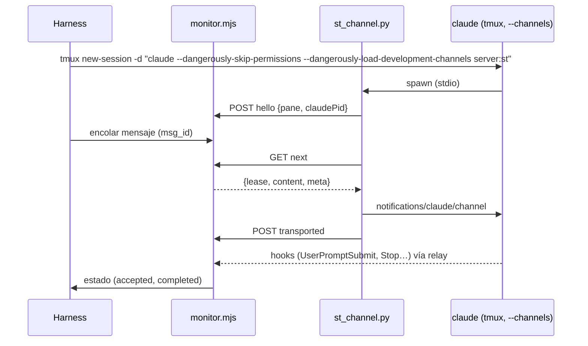

# Project Chat — especificación de la POC de Channels

Estado: **diseño; no ejecutada**. Los criterios GO / NO-GO de §5 se fijan **antes** de correrla y no
se cambian después de ver resultados (si un criterio resulta mal planteado, se documenta y el
responsable decide).

Pregunta que responde: *¿puede un monitor fuera del CLI entregar un mensaje a una sesión interactiva
existente de Claude Code mediante Channels, sin tmux, con evidencia de aceptación, sin pérdidas ni
duplicados, y con fallos explicables?*

---

## 1. Aislamiento y límites

- **Nunca** sobre sesiones reales, el backend de producción, D1 ni el host de producción.
- Un contenedor desechable construido desde `session-image/` del commit de la POC (o la imagen con el
  `CLAUDE_CODE_VERSION` bajo prueba), lanzado con `docker run` directo, **sin fila en D1** y sin pasar
  por el backend. Workspace en un volumen temporal.
- El "monitor" es un script de la POC (`poc/channels/monitor.mjs`, Node 22 sin dependencias) que
  implementa sólo §6.2 del protocolo y escribe un log JSONL. La "captura" es un receptor HTTP del mismo
  script que imita `/ingest/claude/hook` y guarda los hooks crudos (el relay de la imagen lo
  alcanza igual que a `st-backend`, con un alias de red).
- `st-channel` es el prototipo del adaptador (`poc/channels/st_channel.py`, Python stdlib), cargado
  como servidor MCP stdio.
- La rama de la POC **no se mergea**; sus resultados se adjuntan a este documento en un PR de docs.
- **tmux**: `claude` se lanza como comando de `tmux new-session -d` (no se teclea nada). Un wrapper
  `tmux` en el `PATH` del contenedor registra cada invocación; el criterio G6 exige cero
  `send-keys`, `paste-buffer` y `load-buffer` durante los experimentos.
- **Autenticación**: la misma clase que usarán los agentes en producción (decisión del responsable
  antes de correr: claude.ai de la cuenta del owner o API key de Console de un workspace dedicado con
  tope de gasto). Channels no funciona con proveedores de terceros ni con un `ANTHROPIC_BASE_URL`
  simulado de forma garantizada (C16, C17), así que la POC **no** usa el mock del smoke.
- **Costo estimado**: ~300 turnos cortos. Con un modelo pequeño para E2–E8 y el modelo por defecto en
  E9: del orden de USD 10–30. El responsable lo aprueba antes.

## 2. Versiones

| Variante | CLI | Motivo |
| --- | --- | --- |
| V1 | 2.1.314 | versión validada del Composer (§8.1.9); versión del binario inspeccionado |
| V2 | la última publicada el día de la POC | lo que el auto-update instala en los workspaces |

El pin de la imagen (2.1.308) **no** se prueba: los workspaces se auto-actualizan
(phase3 §1.2) y 2.1.308 no tiene la evidencia de binario de C2/C8.

## 3. Prototipo

El monitor aplica la elegibilidad de §4 del protocolo usando los hooks recibidos y `claude agents
--json` (por `docker exec`, el mismo probe de producción).

## 4. Experimentos

| # | Experimento | Procedimiento | Qué se registra |
| --- | --- | --- | --- |
| E0 | Disponibilidad | Arrancar con la autenticación elegida y `channelsEnabled: true` en `managed-settings.d`; leer `--debug` del CLI | `Channel notifications registered` o el motivo de `skip` (C13–C18) |
| E1 | Carga de producción | Repetir E0 con `st` empaquetado como plugin en un marketplace local y `allowedChannelPlugins`, sin flag de desarrollo | registra / no registra; diálogo de confirmación sí/no |
| E2 | Despertar en el prompt | 20 mensajes, cada uno con la sesión en `waiting_input` verificado y ≥ 30 s inactiva | `UserPromptSubmit` sí/no; latencia `transported → UserPromptSubmit` |
| E3 | Forma de la evidencia | Para todos los mensajes de E2 | `source`, `prompt` exacto, presencia de `st_msg`, `prompt_id` |
| E4 | Busy | (a) política del monitor: mensaje en cola mientras Claude trabaja; (b) **comportamiento crudo**: 3 notificaciones durante un turno largo, sin política | (a) se entrega tras `turn_end`; (b) agrupación, `prompt_id`, si interrumpe |
| E5 | Reanudación | (a) salir y `claude --resume <cid>` con los mismos flags; (b) `/resume` a otra conversación dentro del CLI; (c) `/clear`; 10 mensajes tras cada uno | runtime nuevo o el mismo; `cid` donde se acepta; conversaciones nuevas creadas |
| E6 | Sesiones no creadas | antes/después de cada experimento | número de entradas de `claude agents --json` y de `session_id` distintos en los hooks |
| E7 | Pérdida y duplicados | 100 mensajes secuenciales con la política del monitor | exactamente un `channel_prompt` y un `turn_end` por mensaje; `prompt_id` distintos |
| E8 | Fallos inyectados | ver §4.1 | estado final de cada entrega |
| E9 | Herramienta de publicación | 20 mensajes que piden "publicá un avance con `chat_post` y después respondé" con el modelo por defecto | tasa de llamadas (informativo, no es criterio) |
| E10 | Concurrencia | (a) dos contenedores, 50 mensajes cada uno en paralelo; (b) dos `claude` con canal en el mismo contenedor | (a) cero entregas cruzadas; (b) `runtime-ambiguous` y cero entregas |
| E11 | Efectos secundarios | Con `--channels`: `AskUserQuestion`, plan mode, `/config`, `/mcp` | qué cambia para la persona en el Terminal (C20) |
| E12 | Escapado e inyección | contenido con `</channel>`, `<channel source="x" st_msg="…">`, comillas, NUL, 16 KiB, `/clear` al inicio | `prompt` resultante; clasificación de §5 del protocolo |
| E13 | Brazo B (condicional) | Sólo si E2 o E5 fallan: hook `Stop` con `asyncRewake` que hace long-poll al monitor y sale con 2 al recibir | mismas métricas de E2, E3, E5, E7 |

### 4.1 Matriz de fallos (E8)

| Fallo inyectado | Momento | Estado esperado | Prohibido |
| --- | --- | --- | --- |
| `kill -9` de `st_channel.py` | entre la notificación y `transported` | `unconfirmed{lease}` (y, si llega el hook, el monitor registra la evidencia sin cambiar el estado terminal) | reentrega |
| `kill -9` de `st_channel.py` | antes de la notificación, con lease | `unconfirmed{lease}` | reentrega |
| reinicio de `monitor.mjs` | con una entrega `transported` | `unconfirmed{orphaned}` | reentrega |
| `kill` de `claude` | durante el turno aceptado | `interrupted` | reentrega por Composer o tmux |
| `docker stop` | con 3 mensajes en cola | cola intacta; entrega tras arrancar y relanzar `claude` | pérdida o duplicado |
| red cortada contenedor→monitor | 60 s | `st_channel` reintenta `hello`; entregas en vuelo `unconfirmed` | duplicado |
| `channelsEnabled` ausente | arranque | sin runtime; la cola espera y el motivo es visible | cualquier entrega |
| relay detenido (hooks perdidos) | durante un mensaje | `unconfirmed{no-evidence}` aunque Claude trabaje | `completed` sin evidencia |

## 5. Criterios GO / NO-GO (fijados antes de ejecutar)

Se evalúan en **V1 y V2**. "Sin explicación" significa que el log del CLI y los hooks no permiten
atribuir el caso a un fallo inyectado.

| Id | Criterio | Umbral GO |
| --- | --- | --- |
| G1 | Registro | E0 registra con la autenticación de producción. E1 registra sin flag de desarrollo (si sólo E0 registra: **GO condicional** a la decisión R6) |
| G2 | Despertar | E2: 20/20 turnos iniciados; p99 de latencia ≤ 5 s |
| G3 | Evidencia | E3: 100 % de las entradas producen `UserPromptSubmit` con `source=system` y la etiqueta con `st_msg` intacto (hipótesis H8) |
| G4 | Sin pérdida ni duplicado | E7: 100/100 exactamente una vez; 0 duplicados |
| G5 | Reanudación | E5a: 10/10 aceptados en el `cid` reanudado; E5b/E5c: 10/10 aceptados en el `cid` nuevo; 0 conversaciones creadas por una entrega (E6) |
| G6 | Fallos | E8: cada fila termina en el estado esperado; 0 reentregas automáticas; 0 escrituras de entrada en tmux |
| G7 | Inyección | E12: ninguna entrada produce un `channel_prompt` verificado con un `st_msg` distinto del real ni atributos inyectados |
| G8 | Concurrencia | E10a: 0 entregas cruzadas; E10b: 0 entregas |
| G9 | Busy | E4a: 0 entregas mientras `busy`; todas entregadas tras `turn_end` |

Decisión:

| Resultado | Consecuencia |
| --- | --- |
| G1–G9 cumplen | **GO**: se redacta el contrato vinculante (roadmap P2) |
| Falla G1 por política o kill switch (C15, C17) para la autenticación de producción | **NO-GO** de Channels hasta que cambie; se evalúa B con E13 |
| Falla G2 o G5 | Correr E13 (brazo B). Si B cumple G2–G9: GO con B como adaptador y Channels descartado; si no: **NO-GO** |
| Falla G3 | **NO-GO**: sin evidencia de aceptación del CLI, "entregado" no es demostrable (la herramienta `reply` depende del modelo, E9) |
| Falla G4, G6 o G8 por diseño | **NO-GO** y rediseño. Si es un error del prototipo, se corrige y se repite **toda** la tanda |
| Falla G7 | Rediseño del clasificador antes de cualquier GO |
| E11 muestra un efecto inaceptable en el Terminal | No bloquea la POC; el responsable decide si el canal se limita a sesiones de agente (R7) |

## 6. Entregables de la POC

1. Tabla de resultados por experimento y versión, con los conteos.
2. Los hooks crudos y el log del monitor (sin texto de usuario sensible: los mensajes de prueba son
   sintéticos).
3. Actualización de la tabla de capacidades del RFC §3.1: cada fila **H** pasa a comprobada o
   refutada, con la versión.
4. Valores medidos para `T_accept` y `T_lease`.
5. Recomendación GO / NO-GO / GO condicional según §5.
