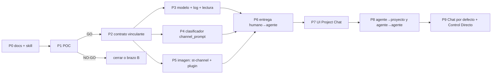

# Project Chat — roadmap incremental

Estado: borrador. Cada fase es uno o más PRs independientes, con su bandera apagada por defecto y
comportamiento neutro cuando está apagada. **Nada de P2 en adelante empieza sin el GO de la POC.**
No interfiere con el release conjunto pendiente (#502–#511): todo es aditivo y va detrás de banderas.

| Fase | Contenido | PRs | Depende de | Riesgo principal | Sale cuando |
| --- | --- | --- | --- | --- | --- |
| **P0** | Estos documentos + skill `architecture-spec` | 1 (docs, draft) | — | — | el responsable cierra las decisiones R1–R8 |
| **P1** | POC aislada (§04): primero **sólo** la fase 0 con `fakechat` (autorización propia); la POC completa con un GO separado. Sólo con la suscripción del responsable | rama sin merge + 1 PR de docs con resultados | P0; autorización de la fase 0 | Channels bloqueado para la suscripción (C15, C17, #105326) ⇒ NO-GO, sin cambiar a API | tabla de resultados + recomendación |
| **P2** | `docs/PROJECT_CHAT.md` vinculante (protocolo con los valores de la POC) | 1 (docs) | GO | que la POC deje hipótesis abiertas | aprobado por el responsable |
| **P3** | Migración D1 (3 tablas), `projectChat/store.ts` (formato de `conversation/store.ts`, escritura con fsync de `paneRecord.ts`, sin ruta de descarte), rutas de lectura y CRUD de proyectos/agentes, `/ws/project/` en `WS_PATH_PREFIXES` | 2 (backend, luego API+WS) | P2 | duplicar lógica del store en vez de extraerla | tests de store (seq, snapshot, rotación) y de `wsUpgrade` |
| **P4** | Clasificador `channel_prompt` en la ingesta + copia idéntica en el frontend; render como marcador. **Cambio de contrato previo** (CONVERSATION.md §4.6): identidad de `user_prompt`/`internal_prompt` = `prompt_id` + hash del `prompt`, para no descartar la entrada encolada de §8.2.1 | 1 | P2 | falsos positivos con texto humano | tests de tabla como `internalPrompt` |
| **P5** | `st-channel` (Python stdlib) en la imagen; `/st-relay/status` con contador acumulado de pérdidas (§3.1 A7 del protocolo); plugin y marketplace local; managed settings `channelsEnabled`/`allowedChannelPlugins` y alias con `--channels` **sólo** para sesiones de agente; `CHANNEL_CLI_VERSIONS`; smoke en el Session Image workflow (variantes de CLI) | 2 (imagen, activación) | P2 | cambios de la API de Channels entre versiones | smoke con la variante de CLI validada |
| **P6** | Monitor: `/ingest/channel/*`, elegibilidad, estados, recuperación; exclusión mutua con el Composer (§8.1.3 gana una precondición `monitor-delivery-in-flight`, cambio de contrato pequeño y propio) | 2 | P3–P5 | carreras entre `next`, hooks y probe | tests de la matriz de fallos de la POC con fakes; smoke real |
| **P7** | UI: lista de proyectos, chat, menciones, roster, estados, tarjetas de resultado; v2 shell; Playwright con el mock backend | 2–3 | P6 | regresión del invariante del Terminal (vista nunca redimensiona) | e2e + capturas |
| **P8** | `chat_post`, `chat_send`, aprobaciones, aristas `allow`, límites M2–M7 | 2 | P7 | bucles y presión de cola | tests de límites y de cadena |
| **P9** | Project Chat como vista por defecto; Composer movido a "Control Directo" | 1 (frontend) | P8 + piloto | confusión entre los dos caminos | decisión del responsable tras el piloto |

## Riesgos transversales

| Riesgo | Mitigación |
| --- | --- |
| Revalidar cada versión del CLI exige autenticación real (no sirve el mock de CI) | Pin del CLI en sesiones de agente; corrida manual firmada con la suscripción del responsable, sin gasto adicional, antes de subirlo (R9) |
| Channels cambia o se apaga (research preview, kill switch) | `CHANNEL_CLI_VERSIONS`; degradación visible; el chat y la cola siguen funcionando, sólo falla el transporte; brazo B documentado |
| Dos mecanismos de entrega (Channels y Composer) que derivan | El monitor nunca usa Composer; Composer congelado (sin features nuevas); un solo log por hecho |
| Costo de mantener `st-channel` | Proceso sin estado, ≤ ~400 líneas, sin dependencias; smoke por variante de CLI |
| D1 en caliente | Sólo metadatos; los mensajes no tocan D1 |
| Recreación necesaria para habilitar un agente | Motor 3.0d existente; habilitar es explícito por sesión |
