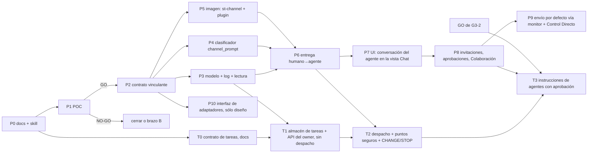

# Project Chat — roadmap incremental

Estado: borrador. Cada fase es uno o más PRs independientes, con su bandera apagada por defecto y
comportamiento neutro cuando está apagada. **Nada de P2 en adelante empieza sin el GO de la POC.**
No interfiere con el release conjunto pendiente (#502–#511): todo es aditivo y va detrás de banderas.

Actualización 2026-11-03: la experiencia es la **conversación del agente con invitados temporales**
(R10–R15 en [02 §9](./02-architecture-rfc.md#9-decisiones-del-responsable-2026-11-02)). Cambian P3,
P7, P8 y P9, y se agrega P10. La POC, sus gates y PASS-B no cambian.

Actualización 2026-11-06: se agrega la línea **T** de tareas por agente
([13-agent-tasks.md](./13-agent-tasks.md)), **sólo como propuesta**: nada de T1 en adelante empieza sin
la aprobación de TD1–TD11 y sus dependencias. No cambia P1–P10 ni la POC.

| Fase | Contenido | PRs | Depende de | Riesgo principal | Sale cuando |
| --- | --- | --- | --- | --- | --- |
| **P0** | Estos documentos + skill `architecture-spec` | 1 (docs, draft) | — | — | el responsable cierra las decisiones (R1–R9 el 2026-11-02; R10–R15 el 2026-11-03) |
| **P1** | POC aislada (§04): primero **sólo** la fase 0 con `fakechat` (autorización propia); la POC completa con un GO separado. Sólo con la suscripción del responsable | rama sin merge + 1 PR de docs con resultados | P0; autorización de la fase 0 | Channels bloqueado para la suscripción (C15, C17, #105326) ⇒ NO-GO, sin cambiar a API | tabla de resultados + recomendación |
| **P2** | `docs/PROJECT_CHAT.md` vinculante (protocolo con los valores de la POC) | 1 (docs) | GO | que la POC deje hipótesis abiertas | aprobado por el responsable |
| **P3** | Migración D1 (`projects`, `project_agents` con `provider`/`role`, `project_agent_edges`, `chats`, `chat_participants`; protocolo §2.1), `projectChat/store.ts` con **un log por conversación anfitriona** más el log de runtimes del proyecto (formato de `conversation/store.ts`, escritura con fsync de `paneRecord.ts`, sin ruta de descarte), rutas de lectura, CRUD de proyectos/agentes y de conversaciones anfitrionas (una activa por agente, archivar), participaciones con `participants_version`, `/ws/project/` en `WS_PATH_PREFIXES` | 2 (backend, luego API+WS) | P2 | duplicar lógica del store en vez de extraerla; D1 y log en desacuerdo sobre participantes | tests de store (seq, snapshot, rotación), del CAS de `participants_version`, del índice "una activa por anfitrión" y de `wsUpgrade` |
| **P4** | Clasificador `channel_prompt` en la ingesta + copia idéntica en el frontend; render como marcador. **Cambio de contrato previo** (CONVERSATION.md §4.6): identidad de `user_prompt`/`internal_prompt` = `prompt_id` + hash del `prompt`, para no descartar la entrada encolada de §8.2.1 | 1 | P2 | falsos positivos con texto humano | tests de tabla como `internalPrompt` |
| **P5** | `st-channel` (Python stdlib) en la imagen; `/st-relay/status` con contador acumulado de pérdidas (§3.1 A7 del protocolo); plugin y marketplace local; managed settings `channelsEnabled`/`allowedChannelPlugins` y alias con `--channels` **sólo** para sesiones de agente; `CHANNEL_CLI_VERSIONS`; smoke en el Session Image workflow (variantes de CLI) | 2 (imagen, activación) | P2 | cambios de la API de Channels entre versiones | smoke con la variante de CLI validada |
| **P6** | Monitor: `/ingest/channel/*`, elegibilidad (incluida la participación `active` con el mismo `participation_id` al prestar), estados, recuperación; exclusión mutua con el Composer (§8.1.3 gana una precondición `monitor-delivery-in-flight`, cambio de contrato pequeño y propio) | 2 | P3–P5 | carreras entre `next`, hooks y probe | tests de la matriz de fallos de la POC con fakes; smoke real |
| **P7** | UI: **extiende la vista Chat existente de la sesión** (no es una pantalla de proyecto): carril del anfitrión y tarjetas de invitado, chip del anfitrión prellenado, selector `@` (nombre, proveedor, rol, disponibilidad), "Invitar a @x", vista previa del contexto sin nada preseleccionado, barra de participantes con "Retirar", estados de entrega; Proyectos como directorio; v2 shell; Playwright con el mock backend | 2–3 | P6 | regresión del invariante del Terminal (vista nunca redimensiona); confundir la tarjeta de un invitado con el anfitrión | e2e + capturas |
| **P8** | `chat_post`, `chat_send`, `chat_invite` (siempre con aprobación), anclaje por `in_reply_to`, aprobaciones de mensajes e invitaciones, aristas `allow` entre participantes activos, **modo Colaboración** (permiso, presupuesto, vencimiento, "Detener", banner), límites M2–M13 | 2–3 | P7 | bucles, presión de cola, alcance de la Colaboración | tests de límites, de cadena, de 403 `not-a-participant` y de cada fin de Colaboración (`budget`, `expired`, `participant-removed`, `chat-archived`, revocada) |
| **P9** | El envío por defecto de la conversación anfitriona pasa al monitor **sólo tras el GO de Channels**; hasta entonces sigue el Composer 3.2. Composer como "Control Directo" | 1 (frontend) | P8 + piloto + GO de Channels | confusión entre los dos caminos | decisión del responsable tras el piloto |
| **T0** | Contrato mínimo de tareas (capa A, 13 §2) en estos documentos | 1 (docs, este draft) | P0 | confundirlo con gestión de proyectos | el responsable aprueba TD1–TD11 |
| **T1** | Log de tareas por proyecto + snapshot (13 §6), API del owner (`CREATE`, `UPDATE`, `STOP` de pendientes = cancelar), lista de la cola en la UI; **sin despacho** | 2 (backend, UI) | T0, P3 | duplicar el store en vez de extraerlo | tests de CAS, idempotencia, verbo/estado y recuperación desde el log |
| **T2** | Despacho como entrega del monitor, una activa por agente, SP1/SP2, `CHANGE`/`STOP` de activas, `task_*` en `st-channel` | 2 | T1, P6, TG1–TG5 en la POC | instrucciones que esperan para siempre sin punto seguro | matriz de 13 §5–§6 con fakes + smoke real |
| **T3** | Instrucciones emitidas por agentes, siempre con aprobación humana | 1–2 | T2, P8, **GO de G3-2** | ampliar G3-2 por la puerta de atrás | tests de 403 por creador/asignado y de aprobación |
| **P10** | Interfaz de adaptadores de runtime (`provider`, capacidades declaradas; RFC §5.2): **sólo diseño**, ningún adaptador nuevo, sin Codex ni ChatGPT | 1 (docs) | P2 | atar el monitor a Channels por descuido | revisión: estados de entrega y R8 sin referencias a Channels fuera del adaptador Claude Code |

## Riesgos transversales

| Riesgo | Mitigación |
| --- | --- |
| Revalidar cada versión del CLI exige autenticación real (no sirve el mock de CI) | Pin del CLI en sesiones de agente; corrida manual firmada con la suscripción del responsable, sin gasto adicional, antes de subirlo (R9) |
| Channels cambia o se apaga (research preview, kill switch) | `CHANNEL_CLI_VERSIONS`; degradación visible; el chat y la cola siguen funcionando, sólo falla el transporte; brazo B documentado |
| Dos mecanismos de entrega (Channels y Composer) que derivan | El monitor nunca usa Composer; Composer congelado (sin features nuevas); un solo log por hecho |
| Costo de mantener `st-channel` | Proceso sin estado, ≤ ~400 líneas, sin dependencias; smoke por variante de CLI |
| D1 en caliente | Sólo metadatos; los mensajes no tocan D1 |
| Recreación necesaria para habilitar un agente | Motor 3.0d existente; habilitar es explícito por sesión |
| Turnos no pedidos entre agentes (ping-pong) | La respuesta de un invitado no vuelve sola (R12); la Colaboración sólo la activa la persona, por conversación, con presupuesto (≤ 20) y vencimiento (≤ 2 h), y se detiene con un clic |
| Entregas a un conjunto que la persona no vio | `to[]` explícito + `participants_version` (409 `participants-changed`); participación comprobada al prestar |
