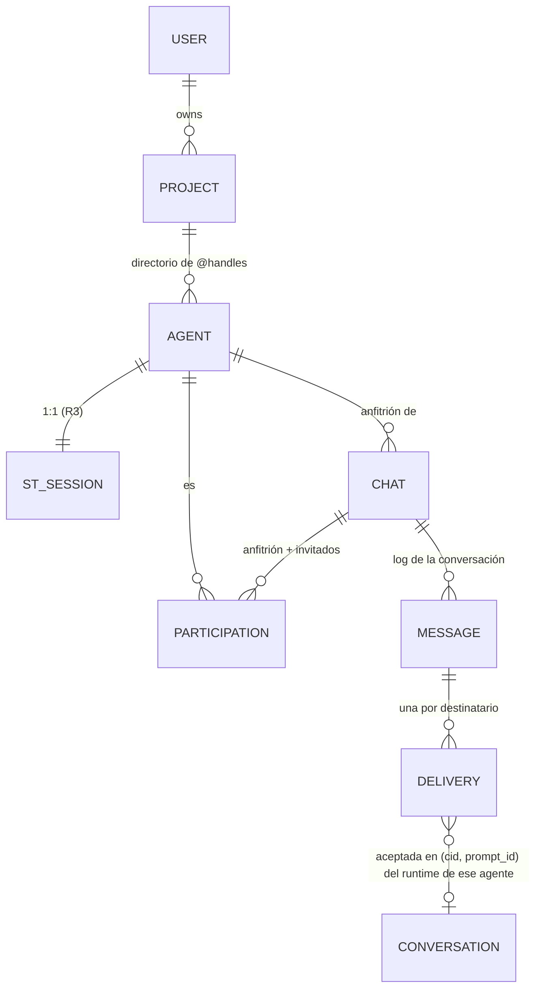

# Propuesta: conversación del agente con invitados temporales

Estado: **aprobada por el responsable el 2026-11-03** con las decisiones D1–D6 (D3 **modificada**:
se agrega un modo Colaboración autorizado explícitamente por la persona, diseñado en 02 §5.6, 03 y 06
§6). Ya está aplicada a 01, 02, 03, 05 y 06, y registrada como R10–R15 en
[02 §9](./02-architecture-rfc.md#9-decisiones-del-responsable-2026-11-02). Este documento queda como
registro de referencia de la propuesta y sus razones; ante cualquier diferencia, mandan los
documentos vigentes.

Interpretaciones confirmadas por el responsable (2026-11-03, segunda revisión):
1. M3 son destinatarios por mensaje (5); M5, mensajes de agentes por cadena (20).
2. M4 (profundidad 3) no limita los intercambios dentro de una Colaboración, a condición de que M5
   sea un límite **global** por cadena, que renovar el permiso no reinicie el presupuesto de la
   cadena y que la cadena conserve su identificación y sus contadores al cruzar la frontera entre
   Colaboración y mensajes ordinarios (03 §8, 02 §5.6).
3. D1 es el estado vigente de los participantes y el log la historia durable. Una discrepancia
   bloquea los préstamos hasta una reconciliación verificable e idempotente; un evento
   `recovered: true` lleva la discrepancia, las versiones y la procedencia conocida, sin inventar
   una aprobación humana; los permisos de Colaboración no se reconstruyen desde D1; si la
   reconciliación no es inequívoca, la conversación queda fail-closed (03 §9.5).

Estado original: propuesta de cambios de diseño (2026-11-03); no aprobada. Una vez aprobada, se
aplica a 01, 02, 03, 05 y 06 según §9.

Esta propuesta **no** cambia:
- los gates de Channels: G1–G12, G3 (G3-A no está aprobado), R8, PASS-A/PASS-B y la POC;
- el Composer 3.2 como Control Directo y recuperación;
- PASS-B0.

No hay código ni migraciones.

## 1. La decisión de producto

| | Diseño vigente (01/06) | Nueva dirección |
| --- | --- | --- |
| Experiencia principal | Un chat **del proyecto**, como una sala | La conversación **individual de cada agente**, como hoy con el Composer |
| Mensaje sin mención | Inválido: "Elegí al menos un agente" | Va al **agente anfitrión** de esa conversación |
| `@otro` | Destinatario de un mensaje del proyecto | **Invita** a `@otro` a esta conversación como participante temporal |
| Sesiones | Una por agente (R3) | Igual. Cada invitado conserva su runtime, sesión e historial; **no** se fusionan |
| Agente → agente | `chat_send` con aprobación o arista `allow` (R4) | Igual, aplicado también a invitar y a mencionar desde un agente |
| Proveedores | Sólo Claude Code | El modelo admite otros (Codex) **conceptualmente**; nada se implementa |

**Qué se conserva:** la entrega por agente (`agent_id` → runtime), los estados de entrega, R8, la
exclusión mutua con el Composer, los límites anti-bucle y "un hecho, un lugar".

**Lo que cambia:** el contenedor de la conversación (de proyecto a conversación anfitriona), quiénes
participan y cuándo, y quién recibe un mensaje cuando no hay mención.

## 2. Identidad y propiedad de la conversación anfitriona

**Modelo propuesto** (cambia 02 §5.2 y 03 §1):



- **`chat_id`** (UUID v4 del backend) identifica la conversación anfitriona. Su dueño es la persona
  (`owner_user_id`; R5, owner-only). Su **anfitrión** es un `agent_id` fijado al crearla y que
  **nunca cambia**: para hablar con otro anfitrión se abre otra conversación. Así "sin mención" tiene
  siempre un significado estable.
- **Dónde vive la conversación.** No es la conversación del CLI (`cid`). Un `cid` cambia con
  `/clear`, `/resume` o un reinicio, y sigue siendo **evidencia** de dónde se procesó cada entrega,
  igual que hoy. La conversación anfitriona sobrevive a esos cambios. Los turnos del anfitrión se
  ven por referencia (§5), no copiados.
- **Proyecto.** Se conserva como **directorio y frontera de permisos**:
  - los `@handles` son únicos dentro del proyecto;
  - las aristas `allow` son del proyecto;
  - un invitado tiene que ser agente del **mismo** proyecto en v1.

  Deja de ser una sala de chat.
- **Cuántas conversaciones por agente.**
  - **Recomendación v1:** **una conversación anfitriona activa por agente**, que se puede archivar
    para abrir una nueva. Es la "conversación individual" que pediste y evita elegir entre varias
    para el mismo anfitrión.
  - Varias simultáneas es una ampliación posterior.

  Decisión **D1**.

## 3. Ciclo de vida de una invitación y retiro

**Participación** = (`chat_id`, `agent_id`, `participation_id`, `role: host|guest`, `state`). El
`participation_id` cambia con cada reinvitación. Así, una entrega, un préstamo o una respuesta de
una participación anterior **nunca** se enganchan a la nueva.

```
            invitar (persona)                    primer mensaje entregado
  (ninguno) ───────────────► invited ────────────────────────────► active
                 │  invitar (agente) ⇒ awaiting_approval ─aprobada─┘   │
                 │                         └─rechazada─► declined       │
                 └──────────────── retirar (persona) ◄──────────────────┘
                                           │
                                           ▼
                                        removed   (historial intacto; reinvitar = participation_id nuevo)
```

- **Invitar desde la persona.** La primera `@mención` de un agente que no participa muestra, antes
  de enviar, el chip "Invitar a @x a esta conversación". Enviar es la confirmación. El servidor
  registra `participant{invited}` **antes** del `message`.
- **Invitar desde un agente** (un anfitrión que pide ayuda): siempre `awaiting_approval` en v1,
  **aunque haya una arista `allow`**. Las aristas autorizan mensajes entre participantes actuales,
  no agregar participantes. Es decisión **D4**.
- **Retirar.** Lo hace la persona desde la barra de participantes. Efectos:
  - entregas `queued` o `awaiting_approval` para ese agente ⇒ `cancelled{participant-removed}`;
  - entregas en vuelo (`transporting`/`transported`/`accepted`): **no se pueden recuperar**
    (Channels no tiene cancelación). Siguen su curso, y su resultado se muestra marcado "llegó
    después del retiro" sin entregarse a nadie;
  - todo `chat_post` posterior de ese agente a la conversación ⇒ 403 `not-a-participant`;
  - el historial no se toca.
- **El anfitrión no se retira.** Se archiva la conversación: el estado pasa a `archived`, las
  colas se cancelan y queda de solo lectura.
- **Sesión del invitado eliminada o recreada.** La participación sigue (el `agent_id` es estable),
  y la disponibilidad lo muestra. Si se quita el **agente** del proyecto (`removed_at`), todas sus
  participaciones pasan a `removed`.

## 4. Enrutamiento sin mención, y con mención

- **El servidor nunca interpreta el texto.** Como hoy en 06 §4, las menciones son **chips**: `to[]`
  explícito con `agent_id`.
- **Sin mención,** el cliente pone el chip del anfitrión, visible y removible antes de enviar:
  "Para: @backend (anfitrión)". El servidor **no infiere** el destinatario. Recibe `to[]` y
  `participants_version`; si cambió la versión (alguien fue invitado o retirado), contesta 409
  `participants-changed` y conserva el borrador. Así no se envía a un conjunto que la persona no vio.
- **Con mención,** recibe **sólo** quien está en `to[]`. Mencionar a `@otro` **no** entrega también
  al anfitrión; para eso, `@backend @otro`. Es la regla más predecible y evita turnos inesperados
  en el anfitrión. Es decisión **D2**; la alternativa sería anfitrión siempre más los mencionados.
- **Visibilidad no es entrega.** Que todos los participantes "vean" la conversación en la UI no
  significa que reciban cada mensaje: un agente sólo procesa lo que se le **entrega** (§5).
- Se registra en el `message`: `routing: default-host | explicit`, `participants_version` y el
  `to[]` resuelto.

## 5. Qué contexto recibe cada invitado

**Principio:** el invitado recibe el **mensaje que lo menciona**, más el contexto que la persona
autoriza en ese envío. Nada más.

| Contenido | ¿Lo recibe el invitado? |
| --- | --- |
| El texto del mensaje que lo menciona | Sí |
| Mensajes anteriores de la conversación | Sólo los que la persona **selecciona** al enviar ("Incluir contexto": los últimos N o elegidos). Hay vista previa del total antes de enviar |
| Resultados del anfitrión u otros invitados | Sólo si se seleccionan, y como cita con autor |
| La conversación del CLI del anfitrión (herramientas, salidas, archivos) | **Nunca**. "Un hecho, un lugar": el hilo del anfitrión no viaja |
| Credenciales, entorno o rutas de la sesión anfitriona | Nunca |

**Sobre de entrega** (se agrega a la `meta` de Channels de 03 §6.2):
- `chat_id`, `msg_id`, `participation_id`, `from{kind, agent_id?}`;
- `context[]`: cada elemento con `msg_id` y autor, marcado como **cita y no instrucción**.

El total respeta M1. Las instrucciones del servidor de canal dicen que el contexto es material
citado.

**Agente → agente:** un `chat_send` del anfitrión lleva sólo su texto. El contexto adicional lo
agrega la persona al aprobar, nunca el agente solo.

## 6. Cómo se publican las respuestas sin confundirlas con el anfitrión

**Dos carriles en una misma línea de tiempo**, ordenados por el `seq` del log de la conversación:
- **Carril principal (el anfitrión).** Tus mensajes, y los turnos del anfitrión renderizados
  **desde su captura**, por referencia a (`cid`, `prompt_id`), igual que la vista Chat de hoy. Es
  la experiencia del Composer.
- **Tarjetas de participante** (invitados). Llevan:
  - un encabezado con avatar, `@handle`, proveedor y el texto "→ respondiendo a <mensaje>";
  - borde y fondo distintos;
  - **nunca** la burbuja del asistente anfitrión.

  El contenido es la referencia al `turn_end` del invitado (R8), más los `chat_post` con
  `in_reply_to`.

Cada elemento muestra **autor y destinatarios** ("Vos → @docs", "@docs → vos").

**Atribución:**
- Una tarjeta de invitado sale **sólo** de una entrega a ese invitado, con su correlación R8.
- `ended_unattributed` sigue igual: un informe compartido nunca se presenta como respuesta.
- Un `chat_post` se publica sólo si su autor es participante **activo** y su `in_reply_to` es un
  mensaje que se le **entregó** a él en **esa** conversación. Si no, 403.

**¿El anfitrión recibe la respuesta del invitado?** En v1, **no automáticamente**: se muestra a la
persona. Para pasársela al anfitrión, la persona la cita en un mensaje al anfitrión con un botón
"Enviar a @anfitrión". Evita el ping-pong entre agentes y el costo de turnos no pedidos. Es decisión
**D3**; la alternativa es una arista `allow` invitado→anfitrión dentro de la conversación.

## 7. Cómo evitar entregas a sesiones equivocadas

| Riesgo | Protección |
| --- | --- |
| Un `@handle` renombrado o repetido | Los mensajes guardan `agent_id`, nunca el handle. El selector muestra handle, nombre, proveedor, rol y sesión. Un handle ambiguo no se confirma |
| El conjunto de participantes cambió entre que lo viste y enviaste | `participants_version` ⇒ 409 `participants-changed` |
| Un retiro mientras el mensaje espera | La elegibilidad (02 §5.5) suma una condición: participación `active` con el mismo `participation_id` **en el momento del préstamo** (`next`) |
| Un agente invitado en varias conversaciones | Una entrega en vuelo por agente (regla 3 vigente), que lleva su `chat_id`. Las respuestas se enrutan **por `in_reply_to` → `chat_id`**, nunca por "la última conversación" |
| Un agente publica en una conversación ajena | Regla de §6: participante activo, y `in_reply_to` entregado a él |
| El runtime equivocado dentro de la sesión correcta | Sin cambios: runtime único, identidad verificada, `waiting_input` (02 §5.5). La procedencia hasta el backend es PASS-B (04 §1.14), que no cambia |
| Una invitación de un agente que lleva a otro agente | Siempre aprobación en v1 (§3) |
| Bucles | M2–M7 se mantienen por cadena, y se agregan dos límites: participantes por conversación ≤ 6 e invitaciones iniciadas por agentes ≤ 2 por cadena. La respuesta de un invitado no vuelve sola al anfitrión (D3) |

## 8. Otros proveedores (sólo modelo; nada se implementa)

**Separar el agente lógico de su adaptador de runtime:**
- `agent.provider`: `claude-code` en v1, y `codex` reservado;
- `agent.role`: texto corto del owner, para el selector;
- **adaptador**: declara sus **capacidades**, y el monitor y la UI se rigen por ellas.

| Capacidad | Claude Code (hoy) | Requisito para cualquier proveedor |
| --- | --- | --- |
| Transporte a una sesión interactiva | Channels (si pasa la POC); Composer sólo como Control Directo | Propio, con su POC y sus gates equivalentes a G1–G12 |
| Evidencia de aceptación | `channel_prompt` (G3, hoy no cumplido) / PASS-A/B | Evidencia verificable del propio proveedor; sin evidencia ⇒ `unconfirmed`, igual que hoy |
| Resultado | `turn_end` (R8) | Un fin de turno correlacionable; si no existe, `ended_unattributed` |
| Identidad del runtime | pid/`starttime`/pane, probe | Equivalente verificable, o el agente no es elegible |
| Captura del historial | `conversation/` | Adaptador de captura propio. El historial nunca se fusiona con el de otro proveedor |

**Consecuencias para el diseño de hoy:**
- los estados de entrega y R8 ya son neutrales al proveedor;
- `channel_prompt`, `st-channel` y CLAUDE.md pasan a ser **del adaptador Claude Code**;
- el sobre de §5 no depende de Channels;
- la disponibilidad del selector viene del adaptador (`sin canal` ⇒ no elegible).

**Fuera de alcance:** Codex, ChatGPT, credenciales de otros proveedores y cualquier cambio de gates.

## 9. Impacto por documento (se aplica sólo tras la aprobación)

| Documento | Cambios |
| --- | --- |
| **01-vision** | §1: "conversación del agente con invitados" reemplaza "chat del proyecto". §3: reescribir U1–U5 (U1 sin mención ⇒ anfitrión; U4 dos agentes = invitar a uno; U5 un agente invita o pide ⇒ aprobación); nuevos U8 (invitar), U9 (retirar sin perder el historial) y U10 (elegir agente con el selector). §4: principios nuevos, "el destinatario siempre está visible antes de enviar" y "contexto mínimo autorizado". §5: multiproveedor sólo como modelo |
| **02-architecture-rfc** | §5.2: modelo de §2 (CHAT, PARTICIPATION, `provider`). §5.3: filas nuevas para tarjetas de invitado y turnos del anfitrión por referencia. §5.4: sin cambios en el flujo; `chat_id`/`participation_id` en `meta`. §5.5: condición de participación activa. §5.6: invitaciones de agentes. §7: fuga de contexto y publicación en conversaciones ajenas. §9: decisiones R10–R13 (= D1–D4) |
| **03-protocol** | §1: identidades nuevas (`chat_id`, `participation_id`, `participants_version`, `provider`). §2.1: tablas propuestas `chats` y `chat_participants`, con un solo anfitrión por conversación y una conversación activa por anfitrión (D1); la migración se escribe en P3, no ahora. §2.2: log por conversación (`.projects/<pid>/chats/<chat_id>.events.jsonl`), mismo formato y fsync; eventos `chat`, `participant{invited\|joined\|declined\|removed}`; `message` con `chat_id`, `routing`, `participants_version` y `context[]`. §3: `cancelled{participant-removed}` y el marcador "después del retiro". §6.1: API de conversaciones, invitar, retirar y mensajes con `to[]` + `participants_version` (409). §6.2/6.3: `next` lleva `chat_id`; `chat_post` exige `in_reply_to`; `chat_invite` nuevo (siempre aprobación). §8: límites nuevos |
| **05-roadmap** | P3: conversaciones y participaciones en lugar de un único log por proyecto. P7: la UI extiende la **vista Chat existente** de la sesión anfitriona; ya no es una pantalla de proyecto. P8: invitaciones y aprobaciones. P9: el envío por defecto en la conversación anfitriona pasa al monitor **sólo tras el GO de Channels**; hasta entonces el Composer 3.2 sigue siendo el camino. Nueva P10: interfaz de adaptadores (sólo diseño). La POC y PASS-B no cambian |
| **06-ux** | §1: se entra por el agente (sesión → Chat), y Proyectos queda como directorio. §2: maqueta nueva con carril principal y tarjetas de invitado. §4: chip del anfitrión prellenado, selector `@` (nombre, proveedor, rol, disponibilidad), vista previa del contexto, "Invitar a @x". §5: barra de participantes con retirar. §6: Control Directo sin cambios. §7: en mobile, participantes como hoja inferior |

**Lo que sigue igual:** 04-poc (gates, XB-1, PASS-B y B0), 07-review y el contrato del Composer.

## 10. Decisiones para el responsable

| # | Pregunta | Recomendación |
| --- | --- | --- |
| D1 | ¿Cuántas conversaciones anfitrionas por agente? | Una activa por agente; archivar para empezar otra |
| D2 | Con una mención, ¿recibe también el anfitrión? | No: sólo los de `to[]` |
| D3 | ¿La respuesta de un invitado vuelve sola al anfitrión? | No: la persona la reenvía con un clic |
| D4 | ¿Una arista `allow` permite que un agente **invite**? | No en v1: invitar siempre requiere aprobación |
| D5 | ¿Un invitado puede ser de otro proyecto? | No en v1 |
| D6 | ¿Cuánto contexto por defecto en "Incluir contexto"? | Ninguno preseleccionado; la persona elige |
