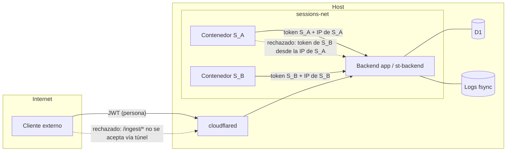

# G3 — autenticidad del emisor y atribución verificable (informe técnico)

Estado: **informe y propuesta; decisiones del responsable (2026-11-05): PR-G3-0 GO, PR-G3-1 GO sólo
implementación y pruebas (bandera apagada, sin merge ni deploy), PR-G3-2 NO-GO por ahora (gate del
roadmap), G3.4 sigue bloqueado.** Revisa el diseño de este directorio (en particular
[03-protocol.md](./03-protocol.md) §1, §2.2, §3, §5, §6 y §7, y [04-poc.md](./04-poc.md) §1.13–§1.14) y
el código de `main` en `1ec4d6c`. No cambia R1–R15, G1–G12 ni el roadmap; donde propone un cambio de
contrato, lo dice. No toca UI, Composer, F1/F2/N14/N17, VM100 ni el kit auditado.

> **Nombres posteriores (2026-11-07):** el 409 `previous-agent-in-flight` de este informe se llama
> `binding-draining` (14 §3.2, 15 §3.6); la regla es la misma. PR-G3-1 se mergeó como `a93232f`.
> Este informe conserva los nombres con los que se aprobó.

## 0. Resumen

- **G3, tal como lo define la POC, es la evidencia de aceptación del lado del receptor**: el
  `UserPromptSubmit` del canal se clasifica como entrega sólo con `source: system` (03 §5). Sigue
  bloqueado: `source` falta en 2.1.314 y 2.1.317. La alternativa B (mods `prompt.submit`) dio PASS-A y
  PASS-B0, y PASS-B1a quedó INCONCLUSIVE.
- **La autenticidad del emisor es otro problema, y no depende del CLI.** Saber qué agente escribió un
  mensaje entre agentes lo decide el backend a partir de **con qué credencial y desde dónde llegó la
  petición**, no de lo que dice el cuerpo. El diseño ya lo plantea en 03 §6.2 y §7: identidad por
  sesión vía `ST_INGEST_TOKEN`, menciones que nunca se leen del texto, anclaje por `in_reply_to`. **No
  hay nada de esto implementado en `main`**: no existen tablas, rutas ni módulo `projectChat`.
- Hay una pieza reutilizable y probada en producción: la autenticación de la ingesta de captura
  (token por sesión con hash en D1, comparación en tiempo constante, invalidación en baja, purga y
  revocación). Tiene una debilidad que importa poco para la captura y mucho para un canal entre
  agentes: **el token es la única barrera**. No se verifica el origen de red, y según la receta de
  despliegue documentada la ruta es alcanzable a través del túnel público.
- **Propuesta mínima:** el principal autenticado es **la sesión, es decir su contenedor**, no el
  modelo. Un request de agente se acepta sólo si pasa **tres comprobaciones de autorización**, todas
  hechas por el backend (no son factores de MFA): el token de la sesión, que el origen de red
  (`req.socket.remoteAddress`) sea la IP del `container_id` vigente de esa sesión en `sessions-net`,
  y que la sesión tenga un vínculo activo con un agente en D1. La autoría la estampa el backend y nunca sale
  del cuerpo. La aceptación (G3 original) sigue siendo un gate aparte, y mientras no se cumpla ningún
  resultado de entrega se presenta como verificado.
- **PR pequeño posible ahora, independiente del smoke y de la UI:** atar `/ingest/*` al origen de red
  del contenedor de la sesión (§7, PR-G3-1). Sirve ya a la captura y es el cimiento del canal. Todo
  lo que crea modelo de Project Chat (P3+) choca con la regla del roadmap "nada de P2 en adelante sin
  el GO de la POC", así que necesita una decisión explícita del responsable.

## 1. Descomposición de G3

| Parte | Pregunta | Quién la puede responder |
| --- | --- | --- |
| **G3.1 Emisor** | ¿Qué principal envió esta petición: qué persona o qué agente? | El backend, por la credencial y el origen de la petición |
| **G3.2 Vínculo** | ¿Ese agente corresponde a qué proyecto, sesión, contenedor y arranque, ahora? | El backend: D1 más lo que observó al crear el contenedor |
| **G3.3 Enrutamiento** | ¿Puede ese emisor dirigir este mensaje a ese destinatario, en esa conversación? | El backend: participaciones, aprobaciones, aristas y Colaboración (03 §3 regla 7, §7) |
| **G3.4 Aceptación y finalización** | ¿El CLI destinatario tomó el mensaje como entrada de canal, y terminó qué turno? | Sólo evidencia del CLI destinatario: `source=system` o la alternativa B (03 §5, 04 §1.13–§1.14) |

G3.1–G3.3 se pueden resolver ya, en el backend, sin experimentos con el CLI. G3.4 no, y esta
propuesta no lo reemplaza: sin G3.4 una entrega nunca pasa de "el contenedor destino informa".

## 2. Estado real

| Pieza | Diseñado | Implementado en `main` | Demostrado | Evidencia |
| --- | --- | --- | --- | --- |
| Token de sesión (32 bytes aleatorios, SHA-256 en D1, comparación en tiempo constante) | Sí (CONVERSATION.md) | **Sí**, para la captura | Sí, en producción | `conversation/registry.ts:21-35` (`generateIngestToken`, `tokenMatchesHash`), `service.ts:422-438` (`authorize`) |
| Caché del token (60 s) invalidada en baja, purga, revocación y activación | Sí | **Sí** | Tests | `limits.ts:83`, `service.ts:406,590,1319,1455` |
| Rotación del token al recrear el contenedor | Sí (§2.7) | **Sí** | Smoke de recreación | `recreate/d1.ts:72` (CAS de `container_id` + hash) |
| Generación por arranque del contenedor (`startGen`) | Sí (v1.7.2) | **Sí**, en memoria | Tests | `service.ts:293,558,614,1315` |
| Identidad del proceso del panel (pid, ancestros, `starttime`, primer plano) | Sí (§8.1.3) | **Sí**, para el Composer y los probes | Smoke del Composer | `service.ts:1775` (`verifyIdentity`), `composerText.ts:294` (`PANE_FACTS_SCRIPT`) |
| Atestación firmada (HMAC) ligada a `containerId` + `imageId`, escrita al observar el hecho | Sí (§2.7.5.1) | **Sí**, para la capacidad de captura | Tests | `conversation/captureAttestation.ts` |
| Clasificación estricta del origen de un prompt (humano / interno verificado / no verificado) | Sí (§4.2.1) | **Sí** | Tests | `conversation/internalPrompt.ts:57` |
| Grados de autorización owner / observe / operate, con auditoría `operate` | Sí | **Sí** | Tests | `sessionManager` `assertCanOperate`, `routes/composer.ts:37`, `session_observe_log` (`db.ts:469`) |
| Origen de red de la ingesta | No | **No**: sólo token y `X-ST-Session` | — | `ingestRoute.ts:116-122`; montado en la app principal antes de `express.json` (`index.ts:377`) |
| Tablas `projects`, `project_agents`, `chats`, `chat_participants`, aristas | Sí (03 §2.1) | **No** | — | ninguna referencia en `backend/src` |
| Autoría estampada por el backend, `client_message_id`, `inReplyTo` obligatorio | Sí (03 §2.2, §6.2) | **No** | — | — |
| `/ingest/channel/*`, leases, runtimes, `degraded` | Sí (03 §6.2–§6.4) | **No** | — | — |
| Clasificador `channel_prompt` (G3.4) | Sí (03 §5) | **No** | **Refutado** para 2.1.314/2.1.317: `source` ausente | README del directorio; 04 §1.10 |
| Origen autenticado del prompt vía mod + socket Unix (alternativa B) | Sí (04 §1.13–§1.14) | No (kit de POC) | PASS-A (XB-1), PASS-B0 (una muestra); PASS-B1a INCONCLUSIVE | 04 §1.13.5, §1.14.13, §1.14.20 |

## 3. Riesgos encontrados

| # | Riesgo | Severidad | Detalle |
| --- | --- | --- | --- |
| **R-G1** | El token es un *bearer* sin ligadura de origen | **Alta** para el canal; media para la captura | `authorize` acepta cualquier petición con el token y el header de la sesión (`service.ts:422-438`). La ingesta está montada en la app principal (`index.ts:377`) y la receta de túnel documentada envía **todo** el host de la API al backend (`docs/DEPLOYMENT.md:294-305`). Si producción sigue esa receta, un token filtrado sirve **desde Internet** y desde cualquier contenedor de `sessions-net`. El token está en el entorno de todo proceso del contenedor (`buildContainerEnv`, `dockerManager.ts:4224`), así que un agente que hace `env` en su terminal o lo publica en un mensaje lo filtra. Con el canal, eso es hablar **como ese agente** en sus conversaciones. *A verificar:* la configuración real del túnel. No la leí, porque está en VM100 |
| **R-G2** | El principal "agente" es el contenedor, no el modelo | Aceptado por diseño | 03 §7: cualquier proceso del contenedor puede llamar a `hello`, `next` o `post`. Es correcto y conviene declararlo como semántica: "lo escribió el agente A" significa "lo envió el contenedor de la sesión de A". No hay forma de separar al modelo de un proceso que el modelo lanzó, y no hace falta |
| **R-G3** | `meta.from` lleva un `handle`, que es renombrable | Media | 03 §6.2 manda `from` (handle u `owner`). Con renombres o intercambio de nombres, el modelo receptor puede confundir quién le habló antes y quién ahora. La identidad para el modelo debe ser `from_agent_id` (estable), y el handle sólo un dato a mostrar |
| **R-G4** | El registro del runtime (`hello`) es autodeclarado | Media, contenida | `claudePid` y `claudeStartTime` los informa `st-channel`, un proceso del contenedor. Basta para enrutar (no puede salir de su sesión) y el monitor lo correlaciona con probes, pero no prueba qué proceso es. La prueba fuerte es la del socket Unix con credenciales del par (PASS-B0), que todavía es investigación |
| **R-G5** | El canal hereda el ciclo de vida del token de captura | Baja, pero sin contrato | Desactivar la captura o revocarla (CLI de emergencia) suspende el hash (`registry.ts:93,125,132`) y por lo tanto corta también el canal. Es fail-closed y deseable, pero el contrato del canal tiene que decirlo, y también que una sesión de agente exige la captura activa |
| **R-G6** | Reasignar una sesión a otro agente | Media | 03 §2.1 permite quitar un agente y asociar la misma sesión a otro. El mismo contenedor, con el mismo token y el mismo CLI, puede tener entregas en vuelo o hooks tardíos del agente anterior. Hace falta evaluar toda evidencia contra el **vínculo vigente** (la fila activa de `project_agents`) y la regla de no reasignar mientras haya entregas no terminales del agente anterior |
| **R-G7** | Aceptación y resultado informados por el propio destinatario | Aceptado, hay que mostrarlo | Hasta G3.4, `accepted` y `completed` son lo que **informa el contenedor destino** (03 §7). Un agente comprometido puede falsear su propia finalización, pero no la de otro agente. La UI no debe presentarlo como verificado por un tercero |
| **R-G8** | Gate del roadmap | Proceso | 05: "Nada de P2 en adelante empieza sin el GO de la POC". Un PR que cree el modelo de Project Chat necesita que el responsable lo autorice explícitamente |

## 4. Propuesta mínima de arquitectura

### 4.1 Principales y autoridad

| Principal | Credencial | Autoridad que lo verifica | Lo que **nunca** cuenta como identidad |
| --- | --- | --- | --- |
| Persona (owner del proyecto) | Cookie JWT `st_token` (`requireAuth`) | Backend; owner-only, admin/lead 404 (R5) | cualquier campo del cuerpo |
| Agente A (principal autenticado: la sesión S, o sea su contenedor) | Comprobaciones de autorización, no factores: (1) `ST_INGEST_TOKEN` de S; (2) `req.socket.remoteAddress` = IP del `container_id` vigente de S en `sessions-net`; (3) vínculo activo A↔S en D1 | Backend; el vínculo lo escribe sólo el owner por REST, y el contenedor y el token los fija el backend al crear el contenedor | `source`, `from`, nombre, handle, etiqueta `<channel …>`, `@mención`, `endpointId`, `claudePid` |
| Runtime (instancia de ejecución) de A | Ninguna propia: es evidencia, no identidad (03 §1) | Correlación del monitor (`start_gen`, probe, pane) | — |

Regla general: **todo lo que llega en el cuerpo es declarado; sólo lo que el backend deriva de la
credencial, del origen y de su propio estado es verificado.**

### 4.2 Flujo

```mermaid
sequenceDiagram
  autonumber
  participant A as Contenedor de A (st-channel)
  participant BE as Backend / Monitor
  participant D1 as D1
  participant L as Log de la conversación (fsync)
  participant B as Contenedor de B (st-channel + CLI)
  A->>BE: POST /ingest/channel/post {clientMessageId, to:[handle], text, inReplyTo}<br/>Bearer token + X-ST-Session=S_A
  BE->>BE: (1) token ↔ hash de S_A · (2) req.socket.remoteAddress = IP del container_id vigente de S_A en sessions-net
  BE->>D1: (3) agente activo de S_A ⇒ A (agent_id, project) · época del vínculo
  BE->>BE: inReplyTo entregado a A en el chat C · participación de A activa
  BE->>BE: to: handles ⇒ agent_ids entre participantes activos de C, mismo proyecto
  BE->>BE: autorización: approval / edge / collab vivo (nunca por @ ni por texto)
  BE->>L: message{author:{kind:agent, agent_id:A, participation_id, binding}} + delivery{queued|awaiting_approval}
  BE-->>A: 202 {msgId, deliveries}
  B->>BE: GET /ingest/channel/next (mismas 3 comprobaciones, para S_B)
  BE->>BE: elegibilidad (03 §4) + re-chequeo de participación y autorización bajo lock
  BE->>L: delivery{transporting, lease_id, endpoint_id, start_gen}
  BE-->>B: 200 {leaseId, msgId, content, meta{from_agent_id, from (display), from_kind:agent, …}}
  B->>BE: POST transported
  BE->>L: delivery{transported}
  Note over B,BE: accepted SÓLO con evidencia G3.4 (channel_prompt verificado o alternativa B).<br/>Sin G3.4 ⇒ uncertain → unconfirmed; nunca éxito, nunca reintento automático
```

### 4.3 Límites de confianza



Confiables: kernel y Docker del host, backend, D1, los logs del host y el owner. No confiable: todo
lo que corre dentro de cualquier contenedor de sesión, incluidos el modelo, sus herramientas,
servidores MCP y `st-channel` (es nuestro código, pero corre donde el agente tiene código arbitrario
como el mismo uid, 04 §1.14.2). Supuesto verificable que hace válida la comprobación (2): los contenedores
corren con `CapDrop: ALL` y `no-new-privileges` (`dockerManager.ts:1002,1018`). Sin `NET_RAW` ni
`NET_ADMIN` no pueden falsificar ni cambiar su IP de origen en el bridge.

### 4.4 Vínculo agente ↔ proyecto ↔ sesión ↔ instancia, y su ciclo de vida

El vínculo verificado es la tupla **(`agent_id`, `project_id`, `st_session_id`, `container_id`)**,
más `start_gen` como generación de ejecución:
- `container_id` sale de D1 `sessions` (lo escribe el backend antes de `start()`);
- la **época del vínculo es la fila activa de `project_agents`**: v1 no reasigna una sesión en el
  lugar (reasignar es quitar el agente y crear otro, con un `agent_id` nuevo), así que no hace falta
  una columna. Si una versión futura permite cambiar la sesión de un agente existente, tiene que
  agregar `binding_epoch` y la misma regla de no reasignar con entregas en vuelo;
- `start_gen` lo lleva el servicio de conversación en memoria.

| Evento | Token | Contenedor / IP | `start_gen` | Vínculo A↔S | Qué pasa con lo que estaba en vuelo |
| --- | --- | --- | --- | --- | --- |
| Salida del CLI (sin parar el contenedor) | igual | igual | igual | igual | runtime retirado (`bye`, pid ausente o `T_endpoint_silent`); entregas ⇒ `unconfirmed{runtime-retired}` / `interrupted` (03 §9.2') |
| Stop / start | igual | igual (la IP puede cambiar: se resuelve otra vez) | +1 | igual | runtimes retirados; entregas como arriba (03 §9.2) |
| Recreación (3.0d) | **rota** | **nuevo** `container_id`, nueva IP | +1 | igual: la sesión sigue siendo la misma | lo del contenedor anterior se rechaza por token y por origen; entregas como en una parada (03 §9.3) |
| Reinicio del backend | igual | igual | memoria perdida | igual (D1) | `uncertain{orphaned}`; 410 a los endpoints ⇒ `hello` (03 §9.1) |
| Quitar el agente | — | — | — | `removed_at` | no terminales ⇒ `failed{agent-removed}` / `cancelled`; posts de S ⇒ 403 |
| Reasignar la sesión a otro agente A' (quitar A, crear A') | igual | igual | igual | **vínculo nuevo** (`agent_id` de A') | **rechazado (409 `previous-agent-in-flight`) mientras haya entregas no terminales del agente anterior**; una vez permitido, todo hook o post se evalúa contra el vínculo vigente y nada se atribuye a A' por haber sido de A |
| Hard delete de la sesión | — | — | — | — | 409 `agent-active` mientras sea un agente activo (03 §2.1) |

### 4.5 Invariantes (*MUST*, verificados por test)

1. **I-1 Identidad sólo derivada.** El autor de un mensaje es `user:<id>` del JWT o el `agent_id`
   resuelto por las tres comprobaciones. Ningún campo del cuerpo (`from`, `source`, `handle`, `author`,
   texto, etiquetas, `@`) participa en la autenticación ni en la autoría.
2. **I-2 Tres comprobaciones para un agente.** Un request de `/ingest/channel/*` se acepta sólo si
   el token coincide con el hash de S, **`req.socket.remoteAddress` (normalizada) es la IP del
   `container_id` vigente de S en `sessions-net`** (nunca un header, `req.ip` ni un dato del cliente),
   y S tiene un vínculo activo con un agente. Una identidad que no se puede comprobar (inspección
   fallida, contenedor detenido o reemplazado, IP ausente o ambigua) es un rechazo. Cualquier fallo responde 401/403 (el
   canal sí contesta con códigos, 03 §6.2), y nunca se escribe nada.
3. **I-3 Sin cruce de proyecto.** El emisor, cada destinatario y la conversación son del mismo
   `project_id`. Se comprueba en el `post` **y otra vez** en el préstamo.
4. **I-4 Las menciones no autorizan.** `to` se resuelve contra los participantes activos; el servidor
   no lee `@` del texto. Ninguna mención, por sí sola, crea una entrega, una invitación aprobada ni un
   permiso.
5. **I-5 Anclaje.** Todo post de un agente lleva `inReplyTo`, un mensaje **entregado a ese agente**,
   en una conversación donde su participación sigue activa (03 §6.2).
6. **I-6 Identidad estable hacia el modelo.** `meta` lleva `from_agent_id`; `from` (handle) es sólo
   texto a mostrar. Las `instructions` de `st-channel` lo dicen.
7. **I-7 Idempotencia y replay.** Clave del mensaje = (`author`, `client_message_id`) (03 §2.2); un
   reenvío con la misma clave devuelve la misma respuesta y no crea otro mensaje. Un `lease_id` se usa
   una vez; un `endpoint_id` de un `start_gen` anterior recibe 410.
8. **I-8 Vínculo vigente.** Toda evidencia (hook, `transported`, post) se evalúa contra el vínculo
   vigente de la sesión; lo de un vínculo anterior se registra como evidencia y no cambia estados del
   agente nuevo.
9. **I-9 Desconocido no es éxito.** Sin G3.4, una entrega nunca llega a `accepted`/`completed`
   verificado; `uncertain`/`unconfirmed` no disparan reintento automático (03 §3 reglas 1 y 2b).
10. **I-10 Fail-closed ante el estado del canal.** Captura desactivada o revocada ⇒ token suspendido
    ⇒ el canal de esa sesión no autentica (R-G5).

## 5. Evidencia de entrega, aceptación y finalización

| Nivel | Estado (03 §3) | Qué lo demuestra | Quién lo afirma | ¿Habilita algo? |
| --- | --- | --- | --- | --- |
| Persistido | `queued` / `awaiting_approval` | línea con fsync en el log | backend | nada todavía |
| Entregado al transporte | `transporting` → `transported` | lease durable + informe del `st-channel` destino | contenedor destino (con las tres comprobaciones) | sólo la espera de aceptación |
| Aceptado por el agente | `accepted` | **G3.4**: `channel_prompt` verificado (o la alternativa B) del pane del runtime del lease | CLI destino; hoy **no hay evidencia válida** | el turno se sigue |
| Finalizado | `completed` | `turn_end` con atribución A1–A7 (03 §3.1) | captura del destino | mostrar el informe como resultado |
| Desconocido | `uncertain` → `unconfirmed{…}` / `ended_unattributed` | ausencia o ambigüedad de evidencia | — | **nada**: ni éxito ni reintento automático; la persona decide |

## 6. Matriz de pruebas

Capa: **U** = unitaria (lógica pura), **R** = ruta con fakes (supertest), **I** = integración con
fakes de Docker, **S** = smoke real (sólo con autorización; fuera de este PR).

| # | Escenario adversarial | Esperado | Capa |
| --- | --- | --- | --- |
| T1 | Post con token válido de S_A, `X-ST-Session=S_A`, desde la IP de S_B | 403, nada escrito | R, I |
| T2 | Post con token de S_A llegando por el túnel (origen loopback / cloudflared) | 403 | R |
| T3 | Cuerpo con `from`/`author`/`source` de otro agente | ignorado; autor = A | U, R |
| T4 | Texto con `@B` y `to` vacío | ninguna entrega a B | U, R |
| T5 | `to: [handle]` de un agente de otro proyecto o no participante | 403 `not-a-participant` | U, R |
| T6 | `inReplyTo` de un mensaje no entregado a A, o de otra conversación | 403 | U, R |
| T7 | Replay exacto (mismo `clientMessageId`) | misma respuesta, un solo mensaje | U, R |
| T8 | `transported` con un `lease_id` vencido o ya usado | 409; sin cambio de estado | U |
| T9 | Endpoint de un `start_gen` anterior (stop/start) | 410 ⇒ `hello` | U, I |
| T10 | Petición del contenedor anterior tras una recreación (token viejo y/o IP vieja) | 401/403 | I |
| T11 | Sesión reasignada de A a A' con entregas de A en vuelo | 409 `previous-agent-in-flight` | U |
| T12 | Hook tardío del vínculo de A tras la reasignación | sólo evidencia; ningún estado de A' cambia | U |
| T13 | Agente quitado con entregas en `queued` | `failed{agent-removed}`; posts 403 | U, R |
| T14 | Agente desconectado (sin runtime) | entrega `queued`, sin préstamo, sin reintento | U |
| T15 | Captura revocada (CLI de emergencia) | canal 401; nada se presta | U, I |
| T16 | Evento duplicado (mismo hook dos veces) | dedupe por identidad (03 §2.2, §5) | U |
| T17 | `channel_prompt` sin `source` (2.1.314) para la entrega en vuelo | `uncertain` → `unconfirmed{no-evidence}`, `degraded{source-absent}`; nunca `accepted` | U |
| T18 | Etiqueta `<channel …>` tecleada o pegada en el Terminal | `user_prompt{origin: unverified}`; ninguna aceptación | U |
| T19 | `meta` hacia el modelo | lleva `from_agent_id`; el renombre de un handle no lo cambia | U |
| T20 | Mismo `X-ST-Session` con un token de otra sesión | 401 | U, R |

## 7. Plan incremental

| PR | Contenido | Depende de | ¿Bloqueado por el roadmap? | Tamaño |
| --- | --- | --- | --- | --- |
| **PR-G3-0** (docs) | Este informe más los cambios de contrato en 03: §1 (vínculo vigente), §6.1 (409 `previous-agent-in-flight`), §6.2 (comprobación de origen, códigos, `from_agent_id`), §7 (principal = la sesión/contenedor, R-G5, R-G6) | revisión del responsable | No (docs, PR #512) | chico |
| **PR-G3-1** (backend) | Ligar la ingesta al origen de red del contenedor de la sesión: la IP esperada sale de inspeccionar **por id** el `container_id` vigente de la sesión en D1 (debe estar corriendo, con ese mismo id, y con una IP en `sessions-net`); **no** se usa DNS. Se compara con `req.socket.remoteAddress` normalizada (IPv4 mapeada en IPv6, mayúsculas, zona), nunca con un header ni con `req.ip`, y se rechaza lo que llegue por el túnel, por loopback o desde otro contenedor, y toda identidad que no se pueda comprobar. Contador `ingest_rejected{wrong_origin}`, la respuesta sigue siendo 204. **Cambio previo de contrato** en CONVERSATION.md §3. Bandera `INGEST_REQUIRE_SESSION_ORIGIN` (apagada por defecto; con la bandera apagada la ruta no cambia y no hace ninguna inspección; se enciende sólo tras una verificación de lectura del despliegue real hecha por el operador). Tests adversariales: token de A desde la IP de B, túnel/loopback, headers falsificados (`X-Forwarded-For`, `X-Real-IP`), IPv4 mapeada en IPv6, IP reutilizada, recreación, contenedor detenido, fallo de inspección y cambios de identidad concurrentes; costo: una inspección por contenedor (single-flight y caché ligada al `container_id`, invalidada en la baja de la sesión) | PR-G3-0 aprobado; verificación (de lectura) de que el backend ve la IP real del contenedor en `sessions-net` | **No**: endurece la captura existente | chico (un módulo, una línea en `authorize`, tests) |
| **PR-G3-2** (lógica pura, opcional) | `projectChat/principal.ts`: funciones puras de autoría, resolución de `to`, anclaje, proyecto y época, con tests de tabla (T3–T7, T11–T13, T19). Sin rutas, migración ni bandera | PR-G3-0 | **Sí**: es P3 adelantado; requiere decisión explícita | chico |
| P3 → P8 | Lo del roadmap, ya con I-1 a I-10 como criterios de salida | GO de la POC, P2 | Sí | — |

Dependencias que no se resuelven con estos PRs:
- **G3.4** (aceptación): la autenticación del emisor **no** la sustituye. Hace falta `source=system` en una versión validada, o la alternativa B (PASS-B1 → B2 →
  B3, con la raíz de confianza del lanzamiento de 09).
- Verificar la configuración real del túnel y que el backend recibe la IP real de los contenedores.
  Es una lectura en el despliegue, que debe hacer el responsable porque está en VM100.

## 8. Contrato que necesitaría la UI (para Claude A; no se implementa aquí)

- Autor de un mensaje: `author.kind` (`human`|`agent`) y `author.agent_id`. El nombre a mostrar se
  resuelve con el handle **vigente** de ese `agent_id`; nunca con texto del mensaje.
- Etiqueta de procedencia: "enviado por la sesión de @handle" para `kind: agent`, sin la palabra
  "verificado" mientras G3.4 no se cumpla.
- Estados de entrega con su texto (03 §3). `uncertain`/`unconfirmed`/`ended_unattributed` se
  muestran como **desconocidos**, nunca como éxito, y sin botón de reintento automático.
- Errores nuevos: 403 `wrong-origin` (sólo diagnóstico de admin; un agente no lo ve en la UI) y 409
  `previous-agent-in-flight` al reasignar una sesión.

## 9. Fuera de alcance y riesgos residuales

- Un agente puede falsear su **propia** aceptación y finalización hasta que exista G3.4 (R-G7).
- Un proceso del contenedor de A sigue pudiendo hablar como A (R-G2): es la definición del
  principal, no un fallo.
- Denegación de servicio desde un contenedor (agotar M2/M6 propios): acotada por los límites de 03
  §8, no por esta propuesta.
- Escape del contenedor o host comprometido: fuera del modelo de amenazas (04 §1.14.2).
