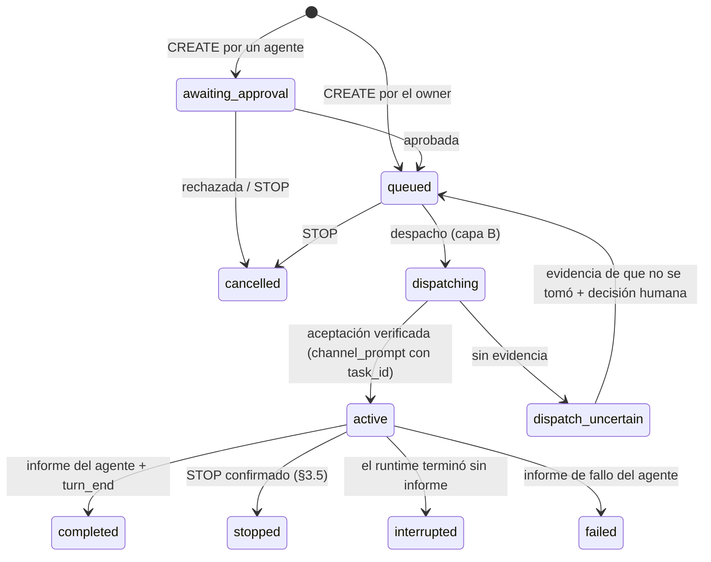

# Project Chat — tareas independientes por agente (propuesta de diseño, sin implementar)

Estado: **diseño documental consolidado, 2026-11-06 (GO del responsable para consolidar el diseño;
NO hay GO de implementación).** **TD1–TD11 aprobadas** como arquitectura (TD3, TD4 y TD8 con la redacción revisada, confirmada el
2026-11-06; TG5 obligatorio). No hay backend, UI ni migraciones de tareas. Cambia un no-objetivo del RFC
(«tareas tipo Jira», 02 §2) **sólo en lo que dice §1**: no es un Jira, y no amplía G3-2, que sigue en
NO-GO. Los gates de Channels (G1–G12, G3, PASS-A/PASS-B, R8) no cambian. Los que siguen siendo
obligatorios están en §9.

Referencias: [01-vision.md](./01-vision.md) §5, [02-architecture-rfc.md](./02-architecture-rfc.md)
§2, §5.4–§5.6 y §9, [03-protocol.md](./03-protocol.md) §1, §3, §3.1, §7 y §9,
[05-roadmap.md](./05-roadmap.md), [10-g3-sender-identity.md](./10-g3-sender-identity.md).

## 0. Regla fundamental y ejemplo

**Un agente no interrumpe un trabajo no relacionado cuando recibe una instrucción nueva.**

Claude A está ejecutando T-101. B necesita un preflight de VM100:

| Acción de B | Qué pasa | Qué **no** pasa |
| --- | --- | --- |
| `CREATE` T-102 para A | T-102 queda `queued` en la cola de A | nada llega a la conversación de A; T-101 sigue |
| `UPDATE T-102` | se reescribe la definición guardada de T-102 (versión +1) | A no se entera: T-102 todavía no empezó |
| `CHANGE T-101` | se registra un pedido de cambio **de T-101**; se entrega a A en un punto seguro | ninguna escritura en el Terminal; T-102 no se toca |
| `STOP T-101` | se registra un pedido de detener **sólo T-101**; A lo toma en un punto seguro y deja su estado recuperable | no se detiene la sesión Docker, el proceso `claude` ni otra tarea |

## 1. Qué es y qué no es una tarea

Una **tarea** es una unidad de trabajo **direccionable** asignada a un agente: tiene identidad
estable, un único asignado, un creador, un estado, una versión y una definición (texto). Sirve para
que las instrucciones digan **a qué trabajo** se refieren y para que trabajo nuevo **espere** en vez
de mezclarse con el que está en curso.

No es un gestor de proyectos: no hay tableros, prioridades, estimaciones, fechas, dependencias,
subtareas, etiquetas ni flujos configurables (lista completa en §7).

La propuesta tiene tres capas, que se aprueban y se implementan por separado:

| Capa | Contenido | Depende de |
| --- | --- | --- |
| **A — contrato mínimo** (§2) | identidad, direccionamiento, estados, versiones, idempotencia, los tres niveles de confirmación | sólo de esta aprobación; se fija como texto |
| **B — cola y ejecución** (§3, §5, §6) | cola persistente, despacho, puntos seguros, `CHANGE`/`STOP` de tareas activas, recuperación; tareas creadas por el owner | GO de Channels (P6 del roadmap) y gates TG1–TG5 |
| **C — instrucciones de agentes** (§4) | un agente crea o pide cambiar/detener tareas de otro, siempre con aprobación humana | capa B **y** GO de G3-2 (hoy NO-GO) |

## 2. Contrato mínimo de identidad y direccionamiento (capa A)

Es lo único que esta propuesta pide fijar ahora, como texto. No depende de Channels ni de G3-2.

### 2.1 Identidades

| Id | Formato | Lo asigna | Estable en… |
| --- | --- | --- | --- |
| `task_id` | UUID v4 | backend en `CREATE` | la vida de la tarea; **es la identidad** |
| `task_key` | `T-<n>`, `n` entero por proyecto, nunca reutilizado | backend en `CREATE` | la vida de la tarea; alias legible, nunca la identidad en el protocolo |
| `assignee_agent_id` | `agent_id` (03 §1) | creador | la vida de la tarea: **no se reasigna** en v1 (reasignar = `STOP`/cancelar y crear otra) |
| `creator` | `user:<id>` \| `agent:<agent_id>` | backend, del principal autenticado | siempre; nunca sale del cuerpo |
| `rev` | entero, +1 en **cada** transición de estado o de definición | backend | hasta la siguiente transición |
| `version` | entero, +1 sólo cuando cambia la **definición** | backend | hasta el siguiente cambio aplicado |
| `instruction_id` | UUID v4 | backend al recibir una instrucción | siempre |
| `client_instruction_id` | UUID v4 | quien emite (UI o `st-channel`) | un intento de emitir **esa** instrucción |
| `attempt_id` | UUID v4 | backend en cada despacho | un despacho de la tarea a un runtime |

### 2.2 Sobre de una instrucción

```jsonc
{
  "verb": "CREATE | UPDATE | CHANGE | STOP",
  "task_id": "…",            // obligatorio salvo en CREATE
  "assignee_agent_id": "…",  // sólo en CREATE
  "if_rev": 7,               // obligatorio salvo en CREATE
  "definition": "…",         // CREATE, UPDATE, CHANGE (≤ 16 KiB, como M1)
  "reason": "…",             // STOP, opcional, ≤ 500
  "client_instruction_id": "…"
}
```

Reglas (*MUST* cuando se vuelva contrato):

1. **Toda instrucción nombra su tarea por `task_id`.** No existe «la tarea actual» implícita. El
   servidor **nunca** interpreta `STOP` o `T-101` escritos en el texto de un mensaje, igual que nunca
   lee menciones del texto (R11).
2. **Verbo y estado tienen que coincidir.** `UPDATE` sólo vale sobre una tarea que todavía no empezó
   (`queued`, `awaiting_approval`); `CHANGE` sólo sobre una activa. Si la tarea cambió de estado entre
   que el emisor la leyó y su instrucción llegó, la respuesta es 409 (`task-active` o
   `task-not-active`) y el emisor decide de nuevo. Así un `UPDATE` pensado para trabajo pendiente nunca
   se convierte en silencio en un cambio de trabajo en curso.
3. **`if_rev` es un CAS.** Si no coincide con `rev` ⇒ 409 `stale-rev` con el `rev` y el estado
   actuales. Nada se aplica sobre una lectura vieja.
4. **Idempotencia por (`creator`, `client_instruction_id`).** El mismo id con el mismo cuerpo repite la
   respuesta guardada; con otro cuerpo ⇒ 409 `idempotency-conflict`. Nunca se crea una tarea dos
   veces ni se aplica una instrucción dos veces.
5. **La autoría la estampa el backend** desde el principal autenticado (cookie del owner, o las tres
   comprobaciones de autorización de una sesión, 03 §6.2). Ningún campo del cuerpo aporta identidad.

### 2.3 Estados



Terminales: `completed`, `stopped`, `cancelled`, `failed`, `interrupted`. `stopped` e `interrupted`
conservan el workspace y el último informe del agente: son recuperables a mano, nunca se reanudan
solos (§7).

Los pedidos sobre una tarea activa **no** son estados de la tarea: son instrucciones con su propio
estado (§2.4). Una tarea `active` con un `STOP` pedido sigue `active` hasta que haya evidencia.

### 2.4 Tres confirmaciones distintas

| Nivel | Significa | Lo produce |
| --- | --- | --- |
| **recibida** | la instrucción está persistida, con `instruction_id` | backend: 202 con `{instruction_id, task_id, rev}` |
| **aplicada** | sobre una tarea pendiente: la definición guardada cambió (`version` +1) o la tarea quedó `cancelled`. Sobre una activa: el **agente** acusó la instrucción con `task_ack(instruction_id, version)` | pendiente: backend (CAS, inmediato). Activa: evidencia del contenedor del agente |
| **detenida** | sólo para `STOP` sobre una activa: el trabajo de esa tarea terminó | evidencia de §3.5; nunca un plazo vencido |

Estado de cada instrucción: `received` → `waiting_safe_point` → `delivered` → `acknowledged` |
`refused{…}` | `superseded{…}`; o `applied` directo en una tarea pendiente; o `rejected{…}` (409/403)
sin efecto. La UI muestra los tres niveles por separado: «STOP recibido», «STOP aceptado por A»,
«T-101 detenida».

## 3. Cola y ejecución (capa B: futura, depende del GO de Channels)

### 3.1 Cola persistente

- Cada agente tiene una cola FIFO de tareas `queued`. Una tarea nueva **nunca** se inserta en la
  conversación activa: espera.
- **Una tarea activa por agente** en v1 (decisión TD2). El CLI interactivo procesa un turno por vez, y
  dos tareas activas en el mismo proceso mezclarían contexto y atribución.
- **Modo de la cola, por agente:** `paused` (por defecto, y **siempre** para un agente que ya existe o
  que ya está trabajando) o `auto`. En `paused` no se despacha nada solo: la persona inicia cada
  tarea. Ninguna tarea nueva se despacha silenciosamente a un agente como A trabajando en #547.
- **`auto` exige una acreditación vigente de «sin trabajo ajeno al sistema»** (TD3). Estar en el
  prompt **no** prueba que un trabajo no registrado haya terminado. La acreditación:
  1. la otorga la persona, explícitamente, por agente y por runtime (`queue_clean_mark{by, at,
     runtime}` en el log), declarando que el agente no tiene trabajo fuera del sistema;
  2. se **pierde sola** (la cola vuelve a `paused`, con la causa visible) ante cualquier evidencia de
     trabajo no registrado después de la marca: un `user_prompt` del Terminal o un envío del Composer
     que no sea un mensaje libre registrado (TD8), un `internal_prompt` (tarea en background del CLI),
     un turno que no se pueda atribuir a una tarea o a un mensaje registrado, pérdidas de hooks (`gap`)
     o un runtime nuevo (salida del CLI, `--resume`, recreación);
  3. nunca se infiere del estado `waiting_input` ni de un plazo de silencio.
- **Despacho:** la siguiente tarea `queued` se presta como una entrega más del monitor (03 §3), con
  `task_id`, `attempt_id` y `version` en la `meta`, sólo si se cumplen **todas** las condiciones de
  RFC §5.5, el agente no tiene ninguna tarea `active` ni `dispatching`/`dispatch_uncertain`, **y**
  (cola `auto` con acreditación vigente) o (cola `paused` y la persona pidió iniciar **esa** tarea). El
  contenido entregado es la definición en esa `version`; un `UPDATE` posterior ya no la alcanza
  (regla 2 de §2.2).
- El despacho usa las mismas reglas de entrega: sin reintentos automáticos. Sin `channel_prompt` ⇒
  `dispatch_uncertain`, y la cola del agente **queda frenada** (no se presta la siguiente) hasta que
  haya evidencia o decida la persona.

### 3.2 Puntos seguros

Un cambio o una detención de una tarea activa se aplican **sólo** en un punto seguro, y lo aplica el
agente, no el backend:

| Punto seguro | Cuándo | Cómo llega la instrucción |
| --- | --- | --- |
| **SP1 — fin de turno** | el agente está en su prompt con identidad verificada (RFC §5.5 condición 2) y no hay otra entrega en vuelo | el monitor presta una **entrega de control** con `task_id`, `instruction_id`, `verb` y `version`, por el mismo camino que cualquier mensaje |
| **SP2 — checkpoint del agente** | dentro de un turno largo, cuando el agente llama a la herramienta MCP `task_checkpoint(task_id)` de `st-channel` entre dos pasos | el resultado de la herramienta trae las instrucciones pendientes de **esa** tarea |

Nunca, en ningún caso: `tmux send-keys`, Escape o Ctrl-C, señales a procesos, `docker stop`/`kill`,
reiniciar el CLI, recrear el contenedor ni el Composer. Si el agente no llega a un punto seguro, la
instrucción queda `waiting_safe_point` y la UI muestra su antigüedad. La salida de emergencia es la de
hoy y es **humana**: la persona abre el Terminal o el Control Directo. Eso queda fuera del contrato de
tareas, y si la persona lo hace la tarea no pasa a `stopped` por eso (§3.5).

### 3.3 `CHANGE` sobre una tarea activa

1. `received` con `if_rev`; a lo sumo **un** `CHANGE` sin resolver por tarea (otro ⇒ 409
   `change-pending`; el emisor puede retirarlo y mandar uno nuevo).
2. En SP1 o SP2 el agente recibe la definición nueva marcada como **cambio de T-101 a la versión
   v+1**, no como una tarea nueva.
3. El agente responde `task_ack(instruction_id, applied, version: v+1)` o
   `task_ack(instruction_id, refused, reason)`. Sólo con `applied` la tarea pasa a `version` v+1.
4. Un `STOP` posterior deja el `CHANGE` en `superseded{stop}`.

### 3.4 `STOP` sobre una tarea activa

1. `received`; desde ese momento la tarea no recibe más `CHANGE`.
2. En SP1 o SP2 el agente recibe «detener T-101». Lo esperado del agente (instrucciones del adaptador,
   su CLAUDE.md): dejar el trabajo en un estado recuperable (nada a medio escribir que rompa el
   workspace; nada se borra) y publicar `task_report(task_id, stopped, summary)`, con lo hecho y lo
   que falta.
3. `task_ack(instruction_id, acknowledged)` sólo dice «lo voy a detener». No es la confirmación.

### 3.5 Qué cuenta como «efectivamente detenida»

Una tarea pasa a `stopped` sólo con las tres cosas, persistidas:

1. un `task_report{stopped}` del `attempt_id` vigente;
2. el `turn_end` del turno que lo contiene, sin otra entrada que haya compartido ese turno (las mismas
   condiciones de atribución de 03 §3.1);
3. después, el agente en su prompt con identidad verificada (probe), sin entrega de esa tarea en vuelo.

**Alcance de la confirmación (TD6).** `stopped` es evidencia de que **el agente reportó** haber
detenido el trabajo de esa tarea, con un turno limpio y vuelta al prompt; es «lo que reporta el
contenedor del agente», con la misma consecuencia aceptada que 03 §7. **No certifica** que no queden
efectos externos pendientes: procesos en background que el agente lanzó, jobs remotos, CI en curso,
pushes, deploys u operaciones en otros sistemas. El `task_report{stopped}` incluye
`external_effects` (lo que el agente declara que dejó en curso, o `none`) y la UI lo muestra como
«detenida según el agente», con esa declaración. Verificar esos efectos es trabajo humano o de otra
tarea, nunca una inferencia del sistema. Si el
runtime muere antes, la tarea pasa a `interrupted` y el `STOP` a `superseded{runtime-retired}`: **un
STOP pedido nunca se convierte en un STOP confirmado** por un plazo, un reinicio o una intervención
manual.

### 3.6 Informes del agente

Herramientas MCP de `st-channel` (además de las de 03 §6.3), todas con `client_instruction_id` y
siempre sobre el `attempt_id` vigente; la de un intento anterior se registra y no cambia nada:

| Herramienta | Uso |
| --- | --- |
| `task_checkpoint(task_id)` | SP2: devuelve las instrucciones pendientes de esa tarea |
| `task_ack(instruction_id, applied\|refused\|acknowledged, version?, reason?)` | acusar una instrucción |
| `task_report(task_id, completed\|stopped\|failed, summary)` | fin del trabajo de la tarea |

Un agente sólo informa sobre **sus** tareas (asignado = su `agent_id`).

## 4. Permisos

| Actor | Puede | No puede |
| --- | --- | --- |
| Owner | todo: crear, aprobar, rechazar, `UPDATE`, `CHANGE`, `STOP`, frenar o liberar la cola de un agente | reasignar una tarea activa (v1) |
| Agente creador (capa C) | `CREATE` para **otro** agente del mismo proyecto ⇒ siempre `awaiting_approval`; `UPDATE` de lo que creó mientras no empezó (si ya estaba aprobada, vuelve a `awaiting_approval`); **pedir** `CHANGE`/`STOP` de lo que creó, que también esperan aprobación humana | tocar tareas que no creó; crear tareas para sí mismo; saltar la aprobación |
| Agente asignado | `task_checkpoint`, `task_ack` y `task_report` de sus tareas | cambiar su definición, reasignarla, crear tareas sin aprobación |
| Admin / lead | nada (R5) | — |

- Una tarea **no** otorga permisos. Su texto no autoriza un deploy ni ninguna acción sensible: esas
  siguen necesitando la aprobación humana de siempre, fuera del sistema de tareas, aunque la tarea
  diga «desplegá».
- Las instrucciones emitidas por un agente dependen de la autenticidad del emisor: **están bloqueadas
  mientras G3-2 esté en NO-GO.** Esta propuesta no la amplía ni la adelanta.

### 4.1 MVP y política futura de delegación (TD4)

**MVP:** toda instrucción emitida por un agente (`CREATE`, `UPDATE`, pedido de `CHANGE`/`STOP`)
requiere aprobación humana, y además el GO de G3-2.

**Futuro (sólo diseño; el modelo lo admite sin cambiar la capa A):** un **permiso delegado** que la
persona otorga a un agente creador para actuar sin pedir aprobación cada vez, con la forma de un
permiso de Colaboración (RFC §5.6):

| Campo | Regla |
| --- | --- |
| `grant_id`, `grantor` | lo crea **sólo** la persona (`user:<id>`); nunca un agente |
| `grantee` | **un** agente creador |
| `scope` | tareas concretas (`task_id[]`) o «las que `grantee` creó para `assignee` X», dentro del proyecto |
| `verbs` | subconjunto de {`UPDATE`, `CHANGE`, `STOP`}; `CREATE` sólo si se aprueba explícitamente aparte |
| `budget`, `expires_at` | obligatorios, con topes; agotado o vencido ⇒ vuelve la aprobación humana |
| revocación | inmediata, por la persona; una instrucción ya `received` bajo un permiso revocado vuelve a `awaiting_approval` |

Invariantes de cualquier delegación, *MUST*:
1. **No autoriza deploys, operaciones destructivas ni acciones sensibles.** Una tarea nunca otorga
   permisos (§4), así que el permiso sólo cubre **editar o detener la definición de una tarea**, no
   lo que el agente haga para cumplirla. Esas acciones siguen con la aprobación humana de siempre,
   fuera del sistema de tareas.
2. **No amplía privilegios:** no se re-delega, no se extiende ni se amplía a sí mismo, no cambia el
   asignado, no saca una tarea de `awaiting_approval` y no alcanza tareas marcadas por la persona como
   `requires_human` (marca que sólo la persona pone o quita).
3. Toda instrucción hecha bajo un permiso lleva su `grant_id` en el log y descuenta presupuesto.

## 5. Concurrencia

- **Escritor único:** el backend, bajo un candado por proyecto en el proceso, como el log de la
  conversación anfitriona. Toda transición es CAS sobre `rev` dentro del candado, después del fsync.
- **Carreras resueltas por la regla 2 de §2.2:** `UPDATE` contra despacho (gana uno; si gana el
  despacho, el `UPDATE` es 409 `task-active`), `STOP` contra despacho (si gana el `STOP`, la tarea
  queda `cancelled` y no se presta), `CHANGE` contra `task_report{completed}` (el `CHANGE` queda
  `superseded{completed}`).
- **Intentos:** cada despacho tiene su `attempt_id`; acks e informes de un intento anterior no cambian
  estados.
- **Tipos de envío, siempre explícitos (TD8, con los nombres de AD6 desde el 2026-11-07):** un
  `message` (conversación libre) y un `work_request` con su verbo: `CREATE` (tarea nueva) o `CHANGE`
  (de la tarea activa, §3.3); `UPDATE` y `STOP` son también `work_request`. El servidor nunca convierte
  uno en otro ni lo deduce del texto. (Antes de unificar: `chat`, `task.create`, `task.change`.)
- **Un mensaje libre no interrumpe por defecto una tarea activa:** mientras el agente tenga una tarea
  `active` o `dispatching`, un `message` queda **retenido** (`held{task-active}`) y se presta recién
  cuando la tarea termina, o lo retira la persona.
- **Intercalar es una elección explícita por mensaje** (`interleave: true`, con confirmación en la
  UI): se presta sólo en SP1, marcado para el agente como «mensaje libre, **no** es una instrucción
  sobre T-101»; no cambia `version` ni `rev` de la tarea y no cuenta como `UPDATE`/`CHANGE`. Ese turno
  queda fuera de la tarea; si comparte turno con trabajo de la tarea, termina
  `ended_unattributed{mixed-input}` (03 §3.1).
- Un envío por Control Directo (Composer) o una escritura en el Terminal durante una tarea activa es
  trabajo no registrado: no es una instrucción de tarea (TD10) y, si la cola estaba en `auto`, la
  devuelve a `paused` (§3.1).

## 6. Persistencia y recuperación

- **Almacén** (recomendado, TD7): un log append-only por proyecto,
  `<WORKSPACE_ROOT>/.projects/<project_id>/tasks.events.jsonl`, más un snapshot atómico del índice
  (tareas, `rev`, cola, ventana de `client_instruction_id`), con el formato y el fsync de
  `conversation/store.ts` y `paneRecord.ts`. Sin tabla D1 en el MVP: un solo almacén, sin divergencia
  D1/log que reconciliar, y el texto de las tareas (que es contenido) nunca entra en D1.
- **Reinicio del backend:** el índice se reconstruye desde el log. Nada desaparece. Despachos y
  entregas de control en vuelo ⇒ `uncertain{orphaned}` por las reglas de 03 §9; nunca se represtan
  solos. Una instrucción `received`/`waiting_safe_point` sigue igual. Un `STOP` pedido sigue pedido:
  la confirmación exige evidencia **nueva** de §3.5. La ventana de idempotencia está en el snapshot,
  así que un reintento del cliente después del reinicio repite la respuesta y no duplica nada.
- **Reinicio del agente** (salida del CLI, parada o recreación del contenedor): la tarea activa pasa a
  `interrupted` y su `STOP` pendiente, si había, a `superseded{runtime-retired}`. Las tareas `queued`
  siguen en la cola. La siguiente se presta sólo cuando la persona libera la cola (un `interrupted`
  frena la cola como un `dispatch_uncertain`).
- **Log ilegible:** el proyecto queda `tasks-unverifiable`: no se despacha ni se acepta ninguna
  instrucción (409) y nada se infiere sin el archivo.

## 7. Fuera del MVP (expresamente)

Tableros, prioridades, estimaciones, fechas límite, SLAs, etiquetas, búsqueda; dependencias entre
tareas y subtareas; flujos o estados configurables; tareas asignadas a humanos o a varios agentes;
reasignar una tarea activa; varias tareas activas por agente; **reanudar** una tarea `stopped` o
`interrupted` (en v1 se crea otra tarea que la referencia en el texto); reintentos o redespachos
automáticos; interrupción forzada de un turno; tareas entre proyectos; comentarios, adjuntos y
notificaciones push propias; permisos por tarea más allá de owner/creador/asignado; integración con
Jira, Linear o GitHub Issues; agentes que crean tareas sin aprobación humana.

## 8. Decisiones del responsable (2026-11-06)

| # | Decisión | Estado |
| --- | --- | --- |
| TD1 | El no-objetivo «tareas tipo Jira» pasa a «tareas direccionables mínimas (§1), sin gestión de proyectos (§7)» en 01 y 02 | **aprobada** |
| TD2 | Una tarea activa por agente en v1 | **aprobada** |
| TD3 | Despacho FIFO automático sólo con la cola `auto` habilitada explícitamente y una acreditación vigente de que el agente no tiene trabajo ajeno al sistema; el prompt no lo prueba. Agentes existentes (como A en #547) empiezan en `paused` y nada se despacha en silencio (§3.1) | **aprobada** (redacción revisada) |
| TD4 | MVP: toda instrucción de un agente con aprobación humana y G3-2. Futuro: permisos delegados acotados (alcance, verbos, presupuesto, vencimiento, revocables) que nunca autorizan deploys, operaciones destructivas ni amplían privilegios (§4.1) | **aprobada**; la delegación es sólo diseño futuro |
| TD5 | Puntos seguros = SP1 + SP2; sin interrupción forzada; la vía manual queda fuera del contrato | **aprobada** |
| TD6 | «Detenida» = informe + `turn_end` limpio + prompt verificado; certifica lo que el agente reportó, **no** la ausencia de efectos externos pendientes (§3.5) | **aprobada**, con la aclaración |
| TD7 | Log por proyecto + snapshot, sin tabla D1 en el MVP | **aprobada** |
| TD8 | Envíos explícitos (`message`, `work_request{CREATE}`, `work_request{CHANGE}`; antes `chat`, `task.create`, `task.change`); un `message` queda retenido mientras haya una tarea activa; intercalar en SP1 es una elección explícita por mensaje y nunca un `UPDATE`/`CHANGE` (§5) | **aprobada** (redacción revisada) |
| TD9 | `task_key` = `T-<n>` por proyecto, nunca reutilizado | **aprobada** |
| TD10 | El Composer/Control Directo no es un canal de instrucciones de tareas | **aprobada** |
| TD11 | Reanudar `stopped`/`interrupted` queda fuera del MVP | **aprobada** |

La delegación de TD4 se decidirá aparte cuando haya implementación de la capa C.

## 9. Gates de la POC que siguen siendo obligatorios

Ninguno se relaja por esta propuesta:

- **G1–G12 de Channels** y la POC completa con su GO separado: todo despacho y toda entrega de control
  es una entrega del monitor.
- **G3** (evidencia de aceptación, `channel_prompt`): `active` exige el `channel_prompt` del despacho.
- **R8 y 03 §3.1** (atribución): `completed` y `stopped` exigen un `turn_end` atribuible.
- **PASS-A/PASS-B** para la integridad hasta el backend.
- **G3-2** (autenticidad del emisor entre agentes): toda instrucción emitida por un agente. Sigue en
  NO-GO.

Gates **nuevos** que la propuesta agrega a la POC (sin ejecutar; necesitan su propia autorización):

| # | Hipótesis | PASS |
| --- | --- | --- |
| TG1 | Una herramienta MCP de `st-channel` llamada **dentro** de un turno largo devuelve instrucciones nuevas (SP2) | el resultado llega en el mismo turno y el agente lo acusa con `task_ack` |
| TG2 | Una entrega de control en SP1 se distingue de una tarea nueva y el agente la aplica a la tarea correcta | `task_ack` con el `instruction_id` y la `version` correctos, sin efectos sobre otra tarea |
| TG3 | Un `STOP` en SP2 termina el turno con un informe y deja el agente en su prompt | las tres condiciones de §3.5, con el proceso `claude` y el contenedor intactos |
| TG5 | La pérdida de la acreditación de §3.1 detecta trabajo no registrado: un `user_prompt` del Terminal, un envío del Composer y un `internal_prompt` después de la marca | cada caso devuelve la cola a `paused` antes del siguiente despacho |
| TG4 | Reinicio del backend y salida del CLI con un `STOP` pedido | ninguna tarea perdida, ninguna instrucción aplicada dos veces, ningún `STOP` confirmado sin evidencia nueva |

Si TG1 falla, SP2 se cae y sólo queda SP1: un `CHANGE`/`STOP` de una tarea en un turno largo espera
al fin del turno. Es una degradación aceptable, no un NO-GO de la propuesta.
