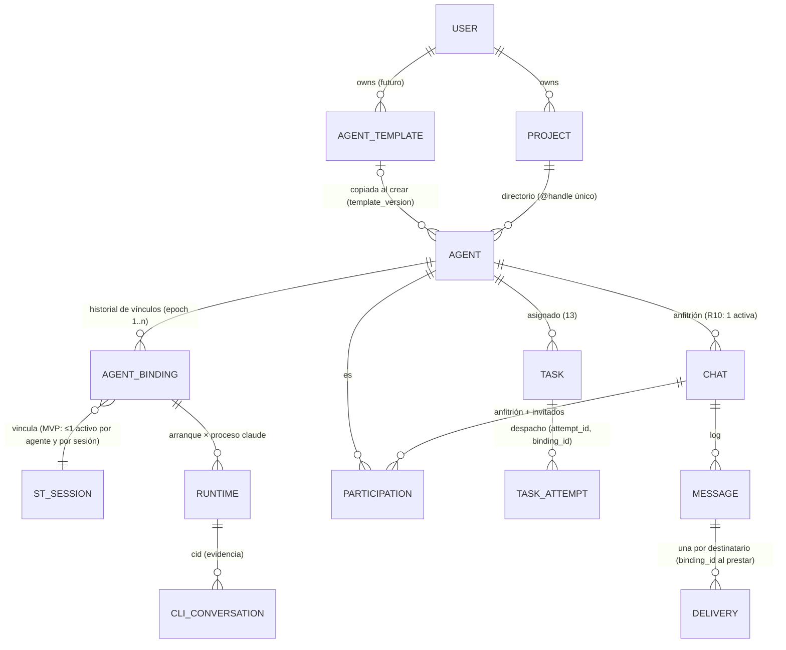

# Equipos de agentes por proyecto — investigación y propuesta (no vinculante)

Estado: **AD1–AD12 aprobadas por el responsable (2026-11-06) como arquitectura, no como autorización
de implementación.** Aplicado a 03 §1 y §2.1 (`project_agents` sin sesión + `agent_bindings`); el resto
sigue siendo referencia de diseño. No se implementan cambios de vínculo, varias sesiones simultáneas,
delegaciones ni activación de agentes detenidos. No hay implementación, migraciones,
endpoints ni cambios de runtime. Ninguna parte toca G3-1 ni su release. G3-2 sigue en NO-GO. Los gates
de Channels (G1–G12), G3, PASS-A/PASS-B, R8 y TG1–TG5 se mantienen.

Lo que se propone fijar en los contratos está marcado en cada punto con una de tres etiquetas:

- **[AHORA]**: necesario ahora para no generar deuda. Cambia el texto de 03 §1 y §2.1 **antes** de que
  P3 escriba la migración. Hoy no hay ninguna tabla `projectChat` en `main`, así que cambiarlo cuesta
  sólo texto.
- **[PREPARAR]**: conviene dejarlo previsto en el modelo (un nombre, un campo o una regla), sin
  implementarlo.
- **[FUTURO]**: es funcionalidad que no bloquea el chat actual.

Referencias: [01](./01-vision.md), [02](./02-architecture-rfc.md) §5.2, §5.5, §5.6 y §9 (R1–R15),
[03](./03-protocol.md) §1, §2.1, §3, §6.2, §7 y §8, [05](./05-roadmap.md),
[10](./10-g3-sender-identity.md) §4.4 y §4.5, [13](./13-agent-tasks.md).

## 0. Resumen

- La base actual **soporta** casi toda la visión: un proyecto como frontera, los agentes como identidad
  lógica con `provider`/`role`, conversaciones anfitrionas con invitados, menciones explícitas,
  aprobaciones, Colaboración, límites anti-bucle, estados de entrega con incertidumbre y tareas
  direccionables.
- **Un punto se vuelve incompatible si se implementa tal como está hoy:** `project_agents.st_session_id
  NOT NULL`, junto con la regla «reasignar = agente nuevo». Ata la identidad del agente a una sesión.
  Con eso, la historia, las conversaciones, los invitados y las tareas de un agente se perderían o
  habría que duplicarlos cada vez que cambie su sesión.
- **Propuesta central [AHORA]:** separar `agent` (identidad) de `agent_binding` (vínculo versionado
  agente↔sesión, con `binding_id`, `epoch` e historial). El MVP sigue con **una sesión activa por
  agente**, pero como **regla de política**, un índice único que se puede levantar más adelante, y no
  como identidad. 10 §4.4 ya anticipaba `binding_epoch`; esta propuesta lo adelanta antes de la
  primera migración.
- **Separar tres conceptos [AHORA]:**
  - **mensaje** (información);
  - **solicitud de trabajo** (los verbos de 13 sobre una tarea);
  - **autorización** (una decisión humana o un permiso delegado).

  Cada uno tiene su propio sobre y sus propias reglas, y ninguno se deriva del texto de otro.
- **Roles y plantillas [AHORA, como datos]:** el rol es texto libre y la plantilla es un objeto del
  usuario que se **copia** al crear el agente. Ningún rol queda codificado.
- Todo lo demás es **[PREPARAR]** o **[FUTURO]**: varias sesiones por agente, plantillas con UI,
  delegación, redes por proyecto, vista de proyecto, activación de agentes detenidos, dependencias.

## 1. Análisis de brechas

| Capacidad de la visión | Estado en el diseño actual | Veredicto |
| --- | --- | --- |
| Project como frontera (agentes, handles, aristas, invitados del mismo proyecto) | 03 §2.1, R14 | **soportado** |
| Agente como identidad persistente | `agent_id` estable ante `/clear`, `--resume`, paradas y recreaciones (02 §5.2) | **soportado**, con la excepción de la fila siguiente |
| Identidad del agente independiente de su sesión | `st_session_id NOT NULL` en `project_agents`; reasignar = quitar y crear otro `agent_id` (03 §1, 10 §4.4) | **incompatible si se implementa así** ⇒ §3 |
| Roles configurables, no codificados | `role` es texto ≤ 60 | **soportado** (ningún rol codificado) |
| Plantillas reutilizables | existen plantillas de **sesión** (#195, sin secretos); no existen plantillas de agente | **falta**; se puede construir encima de #195 ⇒ §2 D-T |
| Varios agentes con el mismo rol | `handle` único por proyecto; el rol no es único | **soportado** |
| Capacidades vs permisos | capacidades del adaptador declaradas (02 §5.2); permisos = owner-only más aristas `allow` | **parcial**: falta un perfil de permisos por agente ⇒ §2 D-P |
| Aislamiento de repositorios, workspaces y credenciales por proyecto | por sesión: workspace, config y secretos cifrados por sesión; token de ingesta por sesión | **soportado por sesión**. No hay secretos «de proyecto» (correcto para el MVP) |
| Aislamiento de red entre proyectos | `sessions-net` compartida: las sesiones se alcanzan por nombre (#291, aceptado para un solo usuario) | **brecha conocida**: no se puede afirmar aislamiento entre proyectos sin redes por proyecto ⇒ [FUTURO], requisito previo para afirmarlo |
| Menciones y destinatarios explícitos | `to[]` y `participants_version`; el servidor nunca analiza el texto (R11) | **soportado** |
| Mensaje ≠ solicitud de trabajo ≠ autorización | mensajes y aprobaciones existen; las tareas (13) son de este mismo diseño; los tres no están separados como sobres distintos | **requiere fijarlo** ⇒ §4 |
| Flujo Developer → QA → Developer sin interrupciones | tareas en cola, puntos seguros, mensajes libres retenidos (13, TD3/TD8) | **soportado en diseño** (capa B; capa C con G3-2) |
| Evidencias (commits, PRs, pruebas) | `task_report{summary}`; no hay referencias tipadas | **falta** ⇒ §4.4 |
| Límites contra bucles | `chain_id`, `depth`, M4–M13; la respuesta de un invitado no vuelve sola (R12) | **soportado**; hay que extenderlo a las solicitudes de trabajo ⇒ §4.5 |
| Recuperación ante reinicios | 03 §9, 13 §6 | **soportado**; hay que agregar el cambio de vínculo ⇒ §3.3 |
| Evidencia tardía de ejecuciones anteriores | `start_gen`, `endpoint_id`, `attempt_id`, I-8 (vínculo vigente) | **soportado**; hay que formalizar `binding_id` en cada evidencia ⇒ §3.2 |
| Agentes ocupados, desconectados o detenidos | elegibilidad de 02 §5.5; una tarea espera en `queued` | **soportado** |
| Activar un agente detenido | `POST /start` con `assertCanOperate` existe (#429), pero el monitor nunca lo usa | **[FUTURO]**, no se habilita en el MVP ⇒ §5 |
| Conversación compartida del proyecto | no existe | ⇒ §2 D-V (proyección, sin otra fuente de verdad) |
| Exactamente una vez para efectos externos | no se promete; hay entregas sin reintento y estados inciertos | **soportado como principio** ⇒ §4.6 |

## 2. Decisiones que conviene fijar ahora

| Id | Tema | Propuesta | Etiqueta |
| --- | --- | --- | --- |
| D-AS | Agente ↔ sesión | `agent` + `agent_binding` versionado. Una sola sesión activa por agente **por política** (índice único parcial) en el MVP (§3) | **[AHORA]** |
| D-ID | Identidad en el protocolo | toda evidencia, entrega, runtime e intento lleva `binding_id`. La autoridad de un request de agente se deriva **del vínculo activo de la sesión autenticada**, nunca del cuerpo (las tres comprobaciones de 03 §6.2, sin cambios) | **[AHORA]** |
| D-MSG | Tipos de envío | tres sobres: `message`, `work_request`, `authorization` (§4) | **[AHORA]** |
| D-R | Rol | texto libre del owner; ningún comportamiento del backend depende del rol | **[AHORA]**: ya es así, se agrega como invariante |
| D-T | Plantillas de agente | objeto del usuario (`agent_templates`) con instrucciones, referencia a una plantilla de sesión #195, capacidades requeridas y un perfil de permisos sugerido. Se **copia** al crear el agente (`template_id`, `template_version`); no hay herencia en vivo | **[PREPARAR]**: en el MVP basta con reservar `template_id`/`template_version` en `project_agents` |
| D-P | Permisos | **capacidades** (lo que el adaptador puede hacer, 02 §5.2) separadas de los **permisos** (lo que el owner autoriza en el proyecto: aristas, permisos delegados de 13 §4.1). El MVP mantiene owner-only, aprobación humana y aristas `allow` | **[AHORA]** la separación conceptual; **[FUTURO]** el perfil por agente |
| D-V | Vista de proyecto | **proyección** de solo lectura sobre las conversaciones anfitrionas y los eventos de tareas existentes, ordenada por tiempo. No es un almacén de mensajes | **[PREPARAR]**: ningún dato nuevo; la decisión es que no habrá otra fuente de verdad |
| D-PJ | Pertenencia | un agente pertenece a **un** proyecto, para siempre; no hay agentes entre proyectos | **[AHORA]**: ya es así, se agrega como invariante |

## 3. Agente, vínculo, runtime y conversación

### 3.1 Modelo



| Nivel | Qué es | Identidad | Vive | Cambia cuando |
| --- | --- | --- | --- | --- |
| **Agent** | identidad lógica: handle, rol, instrucciones, plantilla de origen, permisos | `agent_id` | D1 | nunca (se archiva) |
| **Binding** | «este agente se ejecuta en esta sesión», con época | `binding_id` + `epoch` (entero por agente, +1 por vínculo) | D1, con historial | al vincular o desvincular |
| **Session** | contenedor, workspace, config y token de ST (ya existe) | `st_session_id` (+ `container_id` vigente) | D1 `sessions` | recreación = mismo vínculo (10 §4.4) |
| **Runtime** | proceso `claude` concreto dentro de un arranque | (`binding_id`, `start_gen`, `endpoint_id`, `claude_pid`) | memoria + log | cada arranque o proceso |
| **CLI conversation** | `session_id` de Claude | `cid` | captura | `/clear`, `--resume` |
| **Chat** | conversación anfitriona de la persona con un agente (R10–R15) | `chat_id` | D1 + log | nunca cambia de anfitrión |

### 3.2 Reglas del vínculo [AHORA, como texto de contrato]

Esquema de diseño (no es una migración):

```sql
-- la tabla se llama project_agents (03 §2.1; así está en la migración v19 del PR draft #557, sin merge);
-- la columna project_agents.st_session_id de la versión anterior de 03 desaparece
CREATE TABLE project_agents (agent_id PK, project_id, handle, provider, role, template_id NULL,
                     template_version NULL, created_at, removed_at NULL, UNIQUE(project_id, handle));
CREATE TABLE agent_bindings (
  binding_id    TEXT PRIMARY KEY,           -- UUID v4
  agent_id      TEXT NOT NULL REFERENCES project_agents(agent_id),
  epoch         INTEGER NOT NULL,           -- 1, 2, … por agente; nunca se reutiliza
  st_session_id TEXT NOT NULL,              -- sin FK: D1 aplica las FKs y bloquearía el hard delete (PROJECTS.md §2)
  state         TEXT NOT NULL CHECK (state IN ('active','draining','retired')),
  created_at, retired_at NULL, retire_reason NULL,
  UNIQUE (agent_id, epoch));
-- MVP (política, se puede quitar en el futuro sin cambiar la identidad):
CREATE UNIQUE INDEX one_live_binding_per_agent   ON agent_bindings(agent_id)      WHERE state IN ('active','draining');
CREATE UNIQUE INDEX one_live_binding_per_session ON agent_bindings(st_session_id) WHERE state IN ('active','draining');
```

1. **Las direcciones son lógicas:** mensajes, participaciones, tareas y aristas apuntan a `agent_id`,
   nunca a un vínculo ni a una sesión. Por eso un cambio de vínculo no toca conversaciones, invitados,
   historial ni tareas.
2. **La evidencia es física:** toda entrega prestada, `transported`, hook clasificado, post, `task_ack`,
   `task_report` e intento de tarea registra el `binding_id` con el que ocurrió.
3. **Evidencia tardía:** algo de un vínculo que no es el vigente **se registra y no cambia ningún
   estado**. Es la I-8 de 10 §4.5, generalizada a tareas e intentos. Un request de una sesión cuyo
   vínculo está `retired` falla la tercera comprobación (03 §6.2) ⇒ 403 `not-bound`.
4. **Cambiar de vínculo** es una operación del owner, nunca de un agente, en dos fases:
   - **`draining`**: el vínculo viejo no recibe préstamos nuevos;
   - lo que estaba en vuelo termina por evidencia o se resuelve según las reglas existentes:
     - entregas `transporting`/`transported`/`accepted` ⇒ `uncertain`/`interrupted` por 03 §3 y §9;
     - una tarea `active` ⇒ `interrupted{binding-changed}`;
     - sus pedidos pendientes ⇒ `superseded{binding-changed}`;
   - **`retired`** sólo cuando no queda nada en vuelo de ese vínculo. Recién entonces se crea el vínculo
     nuevo (`epoch + 1`).

   Esto mantiene la regla de 10 (409 `previous-agent-in-flight`) con otro nombre: 409
   `binding-draining`.
5. Lo que espera en cola (mensajes `queued`, tareas `queued`, `message` retenidos) **no** se pierde: apunta
   al agente y se presta con el vínculo nuevo, siempre bajo las condiciones normales de elegibilidad.
6. Reasignar **una sesión** a otro agente es lo mismo visto del otro lado: se retira el vínculo de la
   sesión con A y se crea uno con A′. Ninguna evidencia de A pasa a A′ (10 T12).
7. La recreación del contenedor (3.0d) **no** cambia el vínculo: cambia el `container_id` vigente, que
   la segunda comprobación ya sigue (G3-1).

### 3.3 Varias sesiones por agente [FUTURO, compatibilidad garantizada]

Habilitarlo es quitar `one_live_binding_per_agent` y agregar la regla de elección: qué vínculo recibe
cada préstamo. Las direcciones, la evidencia y las conversaciones no cambian, porque ya llevan
`binding_id`. Antes de habilitarlo hacen falta, entre otras cosas:

- un `binding_id` elegido al prestar;
- «una tarea activa por agente» (TD2), redefinida como «por vínculo» o mantenida;
- reglas de atribución cuando dos vínculos hablan en la misma conversación.

Todo eso queda fuera del MVP.

## 4. Contrato mínimo de comunicación entre agentes

### 4.1 Tres sobres separados [AHORA]

| Sobre | Qué es | Efecto posible | Quién lo emite | Dónde vive |
| --- | --- | --- | --- | --- |
| `message` | información: texto, citas autorizadas (`context[]`), referencias | ninguno sobre tareas ni permisos. Se entrega y se lee, nada más | humano o agente (con las reglas de 02 §5.5 y §5.6) | log de la conversación anfitriona (03 §2.2), sin cambios |
| `work_request` | un verbo de 13 (`CREATE`/`UPDATE`/`CHANGE`/`STOP`) sobre una tarea | crea o modifica una tarea, siempre por el CAS de 13 §2.2 | humano (MVP) o agente (capa C: aprobación + G3-2) | log de tareas del proyecto (13 §6) |
| `authorization` | una decisión: aprobar o rechazar una solicitud, otorgar o revocar un permiso delegado, una arista `allow` o una Colaboración | habilita **una** acción concreta, con alcance | **sólo humano** en el MVP; un permiso delegado (13 §4.1) nunca crea otra autorización | log del objeto que autoriza (conversación o tareas) + D1 cuando ya existe (aristas) |

Invariantes, *MUST*:

1. Ningún sobre se deriva del texto de otro. Un `message` que dice «STOP T-101», «aprobado» o
   «desplegá» es texto. El servidor nunca lo interpreta (R11, 13 §2.2 regla 1).
2. Un `message` **nunca** otorga acceso a recursos, ejecuta acciones ni eleva privilegios. Un
   `work_request` sólo cambia la definición o el estado de una tarea. Una tarea nunca otorga permisos
   (13 §4).
3. Una `authorization` nombra exactamente qué autoriza (`target_kind`, `target_id`, `verb`, alcance y
   vencimiento). No existe una «aprobación general».
4. Las acciones sensibles (deploy, destrucción, cambios en producción, credenciales) **no son verbos
   del sistema**: siguen con su autorización específica fuera del chat y de las tareas.

### 4.2 Identidades y destinatarios

- **Emisor** = principal autenticado ⇒ `from_agent_id` estampado por el backend a partir del vínculo
  activo de la sesión (D-ID), o `user:<id>` por la cookie.
- **Destinatarios** = `to[]` explícito de `agent_id` dentro de un `chat_id` (mensajes), o el
  `assignee_agent_id` de la tarea (solicitudes de trabajo). Siempre del mismo proyecto (R14 y D-PJ).
- **Referencias a tareas:** un `message` puede llevar `task_refs[]` (`task_id`) como **contexto**, por
  ejemplo «estos son los resultados de T-102». Esa referencia no produce ningún efecto sobre la tarea.
  Para cambiar una tarea hace falta un `work_request`.

### 4.3 Estados y confirmaciones

- `message`: los estados de entrega de 03 §3 sin cambios (transportado ≠ aceptado ≠ completado, con
  `uncertain`/`unconfirmed`), más `held{task-active}` (13 §5).
- `work_request`: recibida ≠ aplicada ≠ detenida (13 §2.4).
- `authorization`: `granted` / `denied` / `revoked` / `expired`, con identidad y hora. Nunca hay una
  autorización implícita.

### 4.4 Evidencias [PREPARAR]

`task_report` y `message` pueden llevar `evidence[]`:

```jsonc
{ "kind": "commit|pr|ci_run|test_report|preview_url|artifact",
  "ref": "…", "claimed_by": "agent:<id>", "binding_id": "…",
  "verification": "claimed" }   // MVP: siempre "claimed"; [FUTURO] "backend-verified" | "human-verified"
```

En el MVP una evidencia es **lo que el agente afirma**. Se muestra como afirmación y no como hecho
verificado. Una verificación por el backend (que el commit exista en el remoto, que el PR esté en un
estado dado, que CI esté verde) es **[FUTURO]**, con credenciales de lectura propias y fuera del
contenedor del agente.

### 4.5 Idempotencia, bucles y cadenas

- **Idempotencia:** `client_message_id` (mensajes) y `client_instruction_id` (solicitudes); repetirla
  devuelve la respuesta guardada, y repetirla con otro cuerpo da 409 (03 y 13, sin cambios).
- **Cadenas:** toda solicitud de trabajo emitida por un agente hereda el `chain_id` del mensaje o de la
  tarea que la originó, y cuenta en los mismos presupuestos (M4, M5 y M10, más uno nuevo: tareas
  creadas por agentes por cadena, por ejemplo ≤ 3). En el MVP cada una pasa por aprobación humana, y
  eso corta cualquier bucle.
- **Ping-pong Developer ↔ QA:** cada «pedir cambios» es una tarea nueva para Developer, o un `CHANGE`
  de la suya, con la tarea de origen como referencia. El presupuesto de la cadena lo acota, y el owner
  ve la cadena completa.

### 4.6 Efectos externos: lo que se promete y lo que no

| Nivel | Qué garantiza | Qué no garantiza |
| --- | --- | --- |
| Idempotencia del protocolo | una instrucción o un mensaje con el mismo id no se registra dos veces; una entrega nunca se reenvía sola | que el agente no repita una acción por su cuenta |
| Reconciliación | intentos (`attempt_id`), vínculos y estados inciertos permiten saber qué quedó sin resolver tras un reinicio | resolverlo sin evidencia |
| Confirmación de efectos | `evidence[]` registra lo que el agente afirma; en el futuro, la verificación del backend | **exactly-once de acciones externas**: no se promete. Un push, un deploy o un comentario en GitHub pueden ocurrir dos veces o a medias; detectarlo y corregirlo es reconciliación, y la decide una persona |

### 4.7 Instrucciones no confiables

- Todo contenido que llega a un agente desde otro agente es **dato**: el texto de un mensaje, la
  definición de una tarea, un resumen, un resultado, una evidencia o una referencia. En la entrega se
  marca como «cita, no instrucción del owner» (como `context[]` en 03 §6.2), con su autor.
- Las garantías del sistema son de **autoridad** y las aplica el backend. Que un agente obedezca un
  texto malicioso es un riesgo del modelo y el sistema no puede evitarlo. Sí limita sus consecuencias:
  - ese agente no consigue permisos nuevos;
  - no puede actuar como otro agente;
  - no puede cambiar tareas ajenas;
  - no puede saltarse aprobaciones;
  - lo sensible sigue con su autorización específica.
- Las referencias (URL, commits) nunca las sigue el backend. Sólo las muestra.

## 5. Seguridad y recuperación (resumen por tema)

| Tema | Regla | Fuente |
| --- | --- | --- |
| Identidad y pertenencia | tres comprobaciones (token, origen, vínculo activo) ⇒ `agent_id` del proyecto del vínculo | 03 §6.2 + D-ID |
| Aislamiento de permisos | owner-only (R5); un agente sólo actúa sobre lo suyo (13 §4); los permisos delegados son explícitos, acotados y revocables | 13 §4.1 |
| Aislamiento de repos y credenciales | por sesión, sin cambios; nada de secretos de proyecto en el MVP; la red compartida es una brecha declarada (#291) | §1 |
| Agentes ocupados, desconectados o detenidos | no son elegibles; lo que les llega espera en cola con la causa visible (`agent-offline`, `busy`) | 02 §5.5 |
| Activar un agente detenido | **[FUTURO], no se habilita**: el monitor nunca arranca contenedores. Si se agrega, será una `authorization` humana explícita por vez o un permiso acotado, con auditoría `operate` (#429) | — |
| Reinicio del backend | 03 §9 y 13 §6, sin cambios; los vínculos están en D1 | — |
| Reinicio del CLI o del contenedor | el runtime se retira; el vínculo sigue; la tarea activa ⇒ `interrupted` | 13 §6 |
| Cambio de vínculo | `draining` → `retired`; la evidencia vieja no cambia nada | §3.2 |

## 6. Evolución compatible

1. **Hoy** no hay datos de Project Chat en producción, así que no hay nada que migrar. El cambio [AHORA]
   es de texto: 03 §1 y §2.1 pasan a `project_agents` + `agent_bindings` (hecho en el texto; la migración v19 está en el PR draft #557, sin merge).
2. **Las sesiones Docker existentes no cambian.** Convertir una sesión en agente = crear `agent` +
   `agent_binding{epoch: 1}`. La sesión conserva su id, su contenedor, su token, su captura y sus
   conversaciones del CLI. La captura existente (conversaciones del CLI) sigue siendo la fuente de los
   turnos (02 §5.3). El agente la referencia a través del vínculo, sin copiarla.
3. **Trazabilidad:** el historial de vínculos se conserva siempre, así que «qué sesión ejecutaba a este
   agente cuando pasó X» se responde con el `binding_id` registrado en la evidencia.
4. Si P3 ya se hubiera implementado con `st_session_id` en `project_agents`, la migración equivalente
   sería aditiva: crear `agent_bindings` con `epoch 1` por cada fila activa. Hacerlo ahora evita
   tenerla que escribir después.

## 7. Roadmap incremental

| Bloque | Contenido | Etiqueta | Depende de |
| --- | --- | --- | --- |
| E0 | Este documento; decisiones AD1–AD12 (§10) | — | revisión con ChatGPT |
| E1 | Cambio de texto en 03 §1 y §2.1: `project_agents` + `agent_bindings`, `binding_id` en evidencias, invariantes D-R y D-PJ, y los tres sobres de §4.1 (sólo nombres y reglas) | **[AHORA]** | aprobación de AD1, AD2 y AD6 |
| P3–P9 | Project Chat tal como está planeado, con un vínculo activo por agente | MVP | sin cambios en sus gates |
| T0–T3 | Tareas (13) | MVP / capa C | TD aprobadas, P6, G3-2 |
| E2 | `template_id`/`template_version` reservados; `evidence[]` con `verification: claimed`; `task_refs[]` en mensajes | **[PREPARAR]** | E1 |
| E3 | Plantillas de agente (CRUD + crear un agente desde una plantilla, sobre #195) | **[FUTURO]** | P3 |
| E4 | Operación de cambio de vínculo (`draining`/`retired`) con UI | **[FUTURO]** | P6 |
| E5 | Perfil de permisos por agente y permisos delegados (13 §4.1) | **[FUTURO]** | T3, G3-2 |
| E6 | Vista de proyecto (proyección) | **[FUTURO]** | P7 |
| E7 | Redes por proyecto (#291), requisito para afirmar aislamiento entre proyectos | **[FUTURO]** | decisión propia |
| E8 | Verificación de evidencias por el backend | **[FUTURO]** | E2 |
| E9 | Varias sesiones por agente; activación de agentes detenidos; dependencias entre tareas | **[FUTURO]** | E4 y decisiones propias |

Nada de E2 en adelante bloquea el chat actual.

## 8. Criterios de aceptación y riesgos

**Pruebas que tendría que tener cada fase, cuando se implemente:**

| Área | Prueba | PASS |
| --- | --- | --- |
| Aislamiento | la sesión de un agente del proyecto P intenta dirigir, publicar o crear tareas en Q | 403; nada escrito en Q |
| Aislamiento | el token de S usado desde otro contenedor, desde loopback o desde el túnel | rechazado por origen (G3-1) |
| Vínculo | un hook, un post o un `task_report` tardío de un vínculo `retired` | se registra como evidencia; ningún estado cambia; 403 `not-bound` para requests nuevos |
| Vínculo | cambio de vínculo con una entrega `accepted` y una tarea `active` | `draining` hasta resolver; la tarea queda `interrupted{binding-changed}`; nada se atribuye al vínculo nuevo |
| Vínculo | lo que estaba en cola durante el cambio | se presta con el vínculo nuevo, sin duplicados |
| Reinicios | backend, CLI y contenedor a mitad de una entrega, de un `CHANGE` y de un `STOP` | 03 §9, 13 §6; TG4 |
| Duplicados | repetir `client_message_id` / `client_instruction_id` con el mismo cuerpo y con otro | la misma respuesta / 409 |
| Autorización | un agente aprueba algo, crea una autorización o usa un permiso vencido o revocado | 403; nada aplicado |
| Autorización | un `message` con «aprobado» o «STOP T-101» en el texto | ningún efecto |
| Bucles | Developer ↔ QA pidiendo cambios en ciclo | se corta por el presupuesto de la cadena; el owner ve la cadena |
| Compatibilidad | sesión existente convertida en agente | captura, token, contenedor y conversaciones del CLI intactos |

**Riesgos:**

| Riesgo | Mitigación |
| --- | --- |
| Diseño demasiado amplio que frena Project Chat | sólo E1 es [AHORA] y es texto; el resto no bloquea |
| `binding_id` olvidado en algún camino de evidencia | invariante con test por cada tipo de evidencia (como I-8) |
| Plantillas que propagan permisos sin que se note | se copian al crear, no se heredan en vivo; los permisos nunca vienen en la plantilla sin confirmación del owner |
| Afirmar aislamiento entre proyectos con `sessions-net` compartida | no se afirma hasta E7 |
| Evidencias afirmadas tomadas por verificadas | `verification: claimed` visible en la UI |
| Prompt injection entre agentes | §4.7: la autoridad la decide el backend; el contenido es cita |

## 9. Contrato para Claude A (UI y operaciones; informativo, no implementar)

- **Entidades e ids que la UI muestra:**
  - `project_id`, `agent_id` + `@handle` + `role` + `provider`, `chat_id`, `participation_id`;
  - `task_id` + `T-<n>`;
  - `binding_id`/`epoch` sólo en el detalle técnico del agente («ejecutándose en la sesión X desde…»
    y su historial).
- **Tres acciones de envío distintas en la UI:**
  - «Mensaje» (`message`);
  - «Nueva tarea» / «Cambiar T-n» / «Detener T-n» (`work_request`);
  - «Aprobar» / «Rechazar» / «Revocar» (`authorization`).

  Nunca se infieren del texto escrito.
- **Estados a representar:**
  - entrega: `queued`, `held{task-active}`, `transporting`, `transported`, `accepted`, `completed`,
    `ended_unattributed`, `uncertain`, `unconfirmed`, `cancelled{…}`, `failed{…}`;
  - tarea: `awaiting_approval`, `queued`, `dispatching`, `dispatch_uncertain`, `active`, `completed`,
    `stopped` («según el agente»), `cancelled`, `failed`, `interrupted`;
  - instrucción: `received`, `waiting_safe_point`, `delivered`, `acknowledged`, `applied`, `refused`,
    `superseded`, `rejected`;
  - cola del agente: `paused` / `auto` con la acreditación vigente o la causa de su pérdida;
  - vínculo: `active` / `draining` / `retired`;
  - evidencia: `claimed`.
- **Errores que la UI explica con palabras:**
  - 409: `stale-rev`, `task-active`, `task-not-active`, `change-pending`, `idempotency-conflict`,
    `participants-changed`, `binding-draining`;
  - 409 también: `stop-pending`, `tasks-unverifiable`;
  - 403: `not-a-participant`, `not-bound`, `not-task-creator`, `not-task-assignee`.
  - El índice único de códigos, con su fase y su texto, es 15 §3.6.
- **Operaciones:**
  - en el MVP no hay ninguna operación nueva sobre VM100;
  - un cambio de vínculo futuro es una acción del owner con su verificación previa (nada en vuelo,
    o `draining` visible);
  - la activación de agentes detenidos no existe en el MVP.
- **Decisiones que le afectan:** AD6 (tres sobres), AD7 (vista de proyecto como proyección), TD3
  (cola `paused`), TD8 (mensajes retenidos e intercalar explícito).

## 10. Decisiones pendientes de aprobación

| # | Decisión | Alternativas | Ventajas / costos | Recomendación |
| --- | --- | --- | --- | --- |
| AD1 | Agente ↔ sesión | (a) 1:1 y reasignar = agente nuevo (actual); (b) `project_agents` + `agent_bindings` versionado; (c) `st_session_id` mutable + columna `binding_epoch` | (a) simple, pero la identidad muere en cada cambio; (b) historial explícito, apto para varias sesiones; cuesta una tabla más; (c) intermedia, sin historial consultable | **(b)**, [AHORA], antes de P3 |
| AD2 | Política del MVP | permitir cambiar el vínculo desde el MVP / sólo definir las reglas | implementarlo ahora suma UI y pruebas; definirlo evita deuda | **definir las reglas (§3.2) y no implementar la operación** (E4) |
| AD3 | Roles | texto libre / catálogo de roles por proyecto | el catálogo agrega gestión sin beneficio actual | **texto libre**, sin comportamiento por rol |
| AD4 | Plantillas | copia al crear / herencia en vivo | la herencia cambia agentes existentes en silencio (también sus permisos) | **copia + `template_version`** |
| AD5 | Permisos | owner-only + aristas (MVP) / perfil por agente / roles con permisos | el perfil es flexible pero exige UI y auditoría | **MVP sin cambios; perfil por agente en E5**; las acciones sensibles nunca entran en un perfil |
| AD6 | Tipos de envío | tres sobres y rutas separadas / un sobre con campo `type` | con rutas separadas, un error de cliente no convierte un mensaje en una solicitud; un solo sobre es más simple | **tres sobres** |
| AD7 | Vista de proyecto | proyección / nuevo tipo de conversación «de proyecto» con su log / nada | la proyección no crea otra fuente de verdad; un tipo nuevo choca con R10 («el anfitrión nunca cambia») y duplica reglas | **proyección**; un tipo nuevo sólo con una necesidad probada, en su propio log y sin copiar mensajes |
| AD8 | Varias sesiones | prohibirlo por identidad / por política | por política se puede levantar después | **por política** (índice único) |
| AD9 | Redes por proyecto | ahora / después (#291) | ahora, cambio de runtime fuera de alcance; después, el aislamiento entre proyectos no se afirma hasta entonces | **después (E7)**, declarado como límite |
| AD10 | Evidencias | afirmadas (MVP) / verificadas por el backend | la verificación exige credenciales de lectura y un servicio propio | **afirmadas, visibles como tales**; verificación en E8 |
| AD11 | Solicitudes de trabajo de agentes en el MVP | ninguna hasta G3-2 / con aprobación pero sin G3-2 | sin G3-2 no se sabe quién la emitió | **ninguna hasta G3-2** (coherente con TD4) |
| AD12 | Pertenencia de agentes | un proyecto / varios | entre proyectos rompe la frontera de permisos y R14 | **un proyecto** |

Siguen sin cambios R1–R15, TD1–TD11, los gates de Channels, G3, PASS-A/PASS-B, R8, TG1–TG5 y el
NO-GO de G3-2.
