# Revisión de la interfaz, segunda vuelta: el flujo de trabajo

Pedido del owner (#1680, conversación «Revision etapa 3»). Esta vez la revisión recorre **tareas de punta a punta**, no pantallas. Son propuestas, no se implementa nada. Se refina lo aprobado y no se repiten las 15 de la [primera vuelta](./revision-ui.md); las que siguen pendientes de aquella (9, 10, 12) se dan por conocidas.

**Cómo se miró.**
- La base es `main` c402d96, con #800, #801, #810, #811, #813, #815 y #819. Todavía no están el sidebar a 300 px ni el segundo pase de textos.
- La app corrió en el servidor de Vite con el mock del e2e, en Chromium, a 390×844, 430×932 y 1280×800.
- Cada tarea la hice como un script que toca lo que tocaría una persona. Así los toques, los cambios de pantalla y la dirección de cada paso salen medidos, no estimados.
- Las capturas están en [`assets/ui-review-2/`](../../assets/ui-review-2/).

**Límites de la medición.**
- Las fuentes son las del e2e, y el e2e fuerza la monoespaciada en todo `pre`: por eso el texto de la persona aparece en monoespaciada en las capturas. En la app real es sans.
- Los toasts no aparecen en las capturas, porque el CSS del e2e los oculta. Cuando digo que algo no avisa, lo confirmé en el código.
- Lo que depende de iOS está marcado **a validar en iPhone real**.

## Las tareas, medidas hoy

| # | Tarea | Teléfono | Escritorio | Dudas que aparecen |
|---|---|---|---|---|
| 1 | Abrir la app y retomar el tema que seguía | abre en el inicio → proyecto → tema: **2 toques, 2 pantallas** | abre en «← Elegí un proyecto o una sesión» → proyecto → tema: **2 clics** | «¿dónde estaba?»: la app no recuerda el último lugar |
| 2 | Pedirle algo a un agente y seguirlo | tocar el campo, escribir, enviar: **2 toques**. La fila de estado aparece enseguida («en cola — lo toma en cuanto se libere») | igual | mientras escribís «@dev …», «Para:» sigue diciendo «Elegí a quién con + o @»: **«¿le llega a @dev?»**. Si la respuesta llega a otro tema, no hay aviso |
| 3 | Atender lo que espera | badge → Pendientes → elegir + Responder → ×: **4 toques**. Vuelve al mismo tema ✓ | igual | al responder, la pregunta **desaparece sin decir nada** |
| 4 | Ver qué hizo un agente y volver | ⋯ del tema → «Herramientas de @dev» (abre Files) → Git: **3 toques**; ‹ vuelve al tema con el mismo scroll ✓. Por el rail: ‹ → ⋯ → Git = 3, y **la vuelta cae en el rail, no en el tema** (+1) | ⋯ en Equipo → Git: **2 clics**; vuelve al tema con el mismo scroll ✓ | el ⋯ del tema es un diálogo centrado; el de Equipo, un menú anclado |
| 5 | Cambiar de tema / de proyecto | tema → tema: ‹ + tema = **2**. Proyecto: ‹ + selector + proyecto + tema = **4** | tema: **1**. Proyecto: **3** | volver al tema anterior de otro proyecto cuesta lo mismo otra vez (4) |
| 6 | Crear | tema: + → título → Crear → tema vacío → + Para → elegir → escribir → enviar: **≈ 6 toques y 2 pantallas antes del primer mensaje** | igual | el formulario de agente mezcla inglés (lo cubre el segundo pase de textos) |
| 7 | 2 y 3 con una mano | ‹, selector, ⋯, Pendientes y los «+» de las secciones están **arriba**. Lo único abajo es el composer | — | crear tema y Pendientes, lo más frecuente después de escribir, quedan fuera del pulgar |

**Lo que ya anda bien y no hay que tocar:**
- la fila de estado por destinatario aparece enseguida después de enviar;
- Pendientes se cierra y deja a la persona donde estaba;
- Herramientas → ‹ vuelve al mismo punto del tema (scroll medido: 600 → 600 en teléfono, 762 → 762 en escritorio);
- «Nuevos desde tu última visita» marca lo nuevo adentro del tema.

---

## Hacer ya (chicas, claras)

### 1. En el teléfono, ‹ del proyecto lleva al inicio, no al drawer

*Tareas 5 y 7, y la consistencia de ‹/☰.*

**Qué pasa hoy.** En el rail del proyecto, ‹ abre el drawer (`main.sidebar-open`) y la dirección queda en `#/projects/<pid>`. Desde una sesión, el gesto Atrás lleva a la **pantalla** de inicio. El nivel principal aparece de dos formas distintas según de dónde se venga. Lo marqué como SHOULD-FIX en la revisión de #819 y quedó así en main.

**Propuesta.** En el teléfono, ‹ en la cabecera del proyecto navega a `#` (el inicio, con el proyecto marcado), igual que en escritorio. El drawer queda solo para el ☰ dentro de una sesión.

**Qué gana la persona.** «¿Cómo vuelvo?» tiene una sola respuesta. Además, desde el inicio, Atrás no reabre un drawer encima de otra pantalla.

**Tamaño:** chico.

### 2. «Para:» muestra la mención mientras se escribe

*Tarea 2.*

| Escribiendo «@dev …» | Recién enviado |
|---|---|
| 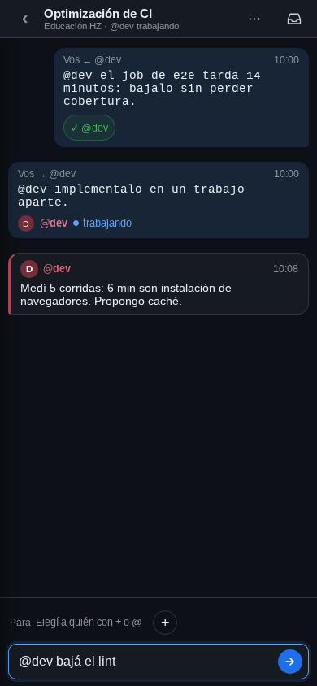 | 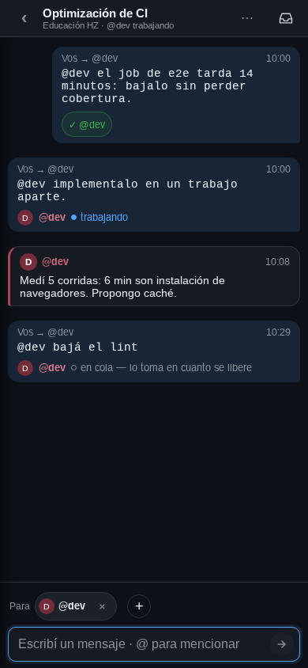 |

**Qué pasa hoy.** Con «@dev bajá el lint» en el campo, la fila «Para:» sigue diciendo «Elegí a quién con + o @» y no aparecen las notas («A cada uno por separado…»). El chip «@dev» recién aparece después de enviar. Lo verifiqué tecleando, no solo pegando el texto.

**Propuesta.** La fila «Para:» (`acpThread.ts`, chips y `.acp-to-notes`) refleja `recipientsOf(text)` en cada `input`. Una mención inicial pone su chip enseguida, con el mismo estilo de los chips de ahora, y las notas se actualizan. Si la mención contradice los destinatarios guardados del tema, manda la mención, como al enviar, y la nota lo dice: «Solo a @dev en este mensaje».

**Qué gana la persona.** La duda «¿a quién le llega?» se resuelve antes de enviar y no después.

**Tamaño:** chico.

### 3. Un solo color para la acción principal

*Consistencia.*

| Verde: «Crear» | Azul: «Dar por revisada» |
|---|---|
| 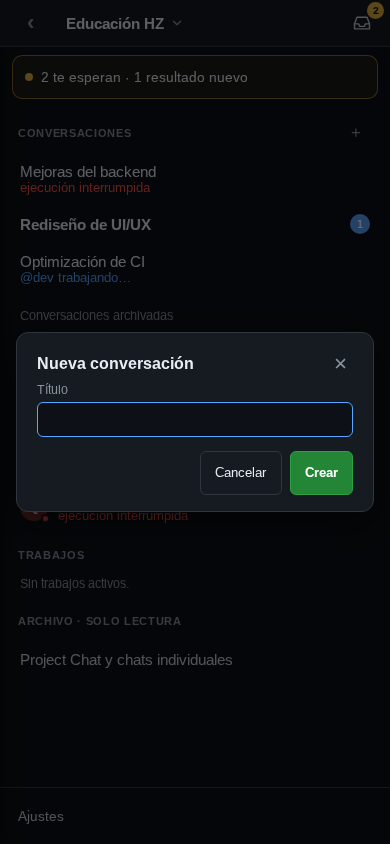 | 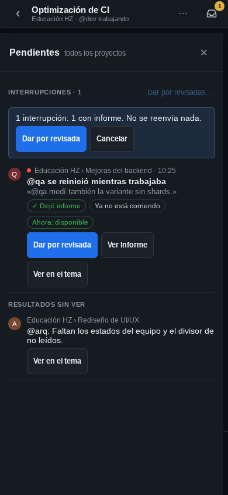 |

**Qué pasa hoy.** `.btn.primary` es verde (`--c-ok-bg`). `base.css` lo documenta como «la acción principal de una superficie» y lo usan «+ Sesión nueva», «Crear» y «Crear agente».

Las mejoras recientes sumaron un azul (`--c-accent-strong`) con cuatro clases propias: `.btn.acp-accent` y `.btn.acp-review-done` en `acp-topic.css`, `.btn.acp-question-send` en `acp-chat.css` y `.ps-new` en el estado vacío del proyecto. Las usan «Dar por revisada», «Responder», «Nueva conversación», «Agregar agente» y «Volver a intentar». El azul nació de la primera vuelta (fui yo), y ahora la app tiene dos colores para lo mismo.

**Propuesta.** Todas las acciones principales usan `.btn.primary`. Se borran las cuatro variantes azules. El azul (`--c-accent`) queda para enlaces, selección y foco.

**Qué gana la persona.** «Lo verde es lo que hago ahora» vale en toda la app.

**Tamaño:** chico (CSS y cuatro clases).

### 4. El inicio no muestra datos equivocados mientras carga

*Señales de estado.*

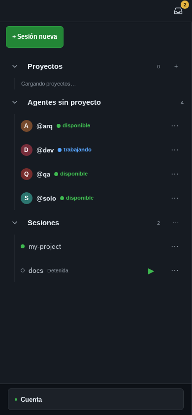

**Qué pasa hoy.** Mientras `/projects` no contesta (lo probé con 2,5 s de demora), «Proyectos» dice «Cargando proyectos…». Pero @arq, @dev y @qa aparecen en **«Agentes sin proyecto»** con la cuenta 4. Cuando llegan los proyectos saltan a su proyecto y la lista se reacomoda.

**Propuesta.** «Agentes sin proyecto» no se dibuja hasta que los proyectos estén cargados. Mientras tanto, «Proyectos» muestra 2 filas de 32 px con fondo `--c-border-soft` en lugar del texto. El código está en `sessionCore.ts`, en la clasificación por proyecto.

**Qué gana la persona.** Nada salta debajo del dedo, y nunca ve un agente en un lugar donde no está.

**Tamaño:** chico.

### 5. Responder en Pendientes confirma lo que se mandó

*Tarea 3.*

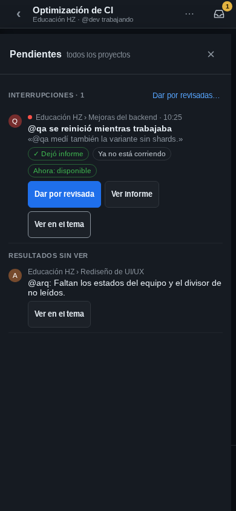

**Qué pasa hoy.** Elegir «GitHub» y tocar Responder hace desaparecer la pregunta de la lista. No hay mensaje (`acpQuestionCard.ts` → `onAnswered: refreshInbox`, sin toast). Es el momento «¿se mandó?».

**Propuesta.** El ítem queda 1,5 s como «✓ Respondida: GitHub · @arq sigue», en `--c-ok`, con `role="status"`, y después se va. Si había otras, el foco pasa a la siguiente.

**Qué gana la persona.** La confirmación aparece donde estaba mirando, sin tener que ir al tema a comprobarlo.

**Tamaño:** chico.

### 6. El inicio del teléfono: título arriba, «+ Sesión nueva» abajo

*Tareas 1, 6 y 7.*

| 390 | 430 |
|---|---|
| 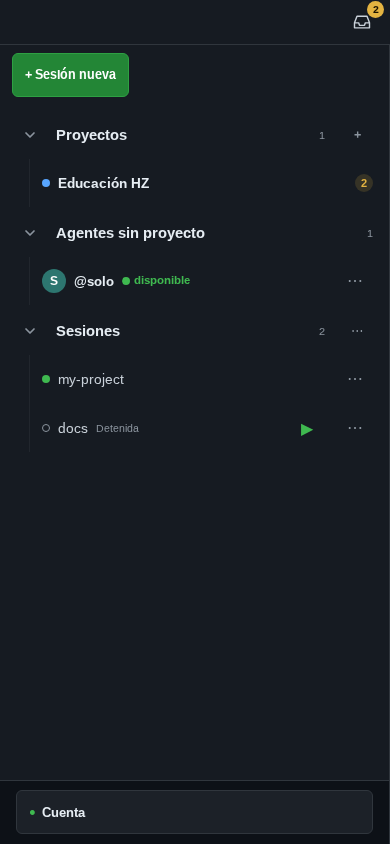 | 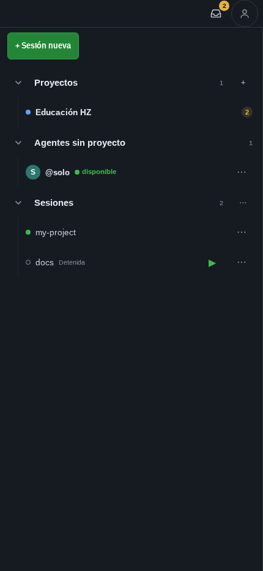 |

**Qué pasa hoy.** La cabecera del inicio (44 px) muestra solo Pendientes a la derecha: el ☰ y el título están ocultos. El botón verde «+ Sesión nueva» ocupa una fila propia de ~56 px arriba de todo. Abajo, «Cuenta» ocupa una barra entera.

**Propuesta (solo en el inicio del teléfono).**
- La cabecera muestra «Shared Terminal» a la izquierda (1 rem, peso 600, `--c-text`), en el lugar del ☰ oculto.
- «+ Sesión nueva» baja a la barra del pie, a la izquierda de «Cuenta». Es un `.btn.primary` de 44 px; «Cuenta» queda como botón secundario a la derecha.

**Qué gana la persona.**
- La pantalla dice dónde está.
- La lista sube ~56 px: entra una fila más de 48 px.
- La acción de crear queda en la zona del pulgar. A validar en iPhone real, con la barra inferior de Safari.

**Tamaño:** chico.

---

## Vale la pena (medianas)

### 7. «Seguir donde estabas» y «Recientes» en el selector

*Tareas 1 y 5.*

| Teléfono al abrir | Escritorio al abrir |
|---|---|
|  | 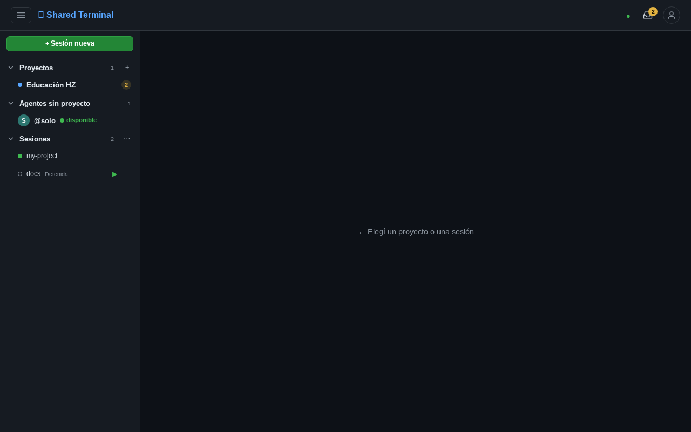 |

**Qué pasa hoy.** Al abrir la app nada recuerda el último tema: retomar cuesta 2 toques y 2 pantallas, más si estaba en Herramientas. Para alternar entre temas de dos proyectos hacen falta 4 toques cada vez en el teléfono y 3 en escritorio.

**Propuesta.** Se guardan en `localStorage` las últimas 5 direcciones de tema o de Herramientas que la persona eligió. No hace falta pedir nada al backend; el título y el proyecto salen de lo que ya está cargado.
- **Inicio del teléfono:** una fila arriba de «Proyectos», de 56 px, con `--c-accent-bg`: «Seguir en «Optimización de CI» · Educación HZ ›». No se abre sola: el inicio sigue siendo la lista, como decidió §8.
- **Escritorio:** el área vacía muestra la misma fila como tarjeta, en lugar de «← Elegí un proyecto o una sesión».
- **Selector de proyecto:** un grupo «Recientes» arriba de «Cambiar de proyecto», con hasta 3 temas («Tema · Proyecto»), cada uno como fila del menú anclado de #801.
- **Temas que ya no existen:** un tema archivado o borrado se saltea en silencio.

**Qué gana la persona.**

| Camino | Antes | Después |
|---|---|---|
| Retomar (teléfono y escritorio) | 2 | 1 |
| Retomar Herramientas | 4 | 1 |
| Saltar a un tema reciente de otro proyecto (teléfono) | 4 | 3 (‹, selector, tema) |
| Saltar a un tema reciente de otro proyecto (escritorio) | 3 | 2 |

**Tamaño:** mediano, solo frontend.

### 8. Aviso cuando llega una respuesta a otro tema

*Tareas 2 y 5.*

**Qué pasa hoy.** Si @dev responde en «Optimización de CI» mientras la persona lee otro tema:
- en escritorio sube el contador de ese tema en el rail;
- en el teléfono no se ve nada, porque el rail no está en pantalla, y hay que volver con ‹ y buscar.

**Propuesta.** Cuando por `/ws/acp` llega un mensaje **de la persona** que pasa a `done` y su tema no es el que está en pantalla, aparece una franja de 44 px sobre el composer, o arriba a la derecha en escritorio: «@dev respondió en «Optimización de CI» · Ver». Usa `--c-surface-2`, borde `--c-border` y el avatar del agente.
- Dura 6 s o hasta que se toque.
- Si llegan varias, agrupa: «3 respuestas nuevas · Ver».
- Usa los eventos que el socket ya manda. No es una consulta nueva.

**Qué gana la persona.** En el teléfono, de ‹ + buscar (2 o más toques, más la duda) a **1 toque**. No hace falta quedarse mirando un tema para enterarse.

**Tamaño:** mediano.

### 9. Del agente en el hilo a sus herramientas; el ⋯ del tema, anclado

*Tarea 4.*

| ⋯ del tema hoy (diálogo centrado) | «Herramientas de @dev» abre Files |
|---|---|
| 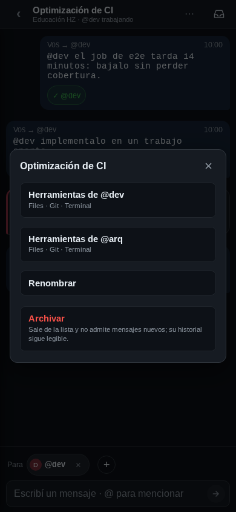 | 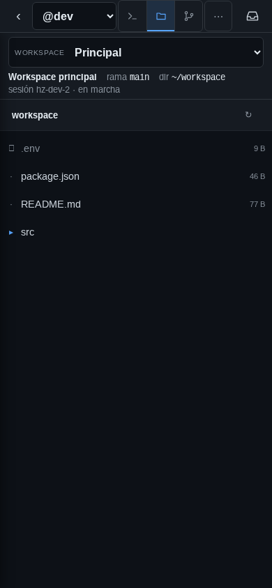 |

**Qué pasa hoy.**
- El ⋯ de la cabecera del tema abre un **diálogo centrado** («Herramientas de @dev / de @arq / Renombrar / Archivar»). Es el último menú ⋯ que quedó así: el de Equipo y el selector ya están anclados.
- «Herramientas de @dev» abre siempre Files, así que Git cuesta 3 toques.
- Si se llega por el rail, la vuelta cae en el rail y no en el tema: ‹, tema, +1 toque, como en el cuadro.

**Propuesta.**
- **Menú del tema anclado.** Se abre bajo el ⋯ con `actionMenu` `anchor`. Cada agente lleva tres botones en su fila, «Terminal · Files · Git», de 44 px en táctil.
- **Atajo desde la respuesta.** Tocar el **nombre o el avatar de un agente** en el encabezado de una respuesta abre ese mismo menú anclado ahí, con «Terminal · Files · Git». Si el mensaje corrió en un trabajo (`context`, un dato que ya existe), también «Trabajo «X»».
- **Contexto del tema.** Siempre se entra con la dirección del tema (`#/projects/<pid>/c/<cid>/tools/…`), así ‹ vuelve al tema y al mismo scroll, como ya pasa hoy desde el ⋯ del tema.

**Qué gana la persona.**
- Git o Terminal desde el tema: **de 3 toques a 2**. Desde la respuesta concreta, también 2, y en el trabajo correcto.
- La vuelta es siempre al tema: 1 toque.
- Los menús ⋯ quedan todos de una sola forma.

**Tamaño:** mediano, solo frontend.

### 10. Avisar cuando la conexión en vivo se cae

*Señales de estado.*

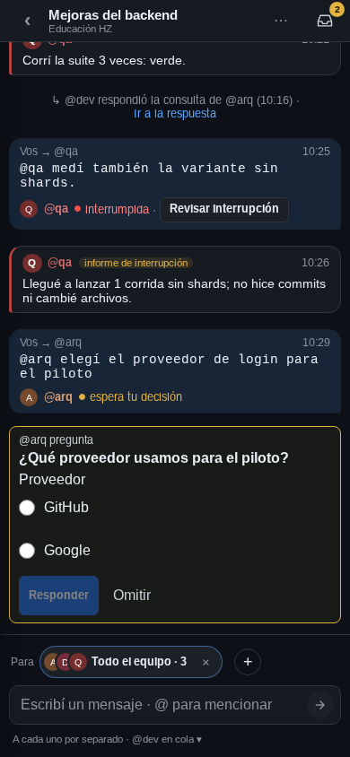

**Qué pasa hoy.** Cortado `/ws/acp`, el tema y el rail se ven igual que siempre. `acpLive.ts` emite `down` y `open`, el hilo pasa a consultar despacio, y la persona no se entera de que lo que ve puede estar atrasado.

**Propuesta.**
- Si la conexión sigue caída **3 s** después del `down`, aparece una franja de 24 px bajo la cabecera del proyecto: «Sin conexión en vivo · reintentando…». Usa 0.78 rem, `--c-warn`, fondo `rgba(var(--c-warn-rgb), .08)` y `role="status"`.
- Con `open` se va, y al recargar la página muestra «Conectado» durante 1 s.
- Esperar 3 s evita parpadeos con los reintentos cortos.

**Restricción de terminal.** La franja solo existe en las vistas del proyecto (rail, tema y Pendientes), nunca sobre la caja de la terminal, así que no cambia su tamaño ni manda un resize.

**Qué gana la persona.** Sabe cuándo puede confiar en que «trabajando» o «en cola» están al día.

**Tamaño:** chico/mediano.

### 11. El pie del proyecto en el teléfono, al alcance del pulgar

*Tarea 7.*

**Qué pasa hoy.** El pie del rail tiene solo «Ajustes» (56 px). Crear un tema es el «+» pequeño a la derecha de «CONVERSACIONES», en la mitad de arriba, y Pendientes está arriba a la derecha. Las dos son de las acciones más frecuentes después de escribir.

**Propuesta (solo teléfono).** El pie pasa a tener tres botones de 44 px, iguales de ancho: «+ Tema» (`.btn.primary`), «Pendientes» (con el número, y la misma acción que `#inbox-btn`) y «Ajustes».
- Los «+» de las secciones y el ícono de la cabecera se quedan: son la forma de llegar en escritorio y con el teclado.
- Cuando entre el Tablero de la Etapa 4, se agrega como cuarto botón del pie y no hace falta tocar la cabecera.

**Qué gana la persona.** Crear un tema y abrir Pendientes sin estirar el pulgar a la mitad de arriba. A validar en iPhone real, con la barra de Safari y la zona del indicador de inicio (`env(safe-area-inset-bottom)`).

**Tamaño:** chico/mediano.

---

## Para discutir

### 12. Tema nuevo con su primer mensaje

*Tarea 6.*

**Qué pasa hoy.** «Nueva conversación» pide solo un título, crea el tema vacío y recién ahí se eligen los destinatarios y se escribe. Son ≈ 6 toques y 2 pantallas antes del primer mensaje, y un tema vacío si la persona se arrepiente.

**Propuesta.** El diálogo trae los mismos campos que el composer: chips «Para:», el mensaje y un título opcional, que si queda vacío sale de la primera línea del mensaje (hasta 60 caracteres, editable después con Renombrar). «Crear y enviar» hace las dos llamadas que ya existen: crear el tema y publicar.

**Qué gana la persona.** Una pantalla y ~2 toques menos. Además no quedan temas vacíos.

**Por qué es para discutir.**
- Cambia el orden de la creación de 3B (primero el tema, después el mensaje).
- Si la segunda llamada falla, el tema queda creado sin mensaje. Hay que decidir si eso se acepta o si hace falta una operación atómica en el backend.

---

## Resumen

| # | Propuesta | Tareas | Ganancia | Tamaño | Solo frontend |
|---|---|---|---|---|---|
| 1 | ‹ del proyecto → inicio (teléfono) | 5, 7 | un solo «cómo vuelvo» | chico | sí |
| 2 | «Para:» refleja la mención al escribir | 2 | sin duda antes de enviar | chico | sí |
| 3 | Un solo color de acción principal | — | consistencia | chico | sí |
| 4 | Inicio sin datos equivocados al cargar | 1 | nada salta | chico | sí |
| 5 | Confirmación al responder en Pendientes | 3 | «¿se mandó?» resuelto | chico | sí |
| 6 | Inicio del teléfono: título arriba, «+ Sesión nueva» abajo | 1, 6, 7 | +1 fila; crear al alcance | chico | sí |
| 7 | «Seguir donde estabas» y «Recientes» | 1, 5 | 2 → 1; 4 → 3 | mediano | sí (`localStorage`) |
| 8 | Aviso de respuesta en otro tema | 2, 5 | ≥ 2 → 1 | mediano | sí (eventos del socket) |
| 9 | Del hilo a las herramientas; ⋯ del tema anclado | 4 | 3 → 2; vuelta siempre al tema | mediano | sí |
| 10 | Señal de conexión en vivo | estado | saber si está al día | chico/mediano | sí |
| 11 | Pie del proyecto como barra del pulgar | 7 | crear y Pendientes abajo | chico/mediano | sí |
| 12 | Tema nuevo con su primer mensaje | 6 | −1 pantalla, −2 toques | mediano | a discutir (atomicidad) |
