# Revisión de la interfaz después de 3B (lectura, navegación, usabilidad)

Pedido del owner (#1605, conversación «Revision etapa 3»). Son propuestas: no se implementa nada en este PR. Se refina lo aprobado en 3A/3B con los tokens y los componentes que ya existen, sin pedir datos nuevos al backend.

**Cómo se miró.** La base es `main` 1b30c0e, que ya incluye #800 y #801. La app corrió en el servidor de Vite con el mock del e2e (`e2e/mockBackend.ts`) en Chromium (Playwright), a 390×844, 430×932 y 1280×800. Al fixture del tema «Mejoras del backend» (`topicStates` de `visual.spec.ts`) le sumé:

- una respuesta larga con lista, tabla y bloque de código;
- una pregunta abierta de @arq;
- un proyecto vacío.

Las capturas están en [`assets/ui-review/`](../../assets/ui-review/).

**Límites de la medición:**
- **Fuentes.** Las fuentes son las del e2e (E2E Sans y E2E Mono), no la fuente del sistema del iPhone. Los conteos de caracteres son orientativos: dan la proporción de la mejora, no la cifra exacta en Safari.
- **Monoespaciada de las capturas.** El e2e fuerza la monoespaciada en todo `pre` (`pre … !important` en el fixture de fuentes). Por eso en las capturas el texto que escribe la persona aparece en monoespaciada. En la app real es sans (`pre.acp-msg-body { font-family: inherit }`), así que no es un hallazgo.
- **Teclado.** El teclado se simuló achicando el alto del viewport: 336 px menos a 390 y 346 px menos a 430. Todo lo que depende del teclado o de las barras de iOS está marcado **a validar en iPhone real**.

**Prioridad.** Va de mayor a menor impacto dentro de cada grupo. Todas las propuestas son **solo frontend**, salvo donde se indica lo contrario.

---

## Hacer ya (chicas, claras)

### 1. Las respuestas de los agentes usan todo el ancho en el teléfono

| Hoy (390) | Hoy (430) |
|---|---|
| 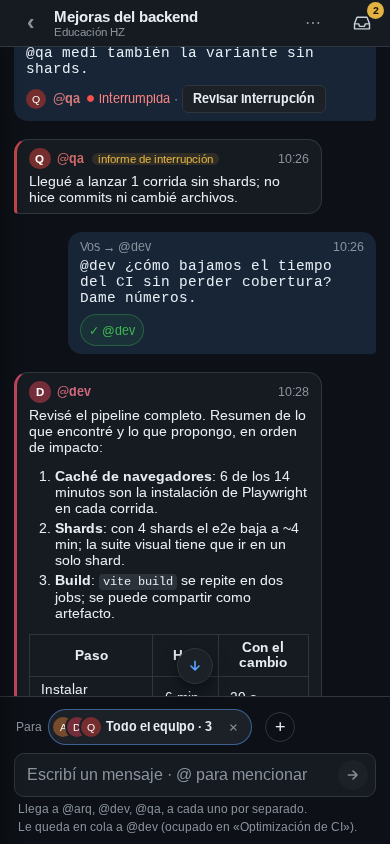 | 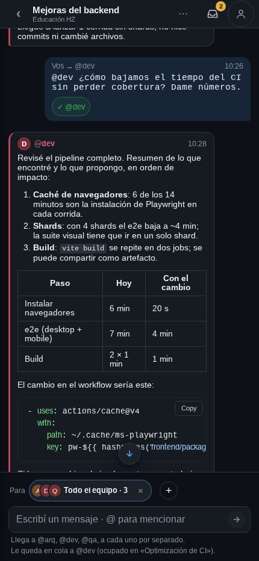 |

**Qué se ve hoy.**
- **Burbuja de respuesta.** Una respuesta de agente (`.acp-bubble.acp-in.acp-voice`) se queda en `max-width: min(85%, 46rem)` (`styles/acp-chat.css`, `.acp-bubble`). A 390 la burbuja mide 308 px de 362 disponibles y el texto (`.chat-md`) mide 280 px.
- **Caracteres por línea.** La primera línea de la respuesta larga entra en ~42 caracteres. A la derecha quedan 54 px vacíos en cada línea de cada respuesta.
- **Respuesta anidada.** La respuesta de una consulta (`.acp-topic-consult`, anidada) baja a 257 px de texto.
- **Mensaje propio.** Un mensaje propio con filas de estado ya ocupa todo el ancho (`.acp-post:has(.acp-rs-list) > .acp-out { max-width: none }`, `styles/acp-topic.css`). Las respuestas no.

**Propuesta (≤ 768 px):**
- **Respuestas del agente.** `.acp-in` lleva `max-width: none; align-self: stretch`. El borde de color de 3 px (`.acp-voice`) y el encabezado con avatar y nombre ya distinguen quién habla, así que no hace falta el hueco a la derecha para eso.
- **Margen lateral del hilo.** Baja de 14 px a 10 px. Es el valor que `acp-chat.css` ya declara para ≤ 640 y que en el tema no se aplica.
- **Respuesta anidada de una consulta.** Se le saca la sangría interna y queda solo su borde de 2 px. El texto pasa de 257 a ~330 px.
- **Mensajes de la persona.** No cambian: siguen alineados a la derecha. Así se mantiene el «yo a la derecha, ellos a la izquierda» de 3A.

**Qué gana la persona.**
- **A 390.** El texto de una respuesta pasa de 280 a ~346 px, de ~42 a ~52 caracteres por línea (+24 %). La respuesta larga del fixture ocupa ~20 % menos de alto.
- **A 430.** Pasa de 314 a ~386 px.
- **Tipografía.** Si se prefiere subir la letra del cuerpo de 0.9 rem (14 px) a 15 px, que se lee mejor en el iPhone, la línea queda en ~48 caracteres: igual se gana ancho y tamaño a la vez. A validar en iPhone real con la fuente del sistema.

**Tamaño:** chico (CSS).

### 2. Composer más bajo, sobre todo con el teclado abierto

| Vacío (390×844) | Escribiendo, teclado simulado (390×508) |
|---|---|
| 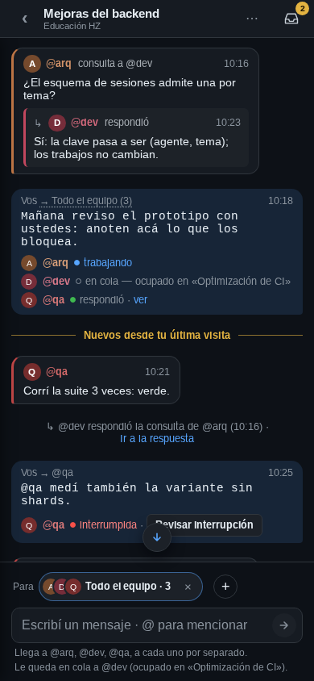 | 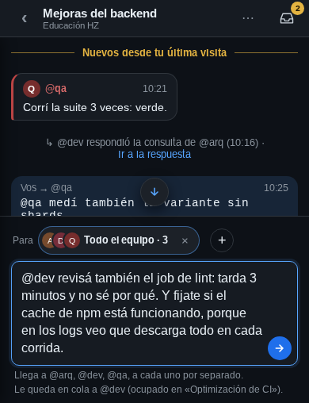 |

**Qué se ve hoy.**
- **Con el campo vacío.** El bloque de abajo ocupa 147 px de 844 (17 %): la fila «Para:» de 44 px, el campo y dos líneas de notas (`.acp-to-notes`, `acpThread.ts` ~1980: «Llega a @arq, @dev, @qa, a cada uno por separado.» / «Le queda en cola a @dev (ocupado en «…»)»).
- **Con un mensaje de 5 líneas y el teclado abierto.** El composer mide 236 px y al hilo le quedan 226 px (menos de la mitad del espacio visible). Aparecen 3 burbujas cortadas.
- **Alto máximo del campo.** Hoy es `min(8 × 22 px + 20 px, 30 % de --app-vh)` (`.acp-chat-input`, `acp-chat.css`).

**Propuesta (`pointer: coarse`):**
- **Notas.** Pasan a **una sola línea**: 0.72 rem, `--c-muted`, elipsis, con el texto unido, por ejemplo «A cada uno por separado · @dev en cola». Tocarla la despliega (`aria-expanded`). La regla de 3B se mantiene: la nota sigue visible antes de enviar.
- **Campo.** Con el foco adentro, el alto máximo baja a **4 líneas** (4 × 22 + 20 = 108 px). Con más texto, el campo hace scroll.
- **Fila «Para:».** Mantiene 44 px. No se esconde, porque es la decisión de a quién llega el mensaje.

**Qué gana la persona.** Con el teclado abierto y un mensaje largo, el composer pasa de ~236 a ~190 px y el hilo de 226 a ~272 px (+20 %). Con el campo vacío se recupera una línea de notas, ~18 px. A validar en iPhone real: alto del teclado, barra de sugerencias y `visualViewport`.

**Tamaño:** chico.

### 3. La tarjeta de pregunta, cómoda para el dedo y con una acción principal

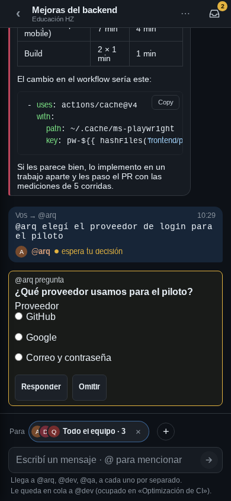

**Qué se ve hoy.**
- **Opciones.** Usan el radio nativo de ~13 px y filas de `min-height: 1.9rem` (30 px) (`.acp-option`, `acp-chat.css` ~620). Están por debajo de 44 px y la parte tocable es chica.
- **Botones.** «Responder» y «Omitir» tienen el mismo peso visual (`.acp-question-actions`).
- **Pendientes.** La misma tarjeta aparece en Pendientes.

**Propuesta:**
- **Opción.** Cada opción es una fila `label` de **44 px** en táctil (36 px en ancho), con toda la fila tocable.
- **Radio.** Mide 18 px, con `accent-color: var(--c-accent)` y 10 px de separación del texto.
- **Responder.** Es la acción principal y usa el mismo tratamiento que `.btn.acp-review-done` (`--c-accent-strong`). Queda deshabilitado hasta elegir una opción.
- **Omitir.** Pasa a botón de texto en `--c-text-2`.

**Qué gana la persona.** Elegir y responder son dos toques seguros sin hacer zoom, y queda claro cuál es la acción esperada. Es la tarjeta que más urgencia tiene en toda la app.

**Tamaño:** chico.

### 4. El menú ⋯ del agente, anclado como el selector de proyecto

| Teléfono | Escritorio |
|---|---|
| 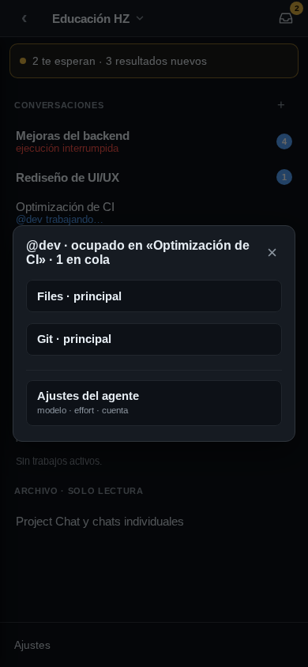 | 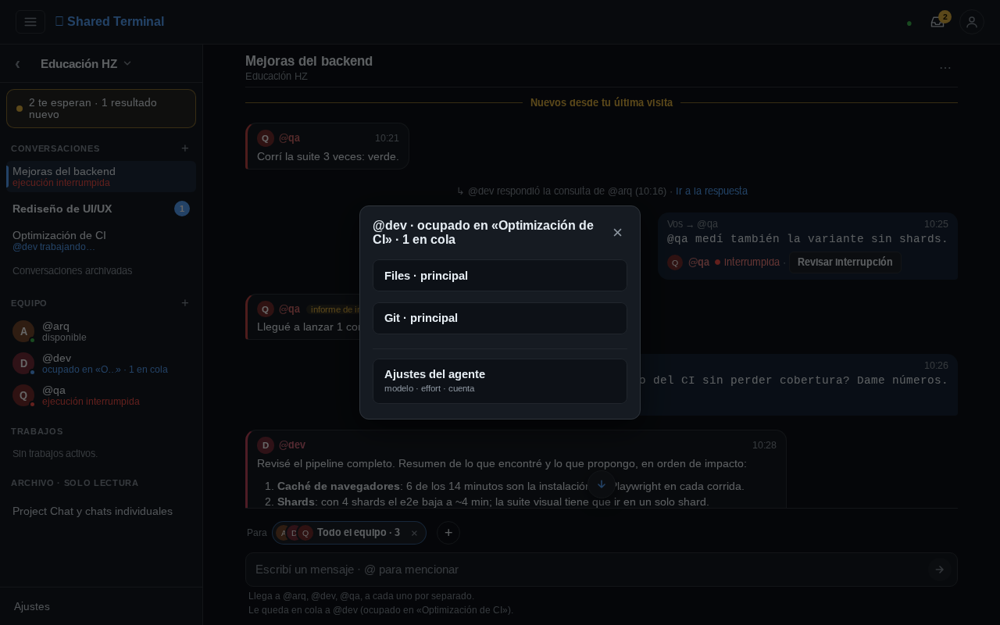 |

**Qué se ve hoy.**
- **Forma.** El ⋯ de una fila de Equipo (`toolsView.openAgentMenu`) abre `openActionMenu` como diálogo centrado. El selector de proyecto ya se abre anclado desde #801.
- **Título.** Repite el estado largo: «@dev · ocupado en «Optimización de CI» · 1 en cola». Ocupa dos líneas y es lo que la fila ya muestra.

**Propuesta:**
- **Anclado.** Se usa la opción `anchor` de `actionMenu` que agregó #801.
  - En ancho: bajo el ⋯ y alineado a su derecha, con un ancho de 240 px.
  - En teléfono: bajo la fila, a todo el ancho con 8 px de margen.
- **Título.** Queda solo «@dev».
- **Ítems.** Siguen igual: Files, Git, trabajos, separador, Ajustes del agente.

**Qué gana la persona.**
- El menú aparece donde tocó y no tapa el rail.
- Los menús de la app se abren todos de una sola forma.
- El título baja de dos líneas a una.

**Tamaño:** chico (reusar).

### 5. Proyecto sin agentes: la primera acción es agregar uno

| Teléfono | Escritorio |
|---|---|
| 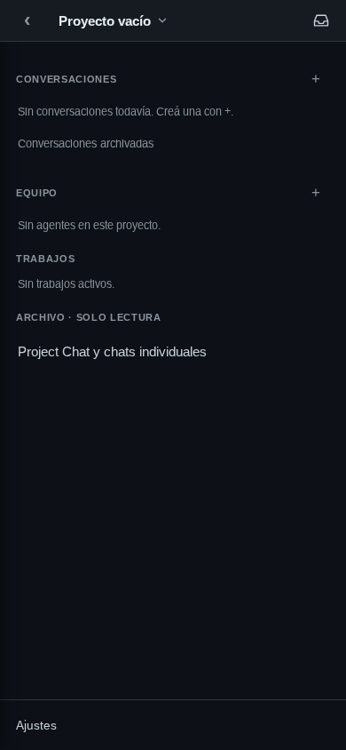 | 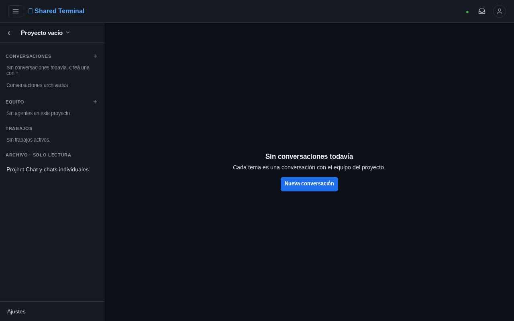 |

**Qué se ve hoy.**
- **Escritorio.** El estado vacío (`projectsView.ts` ~354) ofrece «Nueva conversación» como botón principal aunque el proyecto no tenga agentes. Una conversación sin equipo no lleva a nada.
- **Teléfono.** Se ven cuatro secciones vacías seguidas.

**Propuesta.** Si el equipo está vacío, el estado vacío dice «Este proyecto todavía no tiene agentes» y su botón principal es «Agregar agente». Ese botón abre el mismo formulario que el «+» de Equipo. «Nueva conversación» aparece recién cuando hay al menos un agente. En el rail del teléfono, la sección Equipo va **primero** mientras esté vacía.

**Qué gana la persona.** El paso siguiente está en el primer lugar donde mira, sin ir a buscar el «+» de una sección.

**Tamaño:** chico.

### 6. Terminal en táctil: sacar la pista «Hold Shift + drag»

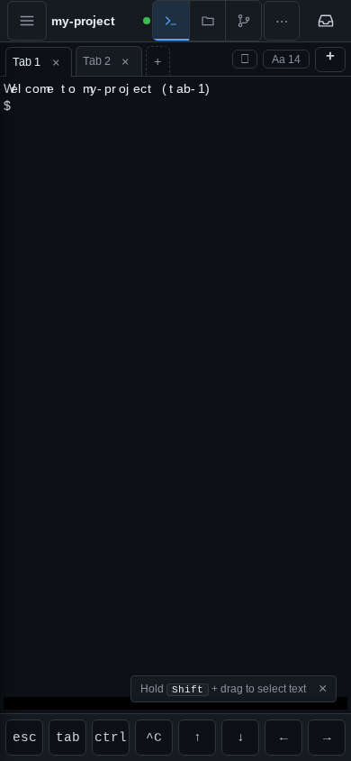

**Qué se ve hoy.** En el teléfono aparece «Hold Shift + drag to select text» (`main.ts` ~731), en inglés. En una pantalla táctil no hay Shift.

**Propuesta.** Con `pointer: coarse` la pista no se muestra. En escritorio se traduce: «Mantené Shift y arrastrá para seleccionar» (con ⌥ Option en Mac).

**Restricción de terminal.** La pista es una capa superpuesta, así que ocultarla no cambia la caja de xterm y no manda ningún resize. La invariante del e2e lo cubre.

**Qué gana la persona.** No ve un consejo que no puede seguir, que además tapa la última línea del terminal.

**Tamaño:** chico.

### 7. El botón «↓» no tapa acciones

**Qué se ve hoy.** El botón «Ir al final» (`.chat-float.chat-end`, `chatScroll.ts`) queda centrado sobre el hilo y tapa «Revisar interrupción» en la captura, a 390. Ya evita las preguntas abiertas (`avoid: .acp-question-open`), pero no los botones.

**Propuesta:**
- **Posición.** Se ancla a la derecha, `right: 12px`, a 12 px por encima del composer. Mide 40 px.
- **Lista de lo que evita.** Suma `.acp-rs-list .btn` y `.acp-post .btn`.

**Tamaño:** chico.

---

## Vale la pena (medianas)

### 8. En el teléfono, la pantalla de inicio es la lista y no un vacío con ☰

| Hoy al abrir | Después de tocar ☰ |
|---|---|
|  | 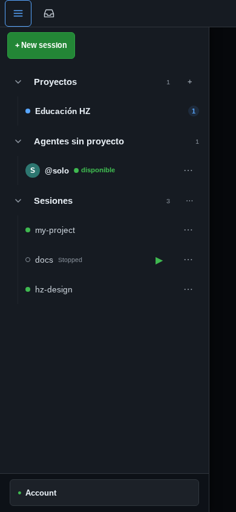 |

**Qué se ve hoy.** Al abrir la app en el teléfono aparece una pantalla vacía con «Select or create a session →» (`#empty-state`, `index.html`). La flecha apunta a la derecha y el texto está en inglés. Lo único útil está detrás del ☰.

**Propuesta.** En el teléfono, sin una sesión ni un proyecto en la dirección, el nivel principal (Proyectos, Agentes sin proyecto, Sesiones) **es la pantalla**: el mismo contenido del drawer, a todo el ancho y sin fondo oscuro. ☰ y ‹ siguen llevando a ese mismo nivel. En escritorio no cambia nada.

**Restricción de terminal.** No hay terminal en pantalla, así que no se manda ningún resize.

**Qué gana la persona.** Un toque menos cada vez que abre la app, y nunca una pantalla muerta.

**Tamaño:** mediano: `sessionCore` y `projectsView` deciden qué se muestra al arrancar, y hay que coordinarlo con @developer.

### 9. Pendientes en el teléfono: más ancho y menos botones

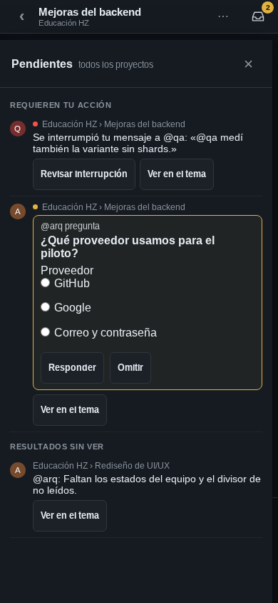

**Qué se ve hoy.**
- **Avatar.** Cada ítem (`.acp-ib-item`, `acp-topic.css` ~499) reserva una columna de 32 px para el avatar.
- **Pregunta.** Agrega su propio marco adentro y termina a 290 px de ancho.
- **Botón por ítem.** Cada ítem tiene además un botón «Ver en el tema», que es una fila de 44 px.

**Propuesta (≤ 768 px):**
- **Avatar.** Pasa a 18 px dentro de la línea de ubicación («Educación HZ › Mejoras del backend») y se elimina la columna.
- **Enlace.** La línea de ubicación es el enlace al tema: 44 px de alto, `--c-accent` al pasar o con el foco. Desaparece el botón «Ver en el tema».
- **Pregunta.** Va sin su marco amarillo, porque el ítem ya está en «Requieren tu acción».

**Qué gana la persona.**
- El contenido de cada ítem pasa de 290 a ~350 px de ancho.
- Cada ítem pierde una fila de 44 px.
- Con dos pendientes, entra uno más en la pantalla.

**Tamaño:** chico/mediano.

### 10. Código y tablas en las respuestas, en el teléfono

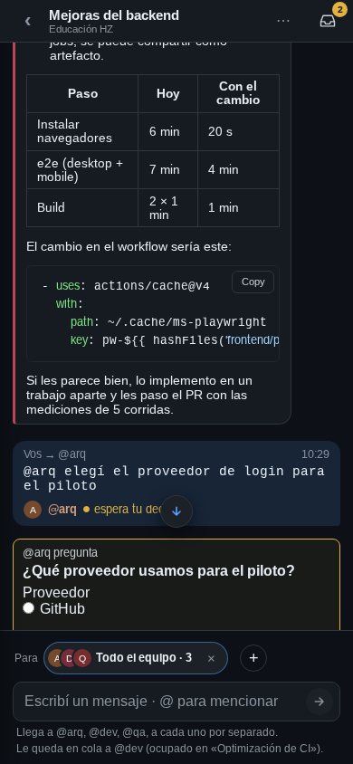

**Qué se ve hoy.**
- **Bloque de código** (`.md-root .md-pre`, `files.css`).
  - Queda con el padding de la burbuja más el suyo (1 rem).
  - El botón «Copy» (en inglés, `chatMarkdown.ts` ~39) tapa el final de la primera línea.
  - Las líneas largas se cortan con scroll horizontal dentro de una caja de 280 px.
- **Tabla.** Se comprime a 280 px y parte en dos líneas celdas como «2 × 1 min».

**Propuesta (≤ 768 px):**
- **Código: márgenes.** Sale a ras de los bordes internos de la burbuja (margen negativo igual al padding de la burbuja) y su padding baja a 0.5 rem.
- **Código: Copiar.** Va en una barra propia de 28 px sobre el código, alineado a la derecha, con el texto «Copiar».
- **Tablas.** Van dentro de `.md-table-wrap` con scroll horizontal propio, `min-width: max-content` y 13 px de letra, sin partir celdas cortas.

**Qué gana la persona.**
- El código gana ~40 px de ancho a 390, sumados a lo que da la propuesta 1.
- «Copiar» no tapa el código.
- Una tabla se lee por fila sin cortes.

**Tamaño:** chico/mediano: la base es compartida con Files, así que el cambio va acotado a `.chat-md`.

### 11. Textos de interfaz en español en las superficies principales

**Qué se ve hoy.** Quedan textos en inglés en lo que se ve a diario:

| Texto actual | Dónde aparece |
|---|---|
| «Select or create a session →» | estado vacío |
| «+ New session» | sidebar |
| «Account» | pie del drawer |
| «Copy» | código |
| «Hold Shift + drag…» | terminal |
| «Collapse …» | nombre accesible del chevron |
| «running» / «Stopped» | estado de sesión |

Conviven con todo lo de 3B, que ya está en español.

**Propuesta.** Un pase de textos sobre esas superficies, sin tocar los nombres de las vistas Terminal, Files y Git, que son nombres propios en la app. Lista cerrada en el PR, revisada por @qa contra los e2e que buscan por texto.

**Qué gana la persona.** Una sola lengua en la interfaz.

**Tamaño:** mediano por la cantidad de specs que buscan por texto en inglés.

### 12. Escritorio: largo de línea de las respuestas

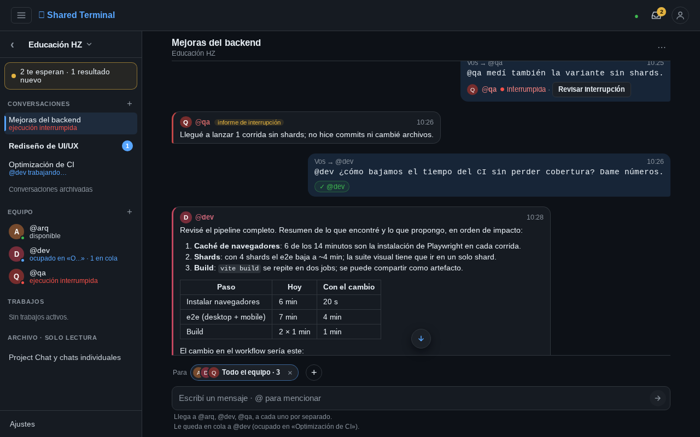

**Qué se ve hoy.** A 1280, el texto de una respuesta llega a ~690 px y ~95 caracteres por línea (`.acp-bubble { max-width: min(85%, 46rem) }`). Con más ancho de ventana crece hasta 46 rem.

**Propuesta.** `.acp-voice .chat-md { max-width: 72ch }`. La burbuja se ajusta al texto. No cambia nada en el teléfono.

**Qué gana la persona.** Líneas de ~72 caracteres, un largo cómodo para respuestas largas. El ojo hace un viaje más corto entre una línea y la siguiente.

**Tamaño:** chico. Es lo único de escritorio que molesta de verdad. El resto de la densidad de escritorio está bien y no lo toco.

---

## Para discutir

### 13. Dónde entra el Tablero (Etapa 4) en la navegación del proyecto

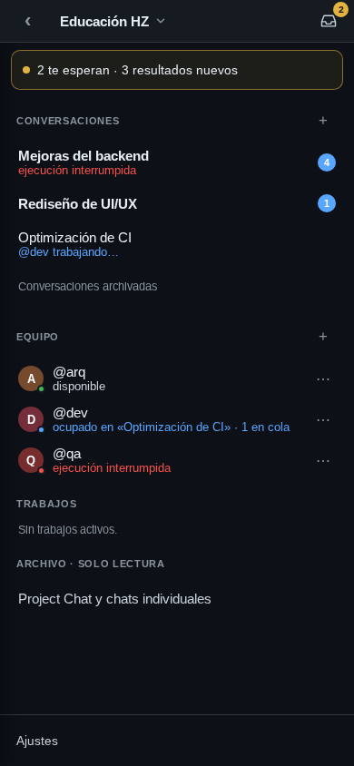

**Hoy.** El proyecto tiene un solo tipo de destino: el tema. Se llega desde el rail (Conversaciones), y Herramientas cuelga de un agente.

**Propuesta, sin rediseñar el prototipo de `assets/design-4`.**
- **En el rail.** El Tablero es **una fila fija del rail**, entre la fila de atención y «Conversaciones»: «Tablero · N bloqueadas», con la cuenta en el mismo tono que las píldoras de #801.
- **En ancho.** Se abre en el área principal, como un tema.
- **En el teléfono.** Es una pantalla más de la pila: rail → Tablero → tarea, con ‹ hacia el rail. No agrega pestañas en la cabecera, que en el teléfono ya está llena (‹, nombre, ⋯, Pendientes).

**Por qué.**
- Mantiene la regla de 3B: el rail es el índice del proyecto y la cabecera es del destino.
- Lo frecuente (tema ⇄ tablero) cuesta un toque en ancho y dos en el teléfono (‹ y la fila), igual que cambiar de tema.

**Para discutir.** Si el owner quiere el Tablero como vista por defecto del proyecto, cambia el aterrizaje de `#/projects/<pid>`.

### Notas de validación (no son propuestas)

- **Gesto Atrás de iOS.** No lo recorrí en esta revisión. Hay que confirmar en iPhone real que el borde izquierdo de Safari hace lo mismo que ‹ en tema → rail → nivel principal, y qué pasa con el swipe con el drawer abierto.
- **Propuesta 2.** El cálculo usa un teclado simulado. La barra de sugerencias de iOS y el `visualViewport` real pueden mover ±40 px.

---

## Resumen por tamaño

| # | Propuesta | Tamaño | Solo frontend |
|---|---|---|---|
| 1 | Respuestas a todo el ancho en el teléfono (+24 % de caracteres por línea) | chico | sí |
| 2 | Composer más bajo con teclado (+20 % de hilo) | chico | sí |
| 3 | Tarjeta de pregunta táctil, Responder principal | chico | sí |
| 4 | Menú ⋯ del agente anclado | chico | sí |
| 5 | Proyecto vacío → «Agregar agente» | chico | sí |
| 6 | Sin pista Shift en táctil | chico | sí |
| 7 | «↓» que no tapa acciones | chico | sí |
| 8 | Inicio en el teléfono = la lista | mediano | sí |
| 9 | Pendientes más ancho, sin botones repetidos | chico/mediano | sí |
| 10 | Código y tablas en el teléfono | chico/mediano | sí |
| 11 | Textos en español | mediano | sí |
| 12 | Largo de línea en escritorio | chico | sí |
| 13 | Lugar del Tablero | para discutir | sí (la vista es de la Etapa 4) |
